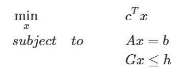
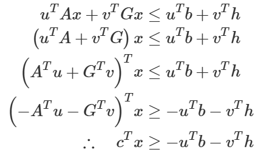
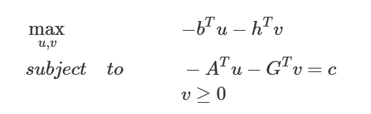

Photo by Aron Burden / Unsplash

SVM에서 사용되는 중요한 문제, Dual Problem에 대해서 나눠보고자 합니다.

SVM은 분류기로 사용되면서 Decision boundary와 데이터 간 사이의 간격, margin을 최대화 하는 것이 목적입니다. 단순히 잘 분류한 것에 끝날 뿐만 아니라 일반화 성능까지 가져가겠다는 아이디어를 margin이라는 개념을 도입해서 구현하고자 한 것입니다. 결국 오류없이 잘 분류가 되었다고 하더라도 Decision boundary와 '각 클래스에서 제일 가까운 sample (Support Vector)의 거리를 최대화하면 새로운 sample이 추가되었을 때에도 뛰어난 일반화 성능을 가질 수 있게 되는 것입니다.

결국 해결하고 싶은 문제는 'margin'을 최대화 하고 싶은 것이며 그 margin이라는 것은 decision boundary에서 정한 margin이라는 구역 내에 어떤 sample도 허용하지 않겠다라는 제약 조건이 들어가는 것입니다. 여기서 lagrange multiplier method를 적용할 수 있습니다.

라그랑주 승수법 (Lagrange multiplier method)은 프랑스의 수학자 조세프루이 라그랑주 (Joseph-Louis Lagrange)가 제약 조건이 있는 최적화 문제를 풀기 위해 고안한 방법입니다. 라그랑주 승수법은 어떠한 문제의 최적점을 찾는 것이 아니라, 최적점이 되기 위한 조건을 찾는 방법. 즉, 최적해의 필요조건을 찾는 방법입니다. 라그랑주 승수법에 의한 정보는 ['라그랑주 승수법 (Lagrange Multiplier Method)'](https://untitledtblog.tistory.com/96)를 참고해주시길 바랍니다.

결국, 기존 우리가 해결하고자 하는 문제가 비용함수 f(x)가 convex function이라면 f'(x) &#61; 0인 지점이 곧 최적점을 의미하는데 실질적으로 해결해야하는 문제가 완벽히 convex function인 상태에서 단순히 찾는 경우는 매우 드뭅니다. 여러 가지 제약 조건이 붙어서 복잡한 상황에서의 최적점을 찾아야 하는 경우가 다반사입니다. 제약조건에 따라서 다르게 적용되는 계산 방법은 ['KKT condiiton'](https://ratsgo.github.io/convex%20optimization/2018/01/26/KKT/)을 참고해주시길 바랍니다. 기존에 수식을 통해 최적점을 찾는 방법은 제약 조건에 따라 등식을 나열하고 이를 연립방정식으로 풀어내는 것이었습니다.

이 때, 입력 변수의 feature가 매우 많아질 경우 연립해야하는 식이 매우 많아졌고 연산량이 늘어났는데 이를 효율적으로 연산하기 위해서 Dual Problem, 쌍대 문제가 등장했습니다. Lagrange Multiplier Method에서의 비용함수와 제약함수 식에서의 모든 input feature들을 라그랑주 승수에 대한 식으로 바꿀 수 있었는데 이렇게 정리하는 게 훨씬 효율적인 연산이 가능했다는 것입니다.

만약 input feature가 100개라면 각 feature마다 편미분을 하고, 또 라그랑주 승수별로 편미분을 해서 KKT Condition을 따져가며 연립 방정식을 해결해야 했습니다. 만약 라그랑주 승수가 단 두 개라면, 모든 feature들을 두 개의 라그랑주 승수에 대한 식으로 변경이 가능해서 최종적으로 2차원 평면에서의 최적점 문제를 구하는 것으로 바꿀 수 있다는 아이디어입니다.

여기서 Dual Problem에 의아했던 점이 있습니다. 기존 Machine Learning의 문제들은 비용함수의 최솟값을 구하는 문제였는데 Primal Problem에서 Dual Problem으로 넘어오면서 최댓값을 구하는 문제로 전환되었다는 점입니다.

Lagrange Multiplier Method for multiple constraint

다음과 같은 제약조건을 가진 문제가 있다고 가정해보겠습니다. 이를  스칼라 형태의 식으로 살펴보면 등식 형태의 제약식이 m개, 부등식 형태의 제약식이 r개가 있고, 이를 만족하면서 목적함수를 최대화시키는 n개의 미지수를 찾는 문제라고도 이해할 수 있습니다.  제약식 양변에 u, v라는 라그랑주 승수인 벡터를 곱해 보면. 여기에서 라그랑주 승수는 0또는 양수이기 때문에, 위 식에서 부등식 형태의 제약식은 부등호 방향이 바뀌지 않습니다. 두 식을 더해서 정리해주면 다음과 같습니다.

최종적으로 input feature인 x가 들어가지 않고 라그랑주 승수로만 정리할 수 있는 식으로 전환할 수 있게 됩니다. 맨 마지막 줄의 좌변이 Primal Problem, 우변이 Dual Problem입니다. Primal Problem은 x 값을 찾는 문제였다면, Dual Problem은 라그랑주 승수들의 값을 찾으면 되는 문제인 것입니다. 따라서 Primal Problem의 x의 feature dimension이 라그랑주 승수의 개수에 비해 너무 많은 경우에는 Dual Problem으로 전환해서 푸는 것이 훨씬 효율적이라는 것입니다.

Primal Problem &#62; Dual Problem

결론적으로는 Primal Problem을 푸는 것이 목적인데 Dual Problem은 반드시 Primal Problem보다 작을 수 밖에 없고 Primal Problem의 최솟값에 최대한 접근하기 위해서는 Dual Problem의 최댓값에 접근하는 것이 제일 합리적인 정답이 됩니다.