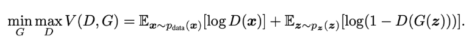
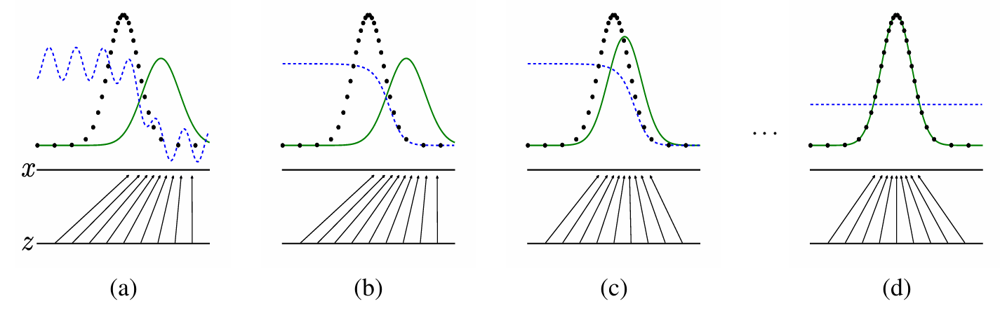
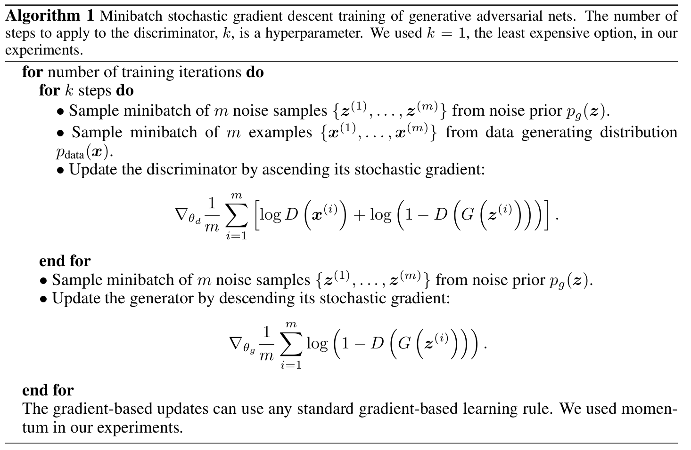

photo by Klara Kulikova / Unsplash

[GAN (Generative Adversarial Nets)](https://scholar.google.com/scholar?hl=ko&as_sdt=0%2C5&q=generative+adversarial+nets&oq=) 논문을 리뷰합니다.

논문 제목부터 알 수 있듯이, adversarial process를 활용해서 데이터를 생성하는 framework입니다. 적대적 관계를 가진 두 모델이 경쟁을 하면서 서로 발전하는 것을 구현한 것입니다.

### <strong>1&#46; Introduction</strong>

이 논문은 2014년 논문으로 당시 생성형 모델(Deep Generative Model)이 갖고 있던 어려움을 다른 시각에서 바라보고 해결하고자 했습니다. 확률 밀도 함수를 잘 추정할 수 있다면 학습 데이터에서 없었다고 하더라도 데이터를 생성해낼 수 있다는 게 기존 생성형 모델의 주요 아이디어였습니다. 하지만 차원이 높아지면 높아질수록 확률 밀도 함수가 정의가 되지 않는 경우가 많이 발생했고, 정의가 된다 하더라도 고차원 공간에서 비효율적일 뿐만 아니라 수렴이 느린 markov chain(t 시점의 상태는 바로 직전 t-1 시점의 상태에만 영향을 받는 stochastic process를 의미)을 사용해 시간이 매우 오래 걸리며 그 확률마저 근사치라는 문제점이 있었습니다. 또한 ReLU와 같은 non-linear activation function을 적용하기에도 어려웠습니다. 그럼에도 불구하고 우도(likelihood)를 추정하려고 했던 가장 큰 이유는 모델의 정량적 평가가 가능했기 때문입니다.

하지만 계산 복잡도가 너무 크다는 단점이 있었기 때문에 우도 성능 평가의 정량적 평가의 이점에 주목하기보다는 계산 복잡도를 낮추는데 초점을 맞췄고, 이를 통해서 우도 성능 평가가 불필요하게 모델을 구성한 것입니다. Marcov chain을 통해서 많은 시간을 사용했던 거와 다르게 단순 역전파만을 사용해서 학습과 샘플링을 가능하도록 해서 기존 생성 모델의 복잡도와 추론 비용을 획기적으로 줄였습니다.

기본적으로 GAN의 아이디어는 적대적인 두 모델 Generator와 Discriminator가 경쟁하는 구조를 도입한 것입니다. 저자는 위조지폐범과 위조 지폐를 색출하는 경찰의 계속된 경쟁에 비유합니다. 위조지폐범은 경찰의 위조지폐 판단 기준을 피해서 위조지폐를 감쪽같이 만드는 것에 초점을 맞추고, 경찰은 그럼에도 불구하고 잘 색출해내는 방향으로 모델을 발전시키는 것입니다.

여기서 GAN에서 의미하는 Adversarial과 Adversarial Examples를 혼동할 수 있는데, GAN에서 의미하는 Adversarial은 학습 구조를 의미하는 반면, Adversarial Examples는 신경망을 속이기 위해 입력을 조작한 예시를 의미합니다.

### <strong>2&#46; Theory &#38; Equations</strong>

Discrimination, Generator, value function V

첫 번째 항부터 살펴봅시다. 진짜 데이터 x에 대해서 Discriminator가 이 데이터를 진짜라고 labeling할 확률 D(x)의 로그값을 Expectation으로 구합니다. 결국 D(x)의 확률이 1에 가까울수록 실제 데이터를 최대한 진짜로 분류를 잘한다는 의미입니다.

이제 두 번째 항을 살펴봅시다. 생성된 가짜 샘플 G(z)에 대해서 Discriminator가 진짜 데이터로 판별할 확률을 의미합니다. G(z)의 입장에서는 본인이 만들어낸 가짜 데이터를 진짜로 분류하게끔 만드는 것이 목적이기 때문에 D(G(z)))가 최대화가 되어야 하는 것입니다.

그래서 G가 1에 가까워질수록 log(1-D(G(z)))가 음의 무한대로 가기 때문에 전체식을 minimize하는 것에 중점을 두는 것이고 discriminator의 입장에서는 진짜 데이터는 진짜 데이터로 분류, 가짜 데이터는 가짜로 분류해서 전체식을 maximize하는 것에 중점을 두는 것입니다. 이론적으로 보면 log(D(x)) &#61; 0, log(1-D(G(z))) &#61; 0으로 가면 완벽하게 discriminator가 잘 분류한 것처럼 보일 수 있지만, 이는 이론적으로도 불가능한 상황입니다. G(z)가 이미 학습하면서 log(1-D(G(z)))가 0으로 가는 것을 방해하고 있는 상황이기 때문에 이론적으로 불가능합니다. 그래서 이론적으로 최적값은 D가 완전히 구분할 수 없는 경우(D(x)도 0.5, D(G(z)))도 0.5로 가짜와 진짜를 반반의 확률로 잘 구분하지 못하는 경우), 즉 log(0.5) &#43; log(0.5) &#61; -log(4) &#61; -1.386이 최적값이 됩니다.

실제 학습을 적용할 때에는 Discriminator의 optimization이 쉽게 일어나며 Discriminator가 학습이 완료되었다고 학습을 종료시켜버리면 overfitting이 일어날 가능성이 높습니다. 즉, D가 G가 만든 샘플과 진짜 데이터를 완벽히 구분할 수 있게 되면, G는 gradient를 거의 받지 못해 학습이 정체됨을 의미합니다. 그래서 논문에서는 <strong>“D를 너무 오래(fully) 학습시키지 말고, k번만 업데이트한 뒤 G를 한 번 학습하는 방식”</strong>을 제안합니다. 이를 Generator는 one step optimization, Discriminator는 k step optimization이라고 합니다.

### <strong>3&#46; Theoretical Approach</strong>

궁극적으로 GAN을 이용한 생성모델이 실제 데이터 분포를 잘 근사하여 좋은 성능을 보일 수 있는지에 대해 증명할 필요가 있습니다.

Figure 1

&#45; <u><strong>Discriminative distribution</strong></u>: D, blue, dashed line &#45; <u><strong>Samples from data generating distribution p</strong></u><u><strong>x</strong></u>: black, dotted line &#45; <u><strong>Generative distribution p</strong></u><u><strong>g</strong></u>: G, green, solid line &#45; <u><strong>Lower horiziontal line</strong></u>: the domain from z uniformly sampled &#45; <u><strong>Upper horizontal line</strong></u>: domain from x &#45; <u><strong>Upward arrows</strong></u>: mapping x &#61; G(z)

(a)&#126;(d)까지 학습이 진행되는 과정을 보여줍니다. (a)에서는 가짜와 진짜 사이의 분포가 크며 Discriminator의 성능도 그렇게 좋지 않은 상태입니다. (b)에서 Discriminator의 성능이 좋은 반면 Generator의 성능은 좋지 않은 상황, C에서는 Generator의 성능이 점차 올라오며 최종적으로는 Generator가 실제 데이터와 거의 같은 데이터를 생성하게 되고 Discriminator가 진짜 데이터인지 가짜 데이터인지 구분할 수 없는, D(x) &#61; 0.5인 상태가 제일 이상적인 상태 (d)가 됩니다. (그래서 수식에서 살펴본 내용에서 ' 이론적으로 최적값은 D가 완전히 구분할 수 없는 경우(D(x)도 0.5, D(G(z)))도 0.5로 가짜와 진짜를 반반의 확률로 잘 구분하지 못하는 경우, 즉 log(0.5) &#43; log(0.5) &#61; -log(4) &#61; -1.386이 최적값이 됩니다.'라고 언급)

이렇게 최종적으로 GAN이 이상적인 모델로 수렴할 수 있기 위해서는 세 가지의 조건이 필요합니다. <strong>1&#46; D와 G가 충분한 capacity를 가져야 한다. </strong>Capacity는 모델이 얼마나 복잡하고 다양한 함수를 학습할 수 있는지를 나타내는 개념이다. Generator는 얼마나 정교한 가짜 데이터를 만들어낼 수 있는지, Discriminator는 얼마나 잘 진짜와 가짜를 구별할 수 있는지를 뜻합니다. 실제 구현에서는 무한한 capacity는 불가능하기 때문에 가능한 한 복잡하고 강력한 아키텍처를 사용하거나 데이터에 맞게 커스터마이징하는 방식으로 접근해야합니다. 너무 작으면 underfitting, 너무 크면 overfitting 위험이 있기 때문에 GAN을 적절한 밸런스와 규제를 통해서 조절해야합니다. <strong>2&#46; D가 항상 G에 대해 최적으로 학습되어야 한다.</strong> 다시 말하면, Generator가 고정된 상태에서 Discriminator가 가능한 가장 잘 학습된 상태라는 것입니다. 모든 입력 x에 대해 Discriminator가 진짜인지 가짜인지 잘 구분할 수 최대한의 상태를 유지하고 있다는 것이고 이를 통해서 Generator가 학습되어야 하는 방향성을 정하게 되는 것입니다.  <strong>2&#46; G가 cost function을 개선시키도록 천천히 업데이트 되어야 한다. </strong>G가 너무 빠르게 바뀌면 D가 따라오지 못하고 전체 학습이 불안정해질 수 있기 때문에 G는 조금씩 조금씩 업데이트 되어야 한다는 의미입니다. D가 G가 만든 샘플과 진짜 데이터를 완벽히 구분할 수 있게 되면, G는 gradient를 거의 받지 못해 학습이 정체됨을 의미합니다. 그래서 앞에서 언급했듯이 논문에서는 “D를 너무 오래 학습시키지 말고, k번만 업데이트한 뒤 G를 한 번 학습하는 방식”을 제안한 것입니다.

이 조건을 통해서 Generator가 생성한 데이터는 실제 데이터의 분포에 근사하도록 생성할 수 있게 되고 Discriminator가 실제 데이터와 가짜 데이터를 분류할 확률이 50%에 수렴하게 되는 것입니다.

Algorithm 1 Pseudo Code

위의 pseudo code는 GAN 알고리즘의 진행 방식입니다. mini-batch SGD를 사용하는 것을 알 수 있습니다. D의 경우 k step으로 학습하는 것을 알 수 있습니다.

Generator를 학습시킬 때, 정규 분포에서 샘플링한 노이즈를 입력 값으로 사용하였고, 활성화 함수는 ReLU와 Sigmoid, 입력 노이즈는 G의 가장 하단 레이어에만 적용합니다. Discriminator를 학습시킬 때, 활성화 함수는 Maxout units( 입력 x에 대해 여러 개의 선형 변환을 적용한 후, 그 중 가장 큰 값을 출력하는 방식, 네트워크가 더 복잡하고 다양한 decision boundary를 학습하는 데 도움)을 사용하였고, 오버피팅 방지를 위해  Dropout을 적용했습니다.

### <strong>4&#46; Advantages and Disadvantages</strong>

<strong>&#91;Advantages&#93; </strong><strong> 1&#46; Inference(추론 과정) 없이 학습 가능</strong> 기존 모델들은 학습 중에 복잡한 추론(inference)이 필요했지만, GAN은 순전파와 역전파만으로 학습 가능합니다. 학습 과정이 더 단순하고 효율적이라는 점에서 실용성이 큽니다. <strong>2&#46; Markov Chain 필요 없음 </strong>샘플 간 의존성이 없고, 병렬 생성이 가능하다는 큰 장점이 있습니다.<strong> </strong><strong>3&#46; 샘플링이 직관적이고 빠름 </strong>노이즈 벡터를 넣기만 하면 즉시 샘플을 생성할 수 있다. (현실 세계의 데이터는 고정된 게 아니라 어떤 확률분포를 따라 다양하게 나타납니다. 이 분포를 학습해서 새로운, 보지 못한 데이터 샘플을 생성하고자 하는 것이기 때문에 Generator는 임의성(randomness)을 입력으로 받아야만 다양한 출력을 만들어낼 수 있습니다. 따라서 이를 위해 사용하는 것이 노이즈 벡터인 것입니다.) <strong> 4&#46; 날카로운(sharp) 샘플 생성 가능 </strong>GAN은 분포의 sharp한 영역까지 학습 가능해서, 다른 모델들이 흐릿하게 생성하는 샘플과 비교해 더 선명한 이미지를 만들어낼 수 있습니다. 이는 Markov chain 기반 모델이 고차원에서 여러 모드를 섞어야 하는 것과 대비되는 장점입니다.

<strong>&#91;Disadvantages&#93; 1&#46; GAN은 생성 확률분포를 <strong>명시적으로 계산할 수 없음 </strong></strong>정확한 likelihood 평가가 불가능해서 성능 비교가 어렵고, Parzen Window와 같은 간접 방법이 필요합니다. <strong>2&#46; G와 D의 동기화가 중요 </strong>G와 D가 동시에 적절히 학습되지 않으면, 불안정하거나 mode collapse(Generator가 너무 빠르게 학습되어, 다양한 z 값에 대해 같은 x를 출력하는 경우로 G의 샘플 다양성이 낮음. 이를 "Helvetica 시나리오"라고 부르는데, 마치 어떤 글자나 이미지 하나만 반복 생성하는 것처럼 진짜 데이터를 다양하게 커버하지 못하게 되는 현상을 의미)가 발생하기 때문에 G와 D 사이의 적절한 균형과 규제가 필요합니다.