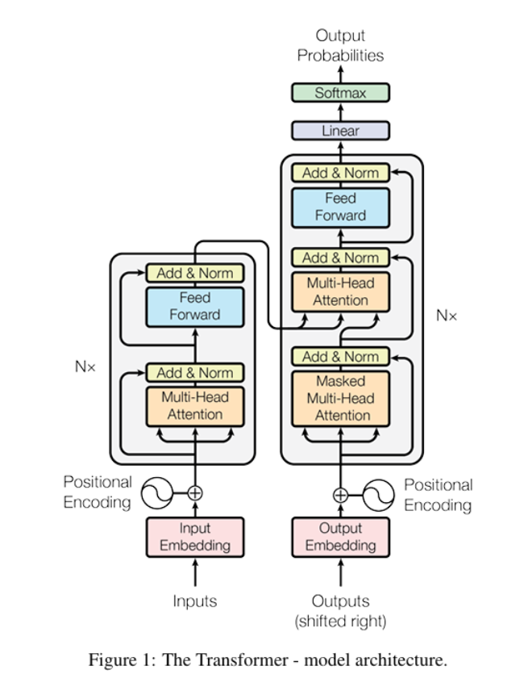
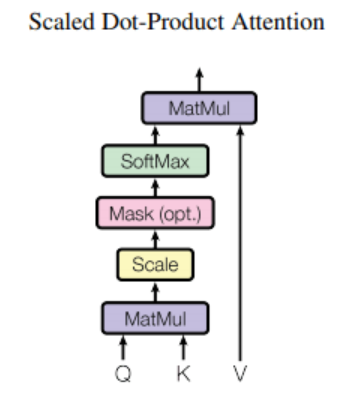
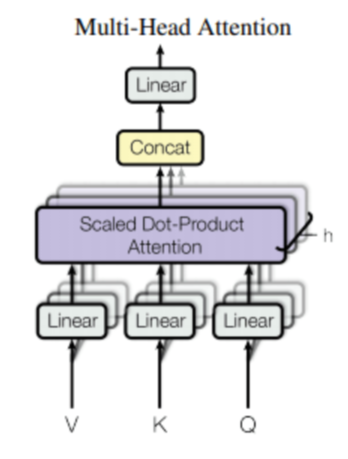
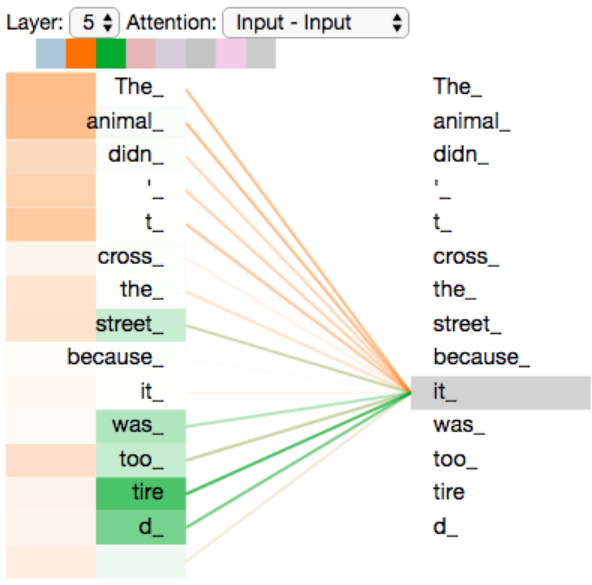
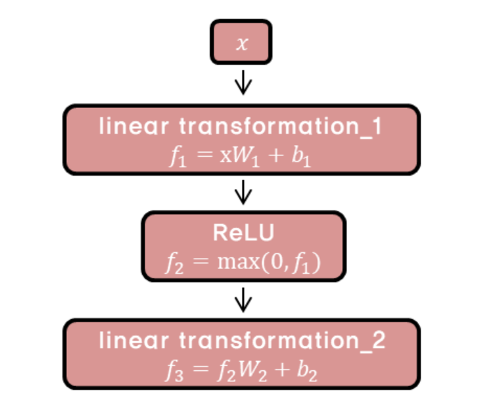
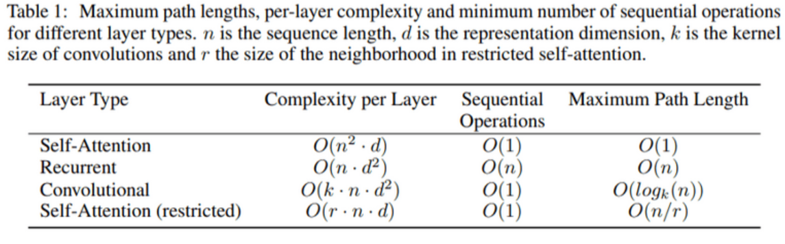
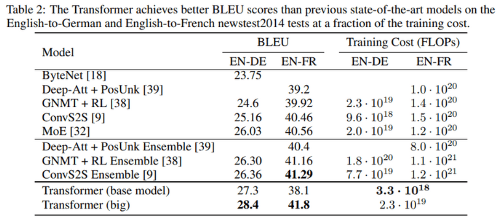
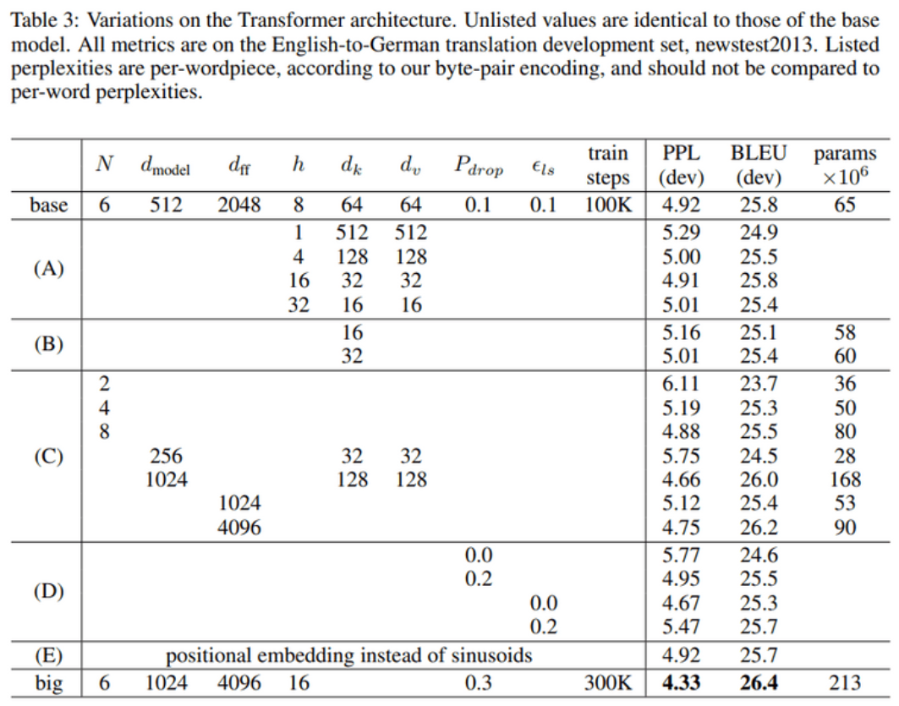
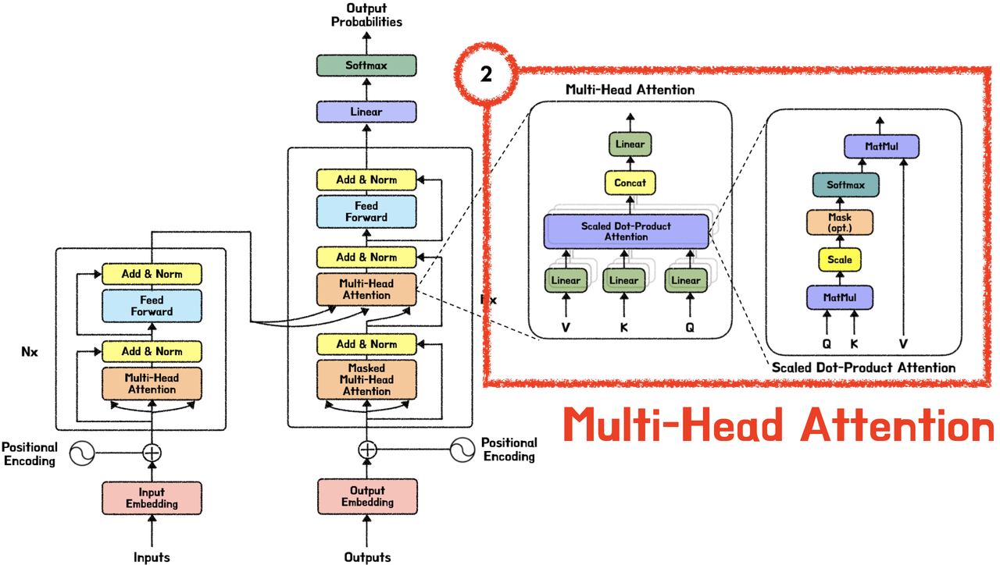
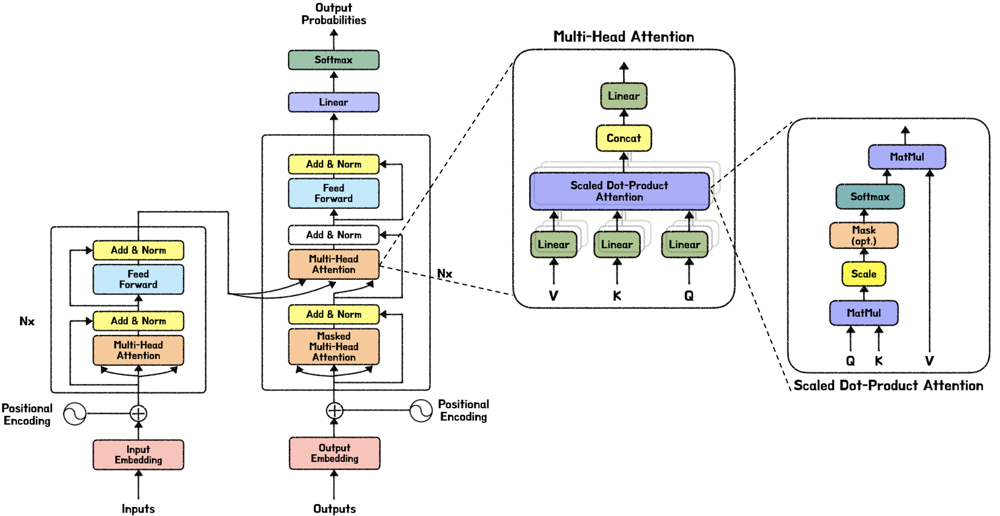

Photo by Jens Riesenberg / Unsplash

[<u>Attention is All You Need</u>](https://scholar.google.co.kr/scholar?hl=ko&as_sdt=0%2C5&q=attention+is+all+you+need&btnG=&oq=attention) 논문을 리뷰합니다.

RNN을 기반으로 한 Seq2Seq 모델은 순차적인 연산이라는 한계에 부딪혀 성능 향상에 제약이 있습니다. 하지만 해당 논문에서 제안한 Transformer 모델은  self-attention을 사용하고, 병렬화 연산이 가능하게하여 문제를 해결했습니다. 기존 모델들에 비해 연산 속도를 높였을 뿐만 아니라 2017년에 발표된 논문임에도 불구하고 현재 2025년까지도 transformer를 활용한 모델들이 SOTA 성능을 유지하고 있습니다. 또한 BERT, GPT에 기반이 되어 NLP뿐만 아니라 CV에서도 ViT(Vision Transformer)를 사용하는 등 현재 인공지능 기술의 트렌드를 이해하는데 필수적인 모델입니다.

### <strong>1&#46; Introduction</strong>

기존에는 encoder-decoder 기반의 sequence 모델이 주류를 이었고, encoder-decoder 내부에 RNN, CNN, attention 기법을 사용해 성능을 끌어올리려고 노력했습니다.

하지만 NLP에서 사용되던 기존의 RNN, CNN 계열의 신경망 구조에서의 한계점이 명확했습니다.  CNN은 병렬 연산이 가능하다는 장점이 있었지만, 정보 손실이 심해 성능이 좋지 않았습니다. 그리고 자연어는 단어의 순서가 중요하다는 생각으로 인해 순차적 모델인 RNN을 사용하여 처리하는 게 유용하다는 고정관념이 있었습니다. RNN이 CNN에 비해 주목받은 것은 사실이지만, long-term dependency라는 태생적인 문제로 인해 성능 향상에 한계가 있었습니다.

attention 기법을 도입해 성능 향상을 시도한다하더라도 RNN 기반이었기 때문에 연산량이 많고 vanishing gradient 문제를 근본적으로 해결할 수 없었습니다. 결국 vanishing gradient로 인해 소실되는 정보에 attention을 하더라도 성능 향상을 기대할 수 없었습니다. LSTM, GRU, ConvS2S 등 RNN의 고질적인 문제를 해결해보려 많은 시도가 있었지만 Transformer의 등장으로 인해 쇠퇴한 모델들이 되어버렸습니다.

이후 Google의 연구팀이 제안한 Transformer는 RNN, CNN 사용없이 self-attention만을 사용해 연산량 문제와 vanihsing gradient 문제에 효과적으로 대처했습니다.

### <strong>2&#46; Transformer model Architecture</strong>

다음은 Transformer 모델의 구조입니다. Transformer 모델은 크게 encoder와 decoder로 구성되어 있습니다.

Transformer의 구조

#### <strong>&#45; Input Embedding</strong>

Input Embedding은 Input에 입력된 데이터를 컴퓨터가 이해할 수 있도록 행렬값으로 변경해줍니다. 만약 ‘This is my car.”라는 문장이 주어졌을 때, 문장을 구성하는 각각의 단어는 그에 상응하는 인덱스 값에 매칭이 되고, 이 인덱스 값들은 Input Embedding에 전달되는 것입니다.

그래서 각각의 단어 인덱스들은 다른 벡터값을 지니고 있는데, 각각 벡터 차원은 해당 단어의 feature value를 가지고 있고, 서로 다른 단어의 feature value가 유사할수록 벡터 공간의 embedding 벡터는 점점 가까워지는 것입니다.

이를 입력에 learning embedding layer를 적용했다고 표현하는데, 입력 데이터(단어, 토큰 등)를 모델이 학습을 통해 의미적으로 잘 표현할 수 있는 벡터(embedding)로 변환하는 layer를 사용했다는 뜻입니다.

#### <strong>&#45; Encoder</strong>

본 논문에서는 Encoder에서 N &#61; 6개의 layer들의 stack으로 구성되어있고, 각각의 layer들은 두 개의 sub-layer로 구성됩니다. multi-head attention, position-wise fully connected network (Feed Forward)입니다. Add &#38; Norm 부분에서는 residual connection를 적용한 뒤에 layer normalization을 적용합니다. 6개의 encoder layer를 쌓는 것은 입력에서 점진적으로 더 깊고 복잡한 표현을 학습해, 번역과 같은 복잡한 자연어 처리 문제를 효과적으로 해결하기 위한 설계입니다.

#### <strong>&#45; Decoder</strong>

decoder에서도 마찬가지로 N &#61; 6개의 layer들의 stack으로 구성되어있고 세 개의 sub-layer로 구성되어있습니다. Masked Multi-Head attention, Multi-Head attention, position-wise fully connected network (Feed Forward)로 구성되어있고 마찬가지로 각 sub-layer마다 encoder와 동일한 방식으로 Add &#38; Norm을 적용합니다. 마지막으로 Linear transformation, softmax를 거쳐 다음 단어의 확률을 계산하여 출력하게 됩니다.

### <strong>3&#46; Key Components </strong>

#### <strong>&#45; Self Attention &#38; Scaled Dot-Product Attention</strong>

Scaled Dot-Product Attention 계산 과정

RNN과 같이 사용되던 기존의 attention의 경우, 어쩔 수 없이 순차적인 데이터 처리를 해야했고 연산이 병렬화되기 어려웠기 때문에 학습 속도가 많이 느렸습니다. 하지만 self attention은 단순하게 compability funciton으로 dot-product를 사용하여 연산을 병렬화, 학습 속도를 향상시켰습니다. 하나의 요소와 다른 모든 요소와의 관계를 병렬적으로 연산하여 빠르게 정보를 결합할 수 있습니다. 이렇게 되면 다음과 같이 질문할 수 있습니다.

<em>자연어는 순서가 중요한데, 이렇게 되면 순서에 대한 정보가 빠지는 거 아닌가요?</em>

네 맞습니다. 이로 인해 순서에 대한 정보를 기입하는 <strong>positional encoding</strong>이 있습니다. (positional encoding에 대한 내용은 뒤에서 설명하도록 하겠습니다.)

그래서 기존 attention과 달리 self-attention에서는 dot-product attention을 사용하는데, 여기서도 문제가 있습니다. 바로 Query와 Key의 차원이 증가하면 Query와 Key의 행렬 곱의 값이 매우 커져서 학습을 정상적으로 진행할 수 없게 됩니다. (차원이 증가하면 Query와 Key의 행렬 곱의 분산이 증가하게 되어 행렬 곱의 값이 매우 크거나 매우 작을 수 있습니다. 이 값을 softmax에 집어넣게 되면 0 또는 1에 가까운 값으로 들어가게 되고 곧 vanishing gradient 문제를 초래하게 됩니다.) 따라서 'Scaling'이 적용된 Scaled Dot-Product Attention을 사용합니다. 이 때 Query와 Key의 차원인 dk<em>dk</em>로 행렬 곱을 나눠 scaling합니다.

#### <strong>&#45; Positional Encoding</strong>

결국 기존 RNN&#43;Attention 구조에서 self-attention을 도입하면서 RNN은 빠지고 단순히 내적을 통해 모든 관계를 연결지어 정보가 흐려지는 것도 막고, 모든 토큰에 대해서도 접근해서 내적을 통해 중요도도 파악할 수 있는 계기를 마련해줬습니다. 하지만 바로 ‘위치’에 대한 정보가 없다는 것은 여전히 문제입니다. 즉, 단어의 sequence에 대한 정보가 반영되어있지 않음을 의미합니다. 결국 언어는 위치가 중요하기 때문에 이 부분을 포기할 수가 없고, 이를 위해 positional encoding(&#61; 위치 벡터도 입력값으로 넣어주는 기법)을 사용하게 됩니다. Positional Encoding이란, 기존의 input 또는 output에 Positional Value를 더해 최종 input을 만들어주는 것입니다.

Positional Encoding에는 여러 방법이 있는데, Google 연구팀은 <strong>Sinusoid Encoding</strong> 방식을 선택했습니다. Sinusoid Encoding에 대해서 궁금한 점은 [&#91;Transformer&#93;-1 Positional Encoding은 왜 그렇게 생겼을까?](https://velog.io/@gibonki77/DLmathPE?)를 참고해주시길 바랍니다.

결론은 하나의 위치 벡터가 4개의 차원으로 표현된다면, <strong>각기 주기가 다른 sine&#38;cosine 함수 4개를 사용해서 서로 다른 위치 벡터값을 가지게끔 만드는 것</strong>이고, 주기의 공배수 정도에서 겹칠 수 있지만 이미 대부분의 단어 위치를 표현할 수 있게끔 각 함수의 frequency(주기)를 잘 정해주면 해결할 수 있는 문제가 됩니다.

#### <strong>&#45; Multi Head Attention</strong>

Multi Head-Attention 계산 과정

여러 개의 Attention Map을 생성하여 모델이 다양한 관점에서 문장을 해석할 수 있도록하는 Multi-Head Attention을 제안합니다. 아래 그림을 살펴보면 문장에서 it이라는 단어의 attention이 The Animal일지, Tired일지 애매합니다. Multi-Head Attention은 이러한 문제를 해결하고자 여러 개의 Head (논문에서는 8개)를 두어 모델이 Head 개수만큼의 Scaled dot product Attention 연산을 수행할 수 있게합니다. 이를 통해 모델은 다양한 관점의 Attention Map을 만들어 성능을 향상할 수 있습니다. Multi-Head Attention은 동시에 Head 개수만큼의 Attention을 수행하고, 각 Head들의 결과를 Concatenation하여 결과를 도출합니다.

출처: https://jalammar.github.io/illustrated-transformer/

#### <strong>&#45; Masked Multi-Head Attention</strong>

Decoder에서의 Masked Multi-Head Attention은 입력 단어를 매 시점마다 순차적으로 입력받아서 다음 단어 예측에 현재 시점을 포함한 이전 시점의 단어들만 참고할 수 있는 RNN과 달리, 학습 과정에서 변역할 문장 행렬을 한 번에 입력을 받는 Transformer는 미래 시점의 단어까지도 참고할 수 있는 현상이 발생합니다. 이를 위해서 Transformer의 decoder에서는 현재 시점의 예측에서 미래 시점의 단어들을 참고하지 못하도록 Mask를 도입했습니다. 연산 자체는 Multi-Head Self Attention과 같지만 차이점은 attention score matrix에서 masking을 적용한다는 것입니다. 즉, 자신보다 미래에 있는 단어들에 대한 행렬정보를 참고하지 못하도록 masking 하는 것입니다.

Masked Multi-Head Attention을 통해 자신이 생성한 토큰들 사이의 관계만 학습할 수 있고, 입력 정보를 직접 활용할 수 없습니다. 그래서 두 번째 sub-layer에 위치한 'encoder-decoder Multi-head Attention'을 통해서 입력 정보를 활용할 수 있게 해야합니다. encoder와 decoder가 연결되어있기 때문에 encoder에서 추출한 의미 정보를 받아들여서 번역 및 생성할 때 맥락에 맞는 결과를 낼 수 있게 됩니다.

#### <strong>&#45; Position-wise Fully Connected Network (Feed Forward)</strong>

Position-wise Feed-Forward Networks 계산 과정

Attention 이후에 fully connected feed-forward network를 지납니다. 이때 FFN은 각 position, 즉 각 단어마다 적용하게 됩니다. 따라서 FFN에 position-wise라는 이름이 붙었습니다. 입력 벡터 x에 대해 선형 변환을 거친 뒤, ReLU 함수를 적용합니다. 논문에서 linear transformation 부분을 kernel&#95;size가 1인 channel 차원만 linear combination한 convolution 연산을 두 번 수행한 것으로 이해할 수 있다고 합니다. 실제로 linear transformation은 1&#42;1 convolution으로 구현하는 경우도 있습니다.

이를 통해서 얻는 이점은 다음과 같습니다. <u>1&#46; 모델의 표현 능력 확장</u> &#95; 첫 번째 선형 변환을 통해 차원을 늘리는데, 차원을 늘려 더 풍부한 feature space에서 다양한 조합이 가능하기 때문에 복잡하고 다양한 패턴을 학습할 수 있다는 장점이 있습니다. <u>2&#46; 차원 복원 및 정보 정제</u> &#95; 기존에 늘렸던 차원을 줄여서 기존 연산 size에 맞추고 더 의미 있는 표현을 사용할 수 있게 됩니다. <u>3&#46; ReLU를 통한 비선형성 적용</u> &#95; 다만 단순하게 늘렸다가 줄이면 한 번의 선형변환과 다름이 없기 때문에 복잡한 데이터를 포착할 수 있게 도와주는 역할을 ReLU가 하게 되는 것입니다.

### <strong>4&#46; Key Innovations of the Self-Attention</strong>

Transformer의 Self-Attention &#38; Scaled Dot-Product Attention을 사용함으로 인해서 얻을 수 있는 효과는 총 3가지입니다.

1. 각 Layer당 계산 복잡도의 감소
2. 병렬 처리 가능한 계산량 증가
3. long-range dependency 최소화 (Sequence가 극단적으로 길면 고려해야함)

layer complexity

위의 표를 통해 알 수 있듯, Self Attention이 RNN과 CNN에 비해 월등히 나은 complexity를 보인다는 것을 알 수 있습니다. 대부분의 NLP 문제에서 sequence&#95;length n이 embedding dimension d보다 작은 경우가 대부분입니다.

Sequence length는 한 번에 모델에 입력되는 데이터의 "순서 있는 요소(토큰, 단어, 프레임 등)"의 개수를 의미합니다.  Embedding dimension은 각 시퀀스 요소(단어, 토큰, 프레임 등)를 벡터로 변환할 때 벡터가 가지는 "특성의 수(차원 수)"를 의미합니다.

### <strong>5&#46; Training</strong>

연구팀은 WMT 2014 English-German dataset과 WMT 2014 English-French dataset을 이용하여 학습을 진행하였습니다. 문장들은 byte-pair encoding(BPE) 방식으로 인코딩하였습니다.

byte-pair encoding(BPE)는 문장이나 단어를 자주 등장하는 부분단위(서브워드)로 쪼개어, 그 조각들의 조합으로 텍스트를 표현했다는 뜻입니다. "lowest"라는 단어가 훈련에 없더라도, BPE로 인코딩하면 "low"와 "est"로 나눠서 표현할 수 있다는 것이고 이는 곧 Out of Vocabulary 문제를 줄일 수 있음을 의미합니다.

8개의 NVIDIA P100 GPU를 이용하여 학습을 진행하였으며, base model의 경우에는 12시간, big model의 경우 3.5일의 시간이 소요되었습니다.

추가로 Optimizer로는 Adam optimizer를 적용하였으며, Residual Dropout과 Label Smoothing 기법도 적용하였습니다.

Residual Dropout은 sub-layer 출력값에 Dropout을 적용합니다. 이후에 Add &#38; Normalization 적용하는 것을 의미합니다. overfitting을 방지하는 역할을 합니다. Label Smoothing은 정답 클래스의 확률을 1에서 약간 줄이고, 나머지 클래스에 소량의 확률을 분배하는 것을 의미합니다. 모델이 정답에 지나치게 확신하지 않도록 하는 것으로 overfitting을 방지하는 역할을 합니다.

### <strong>6&#46; Result</strong>

<strong>Transformer는 번역 Task에서 SOTA 성능을 달성하였습니다. 또한 Training Cost을 주목하면, 타 모델 대비 적은 연산량으로 높은 성능을 보여주고 있습니다. </strong>

Transformer의 성능

모델을 변형해서 추가로 실험을 진행했을 때, 다음 다섯 가지 특징을 발견할 수 있었습니다. 1&#46; (A) Head가 너무 많으면 성능이 떨어진다. 2&#46; (B) Key의 차원이 작아지면 성능이 감소할 수 있다. 3&#46; (C)모델의 크기가 커질수록 성능이 좋아진다. 4&#46; (D) dropout으로 성능을 향상시킬 수 있다. 5&#46; (E) Sinusoid가 아닌 다른 것으로 positional encoding을 해도 성능에 유의미한 차이는 없다.

Transformer 모델 변형 결과

### <strong>7&#46; Conclusion</strong>

Transformer 연구 결과로 얻을 수 있는 결론은 다음과 같습니다.

1&#46; 병렬화를 통해서 훨씬 더 빠른 학습이 가능합니다. 2&#46; 번역 task에서 SOTA 성능을 달성했습니다. 3&#46; 다른 task에서의 적용이 기대됩니다. (실제로 transformer는 현재 모든 인공지능 분야에서 사용되고 있습니다.) 4&#46; RNN과 CNN 없이 self-attention을 도입해, 오직 attention에 기반한 Transformer 모델입니다.

### <strong>&#43; Reference</strong>

[Transformer 파헤치기 &#45; Multi-Head Attention](https://www.blossominkyung.com/deeplearning/transformer-mha)

[트랜스포머(Transformer) 파헤치기—2. Multi-Head Attention](https://www.blossominkyung.com/deeplearning/transformer-mha)

[트랜스포머(Transformer) Attention is All You Need 중 Multi-head Attention에 대해 정리한 내용입니다.](https://www.blossominkyung.com/deeplearning/transformer-mha)

[www.blossominkyung.com](https://www.blossominkyung.com/deeplearning/transformer-mha)

[Transformer 파헤치기 &#45; Positional Encoding](https://www.blossominkyung.com/deeplearning/transfomer-positional-encoding)

[트랜스포머(Transformer) 파헤치기—1. Positional Encoding](https://www.blossominkyung.com/deeplearning/transfomer-positional-encoding)

[트랜스포머 Transformer Attention is All You Need Postional Encoding](https://www.blossominkyung.com/deeplearning/transfomer-positional-encoding)

[www.blossominkyung.com](https://www.blossominkyung.com/deeplearning/transfomer-positional-encoding)

[Attention is All You Need pytorch code review](https://steady-programming.tistory.com/82)

[&#91;NLP&#93;&#91;Code Review&#93; Attention is all you need pytorch 코드 리뷰](https://steady-programming.tistory.com/82)

[논문링크(NIPS, 113405회 인용) Paper motivation RNN은 sequential한 데이터를 처리하는데 있어서 시간의 순서에 따른 hidden state인 $h_{t}$을 $h_{t-1}, t$의 함수로 만든다. 즉, 현재의 $h_t$을 만들기 위해 이전 hid](https://steady-programming.tistory.com/82)

[steady-programming.tistory.com](https://steady-programming.tistory.com/82)