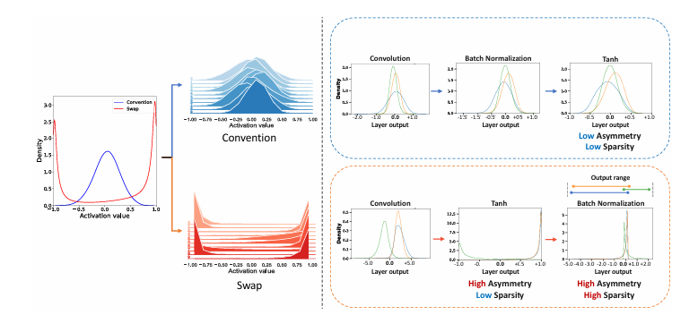
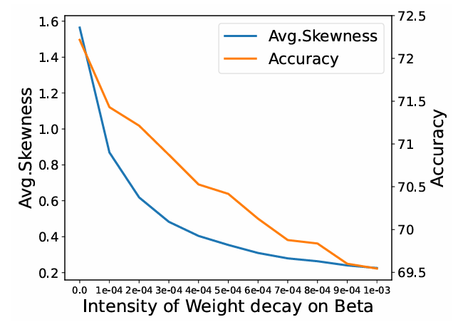
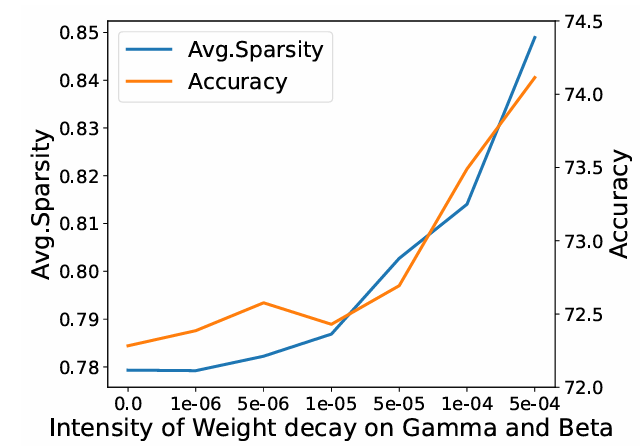
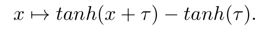
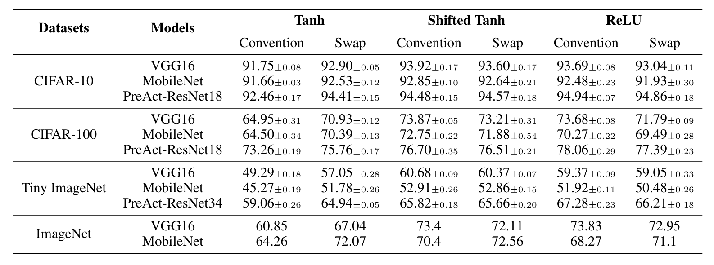

Photo by Ludemeula Fernandes / Unsplash

[Tanh Works Better with Asymmetry](https://scholar.google.com/scholar?hl=ko&as_sdt=0%2C5&q=tanh+works+better+with+asymmetry&btnG=)를 리뷰합니다.

가중치, batch normalization, activation function 순서대로 적용되던 기존 기계학습의 방향에서 batch normalization과 activation function의 순서를 뒤바꿨을 때, bounded activation function 계열이 tanh를 사용했을 때 성능 향상을 관찰하고 그 원인을 분석한 논문입니다. 결국 그 원인은 비대칭성과 희소성에 있다는 것이 주요한 아이디어입니다.

<u><strong>&#43; background  </strong></u>기존 딥러닝 모델 설계는 기본적으로 input과 곱해지는 가중치 값을 조정하는 방식으로 설계가 됩니다. 현대에는 DNN을 사용하면서 많은 층을 쌓게 되고, 입력을 받아서 나온 출력이 그 다음 층의 입력이 되면서 복잡한 관계를 설계할 수 있게 됩니다. 다만 각 층마다 모두 선형 연산을 사용하기 때문에 activation function이 없다면 결국 선형 회귀 모델로 귀결되므로 activation function의 존재는 필수적입니다.  그래서 가중치를 업데이트하고 activation function을 거쳐 연산을 진행하는 것이 하나의 묶음이 되는 것입니다.

가중치에서 activation function으로 넘어가기 전에 normalization 과정을 하나 추가해준다면 더 학습이 잘 됩니다. (해당 논문에서는 Batch Normalization을 언급) 이 과정을 거치면 크게 두 가지 관점에서 성능 향상을 기대할 수 있습니다.  첫 번째는 Loss function의 Global minimum을 찾는 과정에서 Gradient Descent를 할 때 수렴 속도를 빠르게 할 수 있다는 점, 두 번째는 activation function을 사용할 때 0 근처로 값이 모이면 비선형성을 잘 표현할 수 있다는 점입니다.

activation function 중 tanh 계열, ReLU만 봐도 0 근처에서 값이나 기울기 측면에서 유의미한 변화가 발생한다는 점을 눈여겨 봅시다. 극단적인 예시로 만약 Normalization을 하지 않아서 다음 층으로 입력될 이전 층의 출력값이 음수로 몰리게 되면, ReLU의 경우 모든 값을 0으로 만들어 버리는 문제가 발생할 수도 있는 것입니다.

그래서 결론적으로 딥러닝 모델 설계에서 '가중치 → Normalization → Activation Function' 과정이 하나의 기본 틀로 자리잡힌 상황입니다.

이 과정을 이해한 상태로 이제 논문 내용을 리뷰하겠습니다.

'가중치 → Normalization → Activation Function' 과정을 '가중치 → Activation Function →  Normalization ' 로 뒤집으면 tanh 계열 activation function을 사용하면 더 나은 performance를 보여준다는 것이 주요 아이디어입니다.

<strong>bounded activation function</strong>: 값이 유한한 activation function을 의미합니다. tanh 계열 함수들은 대부분 -1&#126;1 또는 0&#126;1로 유한한 값을 갖는 함수이므로 bounded activation function이라고 합니다. <strong>Asymmetric saturation</strong>: 활성화 함수의 출력이 한 쪽 방향으로 더 많이 포화되는 현상을 말합니다. tanh의 경우 -1 또는 &#43;1 주변에 값이 몰려있음을 의미합니다. 이러면 최적화 과정에서 vanishing gradient 문제가 발생할 수 있는데 최종적으로 Batch Normalization을 진행하게 돼서 이 문제를 완화할 수 있는 것입니다. <strong>High sparsity</strong>: asymmetric saturation 상황에서 batch normalization을 적용하게 되면, &#43;1 또는 -1 값에 몰려있는 값들이 평균 0, 분산 1이 되게끔 재배치가 된다는 말이고 몰려있던 값들을 고루 펼치는 과정에서 일부 값들이 0에 가까워지면서 사실 상 0이 되는 sparsity를 띠게 된다는 의미입니다.

convention: '가중치 → Normalization → Activation Function'  swap: '가중치 → Activation Function →  Normalization '

결국 Tanh를 통해서 High Asymmetry이지만 Low Sparsity였던 상황에서 Batch Normalization인 상황을 발견하게 되면서 High Asymmetry, High Sparsity라는 특성을 띨 수 있게 되는 겁니다.

관습적으로 여겨졌던 방식은 Low Asymmetry, Low Sparsity인 반면에 Swap을 하게 되면 High Asymmetry, High Sparsity를 띠게 된다는 것입니다. 이게 오히려 성능 향상을 이룰 수 있다는 점이 이 paper에서 눈여겨봐야할 점입니다.

그렇다면 왜 High Asymmetry와 High Sparsity가 성능적인 측면에서 더 도움을 줄 수 있는 것일까요? Sparsity는 희소성입니다. 대부분의 값들은 0이 되고 일부 값들만 활성화되어있는 상태를 의미합니다. low sparsity에 비해서 입력 정보를 필요한 부분만 강조하여 줄 수 있고, 나머지 정보는 억제하는 역할을 하게 됩니다. 따라서 중요한 특성만 집중하게 되고 노이즈나 불필요한 정보에 대해서 덜 민감하게 만들어서 자연스럽게 Regularization 효과도 얻게 되고 overfitting을 방지하는 역할도 자연스럽게 수행할 수 있게 됩니다. 또한 0인 값이 많아지면 다음 layer들에서 연산해야하는 연산량도 줄어들고 학습 속도도 더 빨라지는 효과도 얻을 수 있습니다.  Asymmety는 비대칭성입니다. High Sparsity가 일어나기 위해서 반드시 선행되어야 하는 중요한 조건입니다. 가중치를 Tanh로 activation function에 집어넣었을 때 생기는 게 비대칭성인데, 이 비대칭성인 상황에서 Batch normalization이 적용이 되어야 High Sparsity가 일어나게 됩니다.

Introduction에서는 Swap을 진행한 것이 bounded activation function 계열인 tanh 계열을 사용해도 ReLU와 같은 효과를 얻을 수 있다는 것을 시사합니다.

논문에서는 'VGG11&#95;16'이라는 모델을 기존 VGG 모델의 마지막 convolution layer를 제거함으로 인해서 모델을 경량화했습니다. VGG 구조가 ImageNet을 기준으로 설계되어서 매우 깊고 복잡한 모델입니다. CIFAR은 그에 비해 낮은 해상도와 적은 클래수 수를 가지고 있기 때문에 VGG 모델을 그대로 가져다가 쓰면 좋지 못한 성능을 보입니다. 작은 해상도의 이미지를 복잡하고 깊은 모델인 VGG에 사용하게 될 경우 overfitting을 일으킬 수 있습니다. 특히, 마지막 convolution layer에서는 이미지의 공간 해상도가 매우 낮은 상태에서 layer를 이동하게 되는데 이렇게 되면 유의미한 feature 추출이 어려워져 오히려 성능이 떨어질 수 있습니다.

그렇기 때문에 마지막 convolution layer를 제외하여 경량화된 모델을 사용한 것입니다.

Metric은 Saturation, Asymmetirc Saturation, Sparsity 총 세 가지로 나뉩니다. skewness(왜도)를 통해서 얼마나 치우쳐져있는지를 파악하여 왜도에 따른 성능차이를 확인하고, sparsity도 파악하여서 sparsity가 높을수록 성능에 어떤 영향을 미치는데에도 파악합니다.

Experiment setup <strong>1&#46; Asymmetry 실험</strong> NWDBN(No Weight Decay Batch Normalization)은 Convention 구조에 적용해서 Batch Normalization 파라미터 Beta에 weight decay를 적용하지 않음으로 인해서 BN이 zero-centered가 되지 않도록 합니다. 즉 Convention 구조에서도 의도적으로 Asymmetry Saturation을 발생시켰을 때에도 성능적으로 유의미한 성능 향상을 얻을 수 있다면 실제로 Swap 구조에서의 성능 향상이 Asymmetry Staturation의 영향이 크다는 것을 의미합니다. 실제로 Beta가 0에 가까운 작은 값일수록 비대칭성이 심해지고 성능이 향상되는 결과를 확인했습니다. <strong>2&#46; Sparsity 실험</strong> Swap 구조를 사용해서 tanh를 통과시킨 후 Batch Normalization을 진행했을 때 sparsity가 발생합니다. Batch normalization의 파라미터를 통해서 weight decay를 조정했을 때 sparsity가 발생하는 정도와 그에 따른 accuracy를 확인했습니다. weight decay가 낮을수록 비대칭성이 늘어나고 이에 따른 sparsity가 증가해 최종적인 정확도가 높아지는 것을 알 수 있습니다. Batch Normalization의 파라미터 값을 제어함으로 인해서 0 근처의 값들이 많아지고 많은 뉴런들이 비활성화 되면서 ReLU와 유사한 효과를 tanh 가지고도 얻을 수 있다는 것입니다. <strong>3&#46; 다양한 구조와 데이터셋에 대한 실험</strong> Dataset: CIFAR-10, CIFAR-100, TinyImageNet, ImageNet Architecture: VGG, MobileNet, PreAct-ResNet Activation function: ReLU, Tanh, Shifted Tanh Swap 구조가 Dataset, Architecture, Activation function의 변화에 따라 일관적이게 나타나는지 확인한 것입니다. 실제로 tanh 기반 모델에서는 convention 모델보다 swap 모델이 더 좋은 성능을 보여주었고, ReLU나 Shifted Tanh에서는 swap을 통한 layer의 순서 변경이 큰 의미를 발휘하지 못한다는 것을 확인할 수 있습니다.

skewness-accuracy

sparsity-accuracy

실제로 관찰한 결과 높은 Skewness와 Sparsity는 성능 향상에 유의미한 양의 선형 관계를 어느정도 가지고 있다는 점을 알 수 있습니다. 그래서 해당 논문에서는 단순히 Activation function과 Batch Normalization을 뒤집은 구조인 swap 구조에 초점을 두는 것이 아니라 Skewness와 Sparsity가 성능에 변화를 줄 수 있다는 것에 초점을 두고 있는 것입니다.

그래서 'Shifted Tanh'라는 새로운 activation function을 제시합니다.

Shifted Tanh

결국 핵심은 Skewness와 Sparsity입니다. 입력을 τ만큼 치우치게 만들어서 skewness를 높인 상태로 tanh에 집어넣습니다. 추후에 τ만큼 tanh 함수를 빼줌으로 인해서 Sparsity를 향상시킵니다.  즉, tanh(x&#43; τ)는 가중치 다음에 tanh를 사용함으로 인해 얻을 수 있는 asymmetric을 유도하는 것이고, -tanh(τ)를 통해서 sparsity를 유도하는 것입니다.

Experimental comparison between orders on various datasets and models기

기존 tanh에서는 swap을 해서 High Asymmetry와 High Sparsity를 유도하니까 더 좋은 성능을 보였고, 이는 곧 훈련 데이터와 다른 데이터가 입력 데이터로 들어오더라도 여전히 좋은 성능을 보여주는 robustness가 높다는 것을 의미합니다. 이미 그 특성을 내장하고 있는 Shifted Tanh와 ReLU는 더 좋은 성능을 보이지만 동시에 더 이상 swap이 convention 방법보다 더 좋은 성능을 보이지는 않습니다.

swap보다 convention이 Shifted Tanh와 ReLU에서는 더 좋은 성능을 보이는 이유는 다음일 것이라고 추측합니다. "이미 Shifted Tanh와 ReLU에는 Asymmetry와 Sparsity를 convention 구조에서 이끌어낼 수 있는데, 오히려 Swap 구조를 통해서 zero-centered를 뒤로 미루게 되면 출력 분포를 흐리게 만들어 오히려 방해가 될 수 있다."

전체적으로 Asymmetry와 Sparsity가 모델의 성능 향상에 도움이 준다는 것을 계속해서 말하고 있습니다. Asymmetry와 Sparsity라는 두 요인이 동시에 존재하기 때문에 정확히 어느 요인이 성능 향상에 더 큰 영향을 미치는지에 대해 분석하기 위해 Convention 구조를 기반으로 Asymmetry만 높이고 Sparsity를 낮춘 모델을 설계합니다. 이를 통해서 Sparsity가 낮아지더라도 Skewness만 높게 설정할 수 있으면 모델의 성능은 오히려 향상될 수 있다는 것을 알 수 있습니다.

[Tanh Works Better with Asymmetry](https://scholar.google.com/scholar?hl=ko&as_sdt=0%2C5&q=tanh+works+better+with+asymmetry&btnG=)의 Conclusion 1&#46; '가중치 → Normalization → Activation Function'인 Swap구조가 Convention 구조보다 성능 향상 효과를 보입니다. 2&#46; Swap 구조의 성능 향상 효과는 Asymmetric(비대칭성)과 Sparsity(희소성)에서 기인합니다. 3&#46; 해당 논문에서 새롭게 제시한 'Shifted Tanh'는 Swap 구조보다 더 강력한 효과를 보입니다.

<strong>결론적으로, 출력값이 제한되어있는 bounded activation function도 Asymmetric과 Sparsity를 확보한다면 unbounded activation function 못지 않은 성능을 발휘할 수 있음을 보여주었습니다.</strong>