Photo by sq lim / Unsplash

Stanford-cs336 Lecture의 Modern Transformer에 대한 내용입니다.

2017년 'Attention Is All You Need'를 시작으로 인공지능의 전반적인 분야에서 Transformer라는 모델을 보편적으로 사용해오고 있습니다. 하지만 2017년에서 2025년으로 오기까지 Transformer에도 문제점이 존재하기 때문에 많은 변화가 일어나면서 발전해왔습니다.

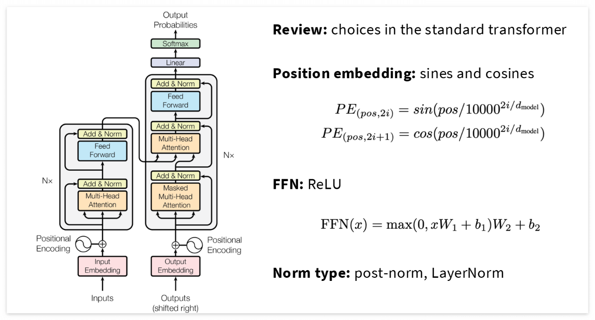

'Original' Transformer

기존의 Transformer는 Positional Embedding으로 Sinusoid를 사용하고, FFN의 Activation function으로 ReLU를 사용하고 Norm Type은 post-norm, LayerNorm의 형태를 띱니다.

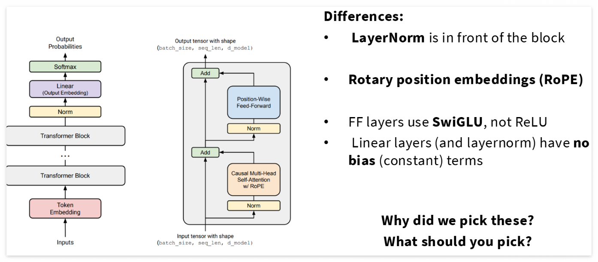

'Implemented' Transformer

현대에 자리잡은 것들을 보면, LayerNorm은 block의 앞에 자리잡고 있고, RMSNorm을 사용하는 추세입니다. 또한 Positional Embedding은 RoPE를 많이 사용하고 FFN은 ReLU가 아니라 SwiGLU를 사용합니다.

왜 이런 변화가 생겼고 기존의 틀에서 벗어나서 지금과 같은 틀이 왜 잡히게 되었는지에 대한 내용을 다루고자 합니다.

---

### I. Common Architecture Variations

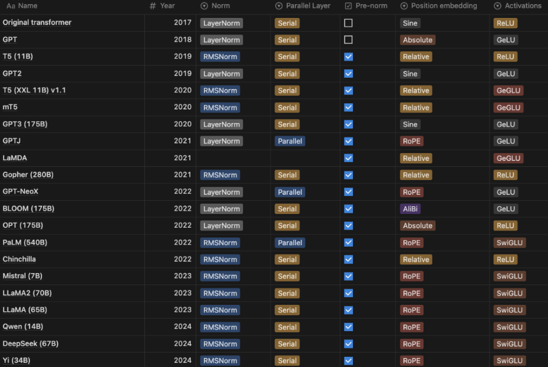

Architecture Variations

시대가 거듭하면서 모델의 구조에 많은 변화가 있었습니다.  Norm의 경우 RMSNorm, Parallel Layer는 Serial, Post-norm보다는 Pre-norm, Positional embedding은 RoPE, Activation function은 SwiGLU로 정착한 모습입니다. 하나씩 살펴보도록 하겠습니다.

---

#### <strong>I-1) Pre-Norm vs Post Norm</strong>

LayerNorm이 적용되는 곳이 Residual Path의 앞에 위치하는가(Pre-norm) 뒤에 위치하는가(Post-norm)에 대한 문제에 대해 다룹니다. 이에 앞서 LayerNorm과 Residual Path가 의미하는 것이 무엇인지에 대해 알아보겠습니다.

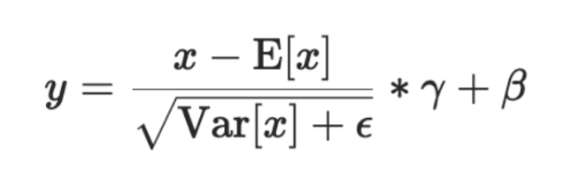

LayerNorm

x \- E\[x\]는 편차, root(Var\[x\])는 표준편차입니다. epsilon은 단지 분모가 0이 되는 것을 방지하기 위해 들어가있는 파라미터입니다.  즉, 기본적인 layernorm의 방향성은 '편차/표준편차', 즉 평균이 0이고 분산이 1이 되게끔하는 표준정규분포(Standard normal distribution)형태를 띠게 됩니다.  이제 스케일(γ) 파라미터와 시프트(β)파라미터에 집중해서 보겠습니다. 스케일 파라미터는 정규화된 값을 각 차원별로 얼마나 다시 늘리거나 줄일지에 대해 조절하는 곱셈 계수입니다. 시프트 파라미터는 정규화된 값을 얼마만큼 이동시키는지에 대한 역할, bias 느낌의 역할을 하는 덧셈 상수입니다. 이렇게 하면 원하는만큼 '각 차원의 크기를 조절(γ), 위치를 이동(β)'시켜서 기존 표준정규분포로 인해 지워졌던 분포적 다양성을 복원할 수 있게됩니다. (표준정규분포를 사용하면 평균0, 분산1로 제한되어 모델의 각 뉴런과 feature가 동일한 출력 범위를 갖게 되어 표현의 유연성을 매우 제한하게 됩니다. 이렇게 되면 복잡한 형태나 구조를 모델이 잘 학습하고 표현할 것이라 기대하기 어렵습니다.) 정규화 하기 이전의 분산을 스케일 파라미터에, 평균을 시프트 파라미터에 집어넣어서 연산하게 되면 정규화 이전 분포로 되돌릴 수 있습니다.

Residual path (\=Skip connection)은 하나의 Block 또는 Layer의 입력을 결과에 그대로 더해주는 구조를 말합니다. 쉽게 말하면 Multi-Head attention(x)와 그냥 input x를 더해서 넘겨주는 것이 Residual Path인 것입니다. 핵심은 'Layer를 거치지 않은 원본 입력을 그대로 유지한 값'이 있어야 한다는 것입니다. 여기서는 input x로 인해 Residual Path를 구현하는 것입니다. 그래서 Residual Path를 진행하고 뒤에 LayerNorm을 진행해 전체적으로 정규화 되는 과정이 Post-LN Transformer, 반대의 케이스가 Pre-LN Transformer입니다.

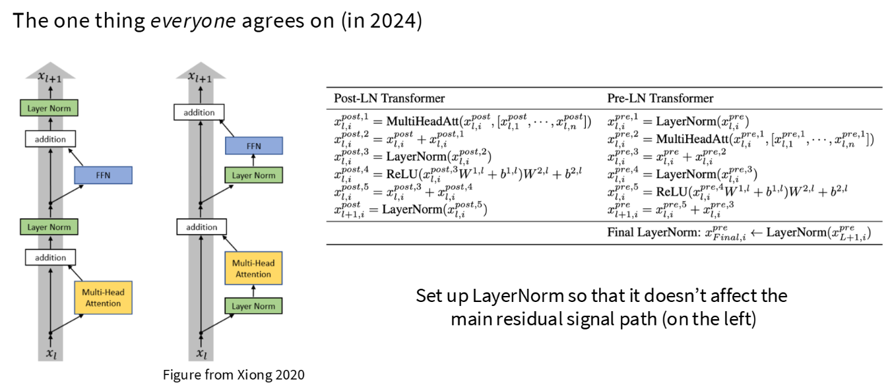

Post-LN Transformer Output: LayerNorm(X \+ MultiHeadAtt(X)) \_ 위 그림에서 왼쪽에 위치 Pre-LN Transforer Output: X \+ MultiHeadAtt(LayerNorm(x)) \_ 위 그림에서 오른쪽에 위치

Pre-LayerNorm이 이를 통해 얻는 이점은 Residual Path를 통해 정보가 온전히 전달된다는 점입니다. Post-LayerNorm의 경우 input 값과 sublayer(x)값이 모두 LayerNorm에 의해 표준정규화가 되기 때문에 추후 학습 과정에서 vanishing gradient 문제에 빠질 위험이 높습니다. 그렇게 때문에 불안정적인 수렴을 할 수 밖에 없고 정보 손실 문제도 발생할 수 있습니다. 이런 문제를 Pre-LayerNorm을 사용하게 되면 해결할 수 있게 됩니다.

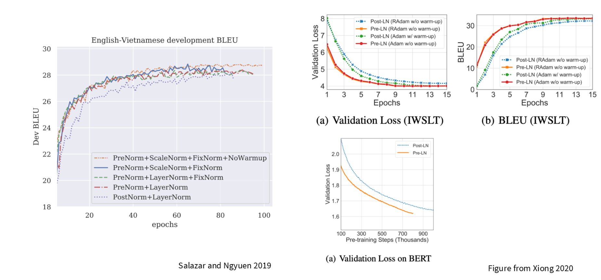

PreNorm vs PostNorm

성능적인 측면에서 봤을 때 Pre-LN이 확실히 적은 epoch에서도 빠르게 좋은 점수로 수렴하는 모습을 볼 수 있습니다. 또한 LayerNorm보다 ScaleNorm과 FixNorm을 사용하고, WarmUp을 사용하지 않았을 때 좋은 성능을 보여줍니다.

- <strong>ScaleNorm</strong>: LayerNorm은 평균과 분산을 구해야하는 것 때문에 비용이 크고 느린 대신에 ScaleNorm은 입력 벡터의 L2-norm만 계산하면 되고, 하나의 learnable scalar를 사용해 벡터 크기를 조정함에 있어 단순하게 변화 시킬 수 있어 빠르다는 장점이 있습니다.
- <strong>FixNorm</strong>: 입력 벡터의 L2-norm을 고정된 값으로 강제 조정해서 embedding이나 hidden state의 norm을 고정된 값으로 유지해 입력 분포가 안정적이고 훈련 초기에 발산할 위험을 줄여줍니다. 즉, 입력의 크기가 일정하기 때문에 다음 layer로 전달되는 값이 예측 가능한 범주에서 움직인다는 것입니다. 이로 인해서 gradient가 갑자기 커지거나 작아지는 현상을 방지할 수 있습니다.
- <strong>WarmUp</strong>: learning rate를 작게 시작해서 점진적으로 크게 만드는 과정입니다. 처음부터 learning rate가 클 경우 수렴하지 못하고 진동하거나 발산하는 케이스가 발생할 수 있는데, 시작을 작게하고 수렴 여부와 속도에 따라서 learning rate를 크게 조정해서 안정적이게 학습할 수 있도록 도와줍니다. 하지만 Pre-norm 구조를 통해서 이미 gradient의 흐름을 안정화 시켜주고 있고, ScaleNorm과 FixNorm의 개입으로 입력 분포를 잘 조절하기 때문에 굳이 Warmup을 사용하지 않아도 되는 상황이고, 오히려 WarmUp을 사용하지 않으면 처음부터 큰 학습률로 빠른 수렴이 가능하다는 장점을 가지고 있습니다.

Pre-Norm을 사용하면 Post-Norm에 비해서 Warmup을 제거하여도 빠르고 안정적인 수렴이 가능하다는 점이 결론이었지만 오늘 날에는 더 큰 네트워크에서도 안정적으로 학습할 수 있게 도와주는 구조적 특성도 갖고 있다는 게  밝혀졌습니다.

하지만 Pre-LN으로도 깊은 네트워크에 갔을 때 안정적인 수렴을 보장하지 않습니다. Residual connection이 깊은 네트워크일수록 누적되기 때문에 각 층마다 Residual을 더하게 되면 분산이 커지게 됩니다. 이 분산이 LayerNorm으로 제어되는 수준을 넘어서게 될 경우 Gradient Spike가 발생할 수 있습니다. 또한 비선형적 activation function의 경우에도 급격하게 분산이 변화할 수 있으며 이 때 입력이 특정 범위를 벗어나면 또한 Gradient Spike가 발생할 수 있습니다.

그리고 Pre-LayerNorm이 입력을 정규화하지만 한편으로는 출력을 정규화하지 않기 때문에 분산이 급증할 수 있고 이로 인한 Gradient Spike가 발생하기도 합니다. 이런 문제를 보완하기 위해 double norm(\= peri-norm)이라는 아이디어가 등장합니다.

double norm(\= peri-norm)은 MulteHeadAttention이나 FFN, 즉 sublayer 앞 뒤로 LayerNorm을 적용시킵니다. 이렇게 되면 결국 Post-Norm의 vanishing gradient 문제는 그대로 안고 가야합니다. 이 부분은 RMSNorm을 사용하면서 어느정도 보완이 가능합니다.

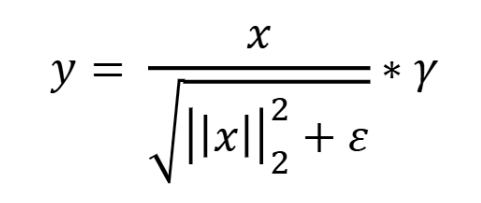

RMSNorm

RMSNorm은 LayerNorm에 비해서 다른 점이 크게 세 가지가 있습니다. 첫 번째로 평균을 빼지 않는다는 점, 두 번째는 분모에 분산 대신에 평균제곱을 사용했다는 것 (그래서 Mean Square에 Root를 씌웠다고 해서 Root Mean Square RMS인 것), 세 번째는 bias의 역할을 하는 Shift Parameter가 없다는 점입니다. 평균을 빼지 않아 입력값들의 중심을 유지함으로 인해서 Vanishing Gradient를 해결하고, 표현의 다양성은 유지할 수 있습니다. 하지만 layer를 거듭할수록, Residual을 더하는 연산이 많아질수록 분산이 튈 수 있다는 문제점을 가지고 있습니다. 그리고 shift parameter는 평균을 빼는 연산이 없어 이미 표현력 손실이 없기 때문에 굳이 shift parameter를 도입할 이유가 없습니다. 따라서 RMS만 구하고 분산이나 편차에 대한 고려를 하지 않아도 되는 것이 연산과 모델의 속도 측면에서 이점을 가져옵니다.

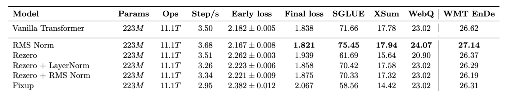

RMSNorm\_validatoin

---

정리하자면 정규화 과정은 마지막에 한다는 딥러닝 관념에 따라 Post-Norm이 제시되었고, Post-Norm은 Residual 연산까지도 정규화를 적용해 Vanishing Gradient에 빠질 위험이 높다는 점에서 Pre-Norm이 고안되었습니다. 하지만 Pre-Norm을 사용한다 하더라도 층이 깊어지면 Residual이 Norm에 의해서 정규화가 된다 하더라도 Residual이 반복해서 더해져 누적되기 때문에 분산이 점점 커져서 Gradient가 안정화 되지 않는 문제(Gradient Spike)가 발생할 수 있습니다. 그래서 Double-Norm(Peri-Norm)을 도입해 앞 뒤로 LayerNorm을 사용하여 Post-Norm의 Vanishing Gradient도 보완하고 Pre-Norm의 Gradient Spike도 해결하고자 했지만 Vanishing Gradient 문제는 학습이 진행되지 않는다는 근본적인 문제가 발생하는 것이기 때문에 LayerNorm 대신에 RMSNorm을 적용함으로 인해서 어느정도 보완할 수 있습니다.

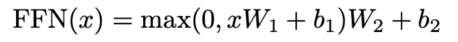

Original Transformer

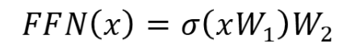

Modern Transformer

최종적으로는 sublayer에 대한 연산이 앞 뒤에 RMSNorm이 붙어서 bias가 필요없는 형태가 발생하고, 이는 RMSNorm이 LayerNorm과 다르게 bias 형태의 shift parameter가 필요없는 이유와 비슷한 맥락으로 적은 연산과 훈련에서의 안정성을 부여할 수 있게 됩니다.

---

#### <strong>I-2) Activation Function</strong>

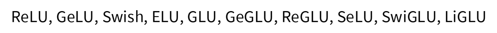

Activation Functions

기본적으로 활성화 함수를 사용하는 이유는 무엇일까요? 선형 함수의 연속으로 구성된 각 layer는 깊은 네트워크에서 연산을 이어간다 하더라도 결국 하나의 선형 함수꼴로 계산이 돼 복잡한 데이터를 학습하기 어렵다는 문제를 해결하기 위해 사용합니다. 즉 비선형성을 추가해서 표현력을 증가시켜 복잡한 구조도 잘 학습할 수 있게 만드는 것입니다.

Activation function에서 Gating이라는 개념이 있습니다. 정보를 선택적으로 통과시키고 차단하는 메커니즘입니다. Activation Function을 사용함으로 인해서 뉴런이 어떤 정보를 다음 층으로 전달할지 결정하는 데 중요한 역할을 합니다.

Original Transformer는 Activation Function으로 ReLU를 사용했습니다. ReLU를 사용한 이유는 tanh계열 activation function의 vanishing gradient 문제로 인해서 ReLU에 대한 성능 향상 시도가 높아졌기 때문이라고 볼 수 있습니다.

많은 Activation Function들이 있지만 이 중에서 ReLU, GeLU, GLU, GeGLU, SwiGLU에 대해서 중점적으로 다루고자 합니다.

1. <strong>ReLU</strong>는 <strong>Rectified Linear Unit</strong>으로 Rectified는 '교정된', '수정된' 이라는 의미를 가지고 있습니다. 수학적으로 음수 값은 제거하고 양수만 남긴다는 개념(값 자체로 Gating)을 가지고 있는 activation function입니다. 기존 tanh 계열 함수들의 Vanishing Gradient 문제가 발생할 수 있다는 점을 해결할 수 있다는 점에서 주목을 받았습니다. 하지만 음수인 값들은 다 0으로 만들어서 해당 뉴런을 아예 비활성화 시키는 Dead Nureon 문제가 있습니다. 0인 값을 만들어 특징을 추출하고, Vanishing Gradient를 해결한다는 장점도 있지만 0인 값이 너무 많아지면 학습이 안 된다는 문제가 바로 Dead Nureon 문제입니다. 또한 x \= 0에서 미분 불가능한 지점이 발생하기 때문에 0에 근사하는 값들은 어떤 미분값을 써야 하는지에 대한 것과 모델의 매끄러운 학습을 방해할 수 있다는 문제가 있습니다. (매끄러운 학습이 진행돼야 일반화 성능이 좋아지기 때문)
2. 다음은 <strong>GeLU(Gaussian error Linear Unit)</strong>입니다. 이름에서 알 수 있듯, Gaussian정규분포의 누적분포함수(CDF)를 활용한 Linear Unit 함수 입니다. 값이 클수록 높은 중요도로 판단해서 CDF에 큰 x값을 넣었을 때 1에 가까운 값이 되고, 해당 뉴런이 강하게 활성화되는 효과를 얻을 수 있습니다. 또한 x \= 0인 지점에서 미분이 가능하기 때문에 매끄러운 학습이 가능해져 Gradient 흐름도 안정되고  일반화 성능에도 긍정적인 영향을 끼칠 수 있습니다. 하지만 누적 분포함수 계산을 위한 erf(x) 함수는 값을 근사하기 위해 테일러 급수를 사용하는데, 이로 인한 연산량이 많다는 문제점이 있습니다.
3. <strong>GLU(Gated Linear Unit)</strong>입니다. 입력의 첫 번째 절반을 a, 입력의 두 번째 절반을 b라고 두었을 때, b를 sigmoid activation function 안에 집어넣어서 Gate처럼 동작하게 합니다. 이를 통해서 정보의 흐름을 조절하고 모델이 더 유연하게 학습할 수 있도록 만들어줍니다. element wise 곱을 활용하여 원소별로 얼마나 정보를 통과시킬지 조절하는 방식으로 Gating을 하게 됩니다. 비선형성 \+ 선형성을 모두 가질 수 있는 특성을 띠기 때문에 표현력이 높은 게 장점이고 element wise 곱을 사용해 GPU 병렬연산에 효율적이어서 속도가 빠르다는 특징이 있습니다.
4. <strong>GeGLU(GeLU Gated Linear Unit)</strong>입니다. GLU는 Gating을 sigmoid function으로 했지만 GeGLU에서는 Gating을 GeLU Fucntion으로 합니다. GeLU Function은 입력이 큰 값으로 들어왔을 때 강하게 활성화되고 0에 작은 값으로 들어왔을 때 약하게 활성화되기 때문에 일종의 Gating을 하는 함수입니다. 즉 GLU에서 GeGLU로 넘어가면서 유일한 변화는 activation function이 sigmoid에서 GeLU로 변했다는 점입니다. sigmoid보다 GeLU가 무슨 장점을 가지고 있어서 이런 변화가 일어났을까요? 바로 Sigmoid는 \+3 이상 또는 -3 이하일 경우 거의 0이나 1에 수렴해서 Vanishing Gradient 문제가 발생한다는 점에서 기인합니다. GeLU는 입력값의 크기에 따라 확률값으로 활성화가 되기 때문에 학습이 더 안정적이고 빠르게 수렴하는 경향이 있습니다.
5. <strong>SwiGLU(Swish Gated Linear Unit)</strong>은 GLU의 Gating인 sigmoid function은 swish로 변경한 것입니다. swish 함수는 ReLU의 아이디어에서 0 이하의 데이터인 경우 0으로 처리하지 않고 upper bound가 0이도록 설정된 함수입니다. Activation function을 ReLU에서 Swish로만 바꾼 경우에 매우 큰 성능 향상을 보인다고 합니다. 양수에서는 수렴하는 값이 없기 때문에 Vanishing Gradient 문제가 발생하지 않고, ReLU에서 모든 음수가 0이 되어버리는 Dead Neureon 문제가 Swish에서는 발생하지 않기 때문에 더 smooth한 학습이 가능합니다.

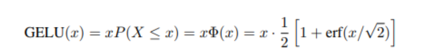

GELU (Gaussian Error Linear Unit)

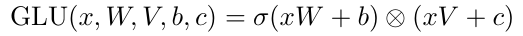

GLU(Gated Linear Unit)

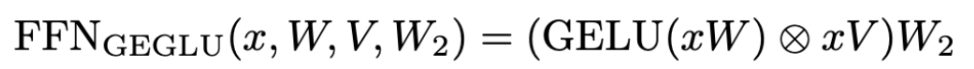

GeGLU(GeLU Gated Linear Unit)

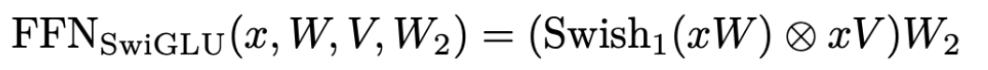

SwiGLU(Swish Gated Linear Unit)

---

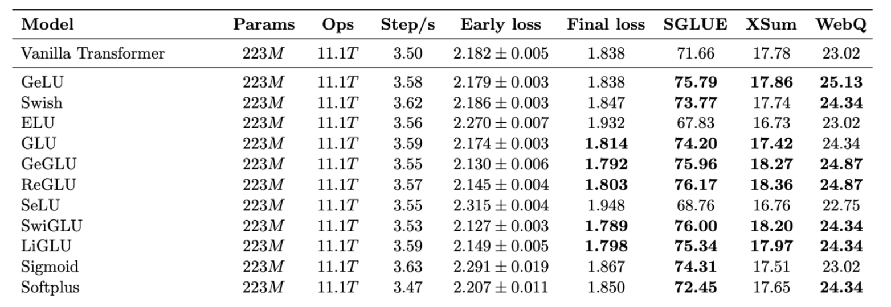

<strong>Params</strong>: 223M(2억 2,300만)개의 파라미터로 동일하다. <strong>Ops</strong>: 모델의 연산량(Operation count, FLOPs)을 의미한다. 11.1T로, 11.1테라가 한 epoch이나 한 step과 같은 한 번의 작업에 수행되는 연산량을 의미합니다.  <strong>Step/s</strong>: 1초에 처리 가능한 스텝 수를 의미한다. 스텝 수가 클수록 학습 속도가 빠르다는 것을 의미한다. <strong>Early loss</strong>: 학습 초기에 측정한 손실 함수(loss)의 평균과 표준 편차를 의미합니다. 손실 값이 낮을수록 정확한 예측입니다. (Early loss는 왜 하는 걸까요? 학습이 제대로 설정되었는지 중간에 loss를 확인함으로 인해서 데이터 오류나 모델 구조에 문제가 있는지 확인할 수 있고, 초반 loss를 빠르게 파악하여 실험을 조기 중단해 자원을 아낄 수 있는 방법이 되기도 합니다. 또한 최종 성능이 비슷하더라도 early loss가 낮은 모델이 더 빠르게 수렴할 것이라 기대할 수 있습니다.) Final loss: 학습 종료 시점의 손실 함수값 <strong>SGLUE</strong>: SuperGLUE 벤치마크 모델 성능입니다. 자연어 이해(Natural Language Understanding, NLU) 태스크에서 사용되며 값이 높을수록 좋다. (뉴욕주립대에서 만든 고차원적 자연어 이해를 파악하기 위한 성능 지표가 SuperGLUE입니다.) <strong>XSum</strong>: XSum 데이터셋 기반 요약 태스크에서 ROGUE 성능 점수입니다. 문서 요약 성능 점수가 높을수록 문서 요약 성능이 좋음을 의미합니다. (애든버러 대학교에서 만든 원문 내용 기반을 완전히 새로운 문장으로 요약하는 모델의 평가 지표입니다.) <strong>WebQ</strong>: WebQuestions 데이터셋 기반 Q\&A 태스크에서의 성능점수입니다. 점수가 높을수록 질의응답 성능이 좋음을 의미합니다. (스탠포드 대학교에서 만든 WebQ는 질의응답 연구 분야 중 대량의 문서에 답을 추출하는 분야가 아니라 복잡한 관계에서 정답을 찾는 분야에 중점을 둔 성능 평가 지표로 활용됩니다.)

#### <strong>I-4) Serial VS Parallel</strong>

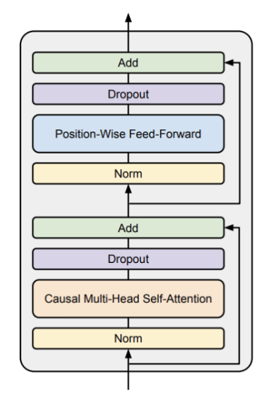

Transformer Blocks

정보를 순차적으로 처리하는가 병렬적으로 처리하는가에 대한 차이점도 존재합니다. 기조 자체가 시간이 지나면서 Serial layer보다는 parallel layers를 주목하고 있습니다. Multi-head attention도 병렬처리를 의미하는 것이기는 하지만, multi-head 측면에서의 병렬처리가 아니라 Transformer block 전체적으로 병렬화 하는 것을 의미합니다.

1. 표현력 향상 Parallel 구조는 여러 경로를 통해 정보를 처리하기 때문에 feature별 풍부한 표현이 가능합니다. SwiGLU, GeGLU 같은 구조는 입력을 나눠서 다시 합쳐 풍부한 표현이 가능하듯 parallel 구조에서도 이런 측면에서 성능적으로 향상이 있다는 것입니다.
2. Gradient 흐름 개선 Serial 구조는 층이 깊어질수록 Vanishing Gradient 문제가 발생할 수 있습니다. Parallel 구조는 Gating이나 Residual connection을 통해서 이 문제를 보완할 수 있습니다.
3. 병렬 처리 가능 GPU에서 병렬 연산이 가능하기 때문에 학습 속도와 추론 속도가 모두 향상됩니다.
4. 모듈화와 확장성 Parallel 구조는 다양한 sublayer를 조합하기 쉬워서 모델 설계가 유연합니다.

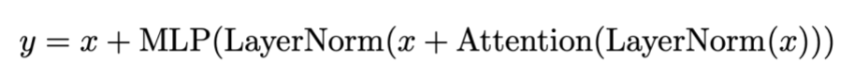

Serialized Formulation

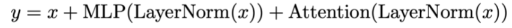

Parallel Formulation

Serial 연산은 모든 연산이 순차적으로 처리하기 때문에 지속적으로 이전 연산이 다음 연산에 영향을 줄 수 밖에 없습니다. 다만 Parallel 연산 방식은 동일한 LayerNorm을 동시에 입력해 병렬적으로 연산합니다. (위 자료에서는 LayerNorm이지만 전에 살펴봤듯이 RMSNorm을 사용하는 것이 더 좋은 성능을 보인다는 것을 알기 때문에 수정하는 방법을 고려할 수도 있습니다.)

최종적으로 Parellel을 사용하면 Serial에 비해 훈련속도가 15% 향상되고, LayerNorm(혹은 RMSNorm 등등)을 한 번 구해놓으면 중복 연산 없이 다양하게 사용할 수 있도록 할 수 있습니다. 그럼에도 불구하고 품질 저하가 일어나지 않는 효과적인 방법입니다.

하지만 아직 Parallel에 대한 깊은 연구가 이뤄지지 않았기 때문에 Parallel이 Serial에 비해서 구조적으로 압도적인 우위에 있다고 보기에는 어렵고, 병렬 연산으로 인해 효율적이다는 정도만 확인된 상황입니다. 실제로 Autoregressive 모델의 문맥 유지, 안정성, 품질을 고려해봤을 때 순차적으로 token을 고려하고 생성하는 것이 아직까지는 도움이 됩니다.

#### <strong>I-4) Positional Embeddings</strong>

Positional Embedding은 근본적으로 self-attention의 내적 과정이 자연어에서 중요한 '순서'의 개념을 고려하지 않는다는 점을 보완하기 위한 개념입니다. 즉, 순서가 바뀌어도 동일한 attention score가 나올 수 있다는 말입니다. 그렇기 때문에 Positional embedding을 통해서 각 token에 위치 정보를 담은 벡터를 추가해주거나 곱해주는 방식으로 위치 정보를 담아냅니다.

Absolute, Sine(Sinusoid), Relative, RoPE에 대해서 알아보겠습니다.

1. <strong>Absolute (Learned Absolute Position embedding, 학습 가능)</strong> Absolute는 'token embedding vector \+ position embedding vector'로 구성되어있습니다. 즉, 위치에 대한 정보를 단순히 더해주는 방식입니다. 자원의 특성 상 모델은 최대 sequence length가 정해져있기 때문에 sequence length \* dimension 크기의 embedding matrix를 학습하게 됩니다. 이 embedding matrix는 gradient descent를 통해서 학습하게 됩니다.
2. <strong>Sinusoid (Fixed Absolute Positional embedding, 학습 불가능)</strong> Absolute 방식이 token과 position의 embedding vector를 더해주는 것이라는 방식을 사용하는 것은 동일합니다. 다만 Absolute에서는 순서에 대한 정보를 일일이 입력해주었던 것과 다르게 sinusoid 방식은 sine과 cosine을 사용하여 position embedding vector를 생성합니다. 그리고 sinusoid 방식은 학습을 embedding vector를 학습할 필요가 없습니다. Absolute는 sequence length \* dimension 만큼의 parameter를 갖게 되지만, sinusoid 방식은 parameter 없이 함수는 고정된 상태에서 내부 변수에 따라 다르게 작동하는 것이기 때문에 학습을 해도 크게 도움이 되지 않습니다. 이 말은 곧 훈련 때 보지 못했던 길이에도 확장할 수 있다는 flexibility를 의미합니다.  쉽게 생각하면, Absolute 방식은 특정 길이와 특정 차원에 대한 embedding vector를 사용하여 학습하기 때문에 그 범위를 벗어나는 순간 적용이 어려워집니다. 그래서 상대적으로 flexibility가 적용이 가능한 sinusoid를 채택했습니다. 하지만 sinusoid를 사용하더라도 position embedding vector가 우연히 주기로 인해 겹치게 되면 문제가 발생할 수 있다는 것인데, 실질적으로 고차원에서 계산을 하기 때문에 일부 차원이 겹칠 수 있어도 모든 차원이 겹치는 경우는 거의 존재하지 않으며, 차원에 따라서 sine, cosine 함수의 주기가 달라지기 때문에 확률적으로 불가능에 가깝습니다.
3. <strong>Relative</strong> Relative 방식은 Sinusoid에서의 문제점을 개선하기 위해 등장합니다. Sinusoid에서는 크게 두 가지의 문제점이 있습니다. 첫 번째로는 position에 따라서 embedding vector를 생성하기는 하지만, 절대 위치를 반영하는 계산이기 때문에 token끼리 얼만큼 거리차이가 나는지에 대한 상대위치를 직접적으로 반영하지 않습니다. 두 번째로는 Query와 Key의 곱으로 구하는 Attention score에 직접 반영되지 않는다는 점입니다. 단순히 입력 벡터에 더하는 과정에만 들어가기 때문에 Attention Score에 위치 정보가 직접적으로 반영되지 않습니다. 그래서 Relative는 수식적으로 두 token의 거리가 입력된 embedding vector와 Query vector와 곱한 값이 반영됩니다. 이 값을 위치 기반 유사도(content-to-position)이라고 합니다. 그리고 특정 token의 Query vector와 Key vector의 곱을 내용 기반 유사도(content-to content)라고 부릅니다. 그래서 내용적으로 유사한 벡터끼리 높은 점수, 거리가 먼 벡터끼리 낮은 점수를 구하도록 유도됩니다.  최종적으로는 상대위치를 고려할 수 있게 되어 자연어에서 중요한 token 간의 관계를 파악할 수 있게 되었고, 따라서 token의 위치에 따른 학습이 가능하게 되었습니다. 최종적으로 sinusoid에 비해 복잡한 관계도 파악하는 게 가능해지는 것입니다.

<strong>RoPE(Rotation Position Embedding)</strong> Position embedding을 Rotation을 통해서 반영하는 것입니다. input을 2차원 pair로 재구성을 하고, 각 pair마다의 position과 벡터의 차원에 따라서 회전 각 theta를 다르게 부여합니다. 즉, 벡터를 회전시키는 과정이 포함되어 있습니다. 이 input이 Query와 Key가 되고 RoPE(Query)와 RoPE(Key)의 곱으로 Attention Score를 구하게 되면, 내적 계산에 위치 정보가 자연스럽게 반영되게 됩니다. <strong>1\) 상대 위치 표현 가능</strong>: 회전 각도의 차이가 곧 상대적 위치의 차이 <strong>2\) 내적에 직접 반영</strong>: Query-Key 내적에 위치 정보를 포함 <strong>3\) 일반화 가능</strong>: 고정된 수식을 기반으로 하기 때문에 긴 시퀀스에도 일반화가 가능 <strong>4\) 파라미터 없음</strong>: Sinusoidal처럼 학습 없이 사용 가능  즉, RoPE는 상대 위치와 절대 위치를 모두 반영했다는 점에서 자연어 처리에서의 중요한 의미를 갖습니다. 상대적으로 먼 거리에 있는 단어들끼리는 연관성이 낮다는 점, 가까운 거리에 있는 단어들끼리는 연관성이 높다는 점, 절대적인 위치에 따라서 같은 단어이더라도 다르게 해석될 수 있다는 점이 모두 반영될 수 있기 때문에 <strong>상대 위치와 절대 위치를 모두 반영할 수 있다는 것은 큰 장점이 됩니다.</strong>

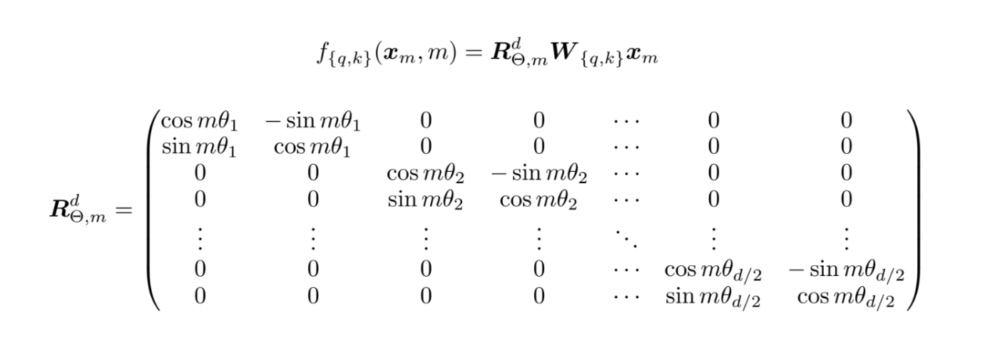

RoPE(Rotation Position Embedding)

---

Architecture 측면에서의 네 가지에 대한 요약입니다. <strong>1&#46; Post-Norm vs Pre-Norm</strong> Post-Norm이 기본적인 틀로 사용되어 왔지만 Vanishing Gradient 문제가 해결되지 않아 Pre-Norm이 고안되었고 Pre-Norm만으로도 Gradient Spike를 해결하지 못해 Peri-Norm(Double Norm)이 고안되었습니다. Vanishing Gradient 문제를 해결하기 위해 LayerNorm을 RMSNorm으로 바꿔서 적용하는 것이 Trend로 자리잡았습니다. <strong>2&#46; Activation Function </strong>Activation Function은 초기 Transformer에서는 ReLU가 사용되었지만 시간이 지나면서 GeGLU와 SwiGLU가 힘을 많이 얻게 되었습니다. 최종적으로 SwiGLU(SiLU)가 널리 사용되고 있는데, GeGLU와 달리 Swish라는 함수 기반으로 구성된 SwiGLU이기 때문에 ReLU의 Sparsity와 Sigmoid의 smoothness를 모두 갖추어서 복잡한 패턴을 모두 학습할 수 있다는 점에서 널리 사용되고 있습니다. <strong>3&#46; Serial Layer vs Parallel Layers </strong>초기 Transformer는 Transformer 전체적인 구조 자체가 Serial, 순차적 구조를 사용했지만 이를 병렬처리 하려는 시도가 생겨나고 있습니다. GPU가 있기 때문에 학습 속도 측면에서 확실한 이점을 가지고 있지만 아직 확실한 연구가 이뤄지지는 않았기 때문에 단언할 수는 없는 상황입니다. 그럼에도 [연산 속도 측면, 그리고 성능 측면에서도 Parallel Layer의 향상을 보고한 연구](https://github.com/kingoflolz/mesh-transformer-jax#gpt-j-6b)가 있다는 점은 주목할만 합니다. <strong>4&#46; Positional Embedding </strong>RNN의 구조적 한계로 인해서 순차적인 처리만 가능하고 이는 곧 장기 의존성 문제로 이어져 시간이 오래 지난 입력의 정보가 뒤 쪽 출력에 끼치는 영향이 미미하다는 문제는 해결할 수 없었습니다. 이 문제를 단순 Inner Product로 해결했지만, 자연어 처리의 특성 상 순서와 위치 정보가 중요하기 때문에 Positional Embedding은 필수적입니다. 많은 과정이 있었지만 RoPE를 통해서 절대적인 위치와 상대적인 위치 모두 고려 가능하고 파라미터나 무거운 학습 없이도 적용 가능하다는 점이 현재 RoPE가 trend를 주도하고 있는 이유입니다.