[Attention is All You Need Paper Review](/posts/attention-is-all-you-need/)에서 이어지는 내용입니다.

[\[Paper Review\] Attention is All You Need](/posts/attention-is-all-you-need/)

[Attention is All You Need 논문을 리뷰합니다.RNN을 기반으로 한 Seq2Seq 모델은 순차적인 연산이라는 한계에 부딪혀 성능 향상에 제약이 있습니다. 하지만 해당 논문에서 제안한 Transformer 모델은 self-atten](/posts/attention-is-all-you-need/)

[nulw.tistory.com](/posts/attention-is-all-you-need/)

---

#### <strong>1\. 왜 RNN은 태생적으로 한계가 존재할 수 밖에 없는가?</strong>

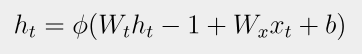

Recurrent Neural Network(RNN)의 기본 구조

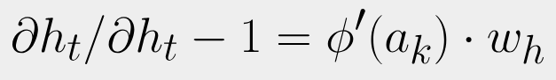

Backpropogation Through Time의 핵심

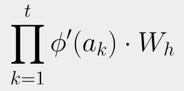

RNN의 Gradient 구하는 방법

기본적으로 RNN은 현재 시점의 hidden state의 vector값을 구할 때 이전 시점의 hidden state vector값이 관여를 합니다. 또한 backpropogation으로 gradient를 구할 때에도 특정 시점의 hiddent state를 그 이전 시점의 hidden state로 미분했을 때의 곱의 연속으로 구성됩니다. 이는 곧 'activation function의 도함수의 값과 반복된 가중치의 곱'들의 곱으로 구성됨을 의미합니다. 만약 activation function의 도함수의 값이 0에 가깝거나 가중치 W가 1보다 작게 초기화가 되었다면 결국 지수적으로 작아져 0에 수렴하는 Vanishing Gradient 문제가 발생할 수 밖에 없습니다. 반대로 값이 크면 되는 것 아닌가라고 생각할 수 있지만 그렇게 되면 Exploding Gradient 문제가 발생하게 되는 것입니다. 즉, 멀리 떨어진 시점에서의 값을 효과적으로 반영하는 것은 RNN에서는 불가능할 수 밖에 없는 구조인 것입니다.

---

#### <strong>2\. Transformer의 핵심인 Attention을 RNN에 적용했음에도 왜 RNN은 죽은 Network가 되었을까?</strong>

태생적인 문제점은 바뀌지 않았기 때문입니다. 기존의 RNN은 encoder에서 decoder로 넘어갈 때 encoder의 마지막 시점의 hidden state vector에 모든 문장 정보를 다 담아서 전달하는 구조였습니다. 그래서 ' <strong>1\. 왜 RNN은 태생적으로 한계가 존재할 수 밖에 없는가?'</strong>에서 다뤘듯이 마지막 시점의 hidden state vector에는 초반 hidden state에 대한 정보가 거의 존재하지 않습니다. 그렇기 때문에 attention 구조를 도입해서 초반 hidden state에 대한 정보를 직접 반영할 수 있도록 하자는 것이 아이디어입니다.

하지만 encoder가 RNN인 이상 태생적으로 후반부 hidden state는 초반 hidden state의 정보가 많이 희석된 상태이기 때문에 중요한 정보임에도 가중치가 많이 부여되지 않을 것이라는 한계가 있는 것입니다.

이를 해결하기 위해 RNN을 개선한 LSTM, GRU, ConvS2S가 제시되었습니다. LSTM과 GRU의 핵심은 Gate에 있습니다.

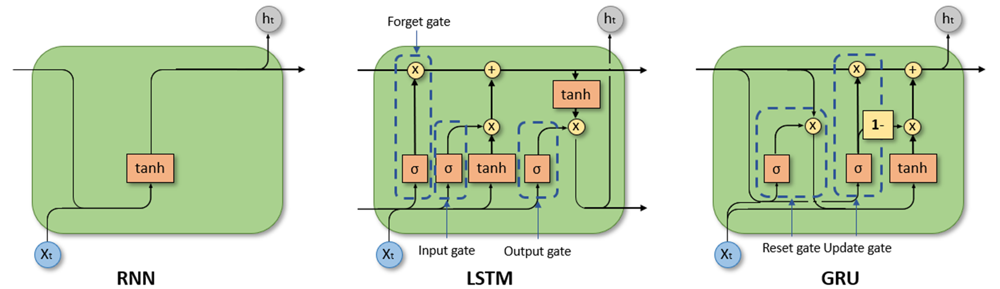

LSTM의 경우 Forget, Input, Output 총 3개의 Gate가 존재합니다. Forget은 이전 hidden state에서 어떤 정보를 버릴지, Input은 현재 입력 중에서 어떤 정보를 기억할지, Output은 현재 cell state에서 어떤 정보를 출력할지 결정합니다. LSTM은 cell이라는 장기 기억 state가 존재합니다.

GRU는 Update, Reset 총 2개의 Gate가 존재합니다. Update는 이전 정보를 얼마나 유지할지 결정합니다. (LSTM에서의 Forget \+ Input 느낌) Reset은 현재 입력을 얼마나 이전 hidden state와 결합할지 결정합니다. LSTM과 다르게 장기 기억을 위한 cell state가 없습니다. 그래서 LSTM의 Output Gate의 역할을 할 필요가 없습니다. Update Gate가 장기기억의 역할을 하게 됩니다.

장기기억을 하기 위한 장치를 설정했지만, 이는 결국 직접 dot product 과정을 통해 거리의 제약을 받지 않는 Tranformer에 비해 자유도가 떨어질 뿐더러 근본적인 Vanishing Gradient 문제는 해결할 수 없습니다.

Transformer의 SOTA 성능에 제일 근접했던 것이 ConvS2S인데, CNN 기반으로 병렬 연산이 가능하고, 정해진 kernel만큼만 정보를 처리하기 때문에 멀리 떨어진 정보를 반영하기 위해서는 층을 높게 쌓아야만 했습니다. 또한 ConvS2S는 병렬 연산으로 인한 position에 대한 정보가 없기 때문에 positional embedding을 absolute 방식을 사용해서 반영했습니다. 기본적으로는 좋은 아이디어인 것은 맞지만 깊게 층을 쌓는만큼 선형적으로 연산량이 증가하지만 Transformer의 경우는 self-attention을 통해서 모든 위치 간 직접 연결이 가능하다는 점이 Transformer가 ConvS2S를 밀어내고 주류가 될 수 있었던 가장 큰 이유라고 볼 수 있습니다.

---

#### <strong>3\. Transformer의 Model Architecture 파고들기</strong>

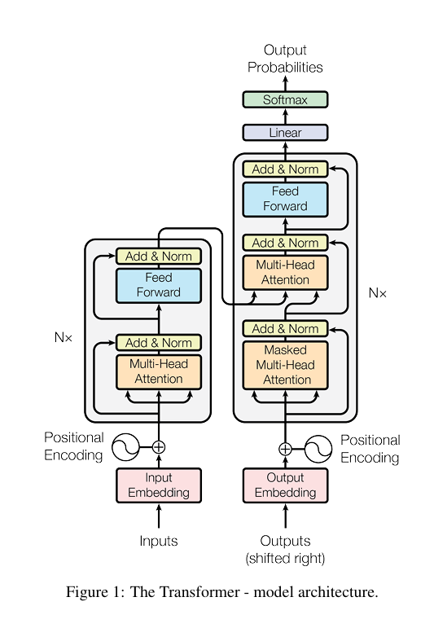

---

<strong> 3-1) Input Embedding</strong> 입력 값이 들어오면 우선 단어별로 Tokenization(토큰화)를 합니다. → Token들을 가지고 37,000개의 subword vocabulary와 매칭시켜 정수 인덱스를 부여합니다. 이 때 37,000개의 vocabulary에 포함되지 않는 token의 경우 \<unk\>라는 인덱스가 부여됩니다.   → 이 정수 인덱스를 각 token마다 512차원으로 확장시킵니다. 이 512차원의 행렬이 가중치로 작동하기 때문에 처음에는 무작위로 부여된 실수 벡터가 훈련 중에 self-attention, Feed Forward, Backpropogation을 통해서 행렬이 갱신되면서 최종 임베딩 벡터가 생성이 되게 됩니다.

---

<strong>3-2) Positional Encoding</strong>

<u>Absolute (Learned Absolute Position embedding, 학습 가능 / ConvS2S에서 사용한 방식)</u> Absolute는 'token embedding vector \+ position embedding vector'로 구성되어있습니다. 즉, 위치에 대한 정보를 단순히 더해주는 방식입니다. 자원의 특성 상 모델은 최대 sequence length가 정해져있기 때문에 sequence length \* dimension 크기의 embedding matrix를 학습하게 됩니다. 이 embedding matrix는 gradient descent를 통해서 학습하게 됩니다.

<u>Sinusoid (Fixed Absolute Positional embedding, 학습 불가능 / 초기 Transformer에서 사용된 방식)</u> Absolute 방식이 token과 position의 embedding vector를 더해주는 것이라는 방식을 사용하는 것은 동일합니다. 다만 Absolute에서는 순서에 대한 정보를 일일이 입력해주었던 것과 다르게 sinusoid 방식은 sine과 cosine을 사용하여 position embedding vector를 생성합니다. 그리고 sinusoid 방식은 학습을 embedding vector를 학습할 필요가 없습니다. Absolute는 sequence length \* dimension 만큼의 parameter를 갖게 되지만, sinusoid 방식은 parameter 없이 함수는 고정된 상태에서 내부 변수에 따라 다르게 작동하는 것이기 때문에 학습을 해도 크게 도움이 되지 않습니다. 이 말은 곧 훈련 때 보지 못했던 길이에도 확장할 수 있다는 flexibility를 의미합니다.  쉽게 생각하면, Absolute 방식은 특정 길이와 특정 차원에 대한 embedding vector를 사용하여 학습하기 때문에 그 범위를 벗어나는 순간 적용이 어려워집니다. 그래서 상대적으로 flexibility가 적용이 가능한 sinusoid를 채택했습니다. 하지만 sinusoid를 사용하더라도 position embedding vector가 우연히 주기로 인해 겹치게 되면 문제가 발생할 수 있다는 것인데, 실질적으로 고차원에서 계산을 하기 때문에 일부 차원이 겹칠 수 있어도 모든 차원이 겹치는 경우는 거의 존재하지 않으며, 차원에 따라서 sine, cosine 함수의 주기가 달라지기 때문에 확률적으로 불가능에 가깝습니다.

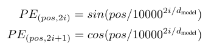

sinusoidal positional encoding

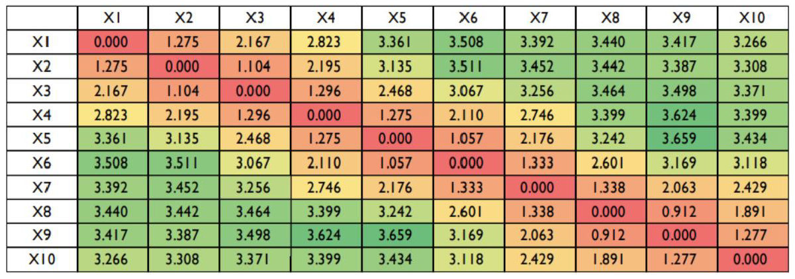

Positional Encoding Value example

---

<strong>3-3) Query, Key, Value는 각각 무엇을 의미하며 어떻게 활용되는가?</strong>

Scaled dot product Attention

일단 논문에서 Attention을 무엇으로 정의하고 있는지부터 알 필요가 있습니다.  Attention은 다음 세 가지 프로세스를 아우르는 말입니다. 1\_Query와 Key의 scaled dot product를 통한 유사도 계산 2\_Softmax로 가중치를 정규화 3\_Value에 가중치를 적용해 최종 출력을 생성하는 것입니다.

해당 논문에서 사용되는 Attention은 정확하게는 Scaled Dot Product Attention입니다.

이 때 여기서 사용하는 Query, Key, Value는 정확히 무엇을 의미하는지 알 필요가 있습니다. Query: 찾고자 하는 정보  Key: 저장된 정보의 특징 Value: 실제 정보

쉽게 이해하자면 Query를 통해서 검색을 하면 실제 정보의 특징인 Key와 내가 찾고자 하는 정보가 얼마나 비슷한지 파악해서 필요한 실제 정보 Value를 활용하겠다는 것입니다.

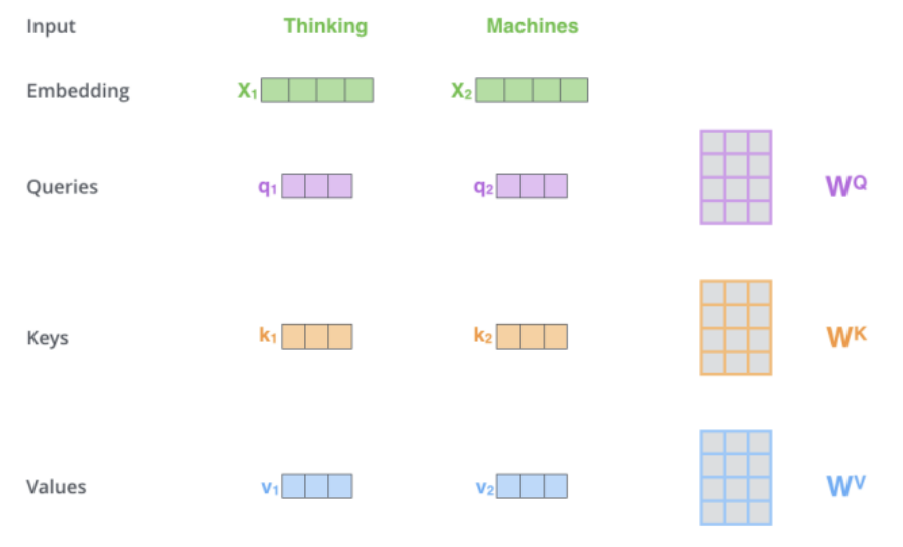

Self-Attention

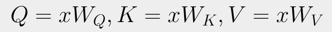

Query, Key, Value

저렇게 Attention의 연산에 활용되기 위해서 Q, K, V는 입력과 각 구성요소마다의 가중치 행렬의 내적으로 나타납니다. Query와 Key의 가중치는<u> '이 token이 어떤 token과 관련있는지 잘 표현하도록'</u> 조정이됩니다. Value의 가중치는 <u>'어떤 정보를 전달할 것인가를 결정하는 역할'</u>을 합니다.

한 문장을 모두 동일하게 받더라도 다른 Q, K, V가 생성되게끔 만들어집니다.

Scaled Dot Product Attention에서 분모에 위치한 Q와 K transpose의 내적이 Attention Score(이 값이 높으면 해당 Query와 Key는 높은 연관성을 가지고 있다고 판단할 수 있습니다.) 그래서 Q와 K는 서로 잘 맞물리게끔 가중치가 학습이 될 것입니다.

가중치를 Query, Key, Value 모두 따로 두었고 각자의 역할이 다르기 때문에 동일한 loss function을 가지고 나아가더라도 각 가중치 행렬마다 전달되는 Gradient가 달라져 차이를 유지할 수 있는 것입니다.

---

<strong>3-4) RNN\+Attention과 Transformer에서 사용되는 Attention은 무엇이 다른가?</strong>

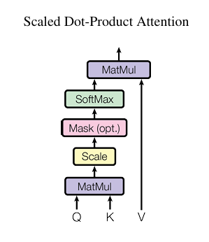

Scaled dot product Attention

일단 Transformer에서 사용하는 Attention인 Scaled Dot Product Attention에 대한 내용부터 다루겠습니다.

Scaled dot product Attention

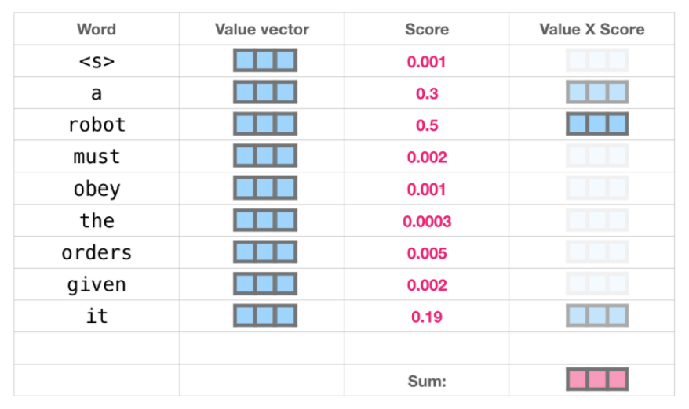

Self-Attention Example

Query와 Key\_transpose의 내적을 하고 이를 Key의 차원의 제곱근으로 scaling하여 Attention Score를 구하게 됩니다. Attention Score는 'QK\_t / sqrt(d\_k)'인 것입니다. 왜 scaling을 했을까요? 일단 기본적으로 Q, K는 높은 차원의 행렬 벡터입니다. 높은 차원 간 dot product를 하면 분산이 자연스럽게 증가하고 값 자체가 많이 커지게 됩니다. 이 값을 그대로 softmax에 집어넣게 되면 확률 자체가 극단적으로 치우칠 수 밖에 없습니다. 그렇다고 normalization은 '길이'의 단위를 맞추는 것이다 보니 Q와 K의 정보가 사라져 자연어 처리에 적합하지 않을 뿐더러 나중에 Key의 차원으로 나누는 scaling보다 연산 비용이 훨씬 비싼 것입니다.

Q와 K의 내적으로 인해 Q와 K의 내적의 분산은 d\_k가 되고 이를 sqrt(d\_k)로 나눴을 경우 'QK\_t / sqrt(d\_k)'이 Q와 K의 내적으로 서로 연관성이 높은 벡터는 높은 값을 갖게 되고 softmax 안에서 높은 확률을 가지게 되니 V가 Q의 결과에 많은 영향을 받아 출력이 되게 됩니다. 예를 들자면, V를 통해서 "it"이 출력되었을 때 "cat"과의 유사도가 높다고 판단되면 "it"은 "cat"을 가리킨다고 판단할 수 있는 것입니다.

<strong>Self-Attention Example</strong>을 보면 알 수 있듯 Query와 Key의 내적, sqrt(d\_k)로  scaling한 값들을 모두 softmax에 집어넣게 되면 총합은 1이 됩니다. 이를 value와 곱을 했을 때 큰 수를 가지는 것들을 파악할 수 있게 됩니다. 각 행렬마다 값을 다 더하면 1이 되는 특성은 softmax를 사용했기 때문에 가능한 것입니다.

근데 Architecture 그림을 보면 중간에 'Mask(opt.)' 과정이 있습니다. Attention 과정은 Encoder 뿐만 아니라 Decoder에서도 발생하는데 Decoder는 Autoregressive(이전까지 생성한 token을 기반으로 다음 토큰을 예측하는 방식) 과정을 통해서 문장을 생성하게 됩니다. 이 때 self-attention은 구조적으로 모든 위치를 동시에 참조할 수 있는 구조이기 때문에 아무런 제약이 없으면 미래 시점의 토큰 정보까지 흘러들어오게 됩니다. 훈련시 masking을 안 하면 미래 정보를 다 알고 있는 상태에서 훔쳐보고 예측을 해버리고 실제로 추론을 해 단어를 생성할 때에는 훈련 때와 조건이 달라져 성능이 떨어지게 됩니다. 그래서 decoder에서 학습을 진행할 때에는 반드시 masked attention은 필수적입니다.

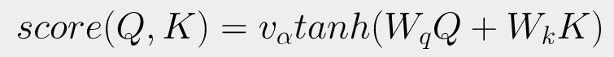

RNN \+ 'Attention'에서의 Additive Attention

RNN에서 활용되는 Attention은 Additive Attention입니다. 이 Attention을 Bahdanau Attention이라고도 합니다. Transformer에서는 self-attention이기 때문에 동일한 차원에 있어서 dot product 하는 것이 용이했지만 이 아이디어가 제시될 당시 Query는 Decoder, Key는 Encoder에 있었기 때문에 서로 다른 차원의 공간에 있었습니다. 그래서 선형 변환을 통해서 차원을 맞춰서 '더하는' Attention을 사용했기 때문에 Additive Attention입니다.

애당초에 더했기 때문에 dot product처럼 대규모 행렬 곱셈으로 병렬 처리가 어려워서 효율적인 방법은 아닙니다.

---

<strong>3-5) Multi-Head Attention은 왜 Multi-Head로 작동을 하는가?</strong>

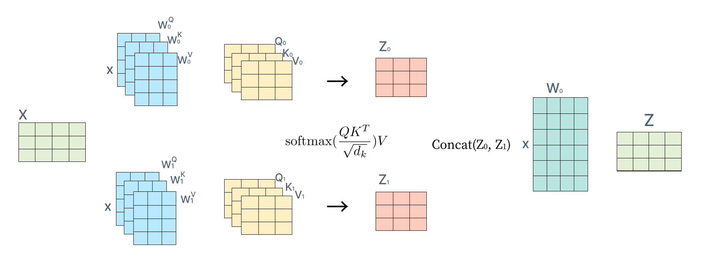

Multi-Head Attention

Single-Head Attention을 하게 될 경우 모델의 기본 차원이512 차원으로 제한 되어있는 상태에서 모든 정보를 하나의 관점에서만 바라보게 됩니다. 다만 Multi-Head인 경우 쪼갠 Head의 개수만큼 다양한 관점(표현공간, subspace)에서 다르게 가중치를 갱신하여 합치게 되면 문법적, 의미적 유사성, 인접한 token간 관련성 등 다양한 관점에서 학습이 가능하게 됩니다. 대신 head의 개수는 8개로 제한했습니다. 많은 head가 있다면 다양한 관점에서 파악이 가능하지만, 모델의 차원이 512 차원으로 제한되어있고 head의 개수가 8개라면 각 헤드의 차원은 64차원으로 제한되어 나중에 concat을 했을 때 512차원이 되도록 유지되게끔 설계되었습니다.

결국 head를 여러 개로 나누면 병렬연산도 가능해서 Single-Head보다 장점이 있고 표현력도 확보되니 사용한 것입니다.

---

<strong>3-6) 왜 Encoder와 Decoder 모두 6개의 identical layer로 구성되어있는가?</strong>

일단 identical layer는 구조적으로 동일한 layer라는 뜻입니다. encoder는 multi-head self attention과 Position-wise Feed Forward Network(Position-wise는 각 token마다 동일한 Feed Forward를 적용한다는 것을 의미합니다.) Feed Forward는  총 두 개의 sublayer로 작동합니다. 이 두 개의 sublayer가 한 묶음으로 묶인 layer가 총 6개인 것입니다. 구조상으로는 6개의 layer들이 동일하지만 각각 다르게 가중치를 학습하기 때문에 구조적으로는 identical layer지만 가중치는 다른 것입니다. 6개보다 layer를 늘리게 되면 계산량이 늘어나 메모리 사용량이 급증하게 될 뿐만 아니라, 6개보다 많은 layer가 쌓이면 연산 비용대비 성능 향상이 미미할 뿐만 아니라 오히려 떨어지는 경우도 발생했기 때문에 layer를 6개로 설정한 것입니다.

---

<strong>3-7) Residual connection과 Layer Normalization을 하는 이유는 무엇인가?</strong>

Residual Connection은 기존 입력 값을 그대로 더해주는 것을 의미합니다. attention이나 Feed-Forward를 진행하게 되면 입력값이 sublayer로 들어가 sublayer(x)가 되는데 이 값은 0과 1 사이의 값이 됩니다. 그래서 Residual Connection으로 인해 x값 그 자체를 더해주면 이에 대해 x로 미분 하더라도 그 x값이 identity matrix I가 되기 때문에 1을 그대로 더하게 됩니다. 이게 기존 입력 값의 흐름을 따라갈 수 있도록 하는 장치로 작용합니다. 따라서 Vanishing Gradient 문제가 완화되는 것입니다.

그렇다면 왜 Residual Connection으로 늘려놓은 값을 왜 Layer Normalization을 통해서 줄이는 것일까요? 일단 Normalization을 한 이유는 sublayer간 학습 환경을 맞춰주기 위해서입니다. Normalization을 하지 않으면 학습이 진행될수록 값 자체가 커져서 오히려 기울기가 폭증하는 Gradient Exploding 위험도 있습니다. 그래서 Gradient의 흐름이 균일화되지 않습니다.  그렇다면 표준정규분포로 정규화하면 되는데 왜 LayerNorm을 사용했을까요?

다음은 Layer Normalization의 수식입니다.

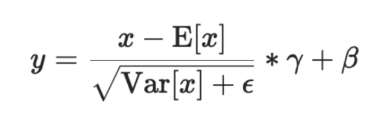

Layer Normalization

x \- E\[x\]는 편차, root(Var\[x\])는 표준편차입니다. epsilon은 단지 분모가 0이 되는 것을 방지하기 위해 들어가있는 파라미터입니다.  즉, 기본적인 layernorm의 방향성은 '편차/표준편차', 즉 평균이 0이고 분산이 1이 되게끔하는 표준정규분포(Standard normal distribution)형태를 띠게 됩니다.  이제 스케일(γ) 파라미터와 시프트(β)파라미터에 집중해서 보겠습니다. 스케일 파라미터는 정규화된 값을 각 차원별로 얼마나 다시 늘리거나 줄일지에 대해 조절하는 곱셈 계수입니다. 시프트 파라미터는 정규화된 값을 얼마만큼 이동시키는지에 대한 역할, bias 느낌의 역할을 하는 덧셈 상수입니다. 이렇게 하면 원하는만큼 '각 차원의 크기를 조절(γ), 위치를 이동(β)'시켜서 기존 표준정규분포로 인해 지워졌던 분포적 다양성을 복원할 수 있게됩니다. (표준정규분포를 사용하면 평균0, 분산1로 제한되어 모델의 각 뉴런과 feature가 동일한 출력 범위를 갖게 되어 표현의 유연성을 매우 제한하게 됩니다. 이렇게 되면 복잡한 형태나 구조를 모델이 잘 학습하고 표현할 것이라 기대하기 어렵습니다.) 정규화 하기 이전의 분산을 스케일 파라미터에, 평균을 시프트 파라미터에 집어넣어서 연산하게 되면 정규화 이전 분포로 되돌릴 수 있습니다.

요약하자면 Residual Connection을 사용한 이유는 Vanishing Gradient 문제를 해결하기 위해서이고, Layer Normalization을 사용한 이유는 학습의 안정화와 표현의 다양성을 잘 유지하기 위해서입니다.

---

<strong>3-8) Position Wise Fully Connected Layer(Feed Forward layer)는 어떤 의미로 사용되는가?</strong>

일단 Position-Wise라는 것은 각 token마다 동일한 Feed Forward를 적용한다는 것을 의미합니다. Position-Wise가 아니라 단순 FFN을 사용하게 되면 문장 전체를 하나의 벡터/행렬로 보고 비선형 변환을 합니다. 결국 Position-wise는 각 token에 FFN을 적용해 위치별로 세밀한 가공능력을 보장하지만 단순 FFN은 그렇지 않다는 것입니다. 그리고 Fully Connected Layer를 통해서 비선형 변환을 하기 때문에 더 깊은 표현력을 얻을 수 있게 되는 것입니다.

그렇다면 왜 Fully Connected였을까요? 몇 개의 뉴런 정도는 누락해 일반화 성능을 확보해도 되는 것 아니었을까요? 이건 다른 방향으로 사용된 것입니다. Fully Connected를 하게 되면 뉴런이 다 연결되어있기 때문에 표현할 수 있는 공간이 확장되는 상황입니다. 모델의 기본 차원은 512차원이지만 이 FF layer를 통과할 때 2048차원으로 확 늘어났다가 탈출하면서 다시 512차원으로 축소됩니다. 이를 통해 2048 차원의 FF layer에서 다양한 특징 조합이 가능하게 되고 ReLU 같은 비선형 activation function으로 복잡한 관계 학습이 가능해지는 것입니다. Fully Connected를 해서 일반화 성능이 떨어질 수도 있지 않는가라는 접근을 하는 건 애당초에 접근 자체가 방향이 어긋난 접근인 것입니다.

Dropout도 물론 일반화 성능을 위해 사용합니다. 총 세 가지의 상황이 있습니다. 각 sublayer들이 Residual Connection 연산을 하기 직전에, Positional Encoding한 직후에, Encoder의 결과가 Decoder의 Multi-Head Attention에 전달되기 전에 사용합니다.

---

<strong>3-9) Output Embedding에 사용되는 Outputs에서 shifted right는 무슨 의미를 갖는가?</strong>

Output embedding은 decoder가 생성해야 할 타겟 토큰 시퀀스를 벡터로 변환하는 층입니다. Encoder에서 Input embedding의 입력으로 사용되는 input은 그냥 문장, 글 그 자체입니다.  그리고 Decoder에서 Output embedding의 입력으로 사용되는 output은 decoder가 생성해야할 정답 문장입니다.

쉽게 생각하면 Encoder는 문제지를 입력으로 넣고 관계를 파악하는 것이고, Decoder는 정답지를 입력으로 넣어 문장을 올바르게 생성할 수 있도록 하는 것입니다.

근데 왜 shifed right, 즉 token을 하나씩 밀어서 사용하는 것일까요? shifted right, 즉 타겟 문장을 한 칸 오른쪽으로 밀어서 현재 토큰 위치 i에는 <strong>이전까지의 토큰</strong>만 디코더 입력에 들어가게 한다는 것입니다. 이렇게 되면 masked attention을 사용할 때 현재 토큰 위치 기준으로 뒤 token attention score를 \- ∞로 만들게 되고 이를 softmax에 집어넣으면 0으로 처리해서 아예 값을 지워버리는 것입니다. (이게 masking입니다.)

Scaled dot product Attention

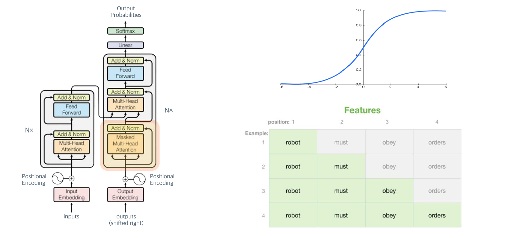

Scaled dot production Attention에 적용하면 괄호 안의 attention score를 음의 무한대로 보내기 때문에 softmax값이 0이 되어서 Value matrix를 곱해도 의미가 없습니다.

---

<strong>3-10) decoder의 첫 번째 sublayer인 masked attention과 두 번째 sublayer인 attention은 역할이 어떻게 다른가?</strong>

첫 번째 sublayer인 masked attention은 autoregressive 방식으로 다음 토큰을 예측해서 생성할 때 미래 정보를 접근하지 못하게 막는 것입니다. 사람이 글을 작성할 때처럼 왼쪽에서 오른쪽으로 생성하는 환경을 재현하는 것에 초점을 둡니다. 그래서 해당 token 기준 뒤 내용들을 모두 0으로 만들어 self-attention을 하게 됩니다. 두 번째 sublayer인 attention은 cross attention이라고 부릅니다. 들어오는 입력 자체가 Query는 masked attention에 의해 생성된 현재까지 생성된 문장, 즉 '현재까지 생성된 token들의 문맥을 요약한 decoder의 현재 시점 hidden state'입니다. 이고 Key와 Value가 encoder에서 출력된 입력 문장 전체이기 때문에 현재까지 생성한 문맥을 기반으로 입력 시퀀스 전체에서 필요한 정보를 찾아오는 역할을 합니다.  Cross-Attention은 Query가 어떠한 흐름으로 문장을 생성하고 있는데 입력 문장 기준으로 어떤 부분이 다음 단어 결정에 중요할지를 묻는 중요한 과정입니다.

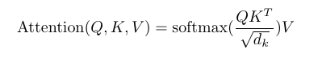

Scaled dot product Attention

softmax(QK / sqrt(d\_k))는 Attention Weight라고 부르고 '입력의 i번째 토큰이 t번째 출력 예측에 기여하는 비율'입니다. 그래서 저 비율을 가지고 많이 반영할 Value를 정하게 되는 것입니다.

이후 Feed Forward를 거쳐 다양한 관점에서 표현력이 깊어지는 과정을 거칩니다. 그 디코더가 마지막까지 맥락을 처리하고 나면, 그 결과는 아직 <strong>"다음 단어가 무엇인지"</strong>로 알 수 없는 <strong>추상적인 벡터 표현</strong>입니다.

---

<strong>3-11) Linear와 Softmax를 거쳐 최종 확률를 내는 과정까지는 어떻게 되는가?</strong>

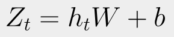

Linear

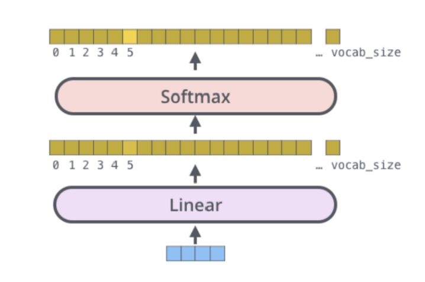

Linear, Softmax

h\_t는 decoder의 최종 출력, 즉 다음 단어가 무엇인지 알 수 없는 추상적인 벡터 표현 행렬입니다. W와 곱해지고 bias를 더하게 되면 Transformer의 Vocab에 있는 모든 단어 후보를 점수로 바꿔주는 변환을 하게 됩니다. 이게 Z\_t가 되는 것입니다.

h\_t는 차원이 \[1 \* 512\], W는 \[512 \* 30,000\]입니다. 저 두 행렬의 곱셈을 통해서 \[1 \* 30,000\]의 결과를 도출할 수 있게 됩니다.

이 W는 input embedding matrix와 가중치 공유(weight tying)를 합니다.

b를 0이면 됩니다. 기본적으로 여기서 Linear를 해주는 것이 bais를 제공해서 학습에 용이하게 변환을 하겠다는 의도보다는

그렇다면 Decoder의 출력을 바로 Softmax에 집어넣어서 확률을 내지 않고이 선형 변환 과정을 한 번 더 가지는 이유는 무엇일까요? 기본적으로 추상적인 벡터표현을 각 단어별 점수 표현으로 만들 수 있다는 점이 의미적으로 중요하고, 512차원으로 구성된 decoder의 출력층을 vocab에 맞게 30,000차원으로 변환시키는 과정이 있다는 것입니다. 그래서 이 값들을 softmax에 집어넣었을 때 Vocab에 있는 단어가 점수로 나올 수 있게 되는 것입니다.

---

#### <strong>4\. Output \_ Perplexity / BELU score</strong>

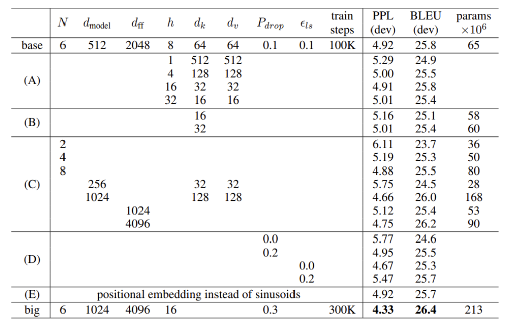

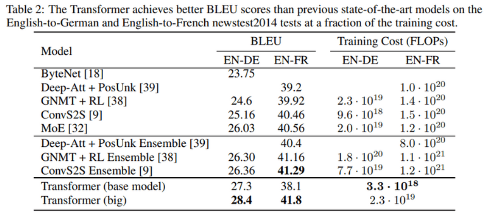

최종 성능 지표들을 통해서 다음과 같은 사실들을 알 수 있습니다.

---

Transformer는 번역 Task에서 SOTA 성능을 달성하였습니다. 또한 Training Cost을 주목하면, 타 모델 대비 적은 연산량으로 높은 성능을 보여주고 있습니다.

<strong>모델을 변형해서 추가로 실험을 진행했을 때, 다음 다섯 가지 특징을 발견할 수 있었습니다</strong><strong>.</strong> 1\. (A) Head가 너무 많으면 성능이 떨어진다. 2\. (B) Key의 차원이 작아지면 성능이 감소할 수 있다. 3\. (C)모델의 크기가 커질수록 성능이 좋아진다. 4\. (D) dropout으로 성능을 향상시킬 수 있다. 5\. (E) Sinusoid가 아닌 다른 것으로 positional encoding을 해도 성능에 유의미한 차이는 없다.

<strong>마지막 결론입니다.</strong>

1\. 병렬화를 통해서 훨씬 더 빠른 학습이 가능합니다. 2\. 번역 task에서 SOTA 성능을 달성했습니다. 3\. 다른 task에서의 적용이 기대됩니다. (실제로 transformer는 현재 모든 인공지능 분야에서 사용되고 있습니다.) 4\. RNN과 CNN 없이 self-attention을 도입해, 오직 attention에 기반한 Transformer 모델입니다.

---

Transformer에서 사용되는, NLP에서 광범위적으로 사용되는 perplexity와 BLEU score는 무엇일까요?

<strong>Perplexity</strong>는 문장 전체의 발생확률을 역수로 취한 값으로 '혼잡도'를 의미합니다. 즉, 다음에 올 문장 전체의 발생확률이 높다는 것은 모델이 그만큼 다음 token, 넓게 보면 문장에 대해서 확신을 하고 있다는 말입니다. 다르게 말하면 Perplexity의 값이 높으면 모델이 다음 문장이나 토큰의 생성에 대해 확신하지 못하는 혼잡한 상황이기 때문에 일반적으로 값이 낮을수록 좋은 모델이라고 볼 수 있습니다. (다른 연구에서도 perplexity가 낮은 게 모델의 성능이 일반적으로 좋다고 밝힌 바 있습니다.) 하지만 Transformer에서는 Label Smoothing을 통해서 오히려 perplexity를 높이는 선택을 했습니다.

바로 Perplexity가 너무 낮으면 그만큼 모델이 다음 단어에 대해 '너무 확신'하는, confident가 높은 모델이 되고 이는 overfitting을 유발할 수 있게 됩니다. 그리고 실제로 Perplexity를 인위적으로 높였을 때 BLEU score와 accuracy는 더 올라갔다고 밝힌 점이 이를 증명합니다.

<strong>BLEU score</strong>는 기계가 번역한 문장(후보 번역)이 사람이 번역한 참조 문장과 얼마나 유사한지를 수치로 나타내는 지표입니다.  번역문의 연속된 n개 단어 묶음을 참조 번역과 비교해 중복 없이 카운트를 하게 됩니다.

이 때 n-gram precision이라는 것을 이용하게 됩니다.  참조 문장(정답): 나는 밥을 먹었다. 예측 문장(모델의 출력): 나는 밥을 먹어요.

1-gram의 경우는 &#91;'나는', '밥을' 먹었다'&#93;와 &#91;'나는', '밥을', 먹어요'&#93;로 구분하게 됩니다. 겹치는 token이 3개 중에 2개이기 때문에 n-gram precision은 2/3 &#61; 0.666...입니다. 2-gram의 경우 &#91;'나는 밥을'&#93;과 &#91;'밥을 먹었다'&#93;로 구분합니다. 참조 문장에 '나는 밥을'이 있지만 '밥을 먹었다'는 일치하지 않기 때문에 1/2 &#61; 0.5의 n-gram precision 값을 갖습니다. 3-gram의 경우 &#91;'나는 밥을 먹어요'&#93;가 &#91;'나는 밥을 먹는다'&#93;와 완전히 일치하기 때문에 precision이 0이 됩니다.

일반적으로 길이가 길어지는, n-gram에서 n의 값이 클수록 정확도는 일반적으로 낮아질 수 밖에 없습니다. 하지만 n의 값이 너무 작아도 어순이나 문장구조가 전혀 반영될 수 없기 때문에 의미가 어색하거나 달라질 수 있습니다. 따라서 의미적 정확성 역시 확보를 하기 어려울 수 있기 때문에 경험적으로 4-gram까지의 precision을 반영하는 것이 도움이 된다고 알려져있습니다.

BLEU score가 0.7에 가까우면 인간 전문가의 번역 수준과 비슷한 성능입니다.