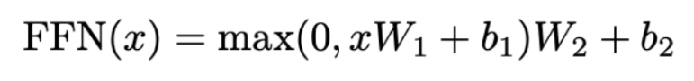
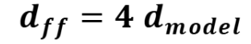
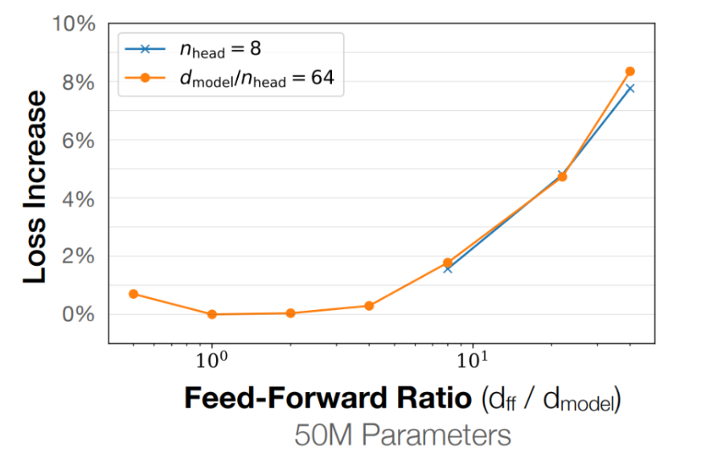
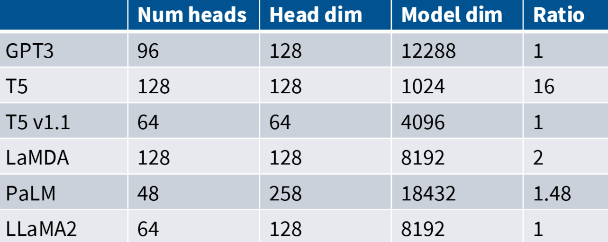
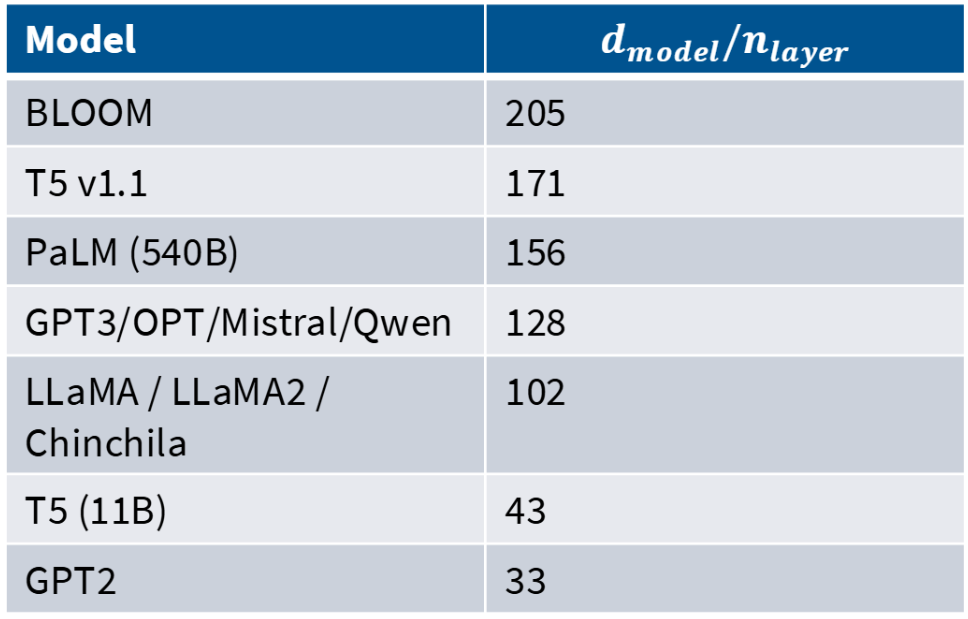
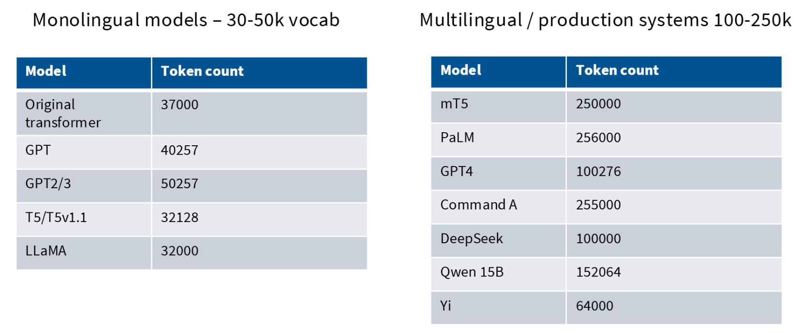
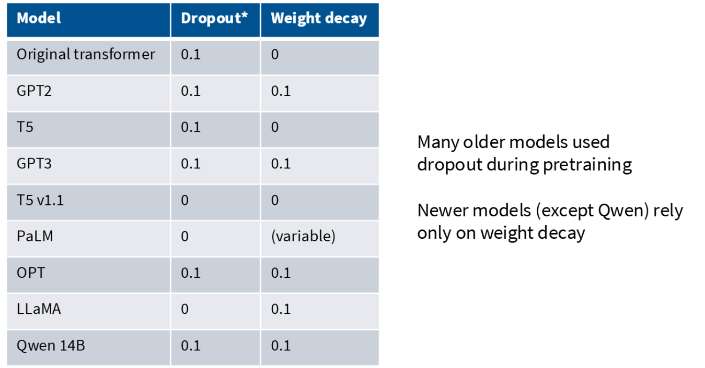
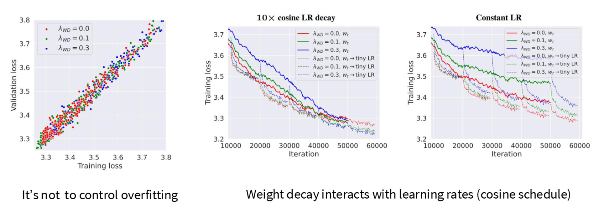

Photo by Pamela Maguigad / Unspalsh

Stanford-cs336 Lecture의 Modern Transformer에 대한 내용입니다. [Modern Transformer\_ (1) Architecture](/posts/modern-transformer-1-architecture-variations/)에서 이어집니다.

[\[공부 일기\] Modern Transformer \_ (1) Architecture Variations](/posts/modern-transformer-1-architecture-variations/)

[Stanford-cs336 Lecture의 Modern Transformer에 대한 내용입니다.2017년 'Attention Is All You Need'를 시작으로 인공지능의 전반적인 분야에서 Transformer라는 모델을 보편적으로 사용해오고 있습니다. 하지만 2017년](/posts/modern-transformer-1-architecture-variations/)

[nulw.tistory.com](/posts/modern-transformer-1-architecture-variations/)

---

#### II. Hyperparameter

- FFN layer의 크기는 hidden size보다 얼마나 커야할까?
- Attention Head의 수는 몇 개가 적절하며 항상 hidden size를 나눌 수 있어야 할까?
- Vocabulary Size는 어떻게 결정해야할까?
- 거대한 언어 모델 LLM에서는 정규화를 어떻게 적용할까?
- 모델 확장 방식은 깊은 것이 좋을까 넓은 것이 좋을까?

다음과 같은 물음에 대한 질문을 하는 chapter입니다.

---

<strong>1\. FFN layer의 크기는 hidden size보다 얼마나 커야할까? </strong>

FFN layer와 Hidden Size간의 크기 관계의

Position Feed Forward Network

모델에 있어 중요한 것은 차원입니다. d\_model은 모델의 기본 차원, d\_ff는 Feedforward layer의 차원을 말합니다. 일반적으로 이 차원은 Feedforward layer의 차원이 모델의 기본 차원 d\_model의 4배로 사용하는 것이 표준입니다.

여기서 말하는 '모델의 기본 차원'은 input을 받았을 때 Neural Network가 학습할 수 있도록 만드는 고정 벡터의 길이를 의미합니다. 일반적으로 Tensor로 입력을 받을 때, \[batch\_size, seq\_len, d\_model\]로 받는데, 선형 변환이 일어나면서\[batch\_size, seq\_len, d\_ff\]로 작동하게 됩니다.

<strong>일반적으로는 이런 4배 차원의 관계가 제일 성능과 연산 효율의 관계에서 최적화되었다고 알려져있습니다.</strong>

4배보다 크다면, ff layer의 차원 수가 늘어나 연산량이 늘어나게 되고 따라서 학습 속도와 추론 속도가 매우 느려지게 됩니다. 물론 표현력 측면에서 더 복잡한 관계를 학습할 수 있기 때문에 성능이 오를 수 있지만 연산량이 급증하기 때문에 과적합 위험도 생기게 되고 효율성 측면에서는 좋지 않습니다. 4배보다 작다면, ff layer의 차원 수가 줄어들어 연산량이 줄어들게 되고 학습 속도와 추론 속도가 비교적 빨라지게 됩니다. 물론 표현력 측면에서 보다 덜 복잡한 관계를 학습하기 때문에 모델이 잡아낼 수 있는 다양성이 적게 될 것입니다.

이런 연산량과 모델의 성능 간 Trade-off 관계를 고려하여 '효율'적인 측면에서는 모델의 기본 차원보다 4배 높게 ff layer의 차원을 설정해주는 것이 좋습니다.

---

하지만 <strong>GLU</strong>나<strong> T5, Gemma</strong>를 사용할 때에는 예외사항이 존재합니다.

GLU의 경우 Gating을 하기 때문에 GLU에 값이 들어갈 때 이전 layer의 출력이 입력으로 들어올 때 '값 \& 게이팅'으로 절반씩 나눠서 들어가게 됩니다. 기존에는 입력 시 행렬 곱과 출력 시 행렬 곱, 총 두 번의 연산이 있었는데 지금은 입력 자체를 값과 게이팅으로 나눠서 총 세 번의 행렬 곱 연산이 일어나게 됩니다. 최종적으로는 연산량(FLOPs)을 줄이기 위해서는 2/3만큼의 차원을 줄여야 합니다. 즉 d\_ff \= 4 d\_model이었는데, 2/3만큼 줄여서 d\_ff \= 8/3 d\_model이 GLU 계열 FF layer에서는 필요합니다. 그렇다면 차원이 줄어들어 성능적인 측면에서 문제가 생기는 것이 아닌가 말할 수 있지만, GLU 자체가 효율적으로 다른 activation function보다 더 나은 표현력을 보여주기 때문에 연산량은 줄어들고 성능 하락은 거의 발생하지 않는 방법이 됩니다.

T5의 경우는 4배가 아니라 64배 확장된 FF layer 차원을 적용합니다. 대부분의 모델들은 보수적이고(conservative) 안전한 하이퍼파라미터를 사용하는데, T5는 매우 공격적인(bold) 설정을 한 대표적인 사례로 언급됩니다. 이렇게 해도 되는 이유가 있습니다. 바로 Tensor Process Unit이라는 구글에서 개발한 가속기가 행렬 곱셈과 텐서 연산에 최적화되어있기 때문입니다.

같은 맥락에서 Gemma의 경우도 GLU 기반의 연산을 하기 때문에 연산량을 줄여도 성능 차이가 나지 않지만, TPU를 사용할 수 있기 때문에 굳이 연산량을 줄이지 않아도 되고 연산량을 오히려 더 늘리면서 성능을 향상시킬 수 있게 됩니다.

데이터가 많아지고 차원이 커질수록 그에 알맞는 무거운 모델이 필요한데, 그 무거운 모델을 TPU를 통해서 빠르게 처리할 수 있다면 성능도 향상시키면서 연산 속도도 줄일 수 있는 좋은 방법이 될 수 있는 것입니다.

최종적으로, FF layer의 차원이 모델의 기본 차원보다 1\~10배 정도까지는 Loss 증가 폭이 거의 없고 성능이 유지됩니다. 이렇게 낮고 평평한 구간을 basin이라고 합니다.

0\~1배의 비율은 표현력이 급격히 떨어질 수 있고, 10배가 넘어가는 순간 연산/메모리 비용 대비 성능 이득이 굉장히 미미합니다. 따라서 대부분의 LLM 설계에서 2\~8배 정도의 구간을 안전지대로 선택합니다.

---

<strong>2\. Attention Head의 수는 몇 개가 적절하며 항상 hidden size를 나눌 수 있어야 할까? </strong>Transformer의 아이디어를 보면 head의 개수는 여러 개입니다. 다양한 관계를 학습할 수 있게 되고, 표현력이 확장되며 병렬성이 뛰어나 효율적인 측면에서도 장점을 가지고 있습니다.

그래서 초기 Transformer의 아이디어는 대부분 모델의 기본 차원은 '각 헤드의 차원 수 X 헤드의 개수'로 맞춰서 계산을 했습니다. 만약 모델의 기본 차원이 512차원이라고 가정하고 head의 개수가 8, head의 차원 수가 64이면, 64차원의 각 헤드를 옆으로 8개를 나란히 concat하게 되면 기본 차원으로 손쉽게 나타낼 수 있었습니다.

하지만 head의 개수를 늘릴 수 있게 되면 더 많이 쪼개서 고려할 수 있기 때문에  attention할 수 있는 주제(topic)이 늘어나게 되고, head의 차원을 늘릴 수 있게 되면 각 head가 복잡한 패턴을 학습할 수 있게 포착 가능한 것입니다.

그래서 차원을 맞추지 않고 계산을 하는 것이 요새의 트렌드이기도 합니다. 만약 차원을 맞추지 않는다면 나중에 차원을 강제로 맞추는 작업이 늘어나 연산량이 늘어날텐데 이런 선택을 한 이유에 대해 의아할 수도 있습니다. 하지만 쉽게 생각하면 이렇게 하는 방법이 오히려 연산량이 늘어나는 것에 비해 얻는 성능적 이점이 더 크기 때문이라고 추론할 수 있습니다.

모델들이 'Num\_heads \* Head\_dimension'과 'Model\_dimension' 비율을 1로 맞추는 것에 반해 TPU를 사용할 수 있는 Google의 모델들은 대부분 이 비율을 지키지 않습니다.

'TPU를 사용할 수 있다면 저 Ratio의 비율은 그대로 유지하면서 head의 개수와 head의 dimension을 늘리는 것이 더 나은 방법이 아닌가?'

<strong>RoPE를 사용하는 것이 2024\~2025년 Trend인데, 이 RoPE가 안정적으로 작동하기 위해서는 head의 차원 수가 크면 유리하게 작동합니다.  또한 헤드의 차원 수가 64/128/256일 경우 TPU의 matmul을 효율적으로 사용할 수 있기 때문에 저 차원에 맞춰서 전달해주는 것이 성능과 연산 효율 측면의 trade-off 관계에서 많은 이점을 가져다준다는 것입니다.</strong>

하지만 성능 측면에서 짚고 넘어가야할 문제가 있습니다. 헤드의 차원 수가 작으면 헤드의 표현력이 낮아져 low rank bottleneck이 발생할 수 있다는 점입니다.

입력 벡터와 출력 벡터로 넘어갈 때, 차원이 더 작은 곳에 초점을 두어 mapping을 하게 됩니다. 넓은 파이프와 좁은 파이프의 유량을 보면, 넓은 파이프의 유량은 좁은 파이프에 맞출 수 있지만 좁은 파이프는 넓은 파이프의 유량에 맞추지 못하는 것으로 이해할 수 있습니다. 이렇게 되면 행렬이 입력 벡터 차원 m과 출력 벡터 차원 n이라고 되어있을 경우, m \* n의 행렬에서는 선형 변환을 통해 작은 차원에 맞춰서 Rank가 설정될 수 밖에 없습니다. [(선형대수학에서의 랭크(Rank))](https://ok-lab.tistory.com/176) 이 때 입력 벡터나 출력 벡터 중 차원이 큰 쪽이 차원이 작은 쪽에 맞춰주며 표현력이 제한되고, 성능이 낮아질 수 있는데 이것이 low rank bottleneck입니다.

<strong>그래서 헤드의 개수와 헤드의 차원의 곱이 모델의 기본 차원과 동일한 1:1 관계를 맞추는 것이 low rank bottleneck을 일으키지 않는 방법이라과 여겨졌는데, 실질적으로 1:1 관계를 지키지 않더라도 유의미한 성능 하락이 발생하지 않는다는 것도 밝혀졌습니다. [\[Low-Rank Bottleneck in Multi-head Attention, Bhojanapalli et al 2020\]](https://scholar.google.com/scholar?q=Low-Rank+Bottleneck+in+Multi-head+Attention)</strong>

<strong>3\. 모델 확장 방식은 깊은 것이 좋을까 넓은 것이 좋을까? \_ DEEP or WIDE??</strong>

layer 개수를 늘려 모델을 깊게(deep) 만드는 것이 좋은지 모델의 기본 차원을 크게(wide) 만들어 모델을 넓게 만드는 것이 좋은지에 대해 논의합니다. 깊은 모델은 더 많은 비선형 선환이 발생해 복잡한 패턴을 잘 포착할 수 있으나 병렬화가 어려워 깊이에 따라 연산량이 늘어나고, 넓은 모델은 병렬화가 용이해 연산 효율이 좋지만 훈련 데이터에만 특화될 위험성이 높습니다. (모델의 차원 수가 늘어난다는 것은 각 층마다의 뉴런 수가 많아진다는 것이고 뉴런과 연결된 가중치의 변화를 노이즈까지도 잘 파악할 수 있다는 것을 의미합니다.)

deep↑, latency ↑, parallelize↓ 그래서 무작정 패턴을 학습하기 위해 모델을 깊게 만드는 것이 정답이 아닙니다.

대부분의 모델들의 모델의 차원 수와 모델의 깊이 관계를 파악해본 결과 <strong>모델의 층과 모델의 기본 차원이 약 100배에서 150배 관계 정도가 좋은 효율을 보이는 Sweet Spot일 가능성이 높음을 시사합니다.</strong>

---

<strong>4\. Vocabulary Size는 어떻게 결정해야할까?</strong>

What are typical vocabulary sizes?

언어모델은 단일어 모델이 있고 다국어 모델이 있습니다. 단일어 모델은 한 개의 언어에 대해서 학습하면 되기 때문에 Vocabulary size, 곧 token의 개수가 상대적으로 많이 필요하지는 않습니다. 하지만 다국어 모델은 여러 개 언어를 paraphrase해서 연결짓기도 하고, 다방면으로 학습을 시켜야하기 때문에 상대적으로 token의 개수가 많을 수 밖에 없습니다.

<strong>\+ Additional Information [\[공부일기\] Sentence Transformer](https://nulw.tistory.com/entry/NLP-Sentence-Transformer)</strong>

---

<strong>5\. 거대한 언어 모델 LLM에서는 정규화를 어떻게 적용할까?</strong>

일단 언어모델의 경우는 미리 학습된 모델을 사용하게 됩니다. 당연하게도 텍스트로 학습해둔 언어지식과 패턴을 활용해 효율적으로 작업할 수 있기 때문입니다.

그렇다면 사전학습 과정에서 정규화가 필요할까요? 정규화를 하는 이유는 과적합의 위험성을 줄이기 위해서입니다. 학습 데이터인 token의 개수가 수조 개에 달하며 이는 파라미터 개수보다 훨씬 많습니다. 이 정도라면 모델이 특정 예시를 token을 통해서 학습해 암기할 수 있을 거라 기대하기 어렵습니다. 따라서 과적합이 발생할 확률이 직관적으로 보면 굉장히 낮다고 말할 수 있습니다.

하지만 실질적으로는 대규모 언어모델의 사전학습 과정에서 정규화 과정을 거칩니다.

Dropout and Weight Decay in practice

모델이 발전하면서 Dropout은 하지 않고 Weight Decay는 유지하는 경우가 많습니다.

과거에는 적은 파라미터와 적은 token 수로 학습을 했기 때문에 과적합 위험성이 존재했습니다. 하지만 모델이 발전하면서 모델의 파라미터 개수와 모델이 학습하는 token의 개수가 매우 많아졌고 데이터를 한 번만 순회하는 single-epoch가 사용되고 있기 때문에 과적합이 애당초에 발생할 위험성이 매우 적습니다. 그래서 Dropout의 필요성이 사라지기는 했습니다.

그렇다면 왜 Weight Decay는 유지할까요?

Weight Decay가 과거 L2 norm (Euclidean norm)으로 사용될 때에는 파라미터의 크기를 제한해서 과적합 방지 유지가 목적이었습니다. 하지만 지금의 Weight Decay는 학습 안정화를 목적으로 사용합니다.

최근에는 weight decay와 함께 cosine decay를 함께 사용하여 학습 안정성을 추구합니다.

Why Weight Decay LLMs?

Weight Decay가 과적합 방지가 원래 주목적이었지만, 학습 안정성이 좋지 않기도 합니다. 바로 Weight Decay는 학습률과 밀접한 연관이 있기 때문입니다. weight decay가 수학적으로 학습률과 곱해지는 hyperparameter라는 점에 주목해야합니다. 학습률이 크면 Weight Decay 효과가 상대적으로 약해지고 학습 후반부로 갈수록 학습률이 그대로 유지되면 수렴하지 못하고 진동하거나 발산할 위험이 커집니다.

그래서 후반부로 갈수록 학습률이 부드럽게 감소하는 cosine decay와 weight decay가 같이 작동할 경우 parameter blow up을 방지함과 동시에 학습률을 감소시켜 안정적으로 loss가 수렴할 수 있도록 도와줍니다

- Parameter Blow up:  파라미터 값이 비정상적으로 커지는 현상을 의미합니다. 학습률이 너무 커서 수렴하지 못하고 발산하는 과정, Exploding Gradients, 비선형 activation function이나 불연속 지점에서의 미분으로 인해 값이 튀는 현상으로 인해 발생하기도 합니다.
- Cosine Decay Cosine 함수를 생각하면 1에서 0으로 줄어드는 π/2 주기만 사용해서 학습 후반부로 갈수록 부드럽게 학습률이 감소할 수 있도록 도와줍니다. Weight Decay는 모델의 가중치에 곱해져 가중치를 제어하는 것이라면 Cosine Decay는 학습률을 감소시키는 다른 개념으로써 사용됩니다.

---

정리하자면 다음과 같습니다.

- <strong>FFN layer의 크기는 hidden size보다 얼마나 커야할까?</strong> 일반적으로 FFN layer (input layer → hidden layer → output layer에서 hidden layer)의 차원은 모델의 기본 차원의 4배로 사용하는 것이, GLU(Gated Linear Unit) 계열은 4배의 2/3 수준이 8/3배로 FFN layer의 차원을 사용하는 것이 좋다고 경험적으로 알려져있습니다.
- <strong>Attention Head의 수는 몇 개가 적절하며 항상 hidden size를 나눌 수 있어야 할까?</strong> . head의 개수를 늘릴 수 있게 되면 더 많이 쪼개서 고려할 수 있기 때문에  attention할 수 있는 주제(topic)이 늘어나게 되고, head의 차원을 늘릴 수 있게 되면 각 head가 복잡한 패턴을 학습할 수 있게 포착 가능한 것입니다. Head의 dimension을 64/128/256에 맞춰서 사용하는 경우가 효율적이며 병렬 연산하는 하드웨어의 발전 (ex. TPU)로 인해서 Attention Head의 dimension과 Head의 개수의 곱이 항상 모델의 기본 차원과 같을 필요는 없습니다.
- <strong>Vocabulary Size는 어떻게 결정해야할까?</strong> Monolingual(단일어) 모델이냐, Multilingual(다국어) 모델이냐에 따라서 Vocabulary Size, 즉 Token의 개수는 달라질 수 있습니다. 당연히 다국어 모델의 경우가 더 커야합니다.
- <strong>거대한 언어 모델 LLM에서는 정규화를 어떻게 적용할까?</strong> Dropout은 Overfitting의 문제를 해결하기 위해 등장했으나, 최근 LLM은 parameter와 학습 token의 개수가 매우 많아 single epoch로 학습하기 때문에 과적합의 위험성이 매우 적어 Dropout을 하지 않습니다. 오히려 Dropout하는 것이 성능을 저하시키는 원인이 되기도 합니다. Weight Decay도 L2 norm을 사용할 때에는 과적합이 주된 목적이었지만, 최근에는 다양한 weight decay 방법을 통해 Parameter Blow Up을 방지하기 위해 사용됩니다. 또한 Cosine Decay와 함께 사용하며 학습 안정성을 확보하기 위해 사용되기도 합니다.
- <strong>모델 확장 방식은 깊은 것이 좋을까 넓은 것이 좋을까? </strong>모델을 깊게 만들게 되면 복잡한 패턴을 파악할 수 있어 성능적인 측면에서 좋다는 것이 일반적입니다. 하지만 모델을 깊게 만들면, 즉 layer의 개수가 늘어나게 되면 연산을 병렬화 할 수 있는 단계가 줄어들고 자연스럽게 학습의 latency가 늘어나게 됩니다. 효율적인 측면에서도 부족할 뿐더러 overfitting의 문제점도 야기될 수 있습니다.  그래서 모델의 차원을 넓게 만드는 방법을 생각하면, 이 부분도 역시나 하나의 layer의 많은 뉴런이 존재하기 때문에 파라미터 수가 늘어나고 훈련 데이터의 noise까지 학습하는 overfitting 문제가 발생할 수 있습니다. 또한 차원이 커지면 고차원 공간에서 대부분의 값이 0이 되는 sparsity 문제, 또 다른 말로는 Curse of Dimensionality 문제가 발생하기도 합니다.  그래서 대부분의 모델들의 모델의 차원 수와 모델의 깊이 관계를 파악해본 결과 모델의 층과 모델의 기본 차원이 약 100배에서 150배 관계 정도가 좋은 효율을 보이는 Sweet Spot일 가능성이 높음을 시사합니다. (대부분의  LLM 모델들이 100&#126;150배 정도의 관계를 보이고 있기 때문에 경험적으로 파악한 수치입니다.)