Photo by Hans / Unsplash

[LoRA: Low-Rank Adaptation of Large Language Models, Microsoft Corporation](https://arxiv.org/abs/2106.09685)를 리뷰합니다.

#### <strong>I. Introduction</strong>

기본적인 아이디어는 모델 전체의 파라미터를 업데이트 하는 것이 아니라 학습 가능한 파라미터의 수를 대폭 감소시켜서 모델을 경량화하지만 성능은 떨어지지 않는다는 것입니다.

그렇다면 이런 아이디어가 나온 이유가 무엇일까요? 바로 Fine-tuning으로 인한 문제점이 있었기 때문입니다. Transfer Learning, Fine-tuning에 대한 사전 설명은 ['전이학습과 파인 튜닝'](https://hi-ai0913.tistory.com/32)을 참고해주시길 바랍니다. (Transfer learning의 큰 범주 안에 pre-training과 fine-tuning이 속해있습니다.)

자연어 처리의 많은 애플리케이션은 하나의 대규모 사전 학습된 언어 모델을 여러 downstream task(pre-trained된 모델을 가지고 구체적인 하위 문제에 적용하는 것)에 적용하는 데 의존합니다.

이렇게 되면 downstream task에 적용돼서 가져다 사용할 때마다 모델의 파라미터의 수가 증가하게 되고 이는 모델의 용량이 매우 커진다는 점에서 문제가 발생합니다. 크게  두 가지 문제가 있습니다. 하드웨어적인 관점에서 모델이 무거워지면 그만큼 연산에 필요한 메모리가 많이 필요하게 되고, 해당 인공지능이 실생활에 사용되는 배포 문제 측면에서 용이하지 않다는 것입니다.

결국 '파라미터 수'를 줄이는 것이 핵심이었기 때문에 <strong>'1) 일부 파라미터만 조정한다. 2&#41; 새로운 task를 위해 외부 모듈을 학습한다.'</strong> 이 두 가지 방법으로 문제를 완화해보려 노력을 했습니다. 하지만 이게 결국 문제를 해결하지는 못했습니다. 일부 파라미터만 조정하면서 성능을 유지하기 위해서는 외부 모듈을 학습할 수 밖에 없고, 외부 모듈을 학습하는 과정에서 외부 모듈을 위한 layer가 마련이 되어야 하기 때문에 기본적인 모델의 depth가 깊어질 수 밖에 없습니다. 결국 모델이 연산해야 하는 양이 많아져 속도적인 측면에서의 추론을 할 때 시간이 지연되는 inference latency 문제가 발생하게 됩니다. (Transformer는 sequence 길이의 제곱, 모델의 기본 차원에 비례하여 시간복잡도가 증가하기 때문에 sequence의 길이를 짧게 하는 것이 inference latency를 줄이는데 도움이 된다.) 그래서 효율을 위해 한 번에 처리 가능한 시퀀스의 길이를 줄일 수 밖에 없었고, 이로 인해 context가 긴 문장을 처리함에 있어서 성능의 한계에 부딪힐 수 밖에 없습니다. 더 중요한 것은 이 방법은 sequence length를 줄여서 학습을 시키기 때문에 긴 context에서의 성능이 full fine-tuning에 비해 저하될 수 있다는 점이 있습니다. 이런 점들이 fine-tuning baseline과 어긋나는 경우가 많기 때문에 효율성과 모델의 품질 사이에서 문제가 발생할 수 밖에 없는, 결론적으로는 해결하지 못한 문제로 남아있었다는 것입니다.

해당 논문에서는 파라미터가 과하게 많은 모델(over-parametrized model)들은 고차원의 공간에 파라미터들이 존재할텐데, 실질적으로는 저차원 선형 부분 공간에 파라미터가 위치함을 보여주는 기존의 연구들을 바탕으로 아이디어를 제시하게 됩니다.

모델 adaptation(pre-trained 모델을 새로운 환경에 적용시키는 것) 중 가중치의 변화도 <strong>intrinsic rank</strong>가 낮으므로(adaptation 과정에서 모델의 파라미터의 변화가 얼마나 많은 차원에 영향을 주는가에 대한 상황에서 실제 모델의 파라미터 차원보다 더 적은 차원 안에서만 영향을 주니까 필요 이상으로 고차원이라는 것) 제안된 <strong>Low-Rank Adaptation (LoRA)</strong> 접근 방식으로 이어진다는 가설을 세웠습니다.

최종적으로 LoRA를 사용하면 사전 학습된 가중치를 고정된 상태로 유지하면서 대신 adaptation 중에 레이어의 변화에 대한 rank decomposition matrix들을 최적화하여 신경망의 일부 레이어를 간접적으로 학습할 수 있게 됩니다. GPT-3 175B(B는 Billion, 즉 1,750억 개의 파라미터)를 예를 들어 전체 rank가 12,288만큼 높은 경우에도 매우 낮은 rank인 1 또는 2로 충분하여 LoRA가 스토리지 및 컴퓨팅 효율성을 모두 높일 수 있음을 보여줍니다.

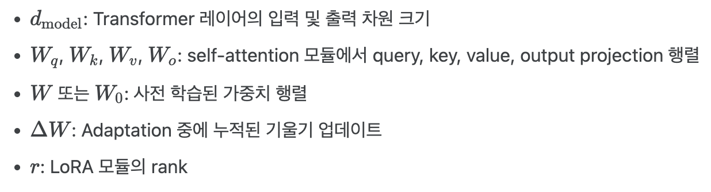

Terminologies and Conventions

#### <strong>II. Problem Statement</strong>

Φ로 parameterize된 사전 학습된 autoregressive model P(y&#124;x)가 주어졌다고 가정합니다. autoregressive model은 앞서 생성했던 데이터를 기반으로 순차적으로 데이터를 생성해내는 model을 의미하고 대표적으로 GPT가 대표적인 autoregressive model에 해당합니다. GPT는 multi-task model이기 때문에 다양한 downstream task를 수행하게 되고 각각의 downstream task는 context-target 쌍의 학습 데이터셋으로 표시가 됩니다.

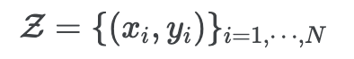

Datasets of context-target pair

x와 y는 모두 token sequence에 해당합니다. Natural Language to SQL (NL2SQL)의 경우는 x가 자연어 query이고 y는 SQL 명령어일 것입니다. 만약 기사 요약 task라면 x가 기사의 내용이고 y가 기사의 요약이 될 것입니다.

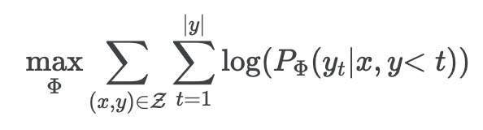

전체 fine-tuning 과정

기본적으로 Φ&#95;0라는 사전학습된 가중치는 fine-tuning 과정에서 Φ&#95;0 &#43;  ΔΦ 형태로 가중치가 변화하게 됩니다. 이 상황에서 파라미터의 차원이 높고 기본적으로 갱신하는 파라미터의 차원 수가 많을 뿐더러 각각의 downstream task마다 복사하고 있어야 하는 인스턴스의 수에 따라서 저장하고 있어야 하는 가중치의 정보가 너무나도 많아지게 됩니다.

여기서

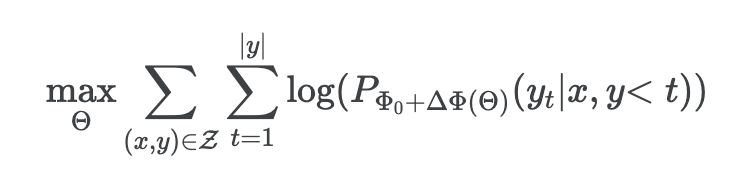

low-rank representation

따라서 해당 논문에서는 low-rank 표현을 사용하여 계산 및 메모리 효율적인 ΔΦ를 인코딩할 것을 제안합니다. 사전 학습된 모델이 GPT-3 175B인 경우 학습 가능한 파라미터의 수 &#124;Θ&#124;는 &#124;Φ&#95;0&#124;의 0.01% 정도로 작을 수 있게 됩니다.

기존 사전학습된 가중치에 BA를 더하는 형태가 기본적인 아이디어인데, B는 기본적으로 0으로 초기화된 가중치이고 A는 랜덤 가우시안을 기준으로 가중치를 초기화 합니다. 왜 새로 학습하는 가중치 ΔΦ를 B랑 A로 나눠서 학습을 하는 것일까요?

B랑 A로 나눴을 경우 얻는 이점은 총 세 가지가 있습니다. <strong>1&#46; 파라미터 수 감소</strong>: d &#42; k의 행렬인 Φ에 대해 B는 d &#42; r, A는 r &#42; k로 연산하게 됩니다. 이 때 d와 k보다 작은 값으로 일반적으로 4&#126;64 정도의 값으로 설정하게 되는데, d&#42;k보다 더 적은 값이 됩니다. 따라서 파라미터 수가 감소하여 연산량이 줄어든다는 이점이 있습니다. <strong>2&#46; Low-Rank 제약</strong>: rank(ΔΦ)는 반드시 r보다 작거나 같을 수 밖에 없습니다. 그래서 언어 모델 파인튜닝 시 업데이트가 본질적으로 저랭크일 것이라는 가설을 구현할 수 있게 됩니다. <strong>3&#46; 효율성 측면</strong>: Φ &#43; ΔΦ 형태의 가중치 업데이트를 하는 상황에서 학습 시에는 ΔΦ인 B와 A의 값만 업데이트를 하고, 추론 할 때에는 Φ &#43; ΔΦ 형태로 더하는 과정만 해서 추가적인 inference latency가 발생하지 않게 됩니다.

B에 있는 가중치 정보는 시작은 zero로 시작하게 되고 A는 평균이 0인 가우시안 분포를 기반으로 한 값으로 random initialization 하게 됩니다. 일단 초반에는 B와 A의 내적 값이 0이게 되기 때문에 기존에 pre-trained 모델과 동일한 함수를 구현하게 됩니다. 즉 첫 번째 Feed Forward에서는 기존 pre-trained 모델과 동일하게 구현이 되고 첫 번째 back propogation부터 가중치가 업데이트 되게 됩니다. 이를 통해서 점진적인 가중치 학습이 가능해지고 따라서 안정적인 fine-tuning이 가능해지는 구조가 됩니다.

#### III. Aren't Existing Solutions Good Enough?

기존의 Transfer Learning, Adaption 방법으로 충분할 거 같은데 왜 LoRA라는 개념이 필요한가에 대한 이야기입니다.

기존 Adaptation 방법에서는 두 가지 주요 전략이 있었습니다. <strong>1&#46; Adapter layer 추가</strong>: 기존 신경망 모델의 중간에 Adapter라는 작은 layer를 삽입하는 방식입니다. Transformer의 각 layer마다의 Residual connection 전에 adapter 모듈을 삽입합니다. 기존 입력 차원이 d차원일 때, down-projection으로 r차원으로 차원을 줄이고 그 값들을 ReLU에 집어넣은 뒤 그 결과 값을 다시 up-projection해서 원래 차원으로 돌려놓게 됩니다.

그래서 output &#61; LayerNorm(x &#43; Adapter(x)) 꼴로 나타나게 됩니다. 즉, 원래 모델은 그대로 두고 필요한 task에 맞게 적은 수의 파라미터만 조정하는 방식입니다.

<strong>2&#46; 입력 레이어 activation의 일부 형식 최적화</strong>: activation function을 거쳐 나온 값들 중 일부만 특별히 학습하거나 최적화하는 것을 의미합니다. prefix tuning이라고 불리는 것이 이에 해당합니다. prefix embedding tuning은 입력의 앞이나 중간 부분에 붙는 특수 토큰들의 임베딩 벡터만 학습을 하는 방식으로, 파라미터의 개수가 d&#95;model &#42; (L&#95;p &#43; L&#95;i)가 됩니다. prefix layer tuning의 경우는 transformer layer 이후에 hidden activation에 학습 가능한 파라미터를 두는 방식이 됩니다. 이렇게 되면 파라미터의 개수는 transformer layer의 개수인 L과 d&#95;model &#42; (L&#95;p &#43; L&#95;i)의 곱으로 구성이 됩니다.

하지만 기본적으로 adaptation을 도입하는 순간, adapter layer를 추가함으로 인한 연산량 증가는 피해갈 수 없고 이로 인한 latency가 발생하게 됩니다.

그래서 기본적으로 대규모 신경망은 latency를 늦추기 위해서 병렬 연산에 초점을 둡니다. 하지만 adapter layer는 layer들의 사이에 위치해 있어서 순차적으로 계산해야하는 상황이 생깁니다. 토큰/배치 차원에서는 병렬로 처리가 가능하지만 adapter layer는 병렬로 처리하는 것이 불가능하다는 것입니다.

이 순차적으로 처리해야하는 layer가 여러 개 생기다보면 online-service에 있어서는 문제점이 생깁니다. 일반적으로 online-service의 경우 batch size가 1로 처리 되는 경우가 많은데 한 번에 병렬로 처리할 수 있는 상황이 발생하지 않기 때문에 순차적으로 처리해야 하는 ㅣayer가 발생함으로 인해서 latency가 체감이 된다는 것이 주요한 아이디어입니다.

Adapter가 파라미터 수와 bottleneck(파라미터 차원을 줄이는 중간 차원을 bottleneck dimension이라고 함)으로 인해 FLOPs(FLoating OPerations, 입력을 한 번 처리할 때 필요한 부동소수점 연산의 개수)가 줄어드는 것은 사실이지만 Autoregressive model이 token을 한 개씩 순차적으로 생성해야하는 상황에서의 latency는 adapter layer가 늘어나게 될수록 체감이 됩니다.

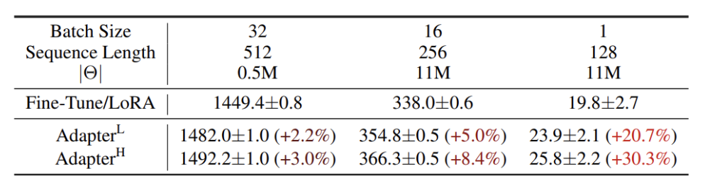

batch 수가 작아서 절대적인 inference time은 줄어들지만 결국 전반적으로 다 생산해야한다는 관점에서 절대 적은 수가 아니게 되고, adaptation layer로 인한 inference latency 증가 비율이 LoRA를 사용한 fine-tuning model에 비해 20&#126;30%가 된다는 점은 절대로 기존의 adapter 방식이 좋은 방식이 아님을 의미합니다.

#### <strong>IV. Method</strong>

<strong>Low-Rank Parametrized Update Matrices  </strong>기존 연구에 밝혀진 바에 의하면, 신경망은 기본적으로 행렬 곱셈을 수행하는 많은 레이어가 포함이 되어있는데 그 레이어들의 가중치 행렬은 일반적으로 full-rank입니다. 이를 특정 task에 adapt할 때 사전 학습된 언어모델의 경우 더 작은 subspace로의 random projection이 가능함에도 불구하고 여전히 효율적으로 학습을 할 수 있고 이를 낮은 instrisic dimension을 갖는다고 표현합니다.

LoRA에서는 이에 영감을 받아서 가중치에 대한 업데이트도 adaptation 중에 낮은 intrinsic dimension을 갖는다고 가정하는 것입니다.

여기서 말하는 instrinsic dimension 가정은, 기존 가중치 차원은 d &#42; k인 것에 비해서 행렬 B와 A의 내적 관계로 나타냈을 때 rank r을 통해서 더 낮은 차원으로 가중치 행렬을 표현할 수 있게 되고 그 r이 곧 필요한 rank r이라는 가정입니다. 결국 내적했을 때  d&#42;k가 되기는 하지만 r(d &#43; k) 수준의 자유도를 가지게 돼서 full fine-tuning이 수정해야하는 파라미터의 차원보다 훨씬 차원이 줄어들어서 훨씬 비용이 줄어든다는 것입니다.

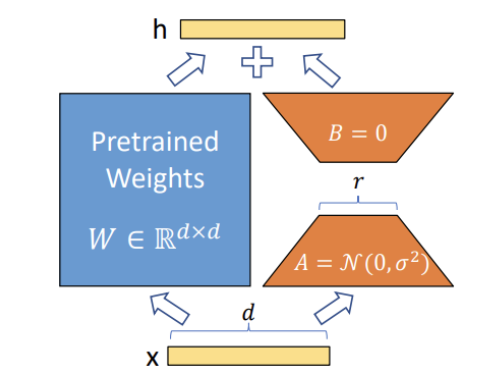

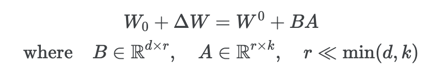

여기서 행렬 A, B는 어떤 분해를 통해 미리 계산해 두는 것이 아니라 학습 과정에서 새로 초기화해서 직접 학습하는 파라미터입니다.

이렇게 되면 BA는 ΔW와 같게 되는데, 실질적으로 B와 A의 low rank인 점을 이용할 수 있게 됩니다. A와 B는 기본적으로 학습 가능한 파라미터 개념이고, A는 랜덤 가우시안 초기화를 하고 B는 0으로 초기화하게 됩니다. 따라서 학습 시작 시에는 BA &#61; 0입니다.

이 아이디어를 전체 fine-tuning의 관점에서 어떻게 일반화할 수 있을까요? 기존의 파라미터 차원보다 낮은 rank r을 hyperparameter로 값을 미리 정해두고 이 r을 사전 학습된 가중치 행렬의 rank로 설정하여 학습 과정에서 전체 fine-tuning의 표현력을 대략적으로 복구하게 됩니다. 즉, 학습 가능한 파라미터의 수가 증가함에 따라 LoRA 학습은 대략적으로 원래 모델 학습으로 수렴하게 됩니다.

핵심은 이로 인해 '추가적인 inference latency'가 존재하지 않는다는 것입니다. adaptation layer를 추가하는 방법이 아니고, 단순히 parameter를 줄임과 동시에 전체 fine-tuning에 맞출 수 있도록 하는 것이며, 기존 모델의 downstream task를 수행하는 모델일 경우 새로운 BA를 통해 새로운 가중치 행렬을 복구하게 되고 이는 memory overhead가 거의 없는 빠른 연산으로 수행할 수 있게 됩니다. 결정적으로 이것은 fine-tuning된 모델과 비교하여 추가 inference latency를 도입하지 않도록 보장합니다.

<strong>Practical Benefits and Limitations</strong>

가장 중요한 이점은 memory와 storage 사용량이 감소한다는 점입니다.

여러 downstream task에 대하여 full fine-tuning을 하게 되면 기존의 가중치 파일과 task 별 새로운 가중치 파일의 full weight 정보를 모두 담아가야 하지만, LoRA를 쓰게 되면 기존의 가중치 파일과 task별 작은 가중치 파일만 가져가면 됩니다.

하지만 LoRA에도 분명한 한계점은 존재합니다. A와 B가 기존 W를 흡수하기로 선택한 경우, 단일 forward pass에서 A와 B가 다른 여러 task에 대한 입력을 일괄 처리하는 것은 간단하지 않습니다. 서로 다른 task에 대해 서로 다른 BA에 따른 서로 다른 W가 생길 수 밖에 없게 됩니다. 그래서 forwad pass 과정에서 같은 layer 내 서로 다른 W를 써야 하는 입력들을 일괄처리하는 게 쉽지 않다는 것입니다.  가중치를 병합하지 않고 latency가 중요하지 않은 시나리오의 경우 배치에서 샘플에 사용할 LoRA 모듈을 동적으로 선택하는 것이 바람직합니다.

#### <strong>V. Empirical Experiments</strong>

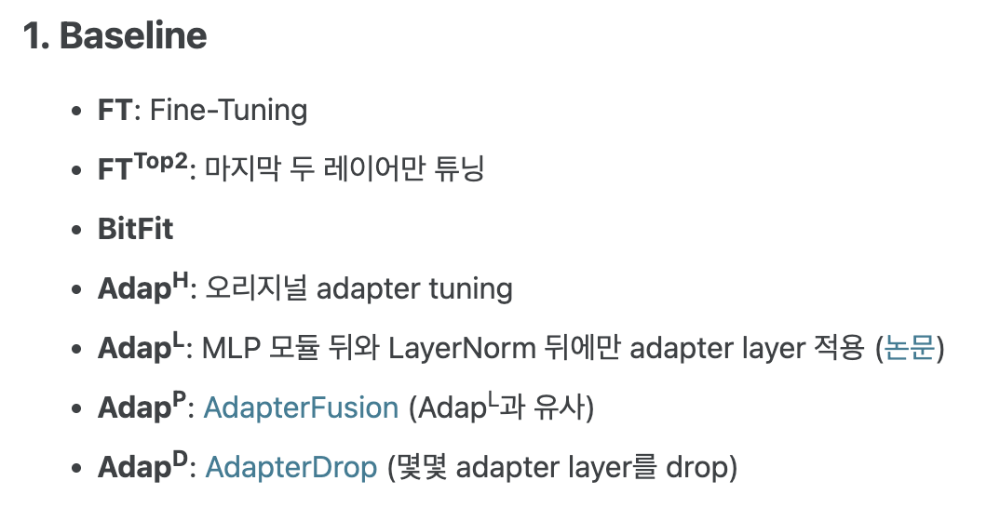

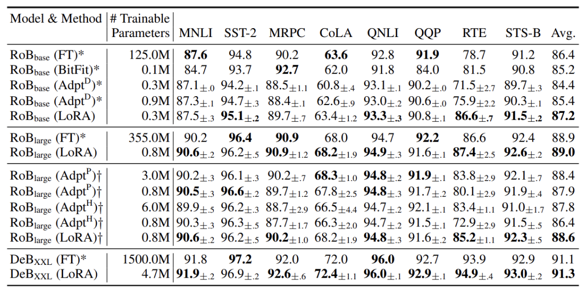

다양한 adaptation 방법을 적용했을 때 모델별 GLUE benchmark 점수

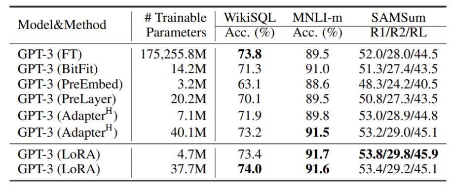

다양한 adaptation 방법을 적용한 GPT-3 175B의 성능 비교 결과

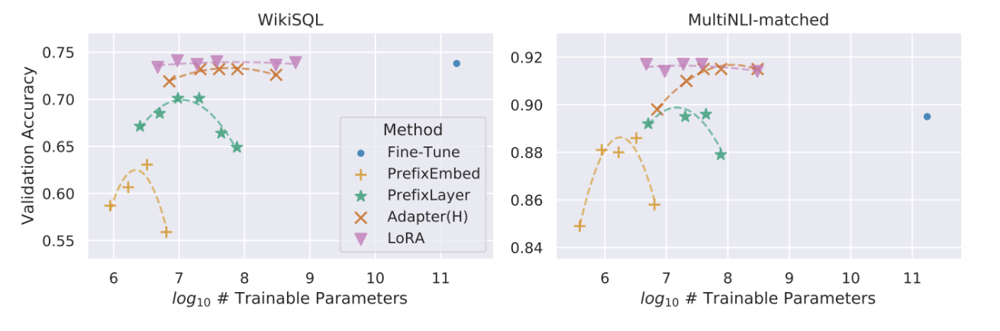

다양한 Adaptation 방법에 대한 GPT-3 175B의 정확도와 파라미터 개수에 대한 그래프

최종적으로 LoRA를 통해서 얻을 수 있는 결론은 다음과 같습니다.

LoRA를 통해서 기존 가중치 W 안에 이미 존재하던 유용한 방향들을 선택적으로 키워서 증폭해 준다는 의미를 갖습니다. LoRA가 찾아낸 BA는 원래 W가 표현하고 있던 feature들과 밀접히 관련된 방향으로 형성된다는 뜻입니다. 즉, 완전 생소한 방향을 새로 만드는 게 아니라 W 안에 이미 있던 표현들을 기반으로 강조할 것을 조절해서 정보를 받아들이고 있다는 것입니다.

W를 Singular Vector Decomposition으로 보면 sigma에는 eigen value에 대한 정보가 들어가있고 큰 value일수록 중요도가 높은 single value를 의미합니다. 기존에 중요하다고 여겨졌던 행렬들은 이미 잘 학습이 되어있다는 뜻으로 볼 수 있기 때문에 LoRA는 상대적으로 덜 강조된 방향을 증폭하여 downstream task에서도 유연하게 작동할 수 있는 역할을 할 수 있게 됩니다.