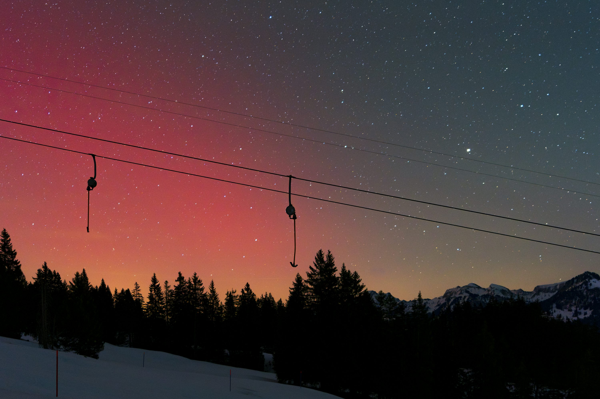

Photo by Philipp Düsel / Unsplash

[GraLoRA: Granular Low-Rank Adaptation for Parameter-Efficient Fine-Tuning](https://arxiv.org/abs/2505.20355)에 대해 리뷰합니다.

LoRA가 단순하고 효율적이라는 거에 대해 PEFT 측면에서 기여도가 높지만 근본적인 한계가 있습니다.

bottleneck 구조에서 overfitting 문제가 있고 실험적으로 32\~64 rank 정도에서만 좋은 성능을 보이지 그 이상으로 rank를 키우면 정확도가 정체되거나 오히려 감소하는 추세를 보이고 여전히 FFT의 성능에는 미치지 못한다는 문제가 있습니다.

해당 논문에서는 이런 구조적인 문제가 LoRA의 bottleneck 구조에 있으며 서로 관련 없는 입력 채널 간의 gradient entanglement를 유발하고 gradient propogation 전파를 왜곡시킨다는 점을 밝히고 있습니다. 즉 특정 채널의 영향이 전체 adpater에 과도하게 학습되면서 학습이 비효율적으로 이루어지게 됩니다.

이 문제를 해결하기 위해 GraLoRA(Granular-LoRA)는 weight matrix를 여러 sub block으로 분할하고 각 block마다 low-rank adapter를 적용합니다.

GraLoRA는 추가적인 계산 비용이나 저장 비용을 거의 증가시키지 않으면서도, LoRA의 한계를 극복해 효과적으로 표현력을 확장하며 FFT의 동작을 더 잘 근사합니다.

다양한 benchmark 실험에서 다른 PEFT 방법들을 일관되게 상회하는 성능(consistently outperforms)을 보였습니다.

## <strong>I. Introduction</strong>

LoRA를 사용해서 적은 parameter 수로도 좋은 성능을 보였고, LoRA의 효과를 극대화하기 위해 다양한 연구들이 초기화 개선 및 구조적인 개선을 제안해왔습니다. (Imporved Initialization \& Structural refinements)

이런 노력들로 성능은 향상되어왔는데 Full Fine Tuning(FFT)과의 격차는 여전히 크고(substantial quality gap) 이런 영향을 끼치는 주된 이유는 rank에 존재하는 구조적인 상한 때문입니다. (inherent upper bound)

그렇다면 구조적으로 하드웨어가 허용하는 범위 내에서 rank를 키우게 되면 FFT에 가까워질 것이라는 느낌이지만 현실적으로 LoRA 구조에서는 그런 유연한 확장이 안정적으로 동작하지 않습니다. 실제로 rank를 단순하게 키우면 대부분의 경우 정확도가 좋아지는 것이 아니라 오히려 떨어지는 케이스가 많습니다.

<strong>바로 서로 관련 없는 feature/channel이 같은 adapter 공간에서 섞여서 ‘gradient entanglement’, 즉 서로에게 영향을 줘서 특정 outlier가 전체 adapter를 왜곡시킨다는 것입니다.</strong>

실제로 실험을 해보면 GraLoRA가 vanilla LoRA보다 더 좋은 성능을 보입니다.

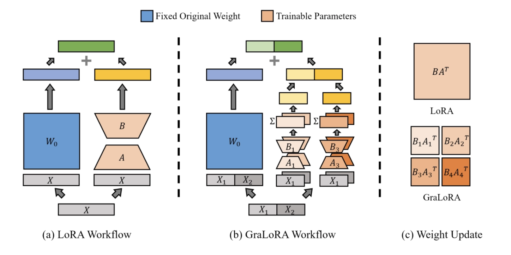

## <strong>II. Details and Limitation of LoRA</strong>

### <strong>2.1 Introduction to LoRA</strong>

LoRA의 adapated layer에 대한 output은 다음과 같이 나타낼 수 있습니다.

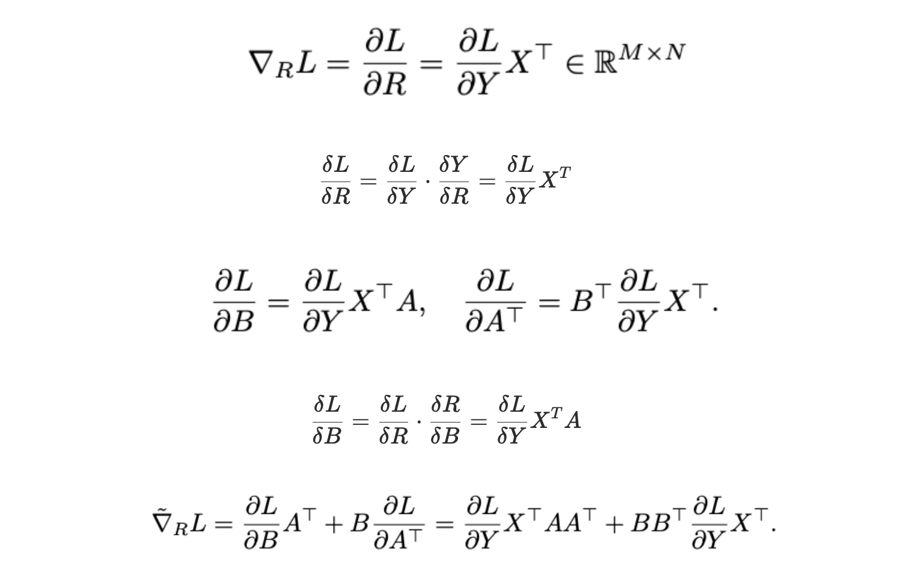

미분했을 때 다음과 같이 나타낼 수 있고, 최종적으로 LoRA의 output 행렬에 대한 gradient에 대한 식을 나타내면 위와 같이 나타낼 수 있습니다.

결국 이 수식들을 통해 알 수 있는 것은 바로 “LoRA의 구조가 gradinet와 input 사이에 단순하지 않은 상호작용(non-trivial interactions)을 유발한다”라는 것을 보여주고 이런 단순하지 않은 상호작용이 rank r 행렬들을 통해서 발생한다는 것을 주장합니다.

### <strong>2.2 Why does LoRA suffer from a Lager Rank?</strong>

LoRA에서는 rank를 64보다 크게 잡아버리면 32\~64 정도의 적당한(moderate) rank를 사용할 때보다 성능이 더 낮아진다는 문제점을 가지고 있습니다. 이런 반직관적인(counterintuitive) 현상이 발생하는 이유가 LoRA의 gradient 누적방식(gradient dynamics)이 FFT와 본질적으로 다르기 때문에 발생합니다. 즉, LoRA의 구조적 설계 때문에 gradient가 특정 입력 차원뿐만 아니라 전체 공간에 본질적으로 민감하게 반응하게 됩니다.

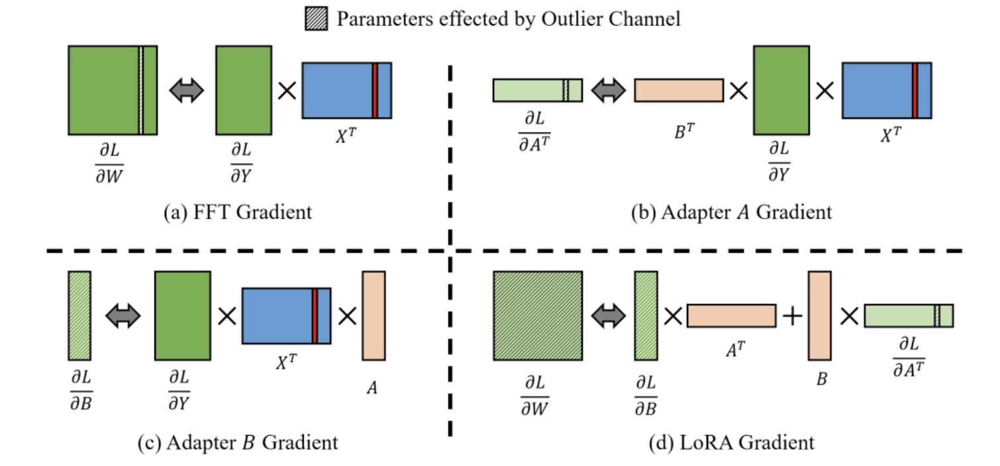

특히 activation이 비정상적으로 큰 값을 가지는 outlier channel이 gradient 신호를 불균형하게(outlier channel들이 가진 정보량에 비해 과도하다는 의미) 지배하는 현상을 관찰했다는 것입니다.

FFT에서는 outlier가 전형적으로는 local에만 영향을 미칩니다. 가중치 행렬의 관점에서 직접으로 상호작용하는 하나의 column weight 값에 대해서만 영향을 주는데, LoRA의 low-rank 구조로 인해 outlier에 대한 영향이 전역적으로 퍼진다는 게 문제입니다. 이런 문제로 인해 outlier input channel에 대한 영향력이 다른 input channel의 영향력을 압도합니다.

결론적으로 LoRA의 gradient dynamics가 FFT와 본질적으로 다르기 때문에 FFT의 성능 수준에 도달하기 어렵습니다.

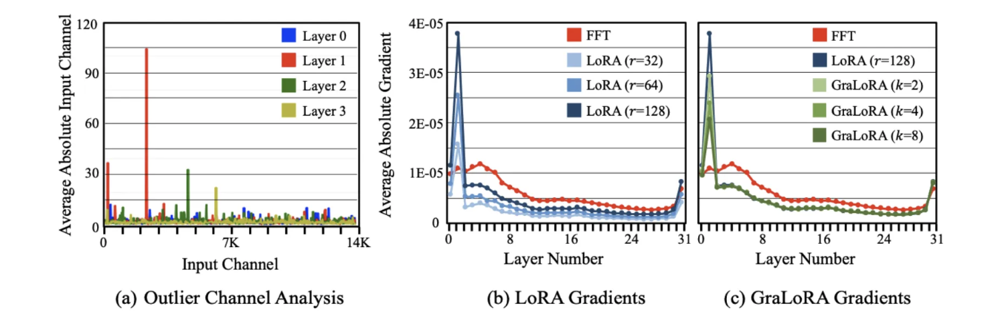

위에 있는 Figure 3을 보면 LLaMA3.1-8B의 1번 layer에 있는 down-projection matrix에 대해서 입력 activation들이 채널별로 심각한 불균형(severe channel-wise imbalance)이 있어 일부 channel의 activation만 유난히 크다라는 문제가 있습니다.

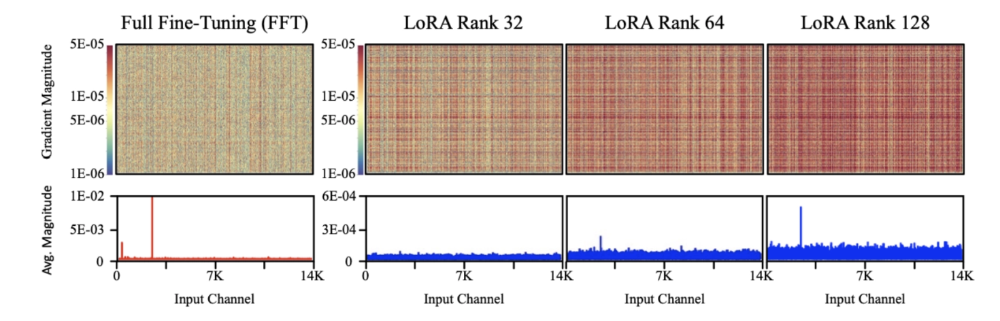

Figure 4\_Gradient distribution in Layer 1 down-projection matrix를 보면 조금 더 명확해지는데, FFT는 비교적 Gradient Magnitude가 균질하게 퍼져있고, 특정 outlier channel의 activation값이 튀어있는 것이 잘 보입니다. 다만 LoRA에서 rank가 커질수록 Gradient Magnitude의 평균값이 전반적으로 커지고, 즉 baseline이 커지다보니까 outlier에 대한 spike가 상대적으로 덜 튀어보인다는 문제가 있습니다. 이를 통해서 LoRA에서 고랭크로 가면 gradient가 특정 channel에 집중되지 않고 고루 퍼지게 된다는 것을 알 수 있고 이로 인한 원인이 앞서 언급한 LoRA의 구조적인 linear adaptation 때문이라고 주장하고 있습니다.

논문에서는 rank가 높아질수록 outlier에 대한 영향이 channel 전반적으로 영향력이 높아진다라는 것을 실험적으로 주장하면서 LoRA의 구조에 대한 빈약함을 언급합니다.

## <strong>III.Method</strong>

### <strong>3.1 GraLoRA: Granular Low-Rank Adaptation</strong>

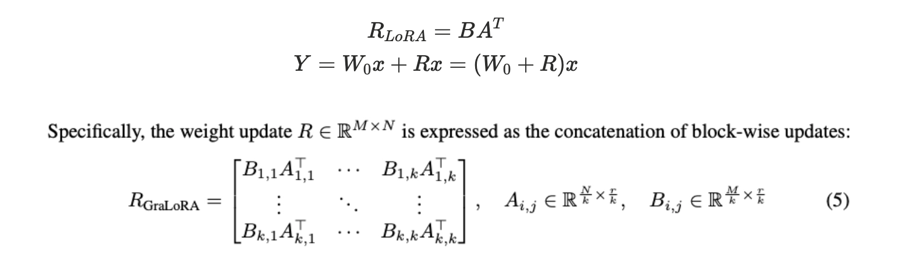

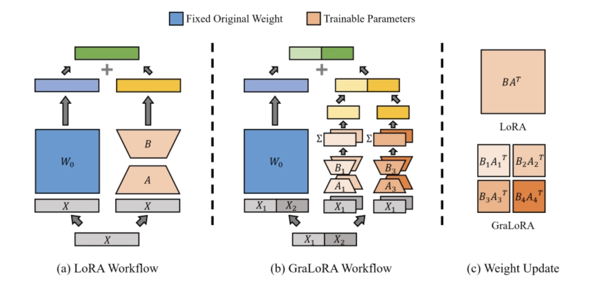

기본적으로 하이퍼파라미터 k에 따라서 k \* k 형태의 independent block으로 구성이 되어있습니다.

바로 이 k가 입력 차원과 출력 차원에 따라 얼마나 분할할지를 결정하는 하이퍼파라미터이며

k \= 1일 때, GraLoRA는 vanilla LoRA와 동일한 형태를 보입니다. (A reduce to B when \~ , A가 B를 포함하는 관계인 경우 이런 표현을 사용)

즉, 가중치 공간을 k의 제곱 개의 하위 subspace로 나누고, 각 subspace가 서로 독립적으로 adaptation 할 수 있도록 설계되어있습니다. 이 덕분에 모델 전체를 한 번에 업데이트 하는 대신에 더 세밀하고 역할이 분화된(feature-wise) 학습을 할 수 있습니다.

GraLoRA를 사용했을 때 얻을 수 있는 이점은 크게 두 가지 입니다.

- enhanced expressivity
- robustness to input outliers

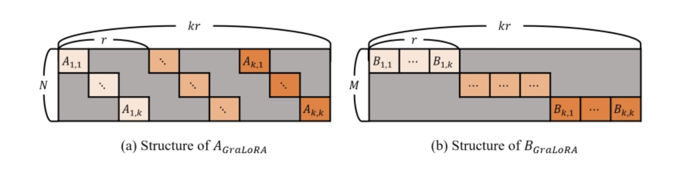

표현력이 증가한다는 것과 input outlier에 대한 robustness가 장점이라고 언급하는데, 왜 그럴까요?

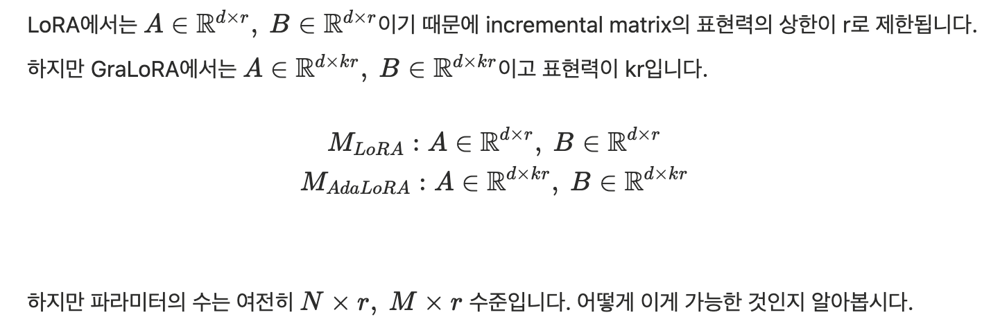

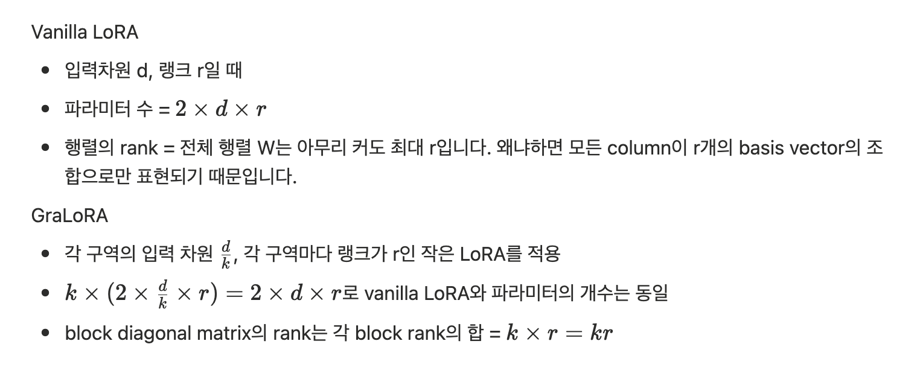

### <strong>3.3 Gradient Dynamics Under Outlier Activation</strong>

GraLoRA는 outlier channel의 영향을 전체 adapter가 아니라 일부 adapter block에만 국소적으로 제한합니다. 각 adapter block은 입력의 특정 부분만 처리하기 때문에 outlier channel과 겹치는 k개의 adapter 쌍만 증폭된 gradient를 직접적으로 받게 됩니다. 즉, outlier와 무관한 block은 거의 영향을 받지 않습니다.

반대로 k^2 \- k개의 adapter들은 일반적인 baseline gradient 크기 수준을 그대로 유지하게 됩니다. 따라서 outlier가 k개 block만 영향을 받기 때문에 나머지 k^2-k개의 block은 안정적일 수 있습니다.

이런 방식의 선택적인 gradient propogation은 FFT에서 실제로 활성화된 성분과 연결된 가중치만 크게 업데이트 되는 동작과 유사합니다.

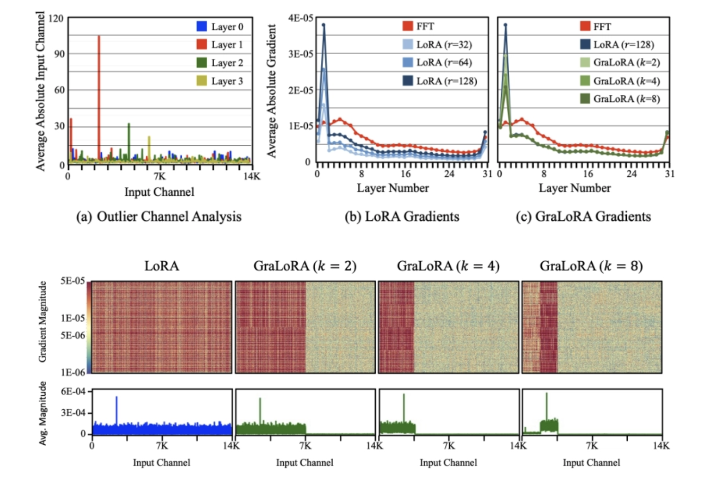

Figure 3 (c)과 Figure 6에서 보면 알 수 있듯이 gradient의 분산(deviation)을 줄이고 outlier channel의 영향력을 제한함으로써 rank를 크게 키운 vanilla LoRA가 겪는 한계를 극복합니다.

### <strong>3.4 Tradeoff Analysis</strong>

GraLoRA가 제공하는 이점들이 아무런 대가 없이 얻을 수 있는 건 아닙니다. computational overhead와 memory overhead가 있습니다.

---

<u>1\. Computational Overhead</u>

LoRA부터 먼저 살펴보겠습니다. LoRA는 down-projection과 up-projection(Reconstruction) 구간이 있습니다. 이 때 FLOPs(초당 부당소수점 연산 횟수, 소수점을 포함하는 실수 계산을 1초에 몇 번하는가?)를 봐야합니다.

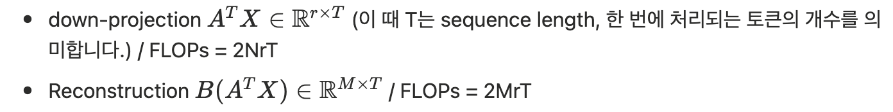

원래 LoRA는 두 단계로 연산합니다.

1단계: 입력 X(N차원)를 r차원으로 줄임 (2N-1)rT ⇒ N번 곱하는 연산이랑 N-1번 더하는 연산 ⇒ r차원으로 줄이기 위해서 r번 반복 ⇒ 입력 문장의 길이(토큰 개수)인 T번 만큼 수행

2단계: latent space r차원을 출력 M차원으로 늘림 ⇒ r번 곱하는 연산과 r-1번 더하는 연산 ⇒ M차원으로 늘리기 위해 M번 연산 ⇒ 입력 문장의 길이(토큰 개수)인 T번 만큼 수행

그런데 GraLoRA는 전체 n개를 k개로 나누기 때문에 한 그룹 당 n/k 개가 들어가게 되고 한 그룹 안에서 더하는 횟수는 n/k \- 1이 됩니다. 이게 총 k개가 있기 때문에 n-k번 더하게 됩니다.

다음은 GraLoRA입니다.

block마다 다음과 같이 되어있습니다. input: N/k, output: M/k, rank: r/k

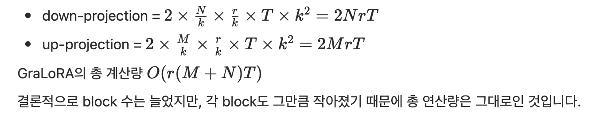

---

<u>2\. Memory Overhead</u>

Inference 할 때에는 GraLoRA도 LoRA처럼 weight에 merge가 가능합니다. 따라서 inference memory overhead는 LoRA와 차이가 없다고 보고 inference에 대한 overhead에는 주목하지 않습니다.

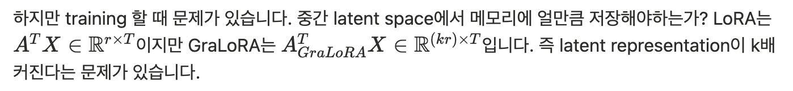

이 문제가 메모리 폭발로 이어지는지에 대한 부분을 살펴봐야 하는데, rank r 자체가 input과 output dimension인 N과 M에 비해서는 매우 작은 수이기 때문에 k를 곱한다고 하더라도 latent의 증가량은 전체 모델의 메모리에 비해 매우 작다는 것입니다. k를 2, 4, 8로 증가시킨 구간까지만 봐도 GPU의 메모리 증가가 10GB에서 10.4GB 수준으로 고려하지 않아도 되는 수치입니다. 또한 gradient checkingpointing을 사용할 때에는 사실 상 메모리 증가가 가려지는(effectively hidden) 문제로 바라보고 있습니다.

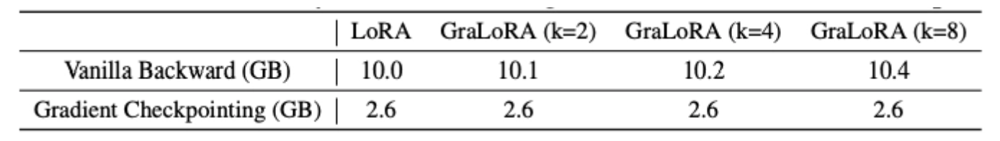

---

<u>3\. Selection of K</u>

이 때 k를 너무 키우게 되면 block 하나 당 표현력이 너무 감소하게 되고, 결국 LoRA의 핵심은 rank를 줄여서 어느정도의 성능이 나오느냐가 핵심이었는데 특히 r이 작을 때 매우 치명적이게 됩니다. 그래서 논문이 실험을 통해 제시한 안정적인 조건은 rank가 k의 제곱의 8배 정도는 유지해줘야 안정적으로 학습이 가능하다고 밝힙니다. 실험 설정에서도 k \= 2이면 rank는 16이나 32, k \= 4면 rank는 64에서 128를 유지하고 진행했습니다. (Ablation stduy에서 보면 rank \= 32일 때 k \= 2에서 최고 성능, rank \= 128일 때 k \= 4에서 최고 성능)

### <strong>3.5 Hybrid GraLoRA</strong>

작은 rank에서는 block당 표현력이 너무 제한이 돼서 오히려 불리할 수 있다고 다뤘습니다. 대략 rank가 16보다 작거나, k가 2인 상황에서는 성능 저하(performance degradation)를 초래하거나 통계적으로 큰 의미가 없는 성능 향상 수준에서 그칠 수 있다는 것입니다.

그래서 LoRA와 GraLoRA를 동시에 사용하자는 아이디어를 제시합니다.

GraLoRA는 feature-local adaptation이라는 특성을 통해서 outlier channel에 대한 gradient 간섭이 감소하고 총 rank는 유지하면서 더 세밀한 방향으로 분해가 가능합니다. 다만 rank를 너무 작게 적용하면 표현력이 감소한다는 단점을 가지고 있습니다.

반면에 LoRA는 rank를 적게 적용해도 전체 weight에 대해 공유된 low rank update가 적용되어 여러 block으로 쪼개진 GraLoRA가 놓칠 수 있는 global 패턴을 파악할 수 있게 됩니다. (그렇다면 outlier channel로 인한 문제점을 제기할 수 있는데, 어차피 outlier channel에 의한 영향을 rank가 커질수록 심화된다고 했기 때문에 해당 부분에서는 여기서는 큰 문제로 바라보지 않는 것 같습니다.)

그래서 서로 concatenate해서 합칠 수 있게, 차원을 맞추는 선에서 학습은 따로 진행하되 출력에 단순히 더해지는 구조로 사용합니다.

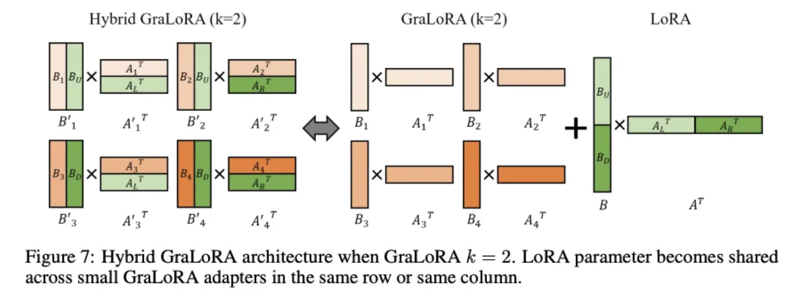

rank가 16이하인 경우에는 hybrid GraLoRA를 사용해서 성능 저하 문제를 완화하고 안정성을 증가시키고 rank가 큰 경우에는 GraLoRA만 사용하는 것이 성능이 더 좋습니다.

## <strong>IV. Experiments</strong>

### <strong>4.1 Experimental Setup</strong>

다섯 개 domain에 대한 실험입니다.

---

<strong>Code Generation</strong>

- 모델: LLaMA3.1-8B
- 하드웨어: A100 80G GPU 8EA
- 데이터셋: Magicoder-Evol-Instruct-110k(WizardCoder에서 선별된 고품질 instruction-response pair)
- 평가: HumanEval\+ 테스트셋 (temperature \= 0.2)
- 지표: Pass@1, Pass@5, Pass@10

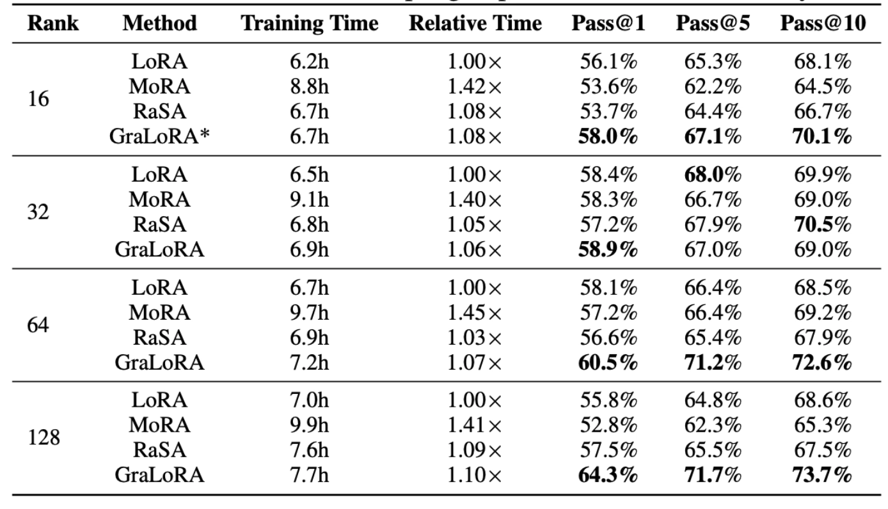

Pass@1은 모델이 딱 1개의 답변만 생성해서 그 답변이 정답이면 성공, 아니면 실패라는 것입니다. 즉, 가장 엄격하고 실사용에 가까운 지표입니다.

그에 반해 pass@10은 10개의 후보를 만들어내고 그 중 하나라도 정답이면 성공입니다. ⇒ 눈여겨봐야할 점은 rank를 늘려도 충분히 활용하지 못하는 다른 모델에 반해서 GraLoRA는 rank를 늘려도 성능이 꾸준히 계속 상승하며 LoRA의 한계를 극복했습니다.

---

<strong>commonsense reasoning</strong>

- 모델: LLaMA3.2-3B, LLaMA3.1-70B, Qwen-2.5-1.5B, Qwen-2.5-7B
- 하드웨어: 1.5B\~8B 모델: H100 80GB GPU 2EA / 70B 모델: A100 80G 8EA
- 평가: commonsense benchmark 8개

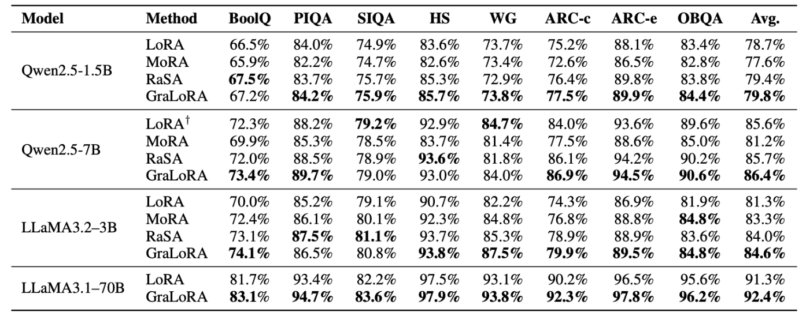

평균적으로 일관된 개선을 보이고 있고, 모델의 크기와도 무관하게 거의 최고 성능을 기록합니다. 이 부분에 대해서 GraLoRA가 강할 수 있는 이유는, commonsense 즉 상식이라는 부분이 단일 feature에 대한 게 아니라 여러 개의 weak signal을 조합해야되는 문제입니다. LoRA가 gradient가 전역적으로 얽혀있고, GraLoRA는 gradient가 local적으로만 전파돼서 간섭 없이 학습이 가능하다고 보는 것입니다.

---

<strong>Mathematical Reasoning</strong>

- 모델: LLaMA3.2-3B
- 데이터: MetaMathQA train set
- 하드웨어: H100 80G GPU 4EA
- 평가: MATH dataset

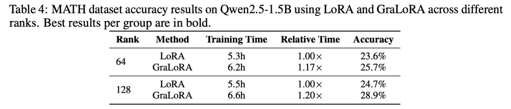

training time 자체는 1.1배에서 1.2배 정도 더 소요되었지만 정확도는 확실하게 향상되는 모습입니다. 최종 출력값이 맞으면 1, 틀리면 0 이런 식으로 계산이 됩니다.

---

<strong>General Language Understanding</strong>

- 모델: RoBERTa-base (encoder-only)
- 태스크: GLUE Benchmark
- 하드웨어:H100 80G GPU 1EA

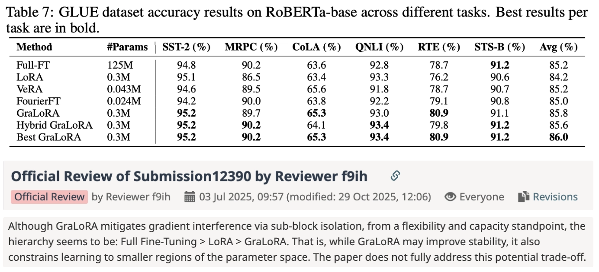

Full-Fine Tuning을 비롯한 다른 LoRA 변형 계열들과 비교해봐도 좋은 성능을 보이고 Hybrid GraLoRA 측면에서도 좋은 성능을 보이는 것을 확인할 수 있습니다.

⇒ rebuttal 기간 해당 리뷰를 보면 GraLoRA가 rank가 낮을 때 성능이 낮은 거 아닌가?라는 의문을 제기했고 이 리뷰를 통해서 Hybrid GraLoRA에 대한 아이디어를 추가로 담은 것으로 보입니다.Understanding task에 대해서도 적은 파라미터를 활용한 Fine-tuning으로도 일관되게 좋은 성능을 보입니다. 해당 task에 대해서 Hybrid GraLoRA도 좋은 성능을 보이는 것을 알 수 있습니다.

---

<strong>Personalized Image Generation</strong>

- 모델: SDXL
- 데이터: Naruto-Blip-Captions / train 90%, eval 10%
- 하드웨어: H100 80G GPU 1EA
- 평가지표: CLIP similarity, DINOv2 similarity

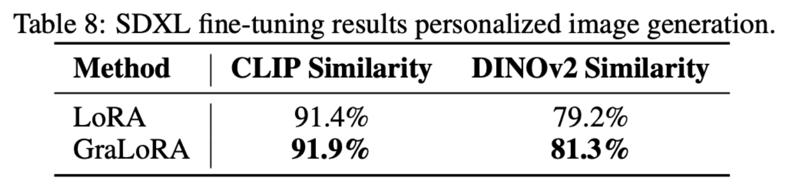

LoRA 대비 일관된 성능이 개선되었다는 것을 보여줍니다. CLIP similarity: 이미지-텍스트 간 alignment DINOv2 similarity: 이미지 내부 표현에 대한 유사도 → 입력 이미지를 pretrained된 DINOv2 모델에 집어넣고 벡터를 얻은 다음에 L2 정규화로 벡터 크기 정규화시키고 벡터 간 내적을 통한 코사인 유사도 계산

---

## <strong>V. Conclusion</strong>

GraLoRA는 LoRA의 전역적 low-rank 업데이트가 outlier에 의해 왜곡되는 문제를 gradient 분석으로 규명하고, block-wise로 독립적인 low-rank 적응을 도입해 추가 비용 없이 표현력과 안정성을 높여 다양한 태스크와 모델 규모에서 일관된 성능 향상을 달성한 PEFT 방법입니다.