Photo by Mark Harpur / Unsplash

Stanford-cs336 Lecture의 Modern Transformer에 대한 내용입니다. [Modern Transformer\_ (1) Architecture](/posts/modern-transformer-1-architecture-variations/), [Modern Transformer \_ (2) Hyperparameter](/posts/modern-transformer-2-hyperparameter/)에서 이어집니다.

---

#### III. Stability Tricks

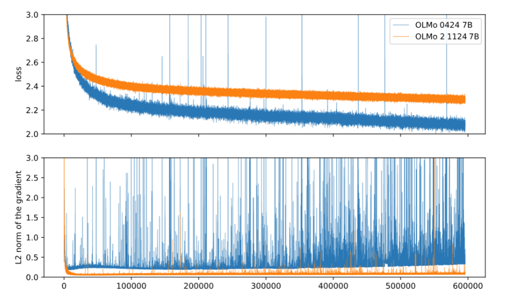

Don't train models that look like the blue curve!

2024년에 HuggingFace에 오픈소스로 올라온 OLMo 0424 7B 모델은 blue curve처럼 loss와 gradient, L2 norm이 굉장히 튀는 모습을 보입니다. 그리고 blue curve처럼 모델은 학습되어서는 안 됩니다.

loss는 손실함수의 값, gradint의 L2 norm 값을 지표로 쓰는 이유는 단순합니다. 우선 단순 gradient가 아니라 gradient의 L2 norm을 쓰는 이유는 'gradient는 벡터라서 크기와 동시에 방향을 나타내지만 L2 norm을 적용함으로 인해 단순 스칼라 값으로 기울기 '값' 자체만 비교할 수 있습니다. gradient가 안정적으로 0에 수렴하면 minimum에 수렴할 수 있기 때문에 두 지표는 깊은 연관이 있습니다.

그렇다면 왜 안정적으로 수렴하는 것이 아니라 손실이나 기울기가 튀어오르게 학습되면 안 되는 것일까요? (Exploding Gradient)

손실이 크게 진동한다는 것은 일단 학습 자체가 안정적으로 이루어지지 않아 수렴하지 않는다는 상황입니다. 이렇게 값이 크게 튀는 상황에는 매 step마다 파라미터 업데이트가 되더라도 서로 상쇄되는 방향으로 학습이 이뤄지기 때문에 학습에 진전이 없으나 학습 자체는 진행이 되고 있기 때문에 overfitting, underfitting의 문제를 동시에 안고 갈 수 있습니다. 이게 만약 gradient exploding으로 이어진다면 학습이 중단될 수도 있는 중요한 문제인 것입니다.

이 문제가 발생하는 이유는 바로 <strong>softmax</strong> 때문입니다.

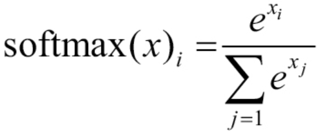

softmax expression

자연상수의 지수함수에 대한 식으로 나타나는데, 지수에 들어가는 x값이 만약에 너무 큰 값을 갖게 되면 중간에 값이 폭발적으로 증가하는 구간이 생기게 되는 것입니다. 적당히 큰 값이면 가능하겠지만 표현할 수 있는 부동소수점의 바이트 수를 넘어가면 overflow나 underflow가 발생할 수 있기 떄문입니다. 크게 세 가지의 경우를 고려할 수 있습니다. <strong>FP16</strong>: 부호 1비트, 지수부 5비트, 가수부 10비트 \_ 지수부 5비트로 e의 지수에 약 11보다 큰 값이 들어오면 overflow <strong>bfloat16</strong>: 부호 1비트, 지수부 8비트, 가수부 7비트 \_ 지수부 8비트로 e의 지수에 약 88보다 큰 값이 들어오면 overflow <strong>FP32</strong>: 부호 1비트, 지수부 8비트, 가수부 23비트 \_ 지수부 8비트로 e의 지수에 약 88보다 큰 값이 들어오면 overflow

하드웨어 측면에서 많은 용량을 사용해도 괜찮다면 상관없을 수 있지만, 설계적인 관점에서 봤을 때 e의 지수에 들어갈 입력 x값을 작게 scaling하되 충분히 다양하게 표현할 수 있도록 바꾸는 것이 더 나은 방법일 것입니다.

원래 저 지수의 입력으로 들어가는 x\_j와 x\_i는 scale과 offset이라는 것을 통해 값이 조정된 상태로 들어가게 됩니다. x\_j와 x\_i로 들어가기 전에 적당한 계수를 곱해서 값의 크기를 조정하는 것을 scale, bias처럼 값을 더해 평행이동 시키는 offset이 있습니다. 모두 값이 너무 커지지 않게 도와주는 역할을 하지만, 학습 과정에서 이 값들은 언제든지 튈 수 있는 값들이 되고 따라서 이 값들이 지수부의 수용 가능한 비트 수를 넘어가게 되면 loss가 급격히 커져 안정적인 학습을 방해할 수 있는 것입니다.

---

<strong>해결책 1\) z-loss</strong>

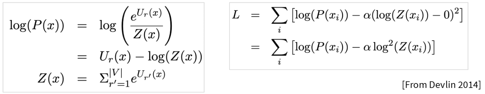

z-loss

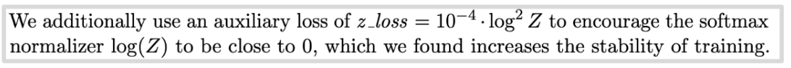

그래서 z-loss라는 것을 사용합니다.  auxiliary는 Loss function에 있는 alpha인데 저 값을 10의 -4제곱 정도의 작은 양수 계수로 만들면 log Z(x) 값을 0에 가깝게 만들기 때문에 Z의 값이 커지는 것과 무관하게끔 값을 0과 1에 맞게 들어가도록 도와줍니다.

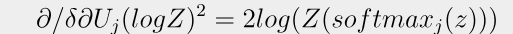

derivative of Loss function

Loss function의 일차 도함수의 경우도 의미를 따지고 보면 결국 log z가 0보다 크면 0으로 당기고, 0보다 작아도 0으로 당겨서 최대한 Z의 영향을 적게 받기 위한 방식을 사용하기도 합니다. 이를 shrink gradient라고 합니다.

결국 z-loss는 지수함수에 입력되는 logit z값의 증가로 인한 overflow/underflow가 문제였기 때문에 그 항의 팽창을 억제하는 방식을 사용한 것입니다.

---

<strong>해결책 2\) QK Norm</strong>

Scaled dot-product Attention의 식을 살펴보면 Q와 K를 내적하는 식이 있는데, 값 자체가 학습 후반부에 layer를 거치면서 값이 커지는 경향이 있습니다. softmax에 집어넣게 되면 0이나 1에 근사값을 갖게 되고 최종적으로 이를 Q와 K에 대한 L2 normalization을 통해서 나누어서 크기를 1로 맞추게 됩니다. 벡터인 값들의 size가 공통적으로 만들어지기 때문에 코사인 유사도를 판단할 때 '각도'만 고려하면 됩니다.

그렇다면 이런 질문을 할 수도 있습니다. '어차피 normalization 하는 거면 나중에 Layer Normalization을 더 적용시키면 되는 것 아닌가?' normalization을 하는 의도는 충분히 동일한 맥락이지만 효과 자체를 볼 필요가 있습니다.

Layer Normalization은 출력의 분산을 줄이는 것에 초점을 맞추기 때문에 근본적으로 입력값의 안정화로 인한 값이 튀는 것은 해결할 수 없습니다. 그럴 때마다 Layer Normalization을 여러번 하면 되는 것 아닌가 싶지만 이 방식은 신호가 약해지고 희석시키는 방식이기 때문에 오히려 학습에 도움이 되지 않습니다. 동시에 연산량이 굉장히 늘어나기 때문에 FLOPs 대비 성능 향상이 굉장히 미미하거나 오히려 하락할 수도 있다는 점이 문제가 됩니다. 따라서 QK Norm을 사용하는 것이 원인을 정확히 파악하여 해결하는 것이 중요합니다.

단순히 임시방편으로 문제를 일단 덮어두는 것이 아니라 정확한 원인을 파악해서 고치는 개념입니다.

---

<strong>해결책 3\) Logit soft-capping</strong>

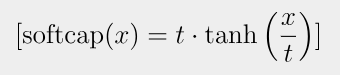

Logit soft-capping

비교 대상으로 clipping이 있습니다. clipping은 값을 잘라내는 개념입니다. 그래서 값이 어색해지고 불연속 지점이 생겨 미분 불가한 지점이 생기게 됩니다. 많이 알려진 사실이지만, 미분 불가한 지점은 불안정한 학습을 유발하게 되는 방법이기도 합니다.

그래서 tanh 함수로 capping 하는 방법을 선택하면 모든 지점에서 미분이 가능함과 동시에 원하는 \+t, -t로 값을 bounding 할 수 있습니다.

---

<strong>해결책 4\) Attention head</strong>

몇몇 예외사항 제외하고는 대부분의 모델은 Attention head를 수정하지는 않습니다. 그렇다면 그 예외사항들은 무엇일까요?

GQA / MQA, Sparse or sliding window attention, Exotic SSM stuff (Jamba, Falcon 3, etc / 강의에서는 Exotic SSM stuff에 대해서 다루지 않음)

---

1\. <strong>GQA</strong>(Grouped Query Attention) / <strong>MQA</strong>(Multi-Query Attention)

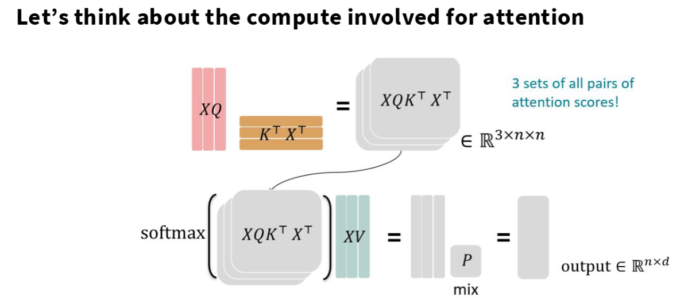

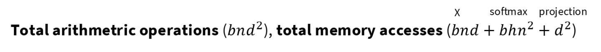

기존 Transformer의 arithmetric operations, memory accesses

기존 Transformer에 대한 정보에 대해 먼저 다루겠습니다. 일단 연산 자체로 보면 토큰에 대한 연산량, 즉 Big-O nation 관점에서 봤을 때 bnd^2만큼 적용이 됩니다. 그리고 memory에 대한 접근에 대한 연산량은 bnd \+ bhn^2 \+ d^2입니다.

---

<strong>1\) Total arithmetric operation은 왜 O(bnd^2)인가?</strong>

우선 arithmetic operation이 무엇을 의미할까요? 단순히 <strong>'얼마나 많은 계산을 하는가'</strong>에 대한 정보를 의미합니다.

b: batch size (한 번 연산할 때 다루는 시퀀스의 개수) n: sequence length (시퀀스의 길이, 한 시퀀스 당 토큰의 개수) d: model dimension (모델의 기본 차원)

기본적으로 batch size와 sequence length를 곱하면 한 번 연산할 때 연산되는 토큰의 개수를 의미합니다. 그리고 입력값은 b\*n\*d의 차원을 갖게 됩니다. bn이 토큰의 개수이기 때문에 d자체는 토큰 한 개당 차원을 의미하기도 합니다. 각 Query, Key, Value를 다룰 때 연산 자체가 Q \= X\*W\_q, K \= X\*W\_k, V \= X\*W\_v, 즉 입력값에 가중치를 곱한 형태를 띠고 있습니다. 이에 대한 학습 가능한 가중치 size는 입력값 상태를 유지함과 동시에 가중치를 곱해 Query, Key, Value를 만들기 위해서는 각 가중치의 차원은 d\*d이어야 합니다.

토큰 한 개 당 적용되는 연산량 자체가 d \* d이고 그 토큰의 개수가 bn이기 때문에 arithmetic operation이 (bnd^2)입니다.

당연히 softmax(bhn^2), LayerNorm(bnd), activation function(bnd)에 적용되는 연산량이 있지만, bnd^2가 지배항이 될만큼 압도적인 연산량을 보유하고 있습니다. (일반적으로 sequence length보다 model dimension이 더 큰 값을 갖습니다.)

---

<strong>2\) Total memory accesses는 왜 (bnd \+ bhn^2 \+ d^2)일까?</strong>

우선 memory accesses는 연산에 필요한 데이터를 '메모리에서 읽고 쓰는 총량'을 의미합니다.

bnd는 Q, K, V의 Tensor를 읽는 것에 사용됩니다. 입력 값 X의 차원이 bnd이고 그와 곱해지는 가중치가 d\*d이기 때문에 각 Query, Key, Value는 X와 가중치의 곱의 차원인 bnd가 됩니다.

bhn^2는 Attention score를 구하기 위해 읽고 쓰는 메모리의 양을 의미합니다. ( h는 head의 개수를 의미합니다.) n^2인 이유는 하나의 sequence에 대해 각 token마다 곱셈을 통해 attention score를 구하게 되고 self attention이기 때문에 자기 자신과 곱해서 점수를 구하므로 n^2꼴로 나타납니다. b는 batch size, 다르게 말하면 배치 한 개 안에 들어있는 시퀀스의 개수이고, h는 head의 개수이기 때문에 Attention score를 구하는데 사용되는 메모리의 총량은 bhn^2가 됩니다.

d^2은 Query, Key, Value를 구할 때 사용되는 가중치 행렬을 읽어올 때 사용됩니다.

---

<strong>3\) Arithmetic Intensity / Multi-Head Attention(MHA) \& Multi Query Attention(MQA) \& Group Query Attention(GQA)</strong>

물론, 당연히 모든 연산이 메모리 접근을 수반합니다. 다만 연산 중간에 레지스터나 캐시에서 처리되는 값은 메모리 접근량 계산에서 제외되는 경우가 많습니다. 이런 값들은 GPU 내부에서 바로 처리 되기 때문에 메모리를 실제로 거의 사용하지 않기 때문입니다. (하드웨어적 측면에서 여기서 말하는 메모리는 DRAM을 의미합니다. 기본적으로 캐시나 레지스터의 경우 물리적으로 연산 유닛과 같은 칩에 위치하기 때문에 데이터를 주고 받음에 있어서 동작이 큰 DRAM 메모리를 거치지 않습니다. 캐시는 손에 들고 있는 상태로 사용할 수 있는 재료, 레지스터는 미리 꺼내 둔 재료, DRAM의 경우 따로 재료를 보관해놓는 장소 정도로 생각하면 이해가 됩니다. 손에 들고 있거나 미리 꺼내 둔 것들은 접근이 용이하지만 재료를 따로 보관해놓은 경우 움직이는 동선 자체로 많은 시간을 사용하고 무겁기까지 하면 부담이 되는 것입니다.)

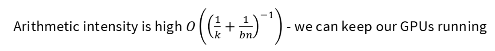

Arithmetic intensity \_ 총 연산량 / 총 메모리 접근량 (FLOPs / Bytes)

Arithmetic intensity는 total arithmetic operations / total memory accesses를 의미합니다. 즉 계산량 대비 메모리 접근량의 비율을 의미합니다. 즉, Arithmetici intensity가 높으면 메모리에 접근하는 거 대비 연산량이 많다는 것이고 낮으면 계산량에 비해 메모리 접근량이 많다는 것입니다.

'we can keep our GPUs running'은 GPU가 쉬지 않고 계속 일하게끔 유지할 수 있다는 것을 의미합니다. GPU는 compute cores(연산 유닛), memory bandwidth(메모리 대역폭)로 구성되어있습니다.

GPU가 최대 성능을 내려면 계속 일하게끔 유지할 수 있어야 하고, 이는 연산 유닛이 쉬면 안 된다는 것을 의미합니다. 연산 유닛이 쉬는 때는 메모리에서 데이터를 가져오는 속도가 느려서 기다리는 경우입니다. (이를 메모리 병목 현상, memory bottleneck이라고 합니다.) 기본적으로 compute cores의 연산량이 bnd^2로 더 높기 때문에 연산 유닛이 쉬지 않고 일하게끔 유지가 됩니다.

연산 유닛이 잘 작동하고 있다는 것은 호재이지만, Multi Head Attention만의 구조적인 한계는 굉장히 명확합니다. 바로 head마다 Query, Key, Value를 모두 따로 계산해서 따로 저장한다는 것입니다. head의 수가 많아질수록 따로 저장하는 양은 많아질 수밖에 없고 이는 메모리에 접근하는 양이 폭증할 수 있음을 의미합니다. head의 수가 늘어난다는 것은 병렬 연산이 가능해진다는 것이지만 메모리 접근량이 많아져 메모리적인 측면에서 효율성을 발휘하지 못했다는 것입니다. 이를 위해서 KV cache라는 개념이 도입됩니다.

Query는 찾고자 하는 정보, Key는 저장된 정보의 특징, Value는 실제 정보를 의미합니다. Query는 내가 찾고자 하는 정보이고 이를 head마다 다르게 유지, Key와 Value를 동일하게 유지한다면 매번 메모리에서 가져오지 않고 cache에서 저장해서 바로바로 꺼내 쓸 수 있게 만드는 것입니다. 연산량 자체는 유지가 되지만 메모리에 접근하는 양이 줄기 때문에 Arithmetic intensity가 커지게 됩니다. 이게 바로 MQA Multi-Query Attention입니다.

하지만 아무래도 동일한 Key와 Value를 사용하기 때문에 표현력 측면에서 문제가 있습니다. 그래서 Multi-Head Attention만큼 많은 Key와 Value의 사용으로 메모리 폭증은 하지 않도록 하되 Multi-Query Atttention만큼 너무 단일화해서 성능을 낮추는 일은 없어야 할 것입니다. 그래서 Head끼리 group을 설정해서 같은 group에 속해있는 경우는 Key와 Value를 공유해서 사용하게 됩니다. 8개의 Attention Head에 Group을 네 개로 설정한다면 \[Head 1, 2\], \[Head 3, 4\], \[Head 5, 6\], \[Head 7, 8\] 각 그룹끼리는 같은 Key와 Value를 사용하는 것입니다.

MHA는 표현력이 좋은 대신에 메모리 접근량이 너무 많기 때문에 효율적이지 못하고, MQA는 메모리 접근량이 적은 대신에 표현력 측면에서 좋은 성능을 발휘하지 못합니다. 그래서 나온 대안이 GQA인 것입니다.

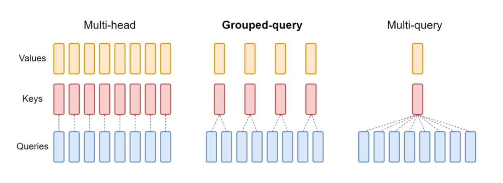

Multi-Head Attention(MHA), Grouped Query Attention(GQA), Multi Query Attention(MQA)

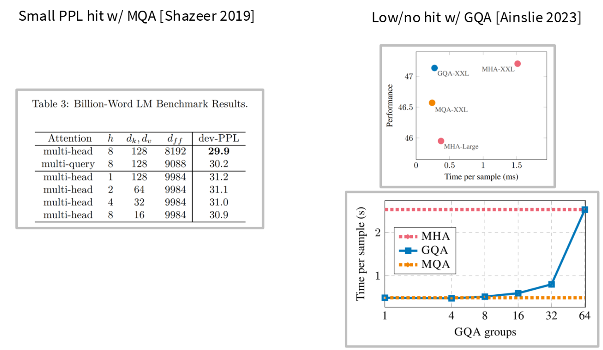

Perplexity(\=PPL)의 관점에서 보면, PPL이 낮을수록 좋은 성능을 보인다는 것인데 성능 자체는 multi-head를 사용하는 것이 모델의 용량이 크기 때문에 좋을 수 밖에 없습니다. 하지만 MHA-XXL과 GQA-XXL을 비교해보면 샘플 당 걸리는 시간의 차이가 4배 가까이 차이나지만 성능적인 측면에서는 큰 차이없이 사용 가능하다는 사실을 알 수 있습니다. 하지만 무조건 GQA가 정답은 아닌 것이 Group의 개수가 늘어날수록 MHA와 다를 게 없는 성능과 시간을 갖기 때문에 MQA와 MHA의 사이에서 합의점을 찾는 것이 현재까지의 방식이라고 볼 수 있습니다.

---

<strong>4&#41; Sparse / Sliding Window Attention</strong>

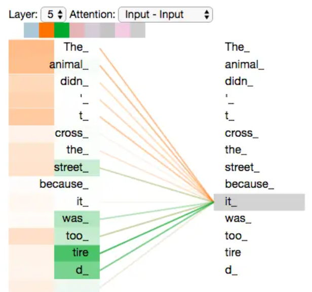

Self-Attention

Attention을 조금 더 미시적인 시각에서 바라보면 Attention은 Self-Attention이기 때문에 동일 sequence 내에서 Attention이 일어나는 구조입니다. 따라서 sequence의 길이가 n이라면 Big-O notation은 O(N^2)이 됩니다. complexity가 지수함수인 것은 연산 최적화의 관점에서 좋은 수치는 아닙니다. 따라서 Sparse/Sliding Window Attention을 도입합니다.

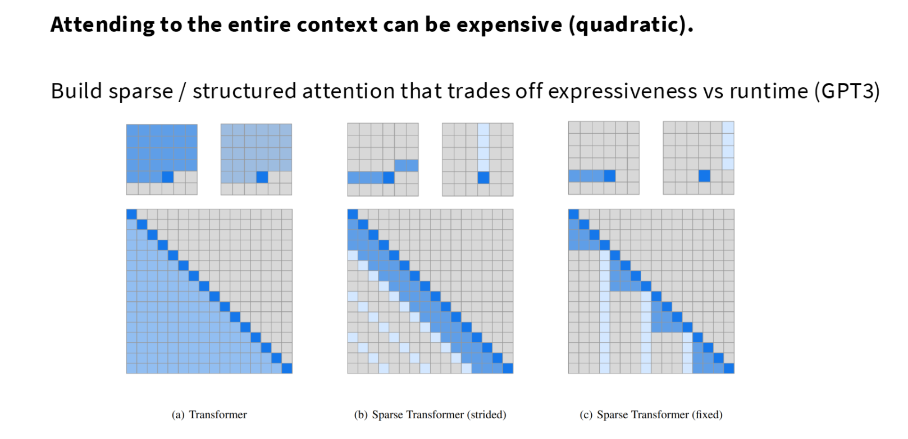

Sparse Transformer (strided, fixed)

Masked Attention을 연산적인 측면에서의 최적화를 위해 다른 방식으로 사용하는 것입니다. strided, fixed 두 가지의 방식을 섞어서 사용을 하게 됩니다.

stride는 '보폭'입니다. 특정 보폭만큼 띄엄띄엄 Attention을 합니다. 이렇게 되면 현재 시점의 토큰이 모든 토큰을 참조하지 않고 토큰 몇 개만 참조를 하게 되는데, 보폭이 있을 뿐 직접적으로 현재 시점과 상호작용하는 직접 참조입니다.

fixed는 시퀀스 길이 n, 블록 길이 i, 앵커 c로 두고 시작한다. 시퀀스의 길이는 내가 attention하고자 하는 문장이나 문단의 token의 개수, 블록 길이에 따라서 특정 시점에서의 token들이 Attention 하는 구간의 길이, 앵커는 Attention한 구간의 바로 직전 인덱스 몇 개를 참조할 것인가에 대한 정보를 담습니다.

예를 들어 시퀀스의 길이 n&#61;16, 블록 길이 i&#61;4, 앵커를 c&#61;2로 둔다면 현재 위치 i &#61; 10을 기준으로 어떻게 Attention이 일어날까요? 블록 길이는 4이기 때문에 &#91;0, 1, 2, 3&#93;. &#91;4, 5, 6, 7&#93;, &#91;8, 9, 10, 11&#93;, &#91;12, 13, 14, 15&#93;가 될 것입니다. 어차피 대각행렬을 기준으로 대칭이기 때문에 현재 시점 i&#61;10 이전으로만 확인하게 됩니다. &#91;8, 9, 10&#93;을 Self-Attention을 하고 앵커는 2이기 때문에 이전 블록들의 마지막 시점 두 개인 &#91;2, 3&#93;, &#91;6, 7&#93;도 간접적으로 Attention을 합니다. 이렇게 되면 내가 보는 위치 내 블록과 멀리 떨어져 있는 token과도 Attention을 하게 됩니다. &#91;2, 3&#93;은 token 0과 1을, &#91;6, 7&#93;은 token 4, 5의 내용을 담고 있기 때문에 넓게 보면 간접적으로 참조하고 있는 것입니다.

이제 strided와 fixed 방식을 결합해보겠습니다. strided는 특정 간격만큼 떨어져 있지만 '직접적으로 연결'되어있습니다. fixed는 앵커로 인해 특정 토큰들과 연결은 되어있고 '간접적으로 참조'하고 있습니다. 직접적으로 연결되어 있지만 띄엄띄엄 연결되어있어 모든 token에 대한 문맥을 파악하기 힘든 부분을 fixed로 인해 간접적으로 참조하여 모든 token들의 내용을 담을 수 있도록 하는 것입니다.

stirded의 문제점을 fixed가 보완하고, fixed의 단점을 strided가 보완하는 방식으로 학습을 진행하게 되고, Vanilla Transformer에서 사용했던 Attention에 비해 연산량이 줄어듭니다. strided 방식의 보폭을 sqrt(N), 블록 길이 i를 sqrt(N)에 가깝게 만들수록 O(N&#42;sqrt(N))으로 complexity가 수렴하게 됩니다.

가장 최근에는 Attention을 할 때, 3개의 Sliding Window Attnention 층으로 좁은 범위의 local attention을 하고 1개의 Full Self-Attention을 사용합니다.

즉 마지막 층에 Full Self-Attention을 쓴다는 것입니다. Sliding Window Attention을 하면 좁은 범위에서 확실한 의미 파악과 관계에 대해서 높은 성능으로 파악이 가능하지만, 어쨌든 멀리있는 정보를 보기 위해서는 반드시 multi-hop, 여러번 층을 거쳐야 도달할 수 있습니다. 이 과정에서 연산량이 늘어나고 효율적인 측면에서 성능이 떨어질 수 있습니다. 그래서 마지막 층에 Full Attention 층을 두어서 token간 직접 Attention한 정보를 이전 layer에 Backpropogation을 통해 전달하게 되고 아무리 멀어도 4개의 층 안에서는 모든 token에 대한 정보에 접근이 가능하게 됩니다. SWA(&#61;Sliding Window Attention)을 통해서 좁은 범위 Attention으로 조금 더 확실한 관계 파악을 함과 동시에 SWA의 한계를 Full Self-Attention 층이 보완을 해주는 것입니다.