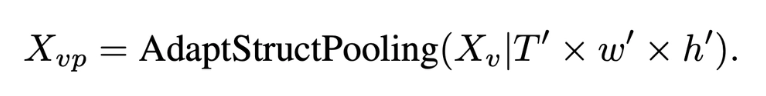
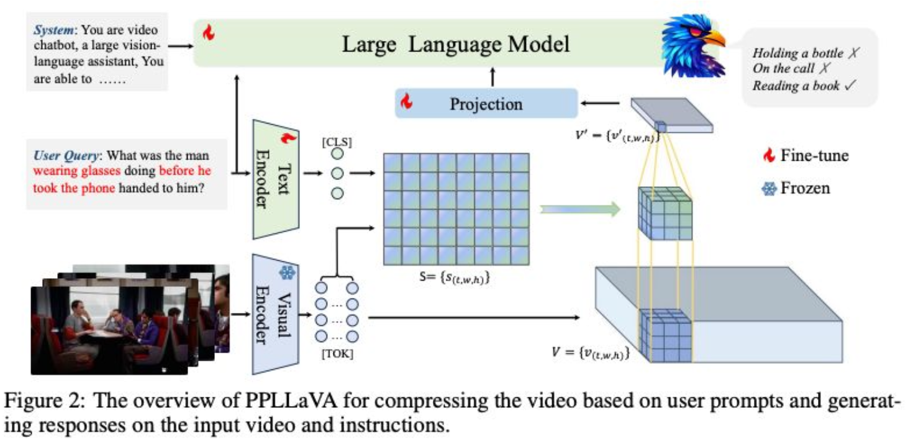
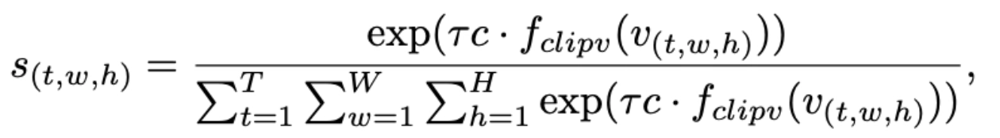
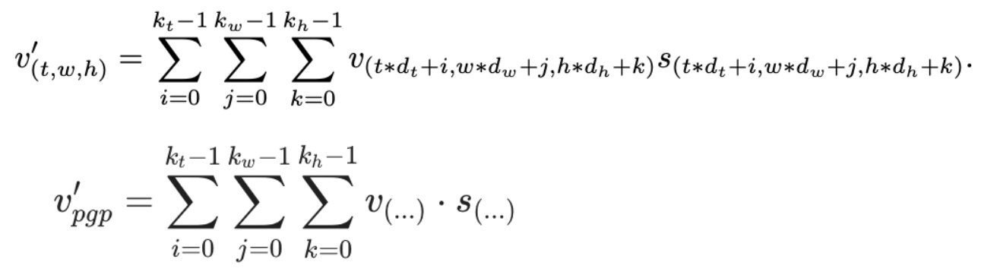
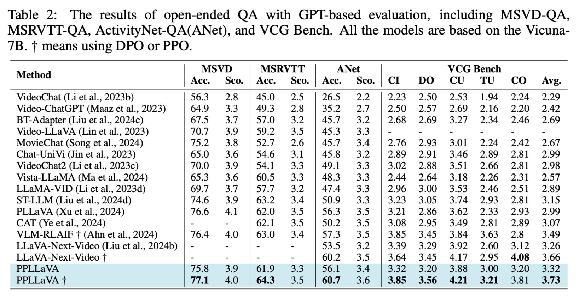
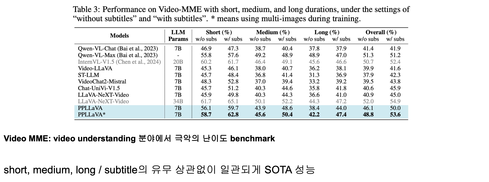
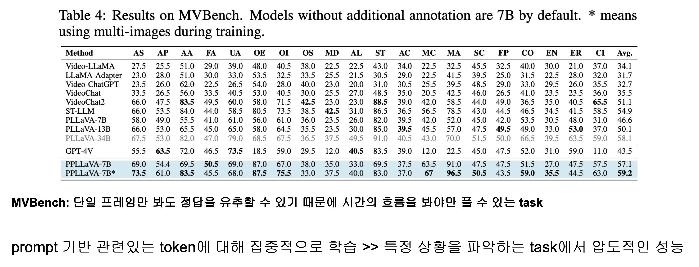

Unsplash / Photo by Alex Shuper

[PPLLaVA: Varied Video Sequence Understanding With Prompt Guidance](https://arxiv.org/pdf/2411.02327)를 리뷰합니다.

PPLLaVA는 기존 LLaVA, PLLaVA를 거쳐서 발전된 모델입니다.

이 논문은 VideoLLM, 멀티모달입니다.

<strong>LLaVA: Large Language and Vision Assistant</strong> 단순 이미지 caption을 넘어서 instruction(지시)에 따라 이미지를 추론하는 패러다임을 제시했습니다.

LLaVA의 본질은 Cross-attention 모듈을 제거하고, 시각 정보를 텍스트와 동일한 형태의 시퀀스로 취급하는 Sequence-Agnostic(sequence에 의존하지않는) 구조를 증명했다는 점입니다.

<u>1\. </u><u>Visual Instruction Tuning</u>: 기존의 단순 Image-Text pair를 넘어, GPT-4를 활용해 Bounding Box와 캡션 기반의 대화형 Instruction 데이터를 생성하여 모델의 추론 능력을 강제했습니다.  <u>2\. </u><u>Projection Layer</u>: Frozen CLIP-ViT의 출력 Z\_v를 LLM의 임베딩 스페이스로 선형 투영합니다. ⇒ H\_v \= W Z\_v  <u>3\. </u><u>Causal Attention의 활용</u>: Input \= \[H\_v, H\_q\] 로 결합하여 Decoder-only LLM에 입력합니다. Cross-attention 없이도, Causal Attention의 특성상 뒤따라오는 Text 토큰 H\_q가 앞선 모든 Visual 토큰 H\_v을 참조(Attend)할 수 있기 때문에 자연스러운 Multimodal Alignment가 달성됩니다.

<strong>LLaVA \+ n-frame </strong>그런데 LLaVA는 1-frame에 대한 접근이었습니다. 그래서 LLaVA가 multimodal task를 잘 수행하니까 비디오에서도 잘 수행할 수 있지 않을까하는 생각에 n-frame으로 확대해서 연구를 해왔습니다. 한 장의 이미지 caption \+ instruction \>\> 비디오에도 적용해보자는 것이었고, frame마다 중복되는 값이 너무 많기 때문에 성능이 좋지 않았습니다.

frame마다 중복되는 값이 많아서 발생하는 문제는 크게 두 가지가 있습니다. 이로 인해 정의할 수 있는 LLaVA \+ n-frame의 근본적인 한계도 두 가지가 있습니다.

1. <u>Attention Dillution</u> 시퀀스 길이 L이 프레임 수 증가에 따라 폭발적으로 커지면, 어텐션 스코어 행렬은 $L \times L$ 차원을 갖습니다. 비디오의 temporal redundancy(붙어있는 프레임끼리는 거의 동일한 정보) 비슷한 Visual 토큰이 다수 입력되면, Softmax 함수의 특성상 유의미한 특정 토큰에 가중치가 집중되지 못하고 평탄화(Flattening)되어 문맥 파악 능력이 상실됩니다.
2. <u>Attention Dillution</u>인 상황에서 벡터의 scale 차이가 softmax의 점수에 과도하게 반영되는 것입니다. LLaVA의 학습에 사용된 비디오 QA 데이터셋 자체가 text는 대표적인 상황에 대한 설명입니다. frame을 대표적으로 제일 잘 설명하는 token과 그에 해당하는 visual token의 값만 커지게 될 것입니다. softmax이기 때문에 이런 큰 값들이 가중치를 지배하는 것은 어떻게 보면 당연한 이치이고, 이를 n-frame method로 적용을 시켜버리면 n개의 frame을 대표적으로 제일 잘 설명하는 token과 그에 해당하는 visual token에 해당하는 Key와 text Query 값만 커지게 될 것입니다. 그리고 이에 대해서 n개의 frame으로 확대가 되면 frame마다 visual token에 해당하는 값만 커지게 돼서 결국 high-norm dominance 현상이 발생하게 됩니다.

이로 인한 근본적인 한계가 두 가지입니다.

1. <u>Vulnerability of Prompts:</u> 프롬프트에 의해 우연히 선택된 몇 개 토큰에 답을 걸어버리기 쉬워지는 것입니다.In distribution이더라도 High-norm dominance로 인해 특정 token에 과도하게 의존하게 되어서 성능이 그렇게 좋지 않습니다. 하지만 Transformer의 Residual Connection 구조로 인해서 문법적인 구조는 사전학습 과정에서 manifold 학습이 전달은 되었고, 입력한 prompt도 학습했던 환경의 분포와 유사하기 때문에 Hallucination으로라도 답변은 잘 하는 것처럼 보일 수 있습니다. 그런데 OOD로 입력이 들어오면 그런 문법적인 구조 자체마저도 관련성이 없는 특징이 되어버리기 때문에 이상한 high norm noise와 결합해서 엉뚱한 답변을 내놓거나 아예 답변을 하지 않는 경우가 발생하는 것입니다. 따라서 프롬프트에 의해 우연히 선택된 몇 개 토큰에 답을 걸어버리기 쉬워지는 것입니다.
2. <u>model scaling degradation: </u>모델의 크기를 13B → 34B로 키웠음에도 불구하고 오히려 비디오 QA 데이터셋의 짧은 text 패턴, 즉 high norm dominance에 의해 모델이 overfitting 되어서 parameter 크기를 키워도 오히려 성능이 하락하는 catastrophic forgetting 문제가 발생합니다. 나쁜 지름길(짧은 텍스트 패턴 \+ 특정 high norm 토큰)을 더 잘 외워버리는 상황

<strong>PLLaVA(Pooling)</strong> 이미지가 중복되는 token들이 너무 많으니까 단순 average pooling을 써서 중복되는 token의 개수를 줄이자는 아이디어입니다.

그래서 AdaptStructPooling 구조를 도입합니다.

AdaptStructPooling (Average)

- 불필요한 temporal redundancy(붙어있는 프레임끼리는 중복된 정보를 가짐)를 제거하지는 못하지만 완화한다.
- 극단적인 feature norm이 많으니까 분산을 줄여 평탄화를 한다.
- 추가적인 파라미터 학습없이 모델의 크기를 키워도 성능이 유지되게끔 만든다.

시간축과 가로 세로에 대한 정보를 전부 다 변형을 시킵니다. 결국 pooling을 시킨다는 것인데 어떤 식으로 진행되는지 천천히 알아보겠습니다.

<strong>PPLLaVA(Prompt-guided Pooling)</strong> 그래서 PPLLaVA에서 해결하고자 하는 핵심문제는 바로 ‘token을 줄여 redundancy는 줄이면서도 prompt와 관련된 정보는 유지할 수 없을까?’입니다.

바로 막대한 정보를 가진 token들이 무분별하게 학습에 활용되게 되면 video LLM은 중요한 정보를 포착하는 능력이 저하가 되고 self-attention의 연산량 능력을 넘어서 불필요한 정보가 노이즈로 작용하여 모델의 성능에도 악영향을 미칠 수 있다는 것입니다.

1. <u>불필요한 temporal redundancy는 어떻게 없앨까요?</u> 일단 redundancy는 두 가지 종류가 있습니다. temporal redundancy가 있고 spatial redundancy가 있습니다. 결국 spatial pooling을 하는 것이 temporal redundancy를 하는 효과를 준다는 것입니다. 그러면 처음부터 patch 수를 줄이면 되는 거 아닌가? ⇒ 그렇게 되면 detail한 정보는 아예 고려할 수 없게 됩니다.
2. <u>feature norm들의 분산이 매우 큰 문제는 어떻게 해결할까요?</u> ⇒ average poolingpatch 개수가 24 X 24 (patch size → 14)라서 프레임 당 토큰 수는 576개입니다. 최종적으로 12 X 12로 pooling하는 것(kernel\_size \= 2, stride \= 2, avg pooling)까지는 성능이 유지가 됩니다. 그보다 작게 pooling하면 성능이 떨어진다고 합니다.바로 한 번에 처리할 수 있는 token의 개수를 사용자에 따라서 유동적으로 바꿀 수 있고, 들어오는 이미지의 입력에 따라서 adaptive하게 pooling할 수 있게 하기 위함입니다. adaptive pooling 과정은 최종적으로 원하는 token의 개수가 몇 개인지에 따라서 유동적으로 바뀌는 adaptive pooling 방식입니다. Attention Hijacking을 유발하는 노이즈의 분산을 억제하면서도, LLM이 비디오를 이해하는 데 필요한 최소한의 공간적 해상도는 사수했습니다.

논문에서도 말하는 핵심적인 것은, video는 중복된 프레임이 많을 수 밖에 없는 구조이기 때문에 일부 frame에 해당하는 key information에 집중해야한다는 것입니다.

즉, 비디오 전체가 중요한 것이 아니라 질문과 관련된 일부 frame만 중요하다고 볼 수 있습니다. pooling 아이디어를 그대로 사용을 하되 ‘prompt’를 이용하겠다는 것이고, 그래서 <strong>Prompt-guided</strong> Pooling LLaVA입니다.

우선 논문에서 주장하는 기존 연구, 특히 PLLaVA에서의 아쉬운 점을 꼽는 것이 세 가지가 있습니다.

1. <u>text와 무관하게 frame 전체를 ‘average pooling’</u>  ⇒ 모든 tokne을 동일하게 average pooling을 하기 때문에 중요한 frame과 text와 관련된 frame에 대해서 특정지어서 파악할 수가 없습니다.
2. <u>instruction-aware feature extraction 하지 않고 단순 linear projection</u>  ⇒ 그래서 prompt awareness가 없기 때문에 유저의 지시를 온전히 반영할 수 없는 것이 문제입니다.
3. <u>시간 축에 의한 redundancy를 줄인 것이 아니기 때문에 여전히 redundancy 문제는 존재</u> ⇒ token이 많은 게 문제가 아니라 중복이 많은 게 문제다! ⇒ certificate length: 질문에 답하기 위해 필요한 가장 짧은 video sub-clip의 길이 ⇒ 영상 전체의 길이가 100이라고 쳤을 때 답에 필요한 부분이 10이라면 ⇒ certificate \= 0.1, redundancy \= 0.9 / 중복이 많으면 certificate length는 짧은 것 ⇒ 그래서 과연 ‘중복’이 문제인 건지를 실험적으로 검증하기 위해 certificate length라는 것을 정의합니다.  ⇒ certificate length를 구할 때 수동으로 labeling을 하지는 않습니다.
   1. video frame을 2fps로 down-sampling
   2. 각 ‘frame token vector’와 ‘quesion \+ answer text’ 사이 cosine similarity를 계산
   3. similarity 계산에 CLIP-L-336 사용
   4. cosine similarity \> 0.5이면 두 개의 frame이 서로 relevant frame이라고 보는 것입니다.

논문에서는 video-MME dataset에서 certificate length가 가장 짧은 영상 100개를 따로 뽑아서 실험을 진행해봤고, 모든 모델에서 redundancy가 높은 영상은 성능이 하락한다는 사실 관계를 파악했습니다. 즉, redundancy가 많을수록 video LLM의 성능이 떨어진다는 것입니다.

---

여기까지가 기존 PLLaVA까지의 내용이고, 이제 PPLLaVA는 이 문제들을 어떻게 해결하고자 했는지 세 가지 부분으로 나눠서 살펴보겠습니다.

### <strong>1\. Fine-grained(세밀한) Vision-Prompt Alignment</strong>

CLIP text encoder로 prompt embedding을 생성하고 CLIP-ViT vision encoder로 video token을 생성하는데 text와 video token을 잘 정렬해야 학습에 잘 사용할 수 있게 됩니다. PPLLaVA에서는 이거에 대해서 prompt embedding vector랑 video token을 ‘Fine-grained Vision-Prompt Alignment’한다고 표현합니다.

이 s값이 곧 relevance score를 의미합니다.

<strong>f\_{clipv}</strong> CLIP-ViT encoder를 통과한 visual token을 LLM embedding space에 올려놓는 linear projection <strong>c</strong> CLIP Text Encoder가 출력한 CLS token embedding <strong>tau</strong> softmax temperature의 반대 역할. tau 값을 높일수록 prompt와 조금이라도 더 연관된 극소수의 시각 토큰이 가중치 s의 대부분을 독식하게 됩니다.

이를 통해서 s라는 tensor가 만들어지는데, text 정보와 image 정보가 정렬되어 활용할 수 있는 정보로 만들게 됩니다.

### <strong>2\. Prompt-Guided Pooling</strong>

Pooling 자체는 일반적인 합성곱에 average를 사용한 average pooling을 사용합니다.

이 때 pooling을 할 때 text와 visual token을 align한 s, relevance score를 활용한 pooling이고 이게 곧 ‘prompt가 지시하는 prompt guided’이기 때문에 prompt guided pooling인 것입니다.

### <strong>3\. Fine-Tuning</strong>

projection MLP, LLM은 visual token과 text의 관계를 학습할 수 있도록 하는 요소이기 때문에 기존의 모델을 그대로 쓰는 것보다 fine tuning을 하는 것이 좋고, FFT가 아니라 LoRA를 사용하는 이유는 핵심 정보에 대해서만 수정해서 기본적인 모델의 성능은 유지할 수 있게 하는 것입니다.

text encoder도 fine tuning하는 이유는 CLIP text encoder의 context length가 77개 token의 문맥만 잘 반영할 수 있는 구조라는 것입니다. 그래서 PPLLaVA에서는 context length를 늘리기 위해서 linear interpolation 식을 사용했고 대신에 이렇게 하면 앞쪽에 대한 문맥은 이미 CLIP 모델이 학습을 잘했을텐데 바꿔서 문제가 생기는 거니까 r값을 조정해서 큰 r 값을 사용하면 앞쪽은 기존 embedding을 거의 유지시켜주고, 뒤쪽은 r을 작은 값을 사용해서 새로운 context 영역으로 확장할 수 있게 asymmetric하게 position을 확장시키는 것입니다.본 연구에서는 시각 토큰과 텍스트 간의 관계를 효과적으로 학습하기 위해 텍스트 인코더, Projection MLP, LLM의 파인튜닝을 동시에(simultaneously) 진행합니다. 모델의 핵심 파라미터를 보존하면서도 새로운 지식을 주입하기 위해 LLM과 MLP에 LoRA를 적용하며, 텍스트 인코더는 긴 프롬프트의 세부 요구사항을 반영하고자 CLIP의 기본 문맥 길이(context length)를 77에서 248로 확장합니다. 이때 기존 모델이 보유한 앞쪽 문맥의 사전 지식 손실을 막기 위해 보간 비율 파라미터(r)를 비대칭적으로 조정하는 위치 보간법(asymmetric linear interpolation)을 적용하여 앞부분의 임베딩은 유지하고 뒷부분은 새로운 문맥 영역으로 확장합니다. 이러한 세 모듈의 동시 학습은 개별 파라미터 공간에서의 부분 최적해가 아닌 모듈 간의 전역적인 모달리티 정렬(alignment)을 달성하기 위함이며, LoRA의 활용은 결합 최적화(joint optimization) 과정에서 발생할 수 있는 파국적 망각(catastrophic forgetting)을 억제하는 정규화(regularization) 역할을 수행합니다.

## Experiment Setup

<strong>Base LLM</strong>: Vicuna-7B (based LLama) <strong>Vision Encoder</strong>: CLIP ViT <strong>Text Encoder</strong>: CLIP text encoder <strong>Hardware/time</strong>: A100 GPU 16EA, 910B NPU 32EA / 24hours <strong>Benchmark</strong>: Video QA benchmark, MVBench

---

## Experiment\_VideoQA

---

## Experiment\_VideoMME(Video Understanding)

---

## Experiment\_MVBench

---

## Conclusion

<u>Limitation</u>

architecture의 scalability를 증명하지 못했습니다. (자원의 한계로 인한 7B 이상의 모델 학습 X) multi-image를 사용했을 때 data에 대한 이해능력은 향상되지만, 대화 능력이 감소한 문제가 있었습니다. 이 부분에 대해서는 명시적으로 논문 저자들이 밝히고 있고 future work에 맡기겠다고 언급했습니다.

<u>Conclusion </u>기존 video-LLM의 문제점 1&#41; 긴 영상과 짧은 영상의 성능 동시에 올리기 어렵고, 2&#41; 중복된 visual token이 많습니다. Video LLM의 성능 문제는 많은 visual token 때문이며, prompt-guided pooling을 통해 중요한 visual feature만 선택하면 효율적으로 video understanding 성능을 향상시킬 수 있습니다.