Photo by Declan Sun / Unsplash

[RoFormer:Enhanced transformer with Rotary Position Embedding](https://scholar.google.com/scholar?hl=ko&as_sdt=0%2C5&q=RoFormer%3A+Enhanced+Transformer+with+Rotary+Position+Embedding&btnG=)를 리뷰합니다.

Transformer는 RNN에서 token 간 먼 거리의 상황에서 발생하는 문제를 어떻게 해결할 것인지에 대한 문제를 다루고 있습니다. 시간 순서대로 정보를 희석해가면 다음 layer으로 넘겨주던 RNN과 달리 단순히 dot product를 하면서 token간 정보가 희석되지 않도록 두었습니다.

Transformer라는 모델을 처음 제시한 Google Research 팀의 2017년 논문 'Attention is Al You Need'에서는 Positional Encoding이라는 방식을 선택했습니다. dot product로 인해서 입력되지 않은 위치와 관련된 정보를 강제로 입력시키는 것입니다. 결국 자연어라는 것은 순서를 무시할 수 없기 때문에 반드시 존재해야하는 작업입니다.

해당 논문은 이 Positional Encoding 과정을 Rotary Positional Encoding으로 하는 것이 성능이 좋다고 말하고 있습니다.

우선 이 전에는 어떤 과정을 거쳐왔는지 알아보겠습니다.

---

#### Background

Positional Encoding과 Self-Attention에 관한 가벼운 이야기만 담고 있습니다. 깊은 이해를 원하시면 다음 블로그를 참고해주시길 바랍니다.

[Attention is All You Need](/posts/attention-is-all-you-need/)

[\[Paper Review\] Attention is All You Need](/posts/attention-is-all-you-need/)

[Attention is All You Need 논문을 리뷰합니다.RNN을 기반으로 한 Seq2Seq 모델은 순차적인 연산이라는 한계에 부딪혀 성능 향상에 제약이 있습니다. 하지만 해당 논문에서 제안한 Transformer 모델은 self-atten](/posts/attention-is-all-you-need/)

[nulw.tistory.com](/posts/attention-is-all-you-need/)

[Attention is All You Need \_ Deep Dive](/posts/attention-is-all-you-need-deep-dive/)

[\[Paper Review\] Attention is All You Need \_ Deep Dive](/posts/attention-is-all-you-need-deep-dive/)

[Attention is All You Need Paper Review에서 이어지는 내용입니다. \[Paper Review\] Attention is All You NeedAttention is All You Need 논문을 리뷰합니다.RNN을 기반으로 한 Seq2Seq 모델은 순차적인 연산이라는 한계에 부딪](/posts/attention-is-all-you-need-deep-dive/)

[nulw.tistory.com](/posts/attention-is-all-you-need-deep-dive/)

Transformer가 처음 제시되었을 때 Posittional Encoding은 Sinusoid 방식을 채택했었습니다. Absolute (Learnable Encoding)방식이 아니라 Fixed Encoding인 Sinusoid를 선택했던 것입니다. 그 이유는 다음과 같습니다.

<strong>Absolute (Learned Absolute Position embedding, 학습 가능) </strong>이를 알기 위해서는 왜 positional encoding이 등장했는지부터 이해할 필요가 있습니다. 당시 RNN을 기반으로 한 LSTM, GRU가 등장했지만 근본적인 문제는 여전히 남아있었습니다. 시간 축 방향에서 순차적으로 전달되어야해서 병렬화가 불가능하고, 최종적으로는 하나의 hidden state에 모든 과거 정보를 압축해야하기 때문에 긴 거리에서는 long-range dependency를 여전히 안고 있던 상황이었습니다. 그렇다면, 병렬화를 가능하게 함과 동시에 long-range dependency를 어떻게 해결했을까요? 우선 convolution 구조 자체가 시간에 의존성이 없는 구조입니다. 그래서 hidden state 자체가 시간이 아니라 입력 window에만 의존하기 때문에 모든 t에 대해서 동시에 계산하는 게 가능합니다. 즉, learnable하게 position vector를 다루면 특정 위치에 있는 벡터가 어떠한 특징을 띠고 있을 것이라는 학습을 하는 것입니다. 하지만 근본적인 문제는 학습했던 그 position을 벗어나는 순간 해당 위치에서의 특징은 학습해본 적이 없기 때문에 모델이 바보가 되는, extrapolation(외삽) 문제가 발생하는 것입니다.<strong> </strong>Absolute는 'token embedding vector \+ position embedding vector'로 구성되어있습니다. 즉, 위치에 대한 정보를 단순히 더해주는 방식입니다. 자원의 특성 상 모델은 최대 sequence length가 정해져있기 때문에 sequence length \* dimension 크기의 embedding matrix를 학습하게 됩니다. 이 embedding matrix는 gradient descent를 통해서 학습하게 됩니다.

<strong>Sinusoid (Fixed Absolute Positional embedding, 학습 불가능)</strong> Absolute 방식이 token과 position의 embedding vector를 더해주는 것이라는 방식을 사용하는 것은 동일합니다. 다만 Absolute에서는 순서에 대한 정보를 일일이 입력해주었던 것과 다르게 sinusoid 방식은 sine과 cosine을 사용하여 position embedding vector를 생성합니다. 그리고 sinusoid 방식은 학습을 embedding vector를 학습할 필요가 없습니다. Absolute는 sequence length \* dimension 만큼의 parameter를 갖게 되지만, sinusoid 방식은 parameter 없이 함수는 고정된 상태에서 내부 변수에 따라 다르게 작동하는 것이기 때문에 학습을 해도 크게 도움이 되지 않습니다. 이 말은 곧 훈련 때 보지 못했던 길이에도 확장할 수 있다는 flexibility를 의미합니다.  쉽게 생각하면, Absolute 방식은 특정 길이와 특정 차원에 대한 embedding vector를 사용하여 학습하기 때문에 그 범위를 벗어나는 순간 적용이 어려워집니다. 그래서 상대적으로 flexibility가 적용이 가능한 sinusoid를 채택했습니다. 하지만 sinusoid를 사용하더라도 position embedding vector가 우연히 주기로 인해 겹치게 되면 문제가 발생할 수 있다는 것인데, 실질적으로 고차원에서 계산을 하기 때문에 일부 차원이 겹칠 수 있어도 모든 차원이 겹치는 경우는 거의 존재하지 않으며, 차원에 따라서 sine, cosine 함수의 주기가 달라지기 때문에 확률적으로 불가능에 가깝습니다.

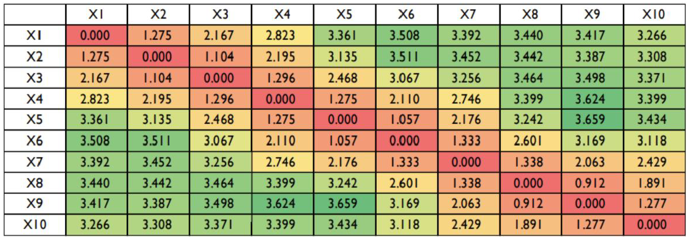

positional encoding vector 간 Euclidean Distance

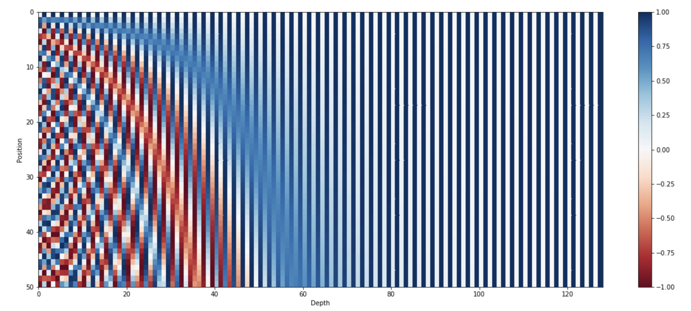

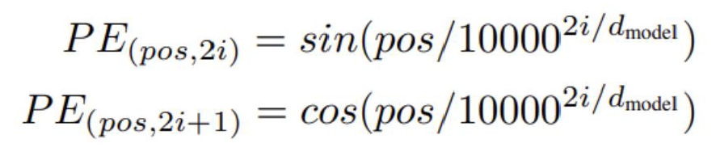

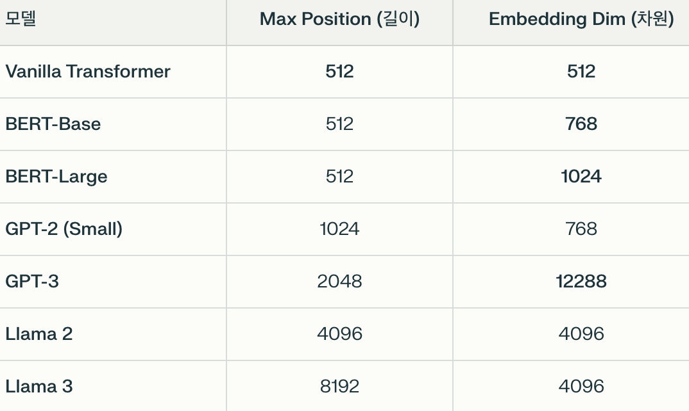

두 방식의 공통점은 결국 Absolute, embedding vector에 값을 씌우는 것입니다. '절대적인' 위치를 적용시키지만, Attention score를 계산하기도 전에 입력값에 에 이미 Positional Embedding Vector가 Positinoal Encoding 과정에서 더해집니다. 그 이후에 Q \= X\_QW, K \= X\_KW, V \= X\_V W로, 각 Query, Key, Value별 가중치를 곱해 Query, Key, Value가 바뀌게 됩니다. 따라서 두 단어 간의 유사성을 파악하는 Attention Score를 구하는 Qeury와 Key의 내적 값에서는 위치 정보가 이미 포함된 상태로 내적이 됩니다. 그렇기 때문에 위치 정보가 잘 담겨있기를 '암시적'으로 바랄 수 밖에 없습니다. 즉 Positional Encoding Vector가 입력 값에서 더해지는 과정에서 한 번 희석, Query, Key, Value를 만들 때 가중치와 곱해지며 다시 한 번 희석이 됩니다.

여기서 중요한 건 일단, 벡터끼리 겹치는 일은 없습니다. 저 분모에 들어가있는 숫자 자체가 사인함수와 코사인 함수의 주기를 다르게 만드는 장치이고, 벡터가 겹치는 상황이 발생하려면 수학적으로 수십 억개의 토큰이 들어와야 하는데 실질적으로 그런 상황은 배제하고 봅니다. (해리포터 전권이 100만\~200만 토큰이기도 하고, 하드웨어 상으로 수섭 억개 토큰이 들어오는 게 감당이 되지 않습니다.)

그런데 벡터 자체들이 겹치지 않는 것은 수학적으로 특정 수준까지는 보장이 되어있는데, 이걸 가지고 Query, Key, Value를 만들었을 때 문제가 발생합니다.

그리고 또 크나큰 문제는 바로 extrapolation 문제, 학습할 때보다 더 긴 길이가 들어오면 가 발생한다는 것입니다. 보면 position에 따라서 일정 차원까지는 position에 따라서 값이 다르게 유지가 되는데, 일정 차원이 지난 후부터는 대부분의 값들이 다 변화가 되지 않는 모습입니다.

그래서 직접적으로 반영이 되어있으면 거리가 어느정도 떨어져있는지에 따라서 어느 정도의 성능차이가 나는지 변수나 파라미터를 확인할 수 있으면 좋지만 Absolute와 Sinusoid 방식은 그렇지 않습니다. 따라서 직접 위치를 반영할 수 있는 Relative 방식이 도입되었습니다.

<strong>Relative Positional Encoding</strong>

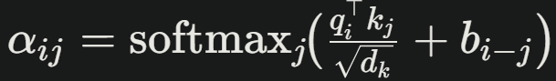

Relative Positional Encoding

이 바이어스 항은 learnable parameter입니다.

원래는 b\_i-j, 바이어스 항 없이 Q와 K의 곱합니다. (최종적으로 Value와 곱하는 형태이기는 합니다.) 기존에 Query와 Key, Value를 구하기 전에 위치 정보를 집어넣던 것을 하지 않고 나중에 위치 정보를 넣어주는 것입니다. (기존의 sinusoid 방식이 위치 정보를 명확하게 다루기 어려웠던 이유는 RoPE 논문을 설명하면서 나옵니다.) 즉, 단어 간의 관계를 파악하기에 용이해진 것입니다. 이로 인해서 absolute, sinusoid 방식보다 Relative가 Perplexity(다음 token을 얼마나 잘 예측하는지에 대한 지표로 사용, 값이 낮을수록 예측 불확실성이 낮아지고 일관된 예측을 할 수 있음을 의미)가 낮은 값으로 더 일관된 성능을 보이는 것으로 알려졌습니다. [(출처: Transformer-XL: Attentive Language Models Beyond a Fixed-Length Context)](https://scholar.google.com/scholar?hl=ko&as_sdt=0%2C5&q=Transformer-XL%3A+Attentive+Language+Models+Beyond+a+Fixed-Length+Context&btnG=)

이런 Relative 방식에도 아쉬운 점은 존재했습니다. 바이어스 항을 보면 단순하게 사전에 정한 위치 정보만큼만 더해주게 됩니다. 100만큼 차이가 나더라도 이렇게 먼 거리 정보는 그냥 8 정도 떨어진 거리 정보라고 반영하게 됩니다. 이 가정을 clipping이라고 하며, 만약 거리를 1부터 100까지 반영한다고 가정하면 파라미터의 수가 급증하지만 1부터 8정도로 가정하면 파라미터의 수가 많이 줄어들게 됩니다. 하지만 실질적으로 파라미터가 급증하는 문제 때문에 세밀한 단어 간의 거리 문제를 회피한 것이며, 이래도 일반화가 잘 된다고 하더라도 한계는 분명히 존재합니다. 따라서 이런 제약 과정까지도 해결하기 위해서 RoPE가 도입이 되었습니다.

근본적인 아이디어는 '위치 정보에 대한 걸 더하지 말고 회전을 시켜서 그 각도에 대한 차이로 접근을 해보자'입니다.

본격적으로 논문에서 밝히고 있는 내용에 대해서 다루도록 하겠습니다.

---

#### I. Introduction

1. 이 RoPE라는 방식은 호환성이 뛰어나서, 이미 사전 학습된 모델을 가져와 적용시키면 그 모델에 추가적인 성능향상을 꾀할 수 있습니다.
2. Learnable Positional Encoding(\=Absolute), Fixed Positional Encoding(\=Sinusoid)는 '절대 위치'만 반영하고, Relative는 상대위치를 반영하지만 bias 항을 '더하기' 때문에 계단화 문제가 생겨 미분 과정에서의 문제가 발생해 학습이 올바른 방향으로 진행되지 않을 수 있습니다.
3. 긴 입력 범위에서도 잘 적용될 수 있고, 토큰의 거리가 멀어졌을 때 자연스럽게 의존성이 줄어들수록 반영할 수 있습니다. 기존 선형 self-attention에서의 위치 인코딩은 맞지 않았지만, RoPE는 선형 Attention에도 잘 적용될 수 있습니다.

그렇다면 이게 어떻게 적용이 될까요?

#### II. Background

우선 기존 Attention Score가 어떻게 적용되어왔는지에 대해 이해할 필요가 있습니다.

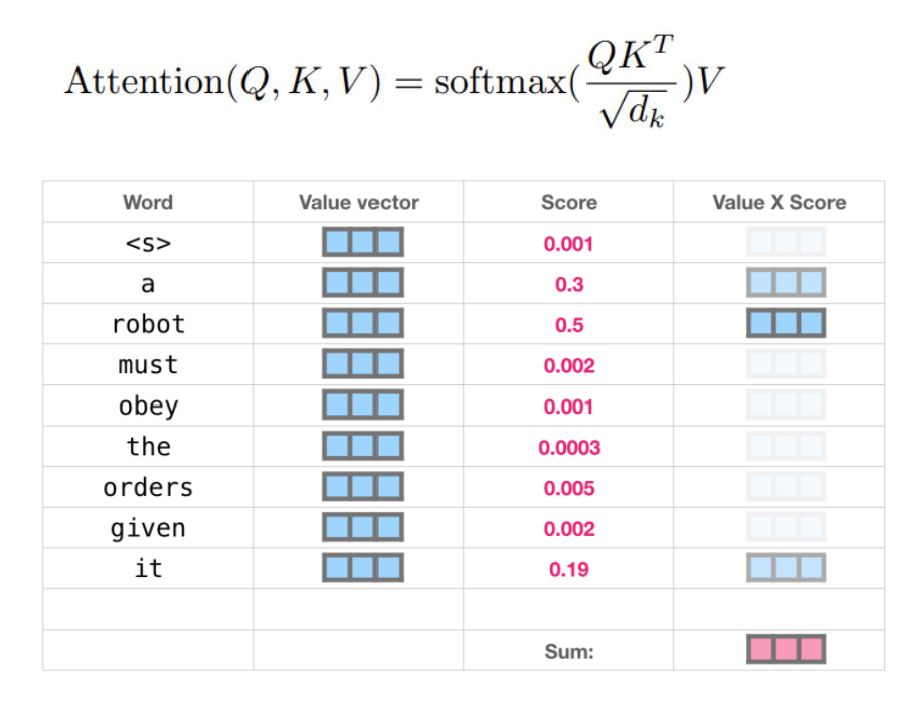

Original Transformer: Scaled-dot product Attention

\[Query: 찾고자 하는 정보, Key: 저장된 정보의 특징, Value는 실제 token vector\]입니다.

softmax 괄호 안에 있는 것이 Attention score, 이 값을 softmax에 집어넣어 확률화 한 것이 정규화된 Attention Score입니다.

즉, 내가 찾고자 하는 정보와 저장된 정보의 특징의 cosine similarity를 구해 유사도를 측정하고 값이 높을수록 해당 token끼리는 관련이 높다는 것을 암시적으로 의미하게 됩니다. 이 값을 Value와 곱해 생성할 때 반영하게 되는 방식입니다.

---

#### <strong>III. Proposed Approach</strong>

기존 Additive method(단순히 벡터끼리 더하는 연산)인 Absolute나 Relative의 경우 미분 상의 문제도 존재했지만, 행렬 연산 측면에서도 효율성이 떨어지는 상태였습니다.

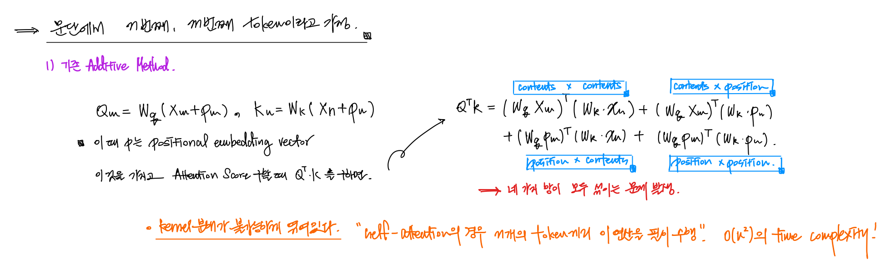

Absolute를 활용한 기존 Additive 방식에서의 연산 효율

position에 대한 정보가 모든 항에 들어가있습니다. 그래서 position에 따른 성능의 차이나 token 간 유의미성 파악이 직접적으로 판단하는 것이 어려웠습니다.

그래서 위치 정보를 '더하는' 행위가 아니라 '회전'을 시키는 관점에서 각도의 차이를 보자는 아이디어가 제시되었습니다. (수학적인 관점에서 복소수를 사용하는데, 실질적으로 행렬 곱셈과 동치이고 이해를 위해서 행렬 곱셈으로 설명하도록 하겠습니다.)

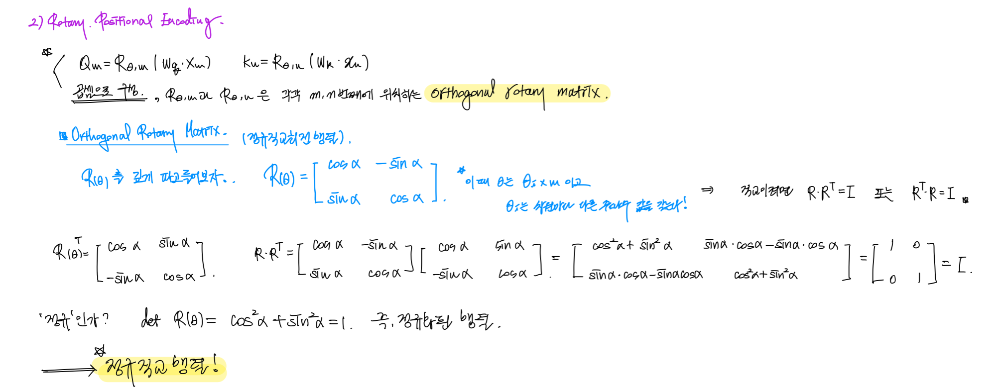

RoPE 연산 방식

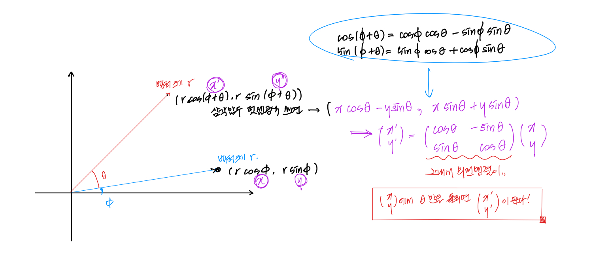

그렇기 때문에 RoPE에서는 기본적으로 Position을 담는 matrix 자체가 정규직교행렬이라는 특수한 행렬이기 때문에 다음과 같은 특성을 가지게 됩니다.

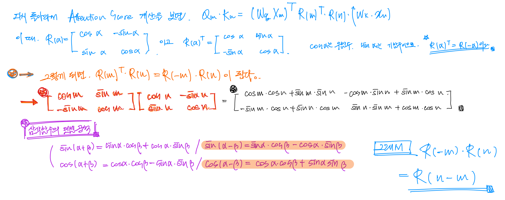

Rotary Matrix의 곱이 n번째와 m번째 토큰의 거리 차이를 반영

Query와 Key의 곱 관계를 유지함과 동시에 Position에 대한 정보를 '곱함'으로써 Relative 방식에서는 bias항을 더했기 때문에 발생했던 계단화(stepping)문제를 해결했습니다. 이와 동시에 n번째, m번째 토큰의 거리에 따른 변화까지 직접 확인할 수 있게 되었습니다.

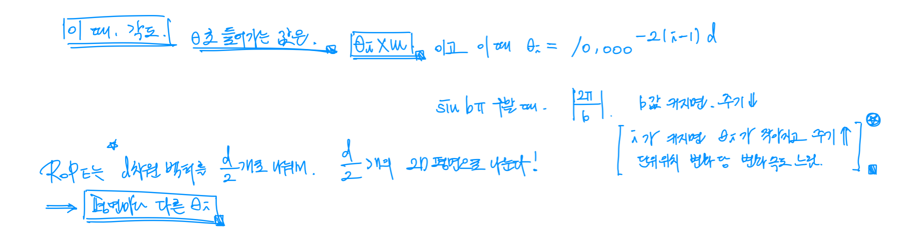

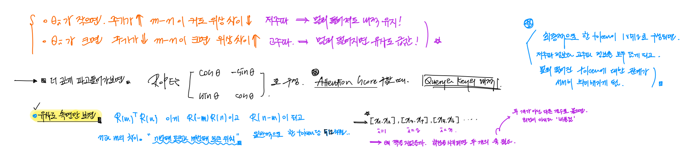

Long-Term decay of RoPE

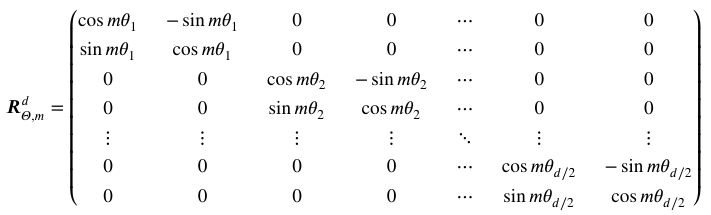

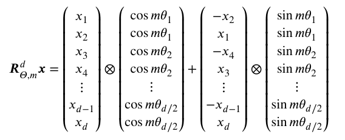

<strong>RoPE(Rotation Position Embedding)</strong> Position embedding을 Rotation을 통해서 반영하는 것입니다. input을 2차원 pair로 재구성을 하고, 각 pair마다의 position과 벡터의 차원에 따라서 회전 각 theta를 다르게 부여합니다. 즉, 벡터를 회전시키는 과정이 포함되어 있습니다. 이 input이 Query와 Key가 되고 RoPE(m번째 토큰의 Query)와 RoPE(n번째 토큰의 Key)의 곱으로 Attention Score를 구하게 되면, 내적 계산에 위치 정보가 자연스럽게 반영되게 됩니다. <strong>1\) 상대 위치 표현 가능</strong>: 회전 각도의 차이가 곧 상대적 위치의 차이 <strong>2\) 내적에 직접 반영</strong>: Query-Key 내적에 위치 정보를 포함 <strong>3\) 일반화 가능</strong>: 고정된 수식을 기반으로 하기 때문에 긴 시퀀스에도 일반화가 가능 <strong>4\) 파라미터 없음</strong>: Sinusoidal처럼 학습 없이 사용 가능  즉, RoPE는 상대 위치와 절대 위치를 모두 반영했다는 점에서 자연어 처리에서의 중요한 의미를 갖습니다. 상대적으로 먼 거리에 있는 단어들끼리는 연관성이 낮다는 점, 가까운 거리에 있는 단어들끼리는 연관성이 높다는 점, 절대적인 위치에 따라서 같은 단어이더라도 다르게 해석될 수 있다는 점이 모두 반영될 수 있기 때문에 <strong>상대 위치와 절대 위치를 모두 반영할 수 있다는 것은 큰 장점이 됩니다.</strong>

<strong>한계점도 분명히 존재합니다.  </strong>

---

#### <strong>IV. Experiments and Evaluation</strong>

&#91;Model&#93;RoPE를 적용한 Transformer 변형 모델인 'RoFormer' &#91;Dataset&#93; WMT 2014 English-German (약 450만 문장 쌍) &#91;Comparision&#93; Original Transformer Source와 Target을 합쳐서 37,000 token의 Byte-Pair Encoding Vocabulary를 생성합니다. &#91;학습 기법&#93; Adam Optimizer Beta1 &#61; 0.9, Beta2 &#61; 0.98 / 0.0000001 &#60; Learning Rate &#60; 0.0005 / Label Smoothing &#61; 0.1 &#91;성능 점수&#93; BLEU 점수를 테스트셋에서 측정해 최종 성능 보고

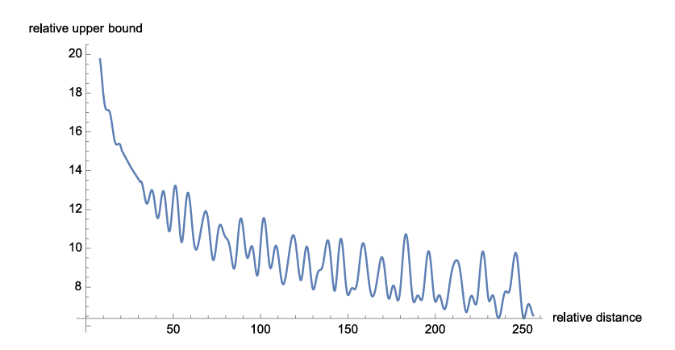

Long-term decay of RoPE

&#91;Results&#93; RoPE를 적용한 RoFormer가 vanilla BERT보다 MLM(Masked Language Modeling) loss가 더 빨리 줄어듭니다. 그리고 RoPE를 사용함으로써 위치 정보를 더 정교하게 주입하기 때문에 Performer의 효율성(선형 복잡도)에 학습 안정성과 표현력까지 더해줍니다.

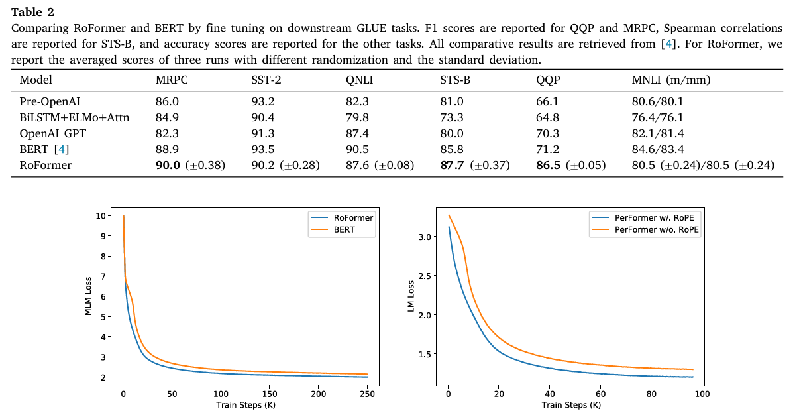

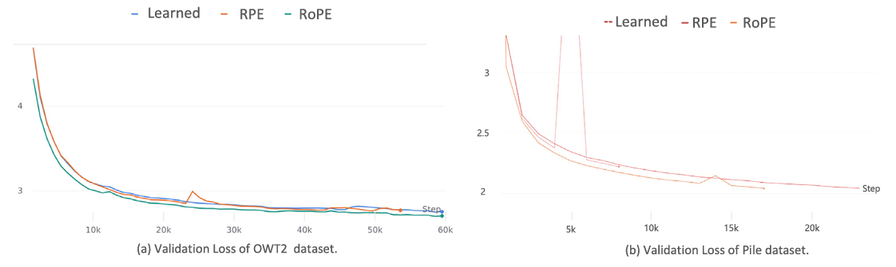