Photo by Ramona / Unsplash

[AdaLoRA: Adaptive Budget Allocation for Parameter-Efficient Fine-Tuning](https://arxiv.org/abs/2303.10512)을 리뷰합니다.

LoRA에서 사용된 것처럼, incremental parameter가 따로 존재하는데, budget이 제한적. 아무래도 하드웨어적으로 메모리 용량이라던지 저장공간 측면에서 허용할 수 있는 파라미터의 양이 있다보니 추가로 학습할 수 있는 파라미터의 범주가 어느정도 되는지가 매우 중요합니다.

기존 방법에서는 incremental parameter budget를 모든 weight matrix에 균등하게 나누는 경향이 있었습니다. 하지만 weight마다 중요도가 다르기 때문에 일괄적으로 같은 budget을 주면 성능이 suboptimal 해진다는 점이 좋지 않다고 말합니다.

weight matrix의 중요도 스코어에 따라서 parameter budget(&#61;rank)를 dynamic하게 다르게 배분합니다.

바로 ΔW를 SVD 형태인 Δ&#61;PΛQ로 매개변수화해서, 중요도가 낮은 부분의 singular value를 잘라내는 방식으로 랭크(&#61;예산)를 줄입니다. 하지만 SVD는 계산 복잡도가 매우 높기 때문에 P, Λ, Q를 직접 학습하면서 Λ만 마스킹하는 구조로 계산 비용을 줄이는 시도를 합니다.

각 weight의 incremental parameter에 대해 중요도 스코어를 계산하고 중요도가 낮은 singular value부터 점진적으로 0으로 만들어나가면서 전체 예산 안에 맞게 rank를 조절합니다. 학습 초반에는 목표 예산보다 조금 큰 예산으로 시작했다가 학습을 진행하면서 전역 스케줄러로 예산을 서서히 줄여가는 방식으로 안정성을 높입니다.

2019년 논문에 따르면 Pre-trained LM이 다양한 자연어 task에서 좋은 성능을 보여줬고, full fine-tuning으로도 downstream task에 적용하는 것이 주된 방법 중 하나이기도 했습니다. 다만 모델이 커질수록 메모리와 저장 공간을 매우 소모한다는 문제점을 가지고 있습니다.

파라미터 수와 메모리 문제가 제일 대표적인 문제인데, BERT의 경우 3억 개, T5의 경우 110억 개, GPT-3는 1750억 개 파라미터를 가진다고 설명합니다. 이런 NLP 시스템은 여러 task를 동시에 처리해야 하는 상황이 많다고 말합니다. downstream task가 많을 때 full fine-tuning을 하면 거대 모델을 별도로 한 카피씩 가지고 있어야 해서 총 메모리 사용량이 사실상 감당하기 어려울 정도로 커지게 됩니다.

이를 대처하기 위한 다양한 방법이 있었습니다. 첫 번째, 큰 Pre-trained Language Model에 small neural modules(adapter, prefix, prompt 등)만 추가하고 base model은 그대로 얼려두고 task별 module만 학습하는 방식이 있습니다. 이렇게 하면 task마다 추가 및 업데이트 되는 파라미터 수가 매우 적어서 full fine-tuning과 비슷한 성능을 유지하면서도 메모리 사용량을 크게 줄일 수 있다고 설명합니다. original model parameter의 1%만큼의 파라미터만 업데이트해도 memory consumption이 많이 완화가 되고 성능은 어느정도 유지가 된다는 것입니다.

두 번째로, diff pruning이라는 PEFT 방법을 통해서도 해결하고자 했습니다. 사전학습된 가중치 행렬이 있을 때 downstream task에서는 W 자체를 다시 학습하는 대신에 W를 그대로 두고 또 다른 incremental parameter를 업데이트 하는 방식입니다. 이 incremental parameter matrix를 sparase matrix로 두어서 실제로는 중요한 위치의 업데이트만 남기고 나머지는 0으로 만들자는 아이디어를 가지고 있습니다.

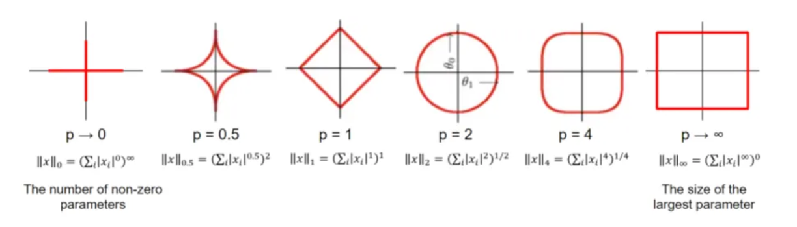

diff pruning은 W &#61; W(0) &#43; ∆라는 식으로 표현이 가능합니다. ∆를 W(0)와 동일한 차원의 행렬로 두고 처음에는 W(0)와 ∆ 전체가 학습 가능한 파라미터로 시작합니다. 학습 중에는 ∆의 각 element에 대해서 gradient를 계산해 업데이트 한 뒤, 값의 크기(magnitude)가 작은 항목을 요소별로 pruning해서 0으로 만듭니다. 결과적으로 대부분의 ∆&#95;ij &#61; 0이 되고 작은 일부 위치만 non-zero라서 non-zero 위치와 값만 저장하면 저장해야할 task별 parameter 수가 크게 줄어들게 됩니다.

task마다 바뀐 부분만 sparse하게 저장해서 디스크/파라미터 수를 줄이는 파라미터 저장 효율 측면의 PEFT 방법입니다.

diff pruning은 두 가지의 문제점을 가지고 있습니다.

1&#46; 연산/프레임워크 측면의 문제점 &#45; 희소성 활용이 어렵다. ∆는 논리적으로 sparse matrix이지만 딥러닝 프레임워에서 비구조적(unstructure) sparse matrix 연산은 최적화가 잘 지원되지 않습니다. 그래서 실제 행렬에서는 ∆를 sparser가 아니라 dense matrix로 저장하고 계산을 해야합니다. 즉 실질적으로는 sparse를 사용함으로써 얻는 메모리 및 저장공간 차원에서의 이득을 보지 못한다는 것입니다.

2&#46; 계산 비용 측면의 문제 (full fine-tuning과 비슷한 맥락) ∆의 모든 원소에 대해 gradient를 계산하고 업데이트 한 다음 그 후에 magnitude 기반으로 prune을 수행합니다. 그래서 backward 시점에 계산해야하는 gradient 수나 연산량이 full-fine tuning에서 W(0) 전체를 업데이트 하는 것과 거의 비슷해지게 됩니다. 즉, 저장되는 최종 파라미터 수는 줄었지만, 학습 시간과 연산량은 사실상 그대로라는 것입니다.

그래서 이런 문제를 해결하기 위해 LoRA가 등장한 것입니다.

∆를 low rank 행렬로 가정하고 ∆ &#61; BA로 parameterize합니다. B는 d1 &#42; r, A는 r &#42; d2의 형태로 구성이 되어있고 파인튜닝 하는 동안 업데이트 되는 파라미터는 A, B 분이며 가중치 W(0)는 그대로 freeze합니다. r은 hyperparameter입니다.

논문에서는 d1 &#61; d2 &#61; 1024, r &#61; 8로 가정했을 때, 추가 학습 파라미터가 전체의 0.5% 미만이고 full fine-tuning과 비교했을 때 학습 overhead를 최대 70%까지 줄일 수 있다고 주장합니다.

&#91;LoRA vs Diff Pruning&#93; diff pruning은 ∆를 sparse matrix로 만들었으나 실질적으로 비효율적이었기 때문에 dense처럼 다뤄야 했습니다. 하지만 LoRA는 이런 문제를 인지하고 BA 형태로 두 개의 작은 dense 행렬 곱만 추가하면 되는 문제로 바꿔버렸습니다.

하지만 LoRA에도 명확한 한계가 존재했습니다. 바로 모든 ∆에 동일한 hyperparameter rank r을 사전에 고정한다는 점입니다.

실제로는 어떤 모듈(FFN vs Self-Attention)이 더 중요한지, 어떤 layer가 더 중요한지 서로 다르지만 모두에게 동일한 파라미터 budget(&#61;rank)를 주는 것은 비효율적이라고 주장합니다.

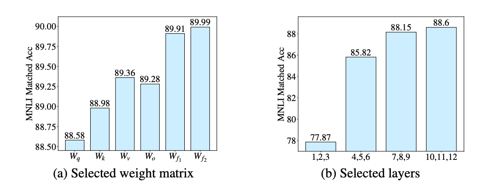

Figure 1을 보면 같은 수의 학습 가능한 파라미터만 사용한다고 가정했을 때 FFN을 LoRA로 fine-tuning한 것이 self-attention을 fine-tuning한 것보다 훨씬 성능이 좋았었다고 보고합니다.  Figure 2를 보면 같은 수의 학습 가능한 파라미터만 사용한다고 가정했을 때 상위 layer, 하위 layer에 LoRA로 fine-tuning했을 때 상위 layer의 가중치 행렬이 더 성능에 중요한 역할을 했음을 알 수 있습니다.

결론적으로 성능에 중요한 역할을 미치는 기여도, 즉 중요도가 다른데 동일한 budget(&#61;rank)를 주는 것은 비효율적이라는 주장입니다.

그래서 어떤 layer나 모듈의 ∆가 중요하다고 판단되면 더 높은 budget(&#61;rank)를 배정하게 됩니다. 그러면 해당 update가 더 많은 자유도를 가지게 되어 해당 레이어가 task-specific한 패턴을 더 잘 표현할 수 있게 됩니다. 반대로 특정 layer나 모듈의 ∆가 중요하지 않다고 판단되면 rank를 줄이거나 pruning하는 방향으로 거의 없애버려서 쓸데없는 파라미터에 대한 overfitting을 막고 전체 연산량, 메모리 같은 계산량을 줄이겠다는 의도입니다.

그러면 그 의도를 어떻게 실현시킬 수 있을까요? SVD based parametrize를 보면 알 수 있습니다.

- 기존 SVD &#43; truncation 방식 행렬에 직접 SVD를 수행해서 작은 singular value를 잘라(truncate) rank를 줄이는 방법을 사용할 수도 있습니다. <strong>이렇게 하면 rank를 명시적으로 제어할 수 있고, 잘 알려진 SVD 성질 때문에 잘린 후의 행렬이 원래 행렬과의 오차를 최소화한다는 장점이 있습니다. </strong>
- 대형 모델에서는 SVD 반복이 매우 비쌉니다. O(d^3) 정도의 복잡도를 가지고 있기 때문에 비현실적으로 비쌉니다.

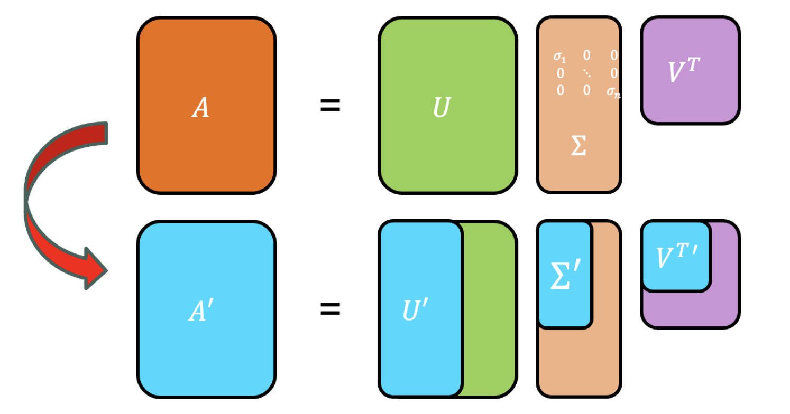

SVD를 쓰면 행렬 A를 σ1u1v1 &#43; σ2u2v2 &#43; ... 이런 방식으로 분해가 가능하게 됩니다. 이미지의 용량은 줄이면서도 화질의 손상도 줄여주는 압축 복원 방법에 널리 사용이 되었던만큼 용량은 줄이되 성능을 유지하거나 향상시킬 수 있다는 점에서 매우 매력적인 것입니다.

LoRA에서 어떤 문제점을 보완하기 위해서 이렇게 학습이 진행된 것일까요?

- reactivation 불가능: BA의 곱으로는 한 번 B나 A의 특정 행렬의 gradient가 0이 되면 다시 활성화 시키는 것이 불가능했습니다. 하지만 AdaLoRA에서는 lambda에 있는 singular value 값을 다시 키우면 됐기 때문에 recovery 하는 것이 가능해졌습니다.
- B와 A의 비직교성: 둘 다 서로 dependent 하기 때문에 하나가 바뀌면 다른 쪽에도 영향을 준다는 것이 학습 불안정에 영향을 줍니다.

Eckart-Young-Mirskty Thorem에 따르면 작은 singular value부터 버리게 되면 SVD를 근사 최적화 하는 과정에서 오차가 최소가 된다는 것이 수학적으로 증명이 되어있습니다.

하지만 계산 비용이 너무 비싸서 직접 계산하는 대신에 모방해서 학습을 하는 형태를 보입니다. 바로 ΔW를 SVD 형태인 Δ&#61;PΛQ로 매개변수화해서 SVD 형태처럼 보이게 합니다. Λ는 singular value를 대각행렬로 담아내고, P와 Q는 orthogonal 행렬 역할을 합니다. 실제로는 P, Λ, Q 모두 학습 가능한 파라미터로 두고, 학습 중에 SVD를 반복 계산하지 않습니다.

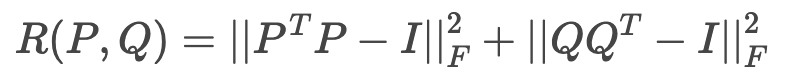

loss 함수 정의

<strong>P, Q가 진짜 SVD의 U, V처럼 되려면 각 열이 거의 직교해야합니다. P와 P의 전치행렬의 내적이 I, Q와 Q의 전치행렬의 내적이 I가 되도록 하는 정규화 항을 loss에 추가함으로 인해서 실제 SVD의 좌우 행렬인 U와 V처럼 되게 하는 것입니다. 이렇게하면 SVD를 직접 돌리지 않더라도 SVD와 비슷한 구조를 유지할 수 있고 고비용 SVD 계산을 피할 수 있게 됩니다. </strong>

그리고 Λ에 담겨있는 singular value 중 중요하지 않은 value들만 0으로 만들어서 drop하는 singular value drop이 있습니다. 이를 통해 중요하지 않은 정보는 제외시키고 P와 Q는 그대로 유지할 수 있다는 점이 강조됩니다. 이렇게 되면 특정 triplet을 너무 일찍 잘랐다고 판단했을 때 Λ의 singular value를 다시 키워서 회복할 수 있는 여지를 남기고, 값의 크기가 작은 singular value만 제거하므로 원래 행렬과의 차이가 최소화되고 학습이 더 안정적이게 됩니다. 그래서 SVD를 다 계산해서 중요하지 않은 정보들을 pruning하는 것은 비용이 매우 비싸기 때문에 PΛQ를 통해서 SVD 계산없이 singular value만 중요도 기준으로 masking해서 rank를 동적으로 조절할 수 있게 합니다. 결론적으로 triplet 단위로 중요도를 계산하고 rank(&#61;남길 singular value의 개수)를 동적으로 조절하는 메커니즘이 됩니다. PΛQ 구조를 기반으로 각 성분의 중요도 점수를 사용해 유효 rank r을 동적으로 조절합니다.

이 상태에서 바로 pruning을 하게 되면, 일시적으로 튄 gradient 때문에 중요한 성분이 제거되는 불안정한 상황이 발생할 수 있습니다. 이를 해결하기 위해 AdaLoRA에서는 EMA 기반 smoothing을 사용합니다. 과거의 중요도 값과 현재 mini-batch에서 계산된 중요도를 일정 비율로 섞어 주면서, 장기적으로 일관되게 중요한 singular value만 살아남도록 합니다. 이를 통해 stochastic noise를 줄이고, 안정적인 rank 조절이 가능해집니다. 또 하나 중요한 요소는 uncertainty, 바로 불안정성입니다. 만약 어떤 singular value의 중요도가 batch마다 크게 변한다면, 그 값은 아직 신뢰하기 어려운 정보일 수 있습니다.

AdaLoRA는 이러한 변동성을 측정해 uncertainty로 정의하고, smoothing된 sensitivity와 uncertainty를 함께 고려해 최종 importance score를 계산합니다. 이렇게 계산된 importance score를 기반으로, AdaLoRA는 중요도가 낮은 singular value부터 pruning하고, 그로 인해 확보된 예산을 더 중요한 곳에 줄 수 있게 됩니다.

이 과정은 고정된 rank를 사용하는 기존 LoRA와 달리, 학습이 진행되면서 layer별로, 그리고 모듈별로 서로 다른 rank를 자동으로 할당할 수 있게 만듭니다. 이게 무슨 말이냐면, incremental matrix는 layer나 module마다 따로 두지만 pruning을 할 때에는 한 군데로 모아놓고 크지 않은 값들은 0으로 만들어버린다는 것입니다.

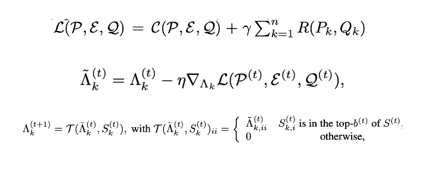

Δ&#61;PΛQ 구조를 SVD로 보면 Δ는 singular value와 그 행과 열에 해당하는 P와 Q의 내적 값과 내적을 한 것의 총합인데, 이 세 개의 묶음을 triplet G {λi,pi,qi}라고 합니다. λi는 i번째 singular value, pi &#38; qi는 i번째 좌/우 singular vector를 의미합니다.

이 triplet이 모델 성능에 얼만큼 기여하는지 수치화하기 위해서 새로운 importance metric을 정의합니다. 기존 sensitivity 기반 pruning 아이디어를 가져오되, 기존처럼 개별 weight 단위가 아니라, triplet 전체에 대한 기여를 반영하도록 설계합니다.

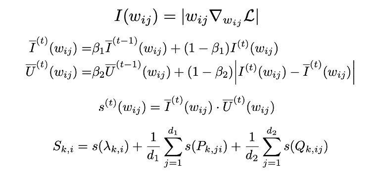

그래서 중요도 점수가 낮은 triplet은 우선순위가 낮게 취급이 되고, triplet의 singular value를 0으로 만들어 해당 성분을 pruning합니다. 반면 중요도 점수가 높은 triplet은 지속적으로 fine-tuning에 사용합니다. 결국 중요도 점수가 낮은 rank는 줄이고 중요도 점수가 높은 rank는 유지해서 전체적인 budget을 조절하는 메커니즘인 것입니다.

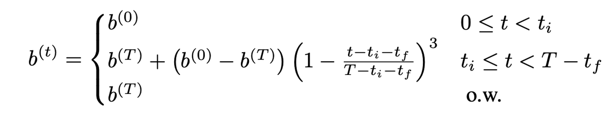

여기에 더해 학습을 원활하게 하기 위한 global budget scheduler라는 메커니즘도 도입되었습니다. 구체적으로는 최종 목표 budget보다 조금 더 크게 budget을 설정한 후에 학습이 진행되면서 budget을 줄여가면서 최종 목표까지 내려가는 scheduler입니다.

초기에 예산을 평균으로 균등하게 배분해서 초기 부분에는 어떤 matrix가 중요한지 모르기 때문에 모두에게 고른 budget을 줘서 parameter space를 넓게 탐색하는 것입니다. 별로 중요하지 않은 task가 초기에 넉넉한 budget을 받을 수 있지만 cubic schedule로 나중에 줄여나갈 때 어차피 중요도가 낮은 쪽의 triplet이 먼저 제거가 되기 때문에 최종 시점에는 중요한 task 쪽에만 상대적으로 높은 rank가 남게 됩니다.

초반에는 파라미터 공간을 넓힐 수 있고, 후반으로 갈수록 중요도가 높은 triplet에만 budget을 집중시키면서 학습 안정성과 최종 성능이 좋아진다고 주장합니다.

다양한 모델에 적용했을 때 성능이 괜찮았고, AdaLoRA는 다양한 budget 설정에서 기존 baseline 방법들보다 일관되게 좋은 성능을 얻을 수 있습니다. 특히 low budget으로 학습 가능한 파라미터의 비율이 매우 낮을 때 성능의 차이가 크게 나게 됩니다. 즉, 거의 전체 파라미터를 건드리지 않더라도 더 좋은 성능을 내게 됩니다.

### Experiment

set-up: DeBERTaV3-base, single V100

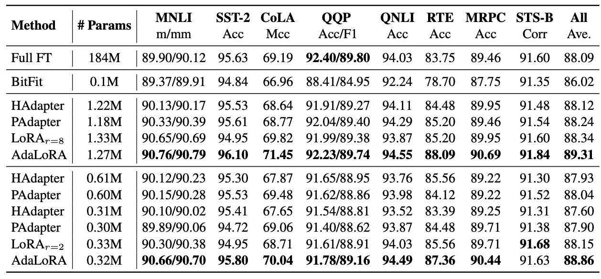

Natural Language Understanding

GLUE benchmark 각 task에서 일반적으로 쓰는 지표들이다. General Language Understanding Evaluation에 해당하는 9개의 task / GLUE는 single-sentence classification(2개: CoLA, SST-2), similarity/paraphrase(3개: QQP, MRPC, STS-B), natural language inference(4개: MNLI, QNLI, RTE) 태스크로 구성되며

- MNLI m/mm: matched, mismatched 두 validation set의 정확도
- SST-2 Acc: SST-2 감성 분류 태스크의 정확도
- CoLA Mcc: 문장 문법성 판별 태스크 CoLA의 correlation coefficient
- QQP Acc/F1: Quora Question Pairs 중 중복 여부 분류에서 정확도와 F1점수
- QNLI, RTE, MRPC Acc: 각각 자연어 추론과 문장상 paraphrase 태스크의 정확도
- STS-B Corr: 문장 의미 유사도 태스크에서 예측 점수와 라벨 간 피어슨, 스피어만 평균 상관계수
- 모든 task 점수 적절히 평균 낸 GLUE 전체 평균 성능 지표

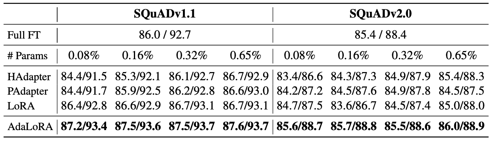

Question Answering

표는 DeBERTaV3-base 모델을 SQuADv1.1과 SQuADv2.0 질문 답변(Question Answering) 데이터셋에서 평가한 결과로, 파라미터 예산(# Params)에 따른 EM(Exact Match)/F1 점수를 보여줍니다.

근데 왜 Exact Match/F1으로 점수를 구하는가? EM은 strict correctness, F1은 semantic closeness를 보완적으로 측정해 종합적으로 평가할 수 있게 합니다.

Adapter는 예산↓ 시 성능 급감(HAdapter 83.4/86.6), LoRA도 미달. AdaLoRA는 저예산에서도 고예산 성능 유지하며 parameter efficiency 최상

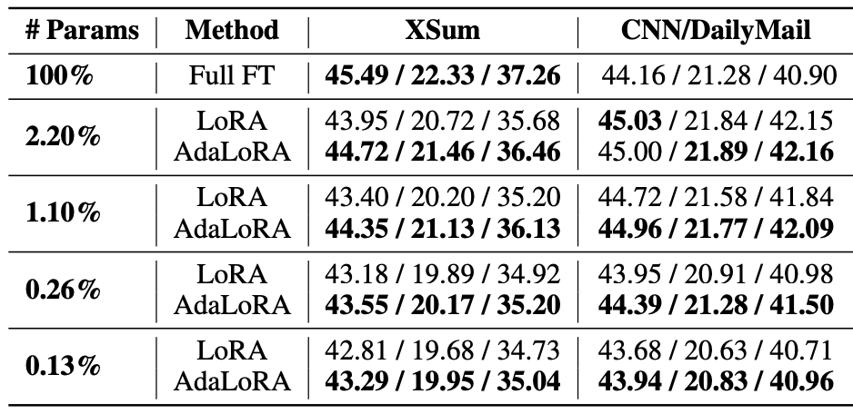

Natural Language Generation

### Analysis

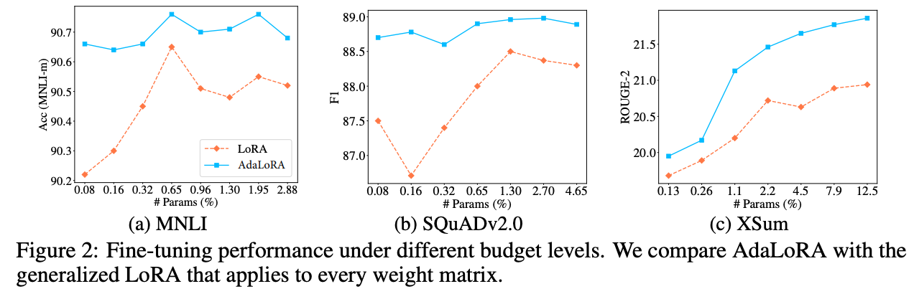

핵심결과: MNLI-m과 SQuADv2.0에서 0.16% 저예산의 performance가 4.65%의 performance와 비슷한 성능을 보인다. SQuADv2.0의 관점에서 F1 score의 scale을 보면 되게 최고의 성능에 근접하다는 사실을 알 수 있습니다.

Xsum, 즉 NLG에서는 예산증가와 성능의 관계가 일정 선형관계를 보이고 있는 것으로 나타나는데, 이는 NLG 태스크가 더 많은 매개변수를 활용할 수 있음을 시사합니다.

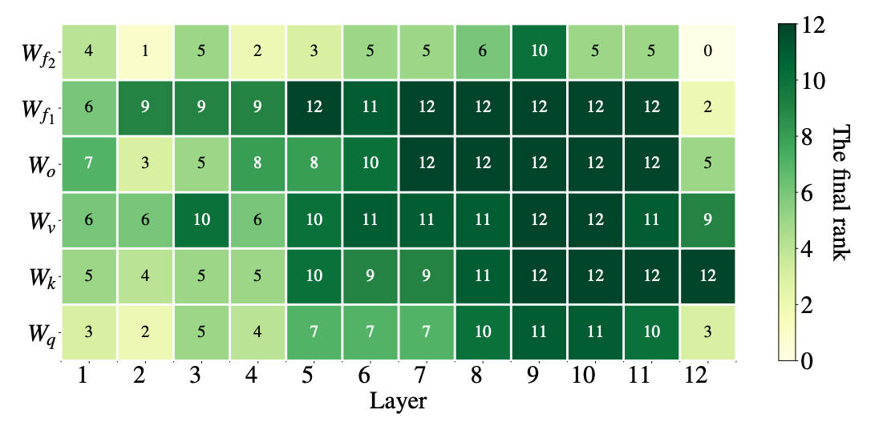

AdaLoRA는 FFN 모듈과 상위 레이어(11-12층)에 더 많은 예산을 할당하며, 이는 Figure 1의 경험적 결론(FFN/상위 레이어가 성능에 더 중요)과 일치합니다. 보면 전반적으로 상위 layer에, 그리고 FFN layer에 많이 예산이 포진되어있는 것을 볼 수 있습니다.

AdaLoRA는 SVD parameterization, Adaptive budget 측면에서 좋은 아이디어를 제시한 논문입니다.

AdaLoRA 이후의 연구를 토대로 분석할 수 있는 것 중 제일 많이 짚는 한계점은 SVD의 특성을 그대로 가져다 쓰는 게 아니라 사용하고자 노력한 수준이라는 점입니다. SVD의 특징을 표방하고 직교 성질도 soft하게 규제항 수준에서 걸어놓은 상황이기 때문에 수학적인 장점을 온전히 사용하지 못하고 있다는 점을 많이 개선해서 연구가 이뤄지고 있는 중입니다.