photo by Sam Goodgame / Unsplash

[GLU Variants Improve Transformer](https://arxiv.org/abs/2002.05202)를 리뷰합니다.

GLU Variants Improve Transformer를 소개하는 이유가 굉장히 명확합니다. 바로 이 논문을 기반으로 현재는 Transformer의 activation function의 trend가 바뀌었기 때문입니다.

Original Transformer가 Attention Is All You Need 논문에 나온 Google Research 팀이 제안한 모델이며, Activation Function은 ReLU를 사용했습니다. 하지만 시간이 지날수록 Transformer 기반 모델들이 다른 Activation Function을 채택했으며 현재는 SwiGLU라는 activation function이 Trend로 자리잡은 상황입니다. 이 GLU 계열의 함수들의 성능을 나열해 제시한 것이 바로 ‘GLU Variants Improve Transformer’입니다.

## <strong>I. Introduction</strong>

기본적으로 활성화 함수를 사용하는 이유는 무엇일까요? 선형 함수의 연속으로 구성된 각 layer는 깊은 네트워크에서 연산을 이어간다 하더라도 결국 하나의 선형 함수꼴로 계산이 돼 복잡한 데이터를 학습하기 어렵다는 문제를 해결하기 위해 사용합니다. 즉, 비선형성을 추가해서 표현력을 증가시켜 복잡한 구조도 잘 학습할 수 있게 만드는 것입니다.

기존에 사용하던 Activation Function은 ReLU입니다.

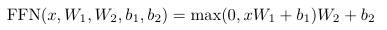

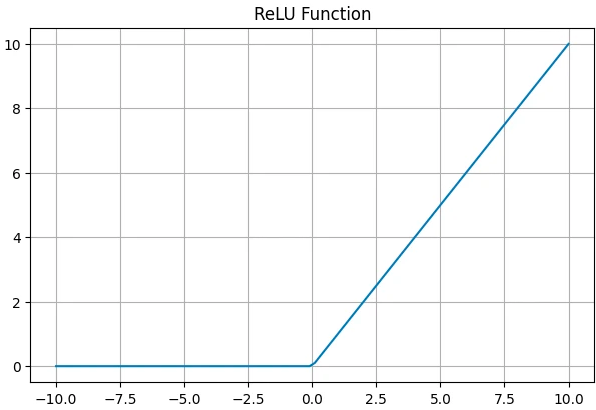

ReLU

일반적으로 Activation Function의 앞 뒤로 각각 한 번씩 총 ‘두 번’의 선형 변환을 거치게 됩니다.

우선 입력 값 x를 W&#95;1와 b&#95;1를 통해서 선형 변환을 하고 그 결과를 ReLU에 집어넣어 연산 결과를 element 별로 적용한 다음에 다시 W&#95;2와 b&#95;2로 2차 선형 변환을 하게 됩니다.

Linear → Activation → Linear의 과정을 거치는 것입니다.

단순히 선형 변환만 하는 Linear→Linear 연산은 몇 번을 반복하더라도 하나의 선형변환으로 정리할 수 있어 학습을 깊게 쌓는 의미가 없게 됩니다. 그런 의미에서 Activation Function을 적용하게 됩니다.

그렇다면 왜 Origianl Transformer에서는 ReLU를 사용했고 ReLU는 무엇일까요?

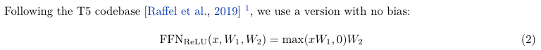

T5(Text-to-Text Transfer Transformer, Google)의 경우는 ReLU의 두 번 선형 변환을 거치기는 하지만, bias항은 뺀 연산을 합니다.

왜 bias를 사용하지 않아도 되는 걸까요?

Transformer는 기본적으로 Attention 후에 정규화를 하는 과정을 담고 있습니다. 이 정규화 하는 과정에서 bias의 역할을 하는 과정이 있기 때문에 bias항을 추가하는게 모델의 파라미터 수만 늘게 되어 대규모 모델에서는 효율성 측면에서 빼버리는 게 훨씬 이득이기 때문입니다. 원래 두 번의 선형 변환에서 가중치 두 개와 bias 두 개로 총 네 개의 파라미터가 있었지만 bias항을 두 개를 줄여버림으로 인해서 절반으로 줄게 되는 효율을 얻을 수 있게 됩니다.

하지만 ReLU는 Dead Nerueon 문제와 x &#61; 0에서 미분이 불가능하다는 점에서 명백한 단점을 가지고 있습니다. ReLU는 2011년에 제시된 아이디어이기 때문에 이후에도 Activation Function에 대한 여러 아이디어가 제시되었습니다.

2016년에는 GELU, 2017년에는 SwiGLU라는 주요한 아이디어가 나왔습니다.

## <strong>II. Gated Linear Units (GLU) and Variants</strong>

해당 논문에서는 총 다섯 가지의 GLU라는 Activation function 계열의 변형에 대한 비교를 하고 그 중에 성능이 제일 좋았던 Activation Function은 무엇인지에 대한 내용을 담고 있습니다. GLU에서의 핵심 아이디어는 Gating에 있습니다.

단순히 activation function에 입력을 집어넣는 것이 아니라 무엇이 중요한지 확률적으로 알게 한다는 것입니다.

동일한 feature를 기준으로 입력값을 반으로 나누고 서로 다른 선형 변환을 거쳐 학습을 하기 때문에 학습 과정에서 동일한 feature에 대해서 정보의 중요성을 더 자세하고 디테일하게 파악할 수 있을 것이라는 기대를 할 수 있는 것입니다.

이제 GLU 계열의 Activation Function 다섯 개의 성능을 비교합니다.

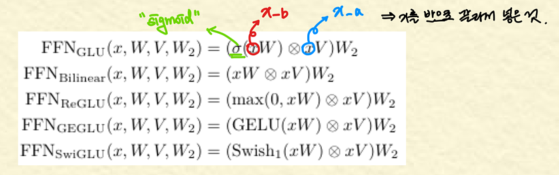

T5 Codebase임을 가정하고 bias항은 모두 제외한 것입니다. 기존 1차, 2차 선형변환의 형태는 그대로 가져갑니다. 하지만 입력값을 두 개로 나누었고 가중치의 개수도 3개로 늘어났습니다. 일단 입력값을 x&#95;a와 x&#95;b로 나누고 각각 가중치를 다르게 곱하기 때문에 1차 선형 변환 때부터 가중치가 두 개가 발생합니다. 이후 2차 선형변환에서 다른 가중치를 곱하기 때문에 다른 활성화 함수들은 1차 2차 선형 변환 과정에서 총 가중치가 2개이지만 GLU 계열들은 총 가중치가 3개입니다. 만약 모델의 학습 차원을 그대로 유지하면 가중치가 2개에서 3개로 되었으니 연산량이 3/2배 늘게 되지만 모델 학습 차원을 2/3으로 줄이면서 모델의 연산량은 그대로 유지한다라는 점을 논문에서 짚고 넘어가고 있습니다.

우선 GLU 계열의 함수들이기 때문에 우선적으로 GLU가 어떤 것인지에 대해 먼저 알아보겠습니다.

### <u><strong>&#91;GLU / Gated Linear Unit&#93;</strong></u>

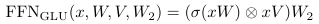

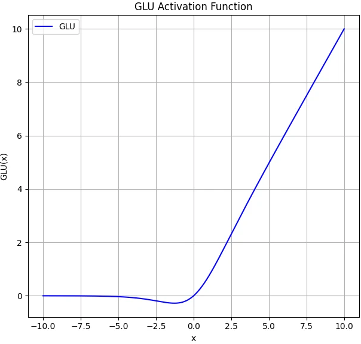

입력의 첫 번째 절반을 a, 입력의 두 번째 절반을 b라고 두었을 때, b를 sigmoid activation function 안에 집어넣어서 Gate처럼 동작하게 합니다. 이를 통해서 정보의 흐름을 조절하고 모델이 더 유연하게 학습할 수 있도록 만들어줍니다. element wise 곱을 활용하여 원소별로 얼마나 정보를 통과시킬지 조절하는 방식으로 Gating을 하게 됩니다. 비선형성 &#43; 선형성을 모두 가질 수 있는 특성을 띠기 때문에 표현력이 높은 게 장점이고 element wise 곱을 사용해 GPU 병렬연산에 효율적이어서 속도가 빠르다는 특징이 있습니다.

하지만 Gating을 할 때 Sigmoid 함수를 사용하기 때문에 0에 가까운 수가 곱해지면 결국에는 Vanishing Gradient 문제를 피할 수는 없습니다.

### <u><strong>&#91;Bilinear&#93;</strong></u>

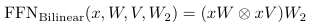

GLU에서 입력 절반을 나눈다는 아이디어는 공유하지만 sigmoid를 통해 gating하는 효과를 제거한 버전입니다. sigmoid를 안 쓰기 때문에 연산량 측면에서 단순하다는 장점은 있지만, Gating의 효과를 볼 수 없기 때문에 정보의 중요성에 대한 파악이 어렵고 따라서 성능이 좋지 않습니다. 거의 주목을 받지 못한 Activation Function입니다.

### <u><strong>&#91;ReGLU / Rectified Gated Linear Unit&#93;</strong></u>

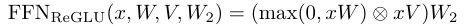

GLU에서 입력 절반을 나눈다는 아이디어는 공유하지만 sigmoid 대신에 ReLU를 사용한 것입니다. sigmoid와 다르게 우선 비선형성을 부여할 수 있다는 점에서 제시한 아이디어이지만, 결국 ReLU도 극복하지 못한 한계인 Dead Nuereon 문제를 그대로 가지고 갔기 때문에 자연스럽게 주목받지 못하는 Activation Function이 되었습니다.

### <u><strong>&#91;GeGLU / Gaussian Error Gating Linear Unit&#93;</strong></u>

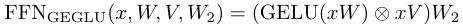

2016년에 제시된 GELU를 변형시킨 모델입니다. 단지 Gating하는 Sigmoid를 GELU로 대체한 것입니다.

### <u><strong>&#91;GeLU / Gaussian error Linear Unit&#93;</strong></u>

이름에서부터 알 수 있듯, Gaussian정규분포의 누적분포함수(CDF)를 활용한 Linear Unit 함수입니다. 값이 클수록 높은 중요도로 판단해서 CDF에 큰 x값을 넣었을 때 1에 가까운 값이 되고, 해당 뉴런이 강하게 활성화되는 효과를 얻을 수 있습니다. 또한 x &#61; 0인 지점에서 미분이 가능하기 때문에 매끄러운 학습이 가능해져 Gradient 흐름도 안정되고  일반화 성능에도 긍정적인 영향을 끼칠 수 있습니다. 하지만 확률 및 랜덤변수 강의에서도 다루는 erf(x) 함수를 통해서 값을 구해야 하며 이를 테일러 급수를 사용해 값을 근사하는데, 이로 인한 연산량이 많다는 문제점이 있습니다. 단순히 성능 대비 너무 많은 연산량으로 인해 지금은 사용하지 않는 Activation Function이 되었습니다.

그렇다면 GeGLU는 GELU를 사용한 건데 무슨 유의미한 차이가 있을까요?

바로 Sigmoid는 &#43;3 이상 또는 -3 이하일 경우 거의 0이나 1에 수렴해서 Vanishing Gradient 문제가 발생한다는 점을 주목해야합니다. 반면에 GELU는 입력이 음수여도 완전히 0이 되지 않고, 입력이 클수록 거의 x에 가까워집니다. 이런 점에서 sigmoid 함수와는 확연하게 다른 특징을 띠고 있기 때문에, 사용했던 것입니다.

GeGLU가 GELU와 다른 점은 바로 Gating을 사용했다는 점인데, Gate가 비선형성을 추가해줌과 동시에 불필요한 channel을 억제해서 학습 용량, 즉 파라미터의 개수에 대한 조절이 가능하다는 특징을 가지고 있습니다.

하지만 이 역시 ‘너무 많은 연산량’이라는 문제는 결국 해결하지 못하기 때문에 주목받지 못하는 Activation Function이 되었습니다.

### <u><strong>&#91;SwiGLU / Swish Gated Linear Unit&#93;</strong></u>

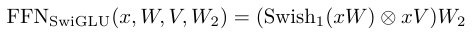

2017년에 제시된 Swish를 변형시킨 모델입니다. 단지 Gating하는 Sigmoid를 Swish로 대체한 것입니다.

그렇다면 Swish는 무엇일까요?

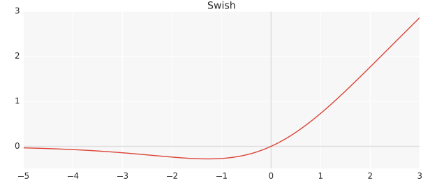

Swish는 Swish(x) &#61; x σ(x)입니다. 단순히 sigmoid 함수에 x를 곱한 형태입니다.

GELU와 장점은 동일하게 가져갑니다. 아무리 음수라고 하더라도 upper bound가 0이지만 절대 0이 되지 않기 때문에 Dead Neureon 문제를 해결했고, 모든 구간에서 미분이 가능합니다.

게다가 GELU에서는 해결하지 못한 ‘연산량’문제도 가볍게 해결했습니다. 테일러 급수를 사용했던 GELU와 다르게 Swish는 x와 sigmoid(x)의 곱으로 구성되어있기 때문에 연산량이 획기적으로 감소했습니다.

즉, GELU의 장점은 모두 가져가고 단점까지 보완한 함수라는 것입니다. 이 함수를 가지고 Gating을 하는 것이 현재 Transformer 학습에서는 제일 좋은 성능을 보여주고 있고, 업계 표준으로 사용되고 있습니다.

→ 결론: SwiGLU가 현재의 Activation Function 중에서는 널리 사용되고 있습니다.

---

## <strong>III. Experiments on T5</strong>

- Encoder, Decoder &#45; 12 layers
- Dimension of Model &#45; 768
- Number of Attention Heads &#45; 12
- Dimension of Each Attention Heads &#45; 64
- Dimension of Feed Foward Network &#45; 2048

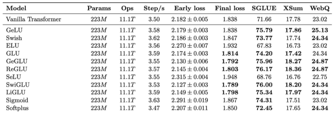

- <strong>Params</strong>: 223M(2억 2,300만)개의 파라미터로 동일합니다.
- <strong>Ops</strong>: 모델의 연산량(Operation count, FLOPs)을 의미합니다. 11.1T로, 11.1테라가 한 epoch이나 한 step과 같은 한 번의 작업에 수행되는 연산량을 의미합니다.
- <strong>Step/s</strong>: 1초에 처리 가능한 스텝 수. 스텝 수가 클수록 학습 속도가 빠르다는 것을 의미합니다.
- <strong>Early loss</strong>: 학습 초기에 측정한 손실 함수(loss)의 평균과 표준 편차를 의미합니다. 손실 값이 낮을수록 정확한 예측입니다. 학습이 제대로 설정되었는지 중간에 loss를 확인함으로 인해서 데이터 오류나 모델 구조에 문제가 있는지 확인할 수 있고, 초반 loss를 빠르게 파악하여 실험을 조기 중단해 자원을 아낄 수 있는 방법이 되기도 합니다. 또한 최종 성능이 비슷하더라도 early loss가 낮은 모델이 더 빠르게 수렴할 것이라 기대할 수 있습니다.
- <strong>SGLUE</strong>: SuperGLUE 벤치마크 모델 성능입니다. 자연어 이해(Natural Language Understanding, NLU) 태스크에서 사용되며 값이 높을수록 좋습니다. (뉴욕주립대에서 만든 고차원적 자연어 이해를 파악하기 위한 성능 지표가 SuperGLUE입니다.)
- <strong>XSum</strong>: XSum 데이터셋 기반 요약 태스크에서 ROGUE 성능 점수입니다. 문서 요약 성능 점수가 높을수록 문서 요약 성능이 좋음을 의미합니다. (애든버러 대학교에서 만든 원문 내용 기반을 완전히 새로운 문장으로 요약하는 모델의 평가 지표입니다.)
- <strong>WebQ</strong>: WebQuestions 데이터셋 기반 Q&#38;A 태스크에서의 성능점수입니다. 점수가 높을수록 질의응답 성능이 좋음을 의미합니다.