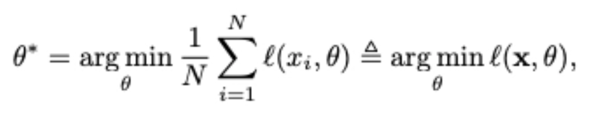
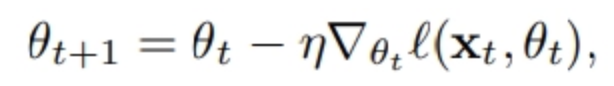
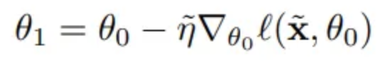
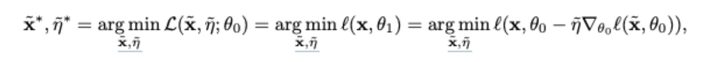
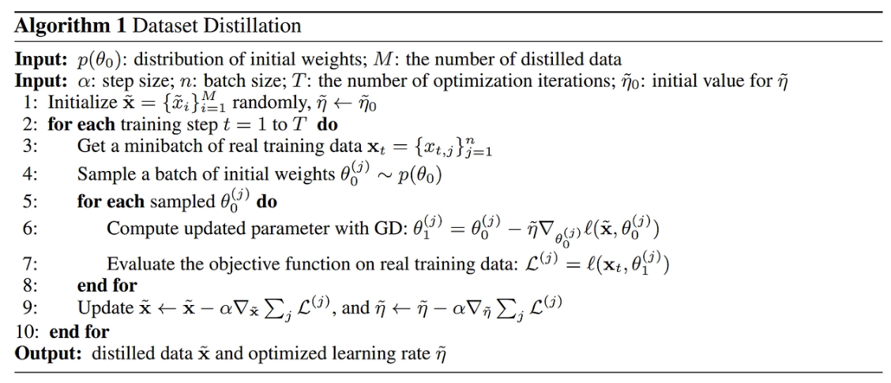
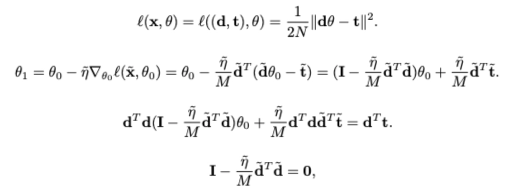

Photo by Willian Justen de Vasconcellos / Unsplash

[Dataset Distillation](https://arxiv.org/pdf/1811.10959)을 리뷰합니다.

Dataset Distillation은 본래 성분별 끓는점 차이를 이용해 물질을 분리하는 화학적 공정에서 착안하여, 이를 데이터셋 구축 과정에 적용한 개념입니다. 즉, 증류 과정처럼 파라미터 업데이트에 유효한 정보(informative components)만을 추출하여 압축된 합성 이미지(synthetic images)를 생성하면, 이것만으로도 원본 데이터셋 못지않은 성능을 달성할 수 있다는 것입니다.

기존의 Network Distillation(Knowledge Distillation)이 앙상블된 Teacher 모델의 지식을 작은 Student 모델로 전이하는 '모델 압축' 기법이었다면, Dataset Distillation은 모델 구조는 고정한 채 대규모 훈련 데이터셋 전체의 정보를 극소수의 합성 데이터로 압축하려는 아이디어입니다. 논문의 핵심 주장은 수만에서 수백만 장에 달하는 훈련 데이터를 클래스당 1장 수준의 합성 이미지로 극단적인 압축이 가능하다는 것입니다.

MNIST를 예로 들면, 0부터 9까지 총 60,000장의 원본 데이터셋을 클래스당 1장씩, 단 10장의 데이터셋으로 압축하여도 충분한 학습 효과를 낼 수 있음을 보여줍니다. 실제로 LeNet 아키텍처에서 원본 6만 장으로 학습했을 때 99%의 Test Accuracy를 기록한 반면, 단 10장의 Distilled Data로 학습했을 때도 94%의 준수한 Accuracy를 달성했습니다. 이러한 고효율 데이터는 추후 Fine-tuning 관점에서도 높은 확장성을 가집니다.

이러한 결과는 실제 데이터가 고유의 분포(Manifold)를 따르지 않으면 테스트 성능을 보장할 수 없다는 기존 머신러닝의 통념을 깨고, 자연 이미지 분포 밖(Out-of-distribution)에 존재하는 합성 이미지로도 효과적인 학습이 가능함을 증명한 것입니다. 즉, 데이터를 고정하고 모델 파라미터를 최적화하던 기존 패러다임에서 역발상하여, 모델을 고정한 채 데이터의 픽셀 값 자체를 Gradient로 업데이트함으로써 '학습에 최적화된 데이터'를 찾아내는 방식입니다.

### 문제점

이 방식은 네트워크의 초기 가중치를 알아야 합니다. ⇒ 현실에서는 random initialization, pretrained model, 초기값이 매번 다릅니다.

### 해결책

랜덤 초기화에도 작동하도록 확장 → iterative distillation

- image distillation을 제안합니다. ⇒ distilled image들을 여러 에폭에 거쳐서 학습 가능, 원래 데이터 성능을 재현하기 위해 필요한 최소한의 distilled data 수의 lower bound를 도출하는 것입니다.

즉, 극소수 이미지로도 고정 초기화 모델 학습이 가능하고, 사전 학습 모델을 초고속으로 fine-tuning을 할 수 있다는 것이며, 또는 의도적으로 특정 클래스를 망가뜨리는 합성 데이터를 생성할 수 있음을 의미합니다.

## <strong>Related Work</strong>

<u><strong>Knowledge Distillation</strong></u>

앙상블된 모델을 하나의 모델로 압축하는 것. 기존의 연구 중에서 실제 데이터 없이 합성 데이터를 만들어 teacher model의 activation 통계를 맞추는 연구가 있었는데, 이 논문은 그게 아니라 실제 데이터셋에서 합성 이미지 몇 장으로 압축한 거니까 애당초에 teacher model이 필요가 없는 것입니다.

<u><strong>Dataset pruning / Core-set / Instance Selection</strong></u>

데이터셋에서 중요한 샘플만 선택합니다. 대표적인 예시로 core-set, active learning, SVM의 support vectors가 있습니다. 공통적인 전제가 선택되는 이미지는 반드시 실제 이미지이고 클래스 당 상당히 많은 샘플이 필요한데, 이 논문에서는 실제 데이터일 필요가 없는 거고 픽셀 값 자체를 마음대로 최적화할 수 있다는 점입니다.

⇒ 기존 방법은 현실 세계의 분포에 묶여있지만, DD는 그 제약에서 완전히 자유롭다. ⇒ 즉, 데이터 선택이 아니라 ‘데이터 생성 &#43; 최적화’라는 다른 문제를 푸는 것이다.

<u><strong>Gradient based Hyperparameter Optimization</strong></u>

기존 연구는 하이퍼파라미터를 최종 validation loss 기준으로 학습 과정을 거꾸로 미분하는 것입니다. DD는 데이터 자체가 대상이고 training set만 사용한다는 것이며 랜덤 초기화에서도 작동합니다.

<u><strong>Understanding datasets / Visualization</strong></u>

기존 연구는 학습된 모델을 이해하고 어떤 feature를 보는지 시각화하는 것이거나 데이터셋의 bias를 분석하는 것인데, DD에서는 모델이 아니라 데이터셋 자체에 주목하는 것입니다.

## <strong>Approach</strong>

목표는 원본 데이터셋을 대체할 수 있을 정도로 성능이 비슷한 극도로 작은 synthetic dataset을 만드는 것입니다. 중요한 전제는 모델 구조는 바뀌지 않고 바꾸는 대상이 데이터라는 것입니다.

기존의 모델 학습 방식

기존에 우리가 알고 있는 학습 방법인데, 이 문제를 DD에서는 다르게 접근할 것입니다.

### <strong>3.1 Optimizing Distilled Data</strong>

요약: 고정된 초기 가중치를 가지고 Gradient descent 1 step일 때의 수식 보통의 모델 파라미터 업데이트는 다음과 같이 합니다.

그런데 해당 논문에서는 합성 데이터셋과 기존 데이터셋 간의 차이를 줄이겠다는 것이 목적이기 때문에 합성 데이터셋에 대해서는 이렇게 모델 파라미터가 정의됩니다.

근데 이런 모델 파라미터 정의를 가지고 최적화하려는 대상이 모델의 파라미터가 아니라 synthetic data와 learning rate라는 것입니다.

### <strong>3.2 Distillation for Random Initialization</strong>

랜덤 초기화인 경우, 즉 현실적인 상황으로 확장시켰을 때의 이야기인데 훨씬 어려운 경우라서 별도의 해결책을 제시합니다. 위에 있는 식만으로는 initial parameter theta&#95;0에 따라서 결과가 달라집니다. 즉, 다른 파라미터에 대한 generalization이 부족하다는 문제가 생깁니다.

### <strong>3.3 Analysis of a simple linear case</strong>

그러면 선형 모델에 적용했을 때 어떨까요? 이 방법이 왜 되는지 그리고 선형모델이기 때문에 어디까지가 한계인지 이론적인 직관을 제공합니다.

일단 linear case는 loss landscape가 완전히 해석이 가능하기 때문에, 딥러닝이어서 어려운 문제인지, data distillation의 아이디어 자체의 한계인지를 짚는 문제입니다.

여기서 linear case로 접근했을 때의 문제는 결국 distilled data의 크기 M은 모델 차원 D 이상이어야한다는 것입니다.

이걸 통해서 알 수 있는 것은 distilled data의 크기 M은 모델 차원 D 이상이어야 한다는 것입니다.

⇒ 필연적인 lower bound가 M ≥ D 60000개의 MNIST 데이터셋에서 중요한 정보만 추출을 해서 10개의 데이터셋으로 만들고 그것만 학습을 해도 학습이 잘된다 → DD

이게 매우 치명적인 수학적인 문제입니다. 왜냐하면 D가 수십&#126;수십만 차원이고, DD의 목적은 N개의 기존 데이터보다 M을 작게 해도 성능이 나오게끔 하겠다가 아이디어였습니다. 그런데 결론이 무작위인 theta&#95;0를 커버하려면 distilled data는 작을 수가 없다는 것입니다. 그래서 arbitrary theta를 찾는 게 아니라 local 조건이 비슷한 theta의 분포로 ‘제한’을 두겠다는 것입니다.

⇒ linear case라는 단순한 상황에서도 random initialization을 사용하면 일반화가 불가능하니까 arbitrary random을 사용하는 건 아니다. 다른 random initialization으로 접근해야한다!

즉, local condition이 유사한 theta들의 분포를 파악하고 거기서 random을 적용해야한다는 것입니다. (차원의 저주 생각하면 꼭 모든 차원에 대해서 학습할 필요 없고 특정 manifold에 대해서 학습하면 되는 그런 관점으로 이해하면 편할 것 같습니다.)

### <strong>3.4 Multiple Gradient Descent Steps and Multiple Epochs</strong>

여러 Gradient Descent, 여러 epoch에 적용했을 때로 확장 → 한 번만 업데이트한다는 비현실적인 제약에서 확장

그리고 random initialization으로 접근했을 때 DD의 아이디어를 현실화할 수 없기 때문에 현실적인 theta&#95;0 분포에 제한된 학습 궤적이라는 제한을 걸어서 제약을 건 문제로 접근하기 때문에 구현이 가능합니다.

일단 linear case로 접근했을 때의 가정에서 문제가 생깁니다.

- theta가 임의의 값
- 단 한 번의 GD step
- distilled data는 M이 고정된 값
- theta에 대해서 균등하게 잘 작동해야합니다.

그런데 실제 실험에서는 이게 적용 안 된다는 것입니다.

- theta가 random이기는 하지만 initialization distribution을 하나로 고정해놓고 사용하면 theta가 특정 manifold 위에 있는 것입니다. 완전한 random이 아니라 제한된 manifold 안에서 random!
- 기존에는 단 한번의 GD step에 대해서만 다뤘고, 이 한 번의 업데이트가 모든 theta의 방향을 커버해야했기 때문에 일반화 성능을 위해서는 M ≥ D라는 조건이 필수적이었습니다. 하지만 여러 step으로 접근을 하게 되면 비선형성이 증가하고 단일 theta에 대한 의존성이 점점 약화되면서 초기 theta&#95;0는 출발점일 뿐, distilled data가 학습 궤적 자체를 설계한다는 것입니다.
- 모델 차원 D가 사실상 크기는 한데, SGD loss lancscape의 특정 방향으로만 탐색을 한다는 게 이미 여타 연구를 통해 널리 알려져있습니다.
- distilled data는 dataset으로 보는 게 아니라 optimizer로 바라보는 게 좀 더 관점 상 맞다는 것입니다. distilled samples가 data distribution을 의미하는 게 아니라 이 방향으로 가라는 gradient signal 시퀀스이기 때문입니다.

### <strong>3.5 Distillation with Different Initializations</strong>

서로 다른 초기화 분포를 가졌을 때의 Dataset distillation

distilled data는 모델 파라미터 theta와 강하게 결합되어 있고 initial parameter가 바뀌면 distilled data의 효과가 급격하게 떨어질 수 있다는 것입니다. ⇒ 어떤 초기화에서도 다 robustness가 있다는 게 아니라, 어떤 종류의 초기화에서는 잘 작동한다는 말을 하고 싶은 것입니다.

그래서 개별 파라미터 하나하나에 대해 일반화 하는 것은 불가능하니까 local 관점에서 기하학적으로 비슷한 특징을 띠는 초기화 분포를 정의하자는 것입니다. 즉! theta 하나에 대해서 distillation 하는 게 아니라 theta의 분포에 대해 distillation 하는 것입니다.

그래서 사람들이 많이 쓰는 initialization 방법 4가지에 대해서 접근합니다.

- random initialization → 아무 것도 모르는 상태에서 출발
- fixed initialization → 랜덤이지만 seed를 고정
- random pre-trained weights → ImageNet 등에서 학습된 모델들의 분포
- fixed pre-trained weights → 특정 하나의 pre-trained 모델 / 가장 강한 가정, 가장 쉬운 distillation

### <strong>3.6 Distillation with Different Objectives</strong>

서로 다른 학습 목적을 가졌을 때의 Dataset Distillation ⇒ 즉, 해당 논문에서 제안한 방법은 범용적으로 사용이 가능하다는 것입니다.

바로 dataset distillation 자체가 특정 학습 결과를 강제로 유도하는 데이터 생성이라는 것입니다. 즉, 모델의 구조를 몰라도, 정확한 weight를 몰라도, 단 한 번의 GD step 만으로도 모델의 내부 표현을 크게 바꿀 수 있다는 것입니다.

distilled data는 ‘기존 이미지’로 보는 게 아니라 이 데이터로 학습했을 때 parameter가 어떻게 바뀌는지를 담고 있는 데이터라는 것입니다. <strong>Dataset Distillation 의도의 결론 → 기존에는 loss function을 직접 최소화하는 것에 초점을 뒀다면, 이건 이미지를 최적화해서 loss function의 최적점을 찾겠다는 말입니다.</strong>

적은 데이터로도 학습이 가능합니다! → 학습 시간을 줄이면서도 효율성이 좋습니다. 전체 분포에 대해서 랜덤으로 뽑는 건 → 진짜 랜덤 확률분포를 가정하고 거기서 랜덤으로 뽑는 건 → manifold 기대를 할 수 있습니다.

## <strong>Experiments</strong>

### <strong>dataset distillation</strong>

초기화가 고정되어있을 대에도 잘 작동할까요? random seed를 고정시키고 고정된 하나의 theta에 대해서 최적화를 시키면 잘 작동한다고 합니다. GD step을 10으로 설정하고, step 한 번에 이미지가 생성되는데 class가 10개니까 총 100번 이미지가 바뀌게 되는 것입니다. 이걸 3 epoch, 3번 반복한다는 뜻입니다.처음에 뽑았던 theta를 계속 사용해서 학습을 합니다.

CIFAR10에서는 8.82%에서 54.03%로 향상된 성능을 보입니다.

MNIST에서 아예 랜덤으로 theta를 초기화했을 때의 성능은 12.9%였는데, fixed initialization 쓰면 93.76%의 test accuracy

오히려 다양한 theta에 대해서 학습시키는 게 도움이 되는 거 아니냐고 반문할 수 있는데, 하나의 파라미터에 맞추는 게 단기간에 폭발적 효과를 이룰 수 있다는 것입니다.

⇒ 초기 네트워크 파라미터 theta를 잘 알고 있을 때, distilled image 몇 장만으로도 특정 네트워크를 얼마나 잘 학습시킬 수 있는가?

초반에 언급했던 ‘완전 랜덤’은 전체 distribution에서 아예 random으로 theta&#95;0를 설정했을 때인 것이고, 여기서 말하는 random은 동일한 초기화 분포를 설정하고 random seed만 다르게 사용하겠다는 것입니다.

최종적인 핵심: 이게 dataset distillation ⇒ loss function의 minimum을 찾아가는 게 목적인데 weight를 변형시켰었는데 이 때 해당하는 학습 데이터셋이 어떻게 변할까, 즉 중요한 특징이 담겨있는 데이터셋이 무엇일까요??

적은 데이터셋으로도 좋은 성능을 보일 수 있게 하겠다는 것입니다. 기존에는 학습 시킬 때 → MNIST 60000장을 가지고 학습을 시켰어야 됐는데 중요한 정보만 담긴, 성능이 충분히 잘 나올 수 있는 데이터셋 10장으로 압축시킨다면… 이 10장을 가지고 학습을 시킨다음에 다른 데이터셋에 대해서 학습을 시켜도 성능이 잘 나오게 된다는 것입니다.

MNIST 60000장이 있고 또 다른 데이터셋을 10000장 정도 학습해서 fine tuning을 원하면→ 70000장 학습

10장으로 압축을 시켜놓은 상태고 10000장을 추가로 학습한다. 이걸로 fine tuning한다→ 10010장 학습

학습 효율이 좋아질 수 있고, 성능도 뒤떨어지지 않는다는 점이 중요한 부분입니다.

### <strong>Discussion</strong>

- 'Dataset Distillation'이라는 개념을 처음으로 선보인 논문
- pretraining weight을 활용하는 방법이나, data-poisoning attack을 하는 방법 등 새롭게 활용 가능한 방안에 대해서도 제시한다.
- MNIST에 대해서는 좋은 성능을 보이나, CIFAR10에 대해서는 비교적 낮은 성능을 보이고 있다. 따라서 CIFAR 10 뿐만 아니라 large-scale dataset에 대해서도 좋은 성능을 보이는 방법에 대한 추가 연구가 필요하다.
- 아직은 initialization이 어떻게 되었느냐에 따라서 성능이 많이 달라지기 때문에, 이러한 dependency를 낮추는 것에 대한 연구도 필요하다.