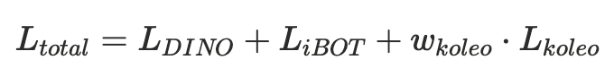
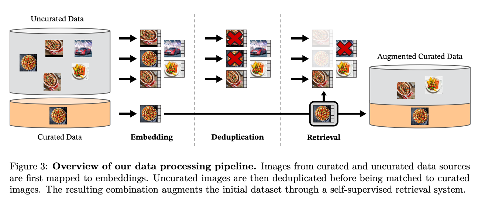
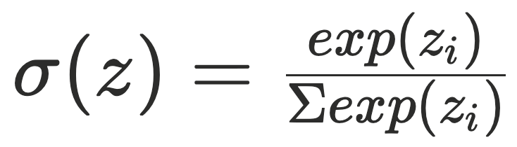
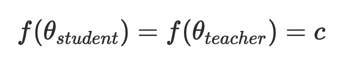
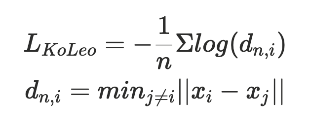
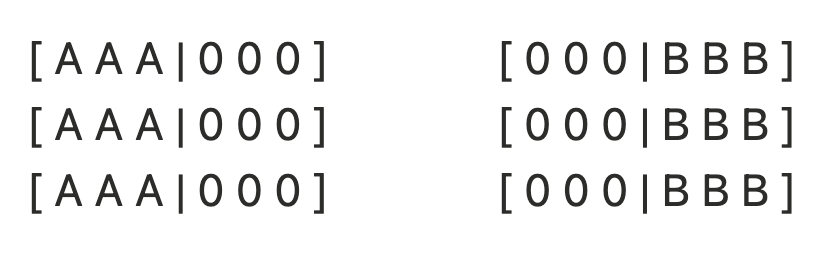
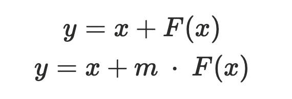

Unsplash / Photo by Tobias keller

[DINOv2: Learning Robust Visual Features without Supervision](https://arxiv.org/abs/2304.07193)을 리뷰합니다.

## <strong>Abstraction</strong>

DINO라는 이름은 'Distillation with NO labels'에서 온 말입니다. 즉, teacher 모델의 출력을 student 모델이 따라가는 distillation 방식을 사용하는데, 정답 라벨 없이 학습을 할 수 있다는 것입니다.

기존 DINO 모델의 경우는 transformer의 sequence 입력의 맨 앞에 위치하는 class(CLS) token을 사용합니다. 그래서 attention 과정에서 sequence의 정보를 요약하는 정보를 CLS token이 가지고 있게 됩니다. 예를 들어 이미지 하나가 고양이라고 했을 때, 벡터로 존재하는 이미지 patch의 값들이 CLS token과 상호작용하면서 CLS에 이미지 한 장의 요약 정보가 들어가 있게 되고, CLS token을 가지고 loss function을 구하기 때문에 Image-level prediction을 학습을 했습니다. 하지만 Dense Prediction(Segmentation, Depth Estimation 등) 측면에서 성능적인 한계가 명확했습니다. 그리고 self-distillation 구조를 통해서 어떠한 downstream task에 대한 즉시 적용이 가능한, 범용적인 visual feature를 학습하는 것이 핵심입니다.

크게 세 가지를 주목해야 합니다.

<strong>1\. Loss function의 진화</strong>

DINOv2의 loss function

<strong>L\_DINO</strong>는 기존 DINO 모델에서 view consistency를 유지하는 image level loss입니다. <strong>L\_iBOT</strong>은 패치 단위의 Cross-Entropy를 계산하는 Masked Patch Prediction Loss입니다. student는 일부가 masking된 이미지를 받고 teacher는 원본 이미지를 받아서 서로의 patch token을 매칭합니다. 기존 knowledge distilation에서는 pre-trained된 모델이 teacher가 되었던 것과 달리 DINO와 DINOv2에서는 student 모델의 EMA를 적용시킨 네트워크가 teacher가 되어 self-distillation 방식을 사용합니다. <strong>L\_koleo</strong>는 벡터들이 임베딩 공간에 균일하게 분포됨과 동시에 유사한 feature는 가까이 위치하도록 합니다.

<strong>2\. Sinkhorn-Knopp Centering 및 엔지니어링 최적화</strong>

기존 DINO의 단순한 Centering/Sharpening을 넘어 Sinkhorn-Knopp 알고리즘을 도입해 Batch 내 Feature Uniformity를 정교하게 제어했습니다. 또한, Positional Embedding을 Untying하고, FFN의 activation function을 SwiGLU로 교체했으며, FlashAttention과 FSDP를 도입해 메모리 효율을 3배 이상, 속도를 2배 이상 높였습니다.

<strong>3\. Data Curation(양질의 정보를 선별) pipeline</strong>

Uncurated 웹 데이터(수십억 장)에서 고품질 이미지를 추출하기 위해, ImageNet 등 Curated 데이터를 초기 DINO 모델로 임베딩한 후, Cosine Similarity 기반의 k-NN 검색을 통해 유사 분포의 데이터만 필터링한 LVD-142M 데이터셋을 자동 구축했습니다.

---

## <strong>I. Introduction</strong>

task agnostic처럼 pre-training 단계에서 알고리즘이 특정 task에 국한된 성능을 보이는 게 아니라 다양한 task에서 일반화된 성능을 보이는, 그래서 범용적으로 적용될 수 있는 성질을 가지고 있습니다.

현대 모델들은 이런 식의 일반화된 성능 향상을 보이는데 이게 바로 대규모 텍스트 사전학습에 의해 가능했습니다. 자기지도학습이나, 비지도 학습을 통해서(즉, 지도학습이 없이) 이룩해왔다는 것입니다.

이게 기존의 NLP 분야에서의 특징이었는데, CV 측면에서도 이런 모델들이 task agnostic한 성질을 보일 것이라고 기대할 수 있습니다.

하지만 뚜렷한 한계가 존재합니다. 바로 텍스트 기반 사전 지도학습 방식은 이미지에 대해 보존할 수 있는 정보량을 제한할 수 있다는 것입니다.

vision 모델에게 이미지를 데이터로 제공할 때, 이미지를 설명하는 caption이라는 텍스트가 존재하는데, 이 caption은 이미지가 담고 있는 풍부한 정보를 단순하게 표현하기 때문에 정보량을 제한할 수 있고 따라서 텍스트에 의한 일종의 사전학습 방식이 복잡한 픽셀 수준 정보가 드러나지 않을 수 있도록 만들 수 있기 때문입니다.

더 나아가서는 이러한 이미지 encoder들의 경우 text-image aligned된 데이터셋을 필요로 합니다.

따라서 vision 모델의 경우는 NLP 분야에서의 텍스트 모델들만큼 유연하지 못해 순수한 raw data만으로 학습하는 능력을 제공하기 어렵습니다.

⇒ 텍스트 기반 이미지 학습의 한계

- caption은 이미지 정보를 충분하게 담지 못함
- 픽셀 수준 표현 학습이 어려움
- text-image 쌍 데이터가 필요
- NLP처럼 raw data만을 가지고 pretrainig하는 것이 불가능

그래서 이러한 문제에 대한 대안(alternative)은 이미지만으로 feature를 학습하는 self-supervised learning입니다. 이렇게 되면 이미지 및 픽셀 수준에서의 정보를 잘 잡아낼 수 있을 것입니다.

하지만 기존의 Self-supervised learning의 연구들은 한계점이 있었습니다. 바로 데이터의 양(quantity)과 질(quality) 사이의 딜레마가 있었다는 것입니다.

ImageNet-1K의 데이터셋은 약 130만장으로, 좋은 데이터 품질을 가지고 있지만 양이 너무 적었습니다. 그래서 그 한계를 뛰어넘기 위해서는 인터넷에서 무작위로 수집한(uncurated) 대규모 데이터가 필요하지만 노이즈가 많고 불필요한 이미지가 섞이는 등 오히려 학습된 featrue의 품질이 저하되는 문제까지 발생할 수 있다는 것입니다.

그래서 본 논문에서는 무작위로 수집한 이미지에서 데이터셋을 필터링하고 재조정하는 자동 파이프라인을 구축했습니다.

- NLP는 raw text를 가지고 품질이 좋은 텍스트와 유사한 분포를 가진 데이터만 남기는 필터링과 중복 제거(De-duplication) 과정을 거칩니다.
- 기존 vision에서는 일일이 사람이 라벨링한 데이터에 의존하거나 텍스트와 이미지의 쌍을 묶는 방식(대표적으로 CLIP)을 사용했기 때문에 이미지 자체의 품질만으로는 대규모 데이터를 정제하는 자동화 프로세스가 부족했습니다.
- 그래서 사람이 사전에 이미지와 묶어놓은 텍스트를 사용하는 게 아니라, ‘이미지 간의 유사도’만을 사용해서 좋은 이미지를 자동으로 선별하겠다는 것입니다.

discriminative self-supervised methods(iBOT)와 비교했을 때 속도는 약 2배 빠르고 메모리 효율이 3배 좋습니다. (⇒ FlashAttention, Nested Tensors, Efficient Stochastic Depth, Fully Sharded Data Parallel) 이를 통해 ViT 아키텍처로 학습된 DINOv2라는 다양한 사전 학습된 모델을 제공합니다. 저자들은 self-supervised 사전 학습만으로도 공개적으로 사용가능한 weakly-supervised 모델과 경쟁할 수 있는 transfer 가능한 고정 feature를 학습하기에 좋다고 말합니다.

## <strong>II. Data Processing</strong>

data processing pipeline

방식은 다음 pipeline을 따릅니다.

- <strong>\[Data sources\]</strong> ImageNet처럼 품질이 좋다고 확신할 수 있는 소규모의 정제된 데이터셋을 준비하고, 이걸 기준점(Anchor)으로 삼습니다. (ImageNet-1k, ImageNet-22k, Google Landmarks etc.) 기준점으로 삼은 데이터와 무작위로 끌어온 12억장의 이미지 데이터들을 embedding vector로 변환하여 동일한 vector space로 보냅니다. <strong>이 때 사전학습된 ViT 모델을 사용하여 이미지를 벡터로 변환합니다. → 왜?</strong> 픽셀 단위로는 이미지의 의미를 비교할 수 없기 때문입니다. 강아지 사진을 회전시키거나 색감만 바꿔도 픽셀 값은 완전히 달라지지만, ViT-H/16이 뽑아낸 Feature Vector는 여전히 강아지라는 의미적 위치를 유지합니다.
- <strong>\[De-Duplication\]</strong> 정리되지 않은 데이터에 SSCD(Self-Supervised descriptor for image Copy Detection)의 복사 감지 파이프라인을 적용하고 중복에 가까운 이미지를 제거합니다.너무 똑같은 이미지가 많으면 학습 효율이 떨어져 벡터가 거의 겹치는 이미지들은 하나만 남기고 지웁니다. 또한 이 작업에 사용된 모든 벤치마크의 test 또는 validation set에 포함된 거의 중복된 이미지를 제거합니다. 여기서 12억장의 데이터가 7억 4천만장으로 줄어듭니다. naive한 clustering 방식을 사용하면 주요한 특징만 남고 다양성이 부족해질 수 있는 문제점이 있기 때문에 일단 7억 4천만장의 데이터를 K-means로 naive하게 clustering하고 나서 기준점으로 삼은 데이터와 코사인 유사도가 높은 데이터들은 남기고 유사도가 낮은 것들은 탈락(Discard)시킵니다.
- <strong>\[Retrieval\]</strong> ⇒ 특정 cluster에서만 데이터를 뽑게되는 over sampling 문제가 발생할 수 있고, 이로 인해 다른 cluster의 특징을 반영하지 못하는 under-sampling의 문제도 같이 야기될 수 있습니다. 그래서 조건부로 데이터를 retrieval합니다. 기준점 데이터(anchor)가 충분히 많은 경우, 각 기준점 이미지 당 가장 유사한 이미지 N개만 추가로 뽑아옵니다.(논문에서는 N\=4로 설정) 기준점 데이터(anchor)가 부족한 경우, 특정 cluster에 몰릴 가능성이 높기 때문에 특정 클래스의 비중이 작아질 수 있습니다. 그래서 그 기준점이 속한 클러스터 전체에서 넉넉하게 sampling합니다.
- <strong>\[Implementation Details\] </strong>여기에서 De-duplication과 Retrieval 단계는 최근접 임베딩을 효율적으로 인덱싱하고 배치 검색하기 위해서 Faiss(Facebook AI Similarity Search)라는 벡터 검색 라이브러리를 사용합니다.하지만 Faiss를 사용하게 되면 책의 Index처럼 벡터 공간을 여러 구역으로 나눠놓고 쿼리가 들어오면 해당 구역만 찾습니다. 또한 벡터의 정밀도를 살짝 낮춰 압축 저장함으로써 메모리 사용량을 줄이고 검색 속도를 높입니다. 그리고 이 모든 과정을 CPU가 아닌 GPU에서 병렬 처리를 합니다. V100(32GB) 8장씩 총 20 노드를 사용해서, 즉 160장의 V100 32GB로 2일 소요되었습니다. 매우 큰 고차원 벡터(이미지 임베딩)가 있을 때, K-NN을 기반으로 이 벡터와 비슷한 이미지를 찾아달라고 하면 계산량이 너무 많아서 몇 달이 걸릴 수 있습니다.

여기까지의 과정을 통해서 12억만개의 Uncurated 이미지 데이터를 1억 4200만 개의 이미지 corpus로 수집했습니다. 이 데이터셋을 LVD(Large scale Visual Dataset)-142M dataset이라고 부릅니다.

---

## <strong>III. Discriminative Self-supervised Pre-training</strong>

[SwAV](https://arxiv.org/abs/2006.09882)를 중심으로 DINO와 iBOT loss의 조합으로 볼 수 있는 discriminative self-supervised 방법으로 feature를 학습합니다. 또한 regularizer를 추가하여 feature와 짧은 고해상도 학습 단계를 확장합니다.

### <u>3.1 Image-level objective(DINO의 아이디어)</u>

Teacher 네트워크와 student 네트워크에서 추출한 feature 간의 cross-entropy loss를 고려합니다. 두 feature 모두 동일한 이미지의 다른 crop에서 얻은 ViT 클래스 토큰에서 나옵니다.

ViT backbone에서 나온 출력벡터는 768 차원인데, 학생 모델의 class token을 student DINO head에 통과시켜 2048차원으로 늘렸다가 256차원으로 다시 줄입니다. 이 벡터를 student DINO head의 마지막 layer의 65,536개의 학습 가능한 파라미터와의 내적 적용하고 softmax를 적용해 prototype scores를 얻습니다.

⇒ 이미지 벡터 값을 DINO head를 통과해서 학습 가능한 파라미터와의 내적을 적용하고 이를 통해 유사도를 파악할 수 있습니다. 여기에 softmax를 적용하면 확률 분포를 얻을 수 있습니다.

<strong>왜 이렇게 Loss를 적용하는 것일까요? </strong>단순히 두 이미지의 벡터 값의 거리를 좁히도록 학습을 하게 되면 모델은 그냥 모든 벡터를 0으로 만들어 거리가 0이 되게 학습을 하는 collapse 문제가 있습니다. 그래서 이렇게 prototype 방식을 사용하게 되면, student 모델은 teacher 모델이 내놓은 확률 분포와 cross-entropy loss를 사용하면서 확률 분포를 맞추는 방식을 선택하게 되면 모든 출력을 0으로 만드는 collapse 문제를 해결할 수 있습니다.

하지만 여기서 teacher 모델은 ground truth를 보장하지 않습니다. 바로 self-supervised learning이기 때문입니다. 그래서 student 모델의 학습된 파라미터를 Exponential Moving Average를 사용해 teacher를 student의 과거를 평균으로 만드는 것입니다. student 모델은 상황에 따라서 이리저리 튀는 학습을 하게 될텐데, 이렇게 되면 Student 모델이 깨달아온 방식들을 서서히 누적해서 낸 모델이 되기 때문에 훨씬 더 안정적이고 일반화된 모델을 만들 수 있게 됩니다.

<strong>결국 ViT를 통해서 global 정보에 대한 학습을 할 수 있습니다.</strong>

### <u>3.2 Patch-level objective(iBOT의 아이디어)</u>

ViT에서는 이미지를 통째로 처리하지 않고 patch라는 조각 sequence로 처리합니다.

Student에게 제공된 일부 입력 patch는 임의로 masking하지만 teacher의 경우는 masking하지 않습니다. 각 masking된 patch의 student와 teacher 사이의 cross-entropy loss를 추가합니다.

<strong>결국 patch-level에서의 학습을 하는 것이기 때문에 local 정보에 대한 학습을 할 수 있습니다.</strong>

그래서 최종적으로 image-level(DINO)에서의 학습으로 global 정보를 학습하고, Patch-level(iBOT)에서의 학습으로 local 정보를 학습해 일반화된 모델을 만들어낼 수 있게 됩니다.

### <u>3.3 Untying head weights between both objectives</u>

image-level과 patch-level에서 학습한 파라미터를 공유하게 되면, 즉 ‘tie’하게 되면 동일한 Head(분류기)를 사용하겠다는 것인데 애당초에 image-level은 global한 특징, patch-level은 local 특징을 학습한 것이기 때문에 파라미터를 공유하게 되면 patch level은 underfit, image level은 overfit된다는 것입니다.

그래서 image-level은 DINO Head, patch-level은 iBOT Head를 사용해 가중치를 untie하겠다는 것입니다.

### <u>3.4 Sinkhorn-Knopp centering</u>

결국 벡터 값을 softmax를 통해서 distribution으로 만들어서 분포에 대한 차이를 줄이는 것을 목표로 하고 있는데, teacher는 softmax를 사용하는 게 아니라 Sinkhorn-Knopp centering을 사용하는 것이 좋다고 알려져있습니다.

teacher와 student의 출력 분포를 생성할 때, 단순 softmax를 사용하는 것이 아니라 softmax centering을 사용하는 것이 좋습니다.

softmax

그리고 기존 softmax를 그대로 사용하는 것이 아니라 모든 샘플의 평균인 c를 빼서 zero-centered로 맞춰서 출력이 특정 클래스로 편향되는 것을 방지합니다.

그런데, teacher의 출력은 softmax centering이 아니라 Sinkhorn-Knopp centering을 사용하는 것이 좋고 student의 출력은 softmax centering을 그대로 사용합니다.

<strong>왜 그럴까요? </strong>바로, 동일한 normalization 기법을 사용했을 때, trivial solution(자명한 해)으로 수렴할 가능성이 높아 모델이 collapse될 가능성이 높다는 것입니다.

self-distillation의 trivial solution(자명한 해) collapse 위험성

이렇게 양쪽의 Neural Network가 모두 동일한 gradient를 받으면 가장 쉬운 해는 둘 다 constant fuction이 되는 것입니다. 이렇게 되면 loss \= 0이지만 아무것도 학습하지 못한 상태가 된다는 것입니다. 따라서 teacher와 student의 정규화를 다른 것을 사용함으로 인해서 trivial solution 문제를 회피해 모델이 collapse되는 현상을 방지하겠다는 것입니다.

### <u>3.5 KoLeo regularizer</u>

- feature uniformity를 강제
- dimensional collapse 방지
- partial prototype collapse 방지

KoLeo regularizer 수식

d는 nearest-neighbor distance이고, feature를 사용하기 전에 L2 norm을 적용해서 hypersphere 상에 투영합니다.

이렇게 hypersphere 위에 투영하게 되면 → 방향은 보존, 크기는 1로 통일: 클래스 간 거리 비교가 공정합니다. → Euclidean distance와 cosine similarity가 단조 감소 관계를 갖습니다. → Alighment와 Uniformity trade-off를 관리할 수 있습니다. → loss function의 수렴 속도가 향상됩니다.

즉, 최단 거리 특징 간의 최소 거리를 최대화하겠다는 것인데 왜 이렇게 하는 것일까요? self-supervised learning은 두 가지의 상충하는 목표를 동시에 달성해야 합니다.

1. Alignment(정렬): 같은 이미지의 augmentation들은 가까운 feature를 가져야 합니다. ⇒ 만약 이것만 최적화하면 모든 샘플이 단일 점으로 collapse됩니다.
2. Uniformity(균등성): 서로 다른 이미지들은 멀리 떨어진 feature를 가져야 합니다. ⇒ 만약 이것만 최적화하면 feature들이 hyperspher에 전체에 퍼지지만 semantic(의미론적) 정보를 잃어버립니다.

KoLeo regularizer는 class끼리 묶되 그 최단 거리들을 최대화시킴으로 인해서 서로 뭉치지 않게 떨어뜨리는 역할을 하며, DINO는 같은 클래스끼리는 묶어 의미없는 feature spread를 억제하게 됩니다. 즉, KoLeo regularizer를 통해서 collapse를 방지하고 DINO 구조를 통해서 의미없는 feature spread를 막습니다.

### <u>3.6 Adapting the resolution</u>

DINOv2에서는 해상도 조정 전략이 있습니다.

학습의 대부분을 224 X 224 resolution으로 진행하고, 마지막 짧은 기간(대략 10,000 iteration 정도)만 518 X 518 resolution으로 해상도를 높여 학습합니다.

<strong>왜 이렇게 학습하는 것일까요?</strong>

Segmentaion이나 Detection 같은 downstream task는 작은 물체를 감지해야합니다. 따라서 해상도를 높여 작은 물체를 감지할 수 있게 합니다. 하지만<strong> 고해상도 학습은 메모리와 시간이 기하급수적으로 증가합니다.</strong> 그래서 초기 학습부터 대부분의 시간은 상대적으로 저해상도로 학습하고 마지막 만 번의 iteration 정도는 고해상도로 학습하여 정보를 보강하는 것입니다.

---

## <strong>IV. Efficient Implementation</strong>

동일한 하드웨어 기준에서 iBOT 구현했을 때와 비교했을 때 DINOv2가 약 2배 빠르면서 3배 정도 메모리 효율이 좋았다고 합니다.

### <u>Fast and Memory-Efficient Attention</u>

그리고 self-attention layer에서 메모리 사용량과 속도를 개선하기 위해 자체 구현한 FlashAttention을 사용했습니다. GPU 하드웨어 특성상 Head 당 embedding dimension이 64의 배수일 때 효율이 가장 좋고, 전체 embedding dimension이 256의 배수일 때 행렬 연산 효율이 더 좋아집니다.

그래서 DINOv2에서는 ViT-g의 구조를 기존 설계와 다르게 합니다.

기존에는 1408 dimension \+ 16 heads (head당 88 dimension)이지만, DINOv2에서는 1536 dimension \+ 24 heads (head 당 64 dimension)을 사용합니다.

하지만 ‘이 구조 자체에 의한 정확도의 큰 차이는 없었다’라고 밝힙니다. 바로 DINOv2의 구조에 의한 정확도 향상이며 자체 구현한 FlashAttention은 메모리 사용량과 속도의 개선을 보여준 것이지 이로 인해 성능이 향상된 것이 아님을 확실히 하기 위함인 것입니다.

### <u>Sequence packing</u>

sequence packing은 여러 입력을 하나로 합쳐서 한 번에 Transformer에 넣는 기술을 의미합니다.

즉, 서로 길이가 다른 token sequence를 하나로 합치되, attention이 섞이지 않게 mask로 분리해서 계산 효율만 높인 방식입니다.

이걸 사용하는 이유는 DINO가 multi crop 학습을 사용하기 때문입니다. 큰 이미지의 경우는 224 해상도로 crop하고 작은 이미지의 경우는 98 해상도로 crop합니다. 한 배치 안에서 서로 다른 해상도의 이미지를 갖게되는 것입니다.

ViT에서는 이미지 → patch → token 방식으로 전달이 되는데 해상도가 높을수록 토큰의 길이가 길어지고 해상도가 짧을수록 토큰의 길이가 짧아지는 문제가 생깁니다. 이런 경우 서로 다른 sequence length가 발생하게 되고 Transformer는 기본적으로 같은 길이의 sequence만 batch로 처리가 가능하기 때문에 기존에는 긴 sequence와 짧은 sequence를 따로 Feed Forward 학습을 시켰습니다. 이 방법이 비효율적이기 때문에 sequence packing을 사용합니다.

방법은 되게 단순합니다. 높은 해상도로 인해 큰 crop을 가진 token과 상대적으로 낮은 해상도로 인해 작은 crop을 가진 token을 concat하는 것입니다. → batch concatenate

즉, 224와 98을 하나로 합쳐서 집어넣기 때문에 그냥 하나의 긴 sequence로 transformer에 집어넣게 되고, Transformer는 기본적으로 같은 길이의 sequence를 batch로 처리하기 때문에 문제가 해결되게 됩니다.

다만 그냥 concat만 하게 되면 self attention을 할 때 서로 다른 해상도를 가진 두 이미지가 서로 attention하게 되어 이미지 정보가 섞이게 되어 잘못된 학습이 될 수 있습니다. 따라서 block-diagonal mask라는 기법을 통해서 이미지를 분리하게 됩니다.

서로 다른 해상도를 가진 A와 B를 block-diagonal mask 통해 분리

이를 통해서 A는 A끼리만 Attention하고 B는 B끼리만 Attention하게 됩니다. 서로 다른 이미지 간 정보 흐름이 완전히 차단됨과 동시에 효율적인 연산을 할 수 있게 됩니다.

### <u>Efficient Stochastic Depth</u>

기존 stochastic depth 방식을 연산 효율 관점에서 개선한 구현 방식입니다.

stochastic depth란 무엇일까요? 바로 Residual Block을 확률적으로 drop하는 기법입니다. Residual Path를 사용함으로 인해서 layer를 더 깊게 사용할 수 있다는 게 딥러닝 측면에서 굉장히 큰 contribution인 것은 맞습니다. 하지만 이로 인한 단점이 없는 것은 아닙니다.

1. layer가 깊어짐에 따라 연산량이 기하급수적으로 증가
2. 모델의 용량이 증가하는 것이기 때문에 훈련 데이터에 대한 상대적인 overfitting 문제 심화
3. Layer를 1000층 이상 쌓게 되면 Vanishing Gradient 문제가 발생

그래서 F(x)에 m \= 0으로 skip하게 되면 가중치 업데이트를 건너뛰고 입력값을 그대로 다음 층으로 넘기게 됩니다.

‘학습 시’에는 일부 layer를 skip해서 효율을 높이고, ‘추론 시’에는 본래의 깊은 네트워크를 사용해서 높은 성능을 낸다는 것이 목표입니다.

결국 핵심은 ‘이론적인 연산량 감소’가 장점인데, DINOv2에서 주장하는 것은 이러한 이론적인 연산량 감소가 실질적인 GPU의 연산속도 향상과 무관하다는 것입니다.

메모리 측면에서 sparse한 matrix(또는 Tensor)에 대한 연산은 오히려 overhead가 많이 발생하기 때문에 dense한 matrix(또는 Tensor) 연산에 최적화되어있습니다.

따라서 기존의 stochastic depth는 연산을 전부 다 한 다음에 0으로 masking하는 방식을 선택했습니다. 즉, 연산은 다 하고, 사용하지 않을 결과값에 나중에 후처리를 해주는 것입니다.

그래서 애당초 연산부터 사용하지 않게끔 하자는 것이 DINOv2에서 주장하는 내용입니다.

기본적인 residual 연산에서 m을 추가해 확률적으로 block을 생략

결국 ‘실질적으로도 연산을 건너뛰는’ skip computation에 대한 내용을 다루게 됩니다.

m \= 0.6이게 되면, 40%의 Block은 생략이 되게 됩니다. (결국 모델의 층이 깊은 구조에서의 단점을 상쇄하기 위함인 것이고, 층이 얕은 모델에서 사용하면 오히려 I/O overhead가 발생할 수 있습니다)

### <u>Fully-Sharded Data Parallel (FSDP)</u>

요약하자면 기존의 DDP라는 방식보다 이 논문에서 제시한 FSDP라는 방식이 더 학습이 잘 된다는 것을 주장하고 싶은 것입니다.

일단 GPU를 여러 개 사용한다는 것은 DDP(Distribution Data Parallel)와 FSDP(Fully Sharded Data Parallel) 모두 동일합니다. 하지만 DDP에는 모델 하나를 여러 개의 GPU에 copy해서 data를 parallel하게 학습 시킨다는 것이고, FSDP는 모델 파라미터를 GPU의 개수만큼 나눈 파편(shard)으로 사용하겠다는 것입니다. 즉, 하나의 모델을 학습시키더라도 더 큰 모델을 학습시킬 수 있습니다. (Single GPU를 사용하면 GPU 하나의 메모리의 크기를 모델이 넘어설 수 없는데, GPU를 여러 개 사용하면 그 GPU 메모리의 크기의 합만 넘어가지 않으면 되게 할 수 있다는 것입니다.)

일반적으로 optimizer는 AdamW를 사용하게 되는데, 여기서는 AdamW로 모델을 학습하려면 float32기준으로 총 4개의 복사본이 필요합니다. ViT-g는 1B 모델인데 이 4개의 복사본을 다 합치면 16GB 정도 됩니다. 이게 single GPU면 하나의 GPU가 16GB의 용량을 다 견뎌야 하지만, 만약에 8개의 GPU를 사용할 수 있다면 각 GPU마다 2GB만 부담하면 된다는 것입니다.

그리고 GPU간 통신은 float16으로 사용해서 속도와 대역폭 측면에서 효율성을 추구합니다. 실질적인 저장과 MLP Head에서의 학습은 float32를 사용해서 학습 안정성을 확보하되 GPU간 통신 문제는 float16을 사용해서 효율적으로 접근하겠다는 것입니다.

기존의 DDP(Distribution Data Parallel)는 통신까지도 float32를 사용하지만 FSDP는 통신 측면에서는 float16을 사용합니다.

### <u>Model distillation</u>

knowledge distillation이라는 건 큰 모델의 출력을 작은 모델이 따라하도록 만드는 것입니다. 이 때 큰 모델을 일반적으로 teacher, 작은 모델을 student라고 하는데 같은 입력에 대해서 teacher와 student의 출력 차이를 최소화하면 되는 것입니다. 일반적으로는 KL Divergence, cosine similarity, MSE로 최소화합니다.

이 Model distillation은 ViT-g라는 10억 파라미터를 가진 초대형 모델을 더 작은 모델인 ViT-L, B, S로 어떻게 손실없이 전달해줄 수 있는가에 대한 내용을 다룹니다.

애당초에 DINOv2의 방식 자체가 self-distillation 방식이기 때문에 distilation을 추가로 얹는 게 어렵지 않습니다.

일반적으로 지도 학습에서는 Teacher의 Soft label과 Student의 예측값을 KL Divergence로 매칭을 합니다. DINO의 목적 함수 자체가 이미 Teacher의 출력 분포와 student의 출력 분포 간의 Cross-entropy를 최소화하는 형태입니다.

그래서 손실함수를 새로 설계하는 게 아니라 대형 모델 ViT-g를 고정된 teacher로 두고 동일한 학습 loop를 사용하는 게 좋은 방법이라는 것을 파악한 것입니다.

최종적으로, 3억 개의 파라미터를 가진 ViT-L조차도 scratch로 처음부터 학습하는 것보다 ViT-g로부터 distillation하면 data만 봤을 때 모델이 최적해라고 판단했던 것을 뛰어넘어 더 좋은 최적해를 반영할 수 있게 된다는 것을 의미합니다.

---

## <u>V.Results</u>

기존에는 self-supervised 모델은 좋긴 하지만 text-image 데이터로 학습한 weakly-supervised 모델(ex.CLIP)보다는 약하다는 인식이 있었습니다.

하지만 DINOv2는 Self-Supervised 모델이 ImageNet classification에서 매우 강력하고, Semantic segmentation, depth prediction, action recognition 등 다양한 task에서도 강력하다는 것을 증명했습니다.

즉, label 없이도 충분히 강한 시각 representation이 가능함을 대규모 실험을 통해서 입증했습니다. 여기서 말하는 representation은 global 뿐만 아니라 local적인 측면에서도 모두 강력하다는 것을 의미합니다.

&#43; Discussion 좋은 모델이기는 하지만, CLIP처럼 image와 text의 alignment가 양방향성을 띠는 게 아니라 image에 특화되어있습니다. 그래서 text understanding task에서는 어려움이 있습니다. 따라서 reasoning(추론) task에 대해서도 좋은 성능을 기대하기에는 어려운 것 같습니다.