Unsplash / photo by Nino Steffen

[Mamba: Linear-Time Sequence Modeling with Selective State Spaces, COLM2024](https://arxiv.org/abs/2312.00752)를 리뷰합니다.

### Abstract

Transformer의 근본적인 문제점, 바로 메모리와 시간 복잡도가 O(N^2)에 수렴한다는 것입니다.

이런 효율적인 측면에서의 문제점 때문에 linear attention, gated convolution, SSM(structured state space model) 등 다양한 subquadratic-time 아키텍쳐(복잡도는 O(N^2)에서 O(n logn)또는 O(N)으로 수렴하도록 하는 구조)가 등장했습니다. 이 중 SSM은 이전 hidden layer에서 얼마나 정보를 가져올 것인지, 입력 값에서 정보를 얼마나 가져올 것인지, 최종 출력에서 은닉층의 정보를 얼마나 반영할 것인지에 대한 내용이 있는데, 그 과정에서 단어 간의 의미적인 관계가 아니라 단순히 거리에 의한 관계에 대해서 학습하게끔 설계가 되어 성능이 낮다는 점을 파악, 이를 개선한 연구입니다.

Transformer의 연산량 문제를 해결하기 위해 다양한 연구가 진행되어왔습니다. <u><strong>Linear Attention →. Gated Convolution → Linear Recurrent Models → SSM</strong></u>

<strong>Linear Attention</strong>: 시간 복잡도 줄이기 위해 등장했지만 softmax 연산을 커널 매핑 함수로 대체하면서 softmax의 확률로 인해 제공되던 토큰에 대한 ‘집중’능력이 상실되었습니다. 특정 토큰을 정확히 지정해야하는 태스크에서는 안 좋은 성능을 보일 수 밖에 없었습니다. 즉, 흐릿하게 문맥을 압축하는 수준에 그쳤다는 것입니다.

<strong>Gated Convolution</strong>: Linear Attention의 흐릿하게 문맥을 압축하는 문제를 해결하고 정보의 흐름을 제어함과 동시에 병렬처리를 유지할 수 있는 방법(Transformer는 추론 과정에서 순차적으로 앞부터 정보를 봐야하고 이로 인한 KV cache 병목으로 인해 병렬 처리에 문제)입니다. 언어 모델에서는 늘 그랬듯이 CNN 기반의 언어 모델은 convolution filter 길이에 제한되어있는 문맥 반영 문제가 있었습니다.

<strong>Linear Recurrent Models</strong>: 시퀀스 길이의 제약을 받지 않는, 문맥을 잘 반영하는 모델임과 동시에 추론 시에도 $O(1)$의 시간 복잡도를 유지(최종 은닉층인 $h_t$에 모든 정보가 다 담겨있고 시퀀스 길이 t가 얼마나 길어지던 간에 은닉층 $h_t$의 정보는 그대로 사용하기 때문에 t와 독립적)하는 RNN 기반의 장점을 차용하기 위해 사용되었습니다. 또한 병렬 스캔 알고리즘을 적용해서 RNN임에도 학습 시 O(N)의 병렬 처리를 달성할 수 있었습니다. 전이행렬 A가 입력 데이터와 무관하게 고정되어서 단순히 시간에 따라 감쇠하는 LTI(Linear Time-Invariant) 성질을 가집니다. 그래서 무엇을 잊고 기억할지 명확하지 않습니다.

<strong>SSM</strong>: Linear Recirremt Models가 한창 유행할 때 일단 LTI의 성질은 그대로 가져갔지만(ex. S4) 추후에 Mamba의 등장으로 해결됐고 동시에 RNN attention의 long-range dependency 문제도 해결했습니다.

### Background

SSM(structured state space model)

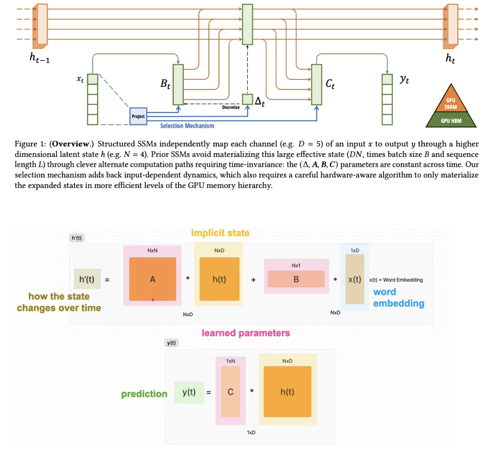

SSM architecture

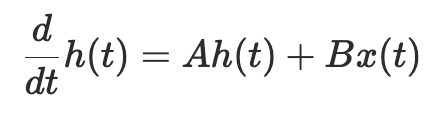

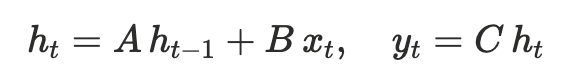

은닉상태 갱신(전이 A, 입력 B) → 출력 C로 볼 수 있습니다. A, B, C는 학습 가능한 파라미터입니다.

A는 이전 상태를 얼마나 유지할지, B는 현재 입력을 현재 상태에 얼마나 주입할지, C는 은닉 상태에서 얼마나 읽을지를 결정하게 됩니다. 기존 S4와 같은 SSM 모델의 경우는 이런 절차가 토큰 간의 거리에만 의존이 되고 의미적인 내용을 반영하기가 어려운 구조였습니다.

SSM은 연속 시간 상에서의 수식입니다. 이런 연속 시간 기반의 설계를 그대로 쓰는 게 아니라 이산 시간을 변환을 시켜야 성능과 메모리 측면에서도 사용 가능합니다. 연속적인 시퀀스를 일정 단위로 자른다는 것인데 Delta라는 시간 간격을 의미하는 기호로 정의해두고 A, B를 계산할 때 이 시간 간격을 고려하도록 합니다.

이렇게 이산화를 함으로 이전 상태에 의존적이었던 형태에서 convolution 형태로 바꿀 수 있게 되었습니다. ⇒ 그래서 빠른 학습이 가능하게 되었습니다.

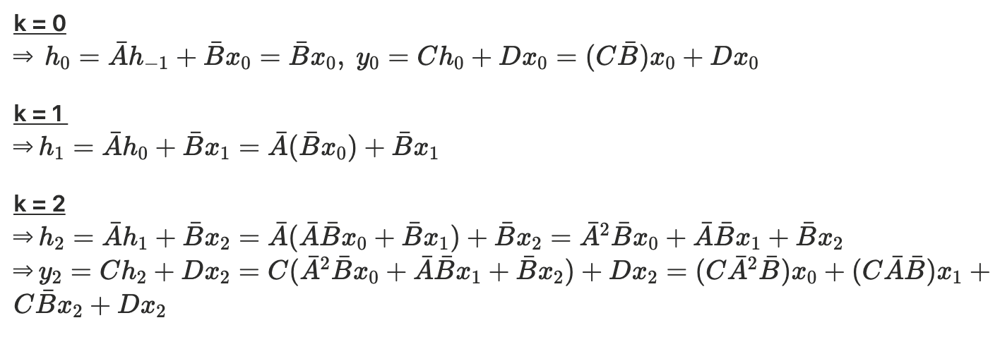

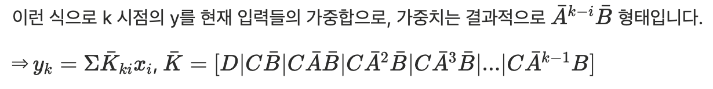

핵심은 K 행렬은 입력과 무관하게 되고 입력 시퀀스 전체에 동일하게 적용이 됩니다. 그래서 의미론적인 관계를 파악하는 것는 것은 약하고 거리 기반에 대한 연산에 의존하게 되는 것입니다. 즉, 입력과 무관하고 입력 시퀸스 전체에 동일하게 적용된다는게 문제가 되는 것입니다.

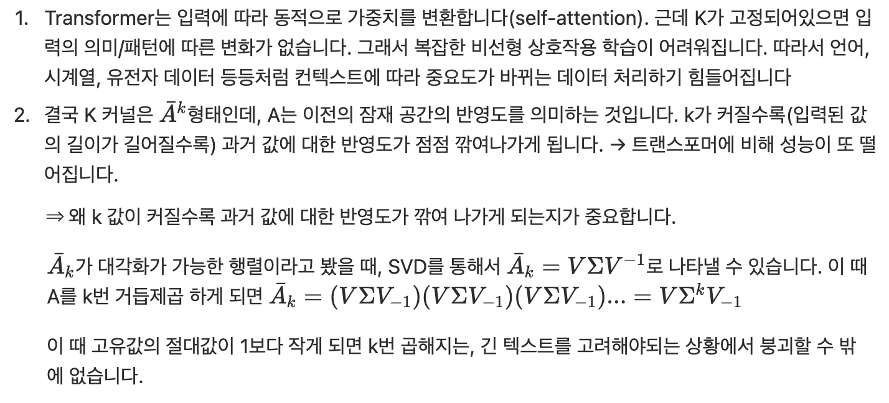

SSM이 recursion을 convolution 병렬 연산으로 바꾸고 실제 구현에 걸리는 시간이 더 많다 보니 transformer랑 시간 복잡도 차이가 유의미하게 차이나지 않습니다. 이런 기본적인 구조 자체에 문제가 있기 때문에 HiPPO를 SSM에 적용시켰고 이로 인해 등장한 모델이 LSSL(Linear State-Space Layer, NeurIPS 2021)입니다.

### HiPPO(High-order Polynomial Projection Operator)

⇒ K의 행렬의 거듭제곱이 길어지면 길어질수록 차수가 커지기 때문에 이런 붕괴를 막기 위해 HiPPO가 등장합니다.

⇒ 연속적인 함수나 신호를 시간에 따라 압축된 상태로 표현 “아직 이산적인 구조로 넘어온 것이 아니라 연속적인 구조는 여전히 유지되어있는 상태이고 여기서 ZOH를 만나야 이산(discrete) 개념이 넘어오는 것입니다.”

핵심은 SSM의 핵심 식에서 행렬 A의 숫자를 어떻게 세팅해야하는가에 대한 해답을 제시한 것입니다.

<strong>직교 다항식 투영 (Orthononal Polynomial Projection)</strong>

무한히 긴 과거의 연속 신호 u(t)를 고정된 N차원의 상대 벡터 x(t)에 압축할 때, 정보 손실을 최소화하기 위해 직교 다항식에 신호를 projection하는 것입니다.

시간-의존 신호 u(t)를 <strong>‘orthogonal’ 다항식 기반</strong>의 계수 형태로 만들어주고 이 계수들이 SSM에서 h(t)가 됩니다.

핵심은 ‘직교’, ‘다항식 기반’인 것이 중요합니다. 직교임을 이용해서 과거 시점부터 현재 시점까지의 연속된 입력 신호를 정보의 간섭이나 손실없이 최적으로 압축할 수 있게 되었고, 과거에 입력된 값들을 다항식 계수 형태로 표현할 수 있게 되었습니다.

HiPPO에서 행렬 A와 B는 학습되는 가중치 아닙니다. 시간에 따라 들어오는 신호 x(t)를 다항식 기저에 사영시키고, 그 사영된 계수 h(t)가 시간이 지남에 따라 어떻게 변하는지 해석학적으로 풀어서 얻어낸 closed form 행렬입니다. (입력 신호의 과거 기록을 다항식들로 이루어진 함수로 근사(Approximation)하고, 시간이 흐름에 따라 이 다항식의 계수들이 어떻게 변하는지 미분 방정식을 풀었더니 정해진 상수 행렬이 튀어나왔다는 것)

다항식 계수들의 변화가 있을 때 그 계수들이 시간에 따라 어떻게 변하는지가 HiPPO에서 유도됨으로 인해서 대각행렬로 정리가 됩니다. 따라서 행렬 자체가 sparse matrix가 되고 고유값들이 안정적인 범위에 해당이 되고 학습이 진행되어도 gradient가 안정적으로 유지된다는 특징이 있습니다.

### ZOH(Zero-Order Hold)

HiPPO는 연속시간을 모델링에 사용하기 위한 작업이었다면, ZOH는 이를 하드웨어에서 연산하기 위한 이산화 작업에서 완성된 것입니다.

약 HiPPO 없이 무작위로 A 를 만들고 이산화했다면, 모델은 긴 문맥(LRD)을 전혀 기억하지 못했을 것입니다. 반대로 HiPPO 설계도만 있고 이산화 과정이 없었다면, 우리는 그 모델을 GPU에 올려서 텍스트 토큰을 학습시킬 수조차 없었을 것입니다.

HiPPO는 연속 신호를 '완벽하게 기억할 수 있는 수학적 공식(행렬 A)'을 찾아낸 것일 뿐, 그 공식 자체를 컴퓨터가 직접 계산할 수는 없기 때문에 ZOH를 사용합니다.

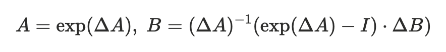

### S4(Structured State Space Sequence Model)를 다시 바라보면

SSM이 Transformer를 대체하기 위해서는 거대한 dense matrix인 A의 연속적인 거듭제곱 연산 A^k가 유발하는 O(N^2L)의 하드웨어 병목을 반드시 우회해야만 했습니다.

이 Dense Matrix A를 DPLR(Diagonal Plus Low Rank) 형태로 수학적으로 구조화했습니다. 이를 통해서 시간 축이 아니라 주파수 축에서 커널 전체를 해석적으로 도출해낼 수 있었습니다.

이 K를 시간 축에서 직접 구하려면 매 스텝마다 이전 결과에 A를 곱해야만 했습니다. 순차적 중복성이 발생하게 되는데  A가 기본적으로 N x N dense matrix이고 sequence의 길이가 L일 때 시간 복잡도 O(N^2L)이 발생하게 되는 것입니다.

원래 기존의 시간 축에 대한 신호 처리의 효율적인 변환을 위해 푸리에 변환을 사용하는데, 신호를 사인과 코사인 파동의 합으로 분해한 뒤 주파수 대역별로 볼륨만 조절(단순 곱셈)하고 다시 시간 축으로 합치자는 것이 주파수 도메인 연산의 핵심 아이디어입니다.

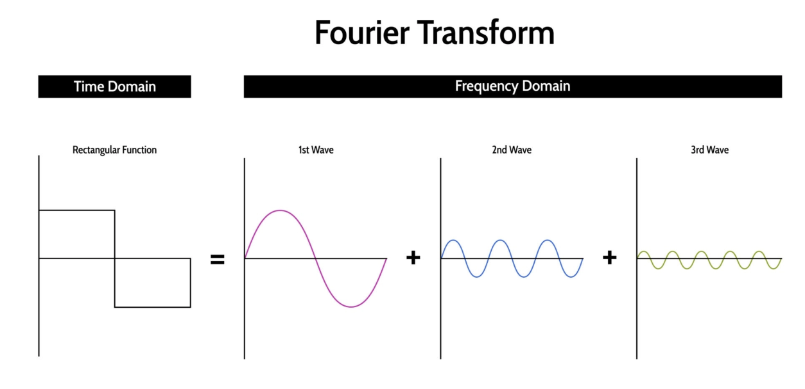

Fourier Transform

그런데 S4의 핵심 아이디어는 시간 축을 아예 skip하는 것입니다.

주파수 변환 커널(푸리에 변환 커널)을 얻기 위해서 일단 시간 축 커널 K를 먼저 만들어야 합니다. 이 시간축 커널을 만드는데 이미 거대한 연산량이 필요해서 주파수 축으로 넘어가기 전부터 문제가 발생합니다.

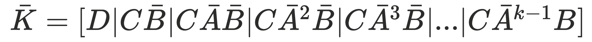

시간 축 커널 K

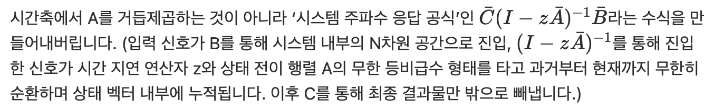

⇒ 즉, SSM의 cycle을 단 한 번의 행렬 곱셈으로 압축해 놓은 것입니다.

- A(상태 전이 행렬): 이전 스텝의 은닉 상태 x가 현재 스텝 x로 어떻게 변화할지 결정합니다.
- B(입력 투영 행렬): 외부에서 들어온 1차원 토큰 입력을 N차원의 거대한 상태공간 내부로 mapping하는 입력 게이트입니다.
- C(출력 투영 행렬): N차원으로 복잡하게 얽혀있는 내부 상태 벡터 x로부터 우리가 궁극적으로 필요로 하는 1차원 출력값 y를 추출해내는 출력 게이트입니다.

결과적으로 시간 축에 존재하던 L 번의 순차적 루프를 완전히 건너뛰고, 특정 주파수 z들을 한 번에 평가(Evaluation)하는 병렬 계산 경로를 개척한 것입니다.

## S6(Mamba, Selective Scan S4)

S4에서 ‘선택적’, ‘스캔’ 두 가지의 기능을 추가한 것입니다.

- <strong>Selective(선택적)</strong>
- S4에서 A, B, C는 학습 가능한 파라미터이지만 입력 시퀀스와 무관하게 모든 입력에 대해서 동일한 A, B, C가 적용되었습니다. S6에서는 입력의 내용에 따라 A, B, C가 유동적으로 변하는 메커니즘입니다. 고정된 행렬로만 연산되는 시스템을 강제로 전환해서 불필요한 노이즈는 망각하고 핵심 정보는 기억하는 데이터 의존적 필터링 권한을 모델에 부여합니다.
- <strong>Scan(스캔)</strong>합성곱을 포기하는 대신에 행렬 연산의 결합 법칙을 활용해서 시퀀스를 이진 트리 형태로 쪼개어 병렬 연산하는 ‘Hardware-aware Parallel Scan’ 알고리즘을 도입합니다. HBM(느린 메모리)으로의 접근을 최소화하고 SRAM(빠른 메모리) 내에서 상태를 극도로 빠르게 업데이트하는 것입니다.
- A, B, C를 입력에 따라서 유동적으로 변하게끔 만든 메커니즘을 선택했기 때문에 글로벌로 convolution 합성곱 연산을 하는 것과 FFT(Fast Fourier Transform) 연산이 수학적으로 불가능해졌습니다.

<u><strong>이 때 Hardware-aware Parallel Scan이 무엇일까요?</strong></u>

우선, 기존 SSM의 연산을 간단하게 만듭니다.

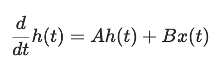

Ah(t)는 이전 입력 h(t-1)을 기다려야 하지만 Bx(t)는 이전 입력에 전혀 영향을 받지 않습니다. 하지만 매번 은닉층을 t → t&#43;1로 넘어갈 때마다 Bx(t)를 매번 중복 연산해야 합니다. 그렇기 때문에 ‘완벽하게 독립적인 병렬 연산으로 일괄처리’할 수 있는 것입니다.

<strong>그리고 스캔 연산자 부분을 살펴봅니다. </strong>상태 쌍을 (A, B, x) 3개의 텐서를 사용해야 했는데 Bx(t)를 단순히 x&#95;t로 사용함으로 인해서 (A, x)로 만들 수 있게 되고

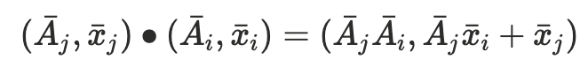

결합 연산자로 최소한의 연산만 하게끔 만든 것입니다.

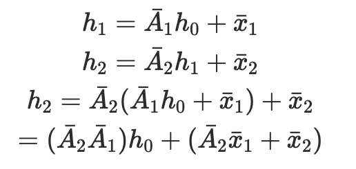

마지막 줄을 통해서 (A, x)를 재정의 하는 이유를 알 수 있음

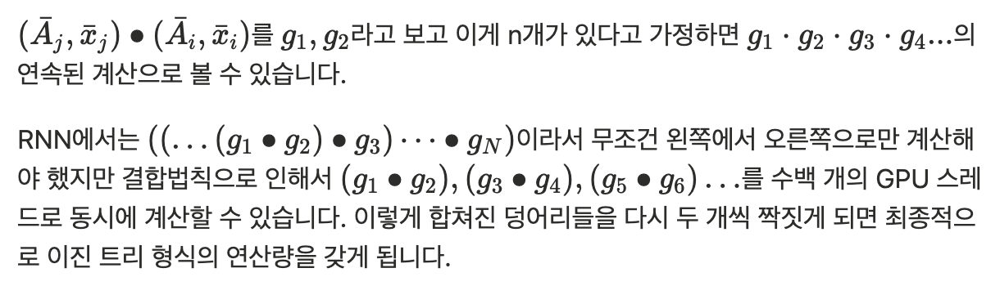

# Conclusion

### Limitation

- Mamba에도 하드웨어 병목이 있습니다.
  1. Dimensionality Explosion
  2. mamba가 연속적인 상태를 추적하기 위해서 유지해야하는 tensor의 물리적 크기 자체에 있습니다. 시퀀스 전체의 상태를 저장하기 위해서 메모리 비용이 굉장히 많이 듭니다.
  3. HBM과 SRAM 사이의 I/O bottleneck
  4. GPU 내부에는 거대하지만 느린 HBM(High Bandwidth Memory)과 코어 바로 옆에 붙어 있어 극도로 빠르지만 용량이 매우 작은 SRAM이 존재합니다. 병렬 스캔을 Naive하게 구현하면 여기서 시스템이 붕괴합니다. Scan 과정에서 SRAM에서 계산한 뒤 HBM에 write했다가, 다음 층을 계산하기 위해 HBM에서 다시 SRAM으로 read해야 합니다.

  ⇒ 이런 문제를 해결한 Mamba2는 ICML2024에 accept 되었습니다.

mamba 3b 모델 기준, 동일한 크기의 transformer보다 성능이 뛰어나고, 두배 크기의 transformer 모델과 비슷한 성능을 자랑합니다.

추론 속도 및 효율 또한 transformer보다 약 5배 높은 추론 처리량을 보였습니다.

메모리 사용량 또한 transformer에 비해 훨씬 효율적입니다.

기존 SSM의 recursion 방식보다 40배 빠릅니다.