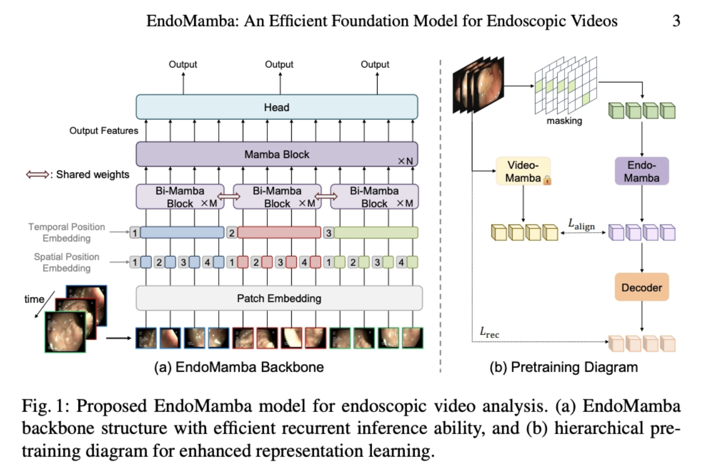
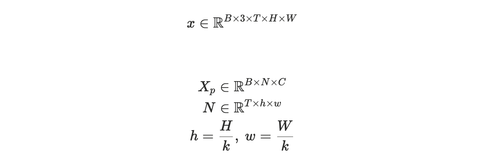
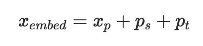
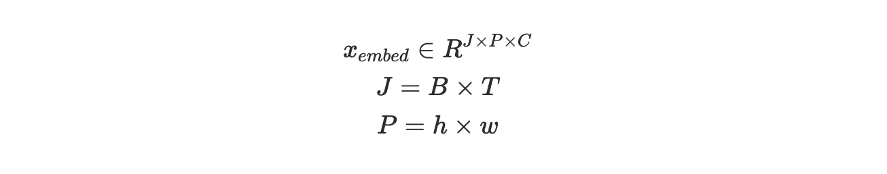
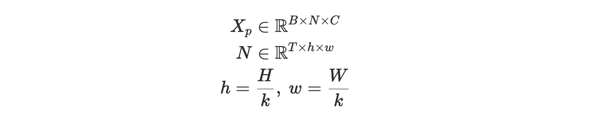
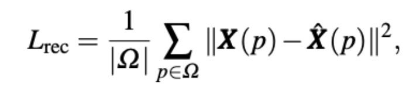
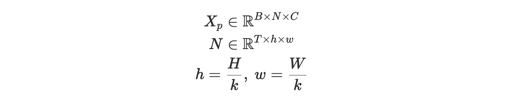
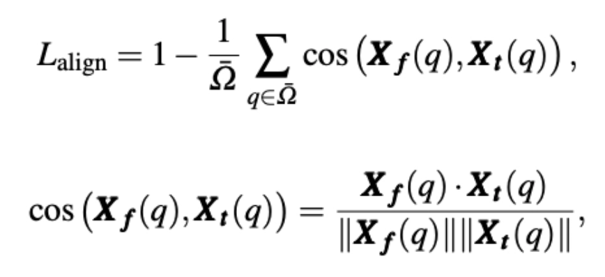
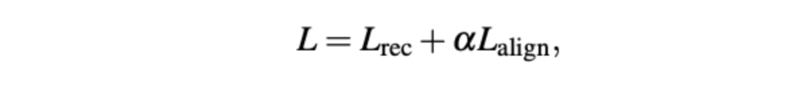
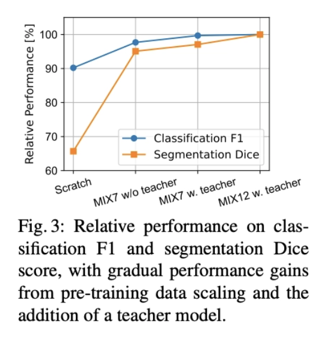

Unsplash / Photo by Kiriakos Verros

[EndoMamba: An Efficient Foundation Model for Endoscopic Videos via Hierarchical Pre-training](https://arxiv.org/abs/2502.19090)를 리뷰합니다.

내시경 영상 기반 작업은 최소 침습(minimally invasive) 수술에서 중요한 역할을 합니다. 최근 video foundation 모델들이 가능성(promise)를 보여주고 있지만 <strong>계산 효율성이 낮고 내시경 분야에서 사전학습에 사용하는 데이터가 제한적이라서 성능이 최적이 아니라는 점은 여전히 문제입니다.</strong>

1. 그래서 계산 효율성 측면에서 실시간 추론에 최적화된 EndoMamba backbone 구조를 제안합니다. Spatial feature: Bidirectional Mamba Block을 통해 개별 프레임 내부에서 spatial 모델링을 수행 Temporal feature: Vanilla Mamba Block을 통해서 시간 축에서 과거 → 현재 방향의 추론을 수행합니다.
2. 또한 video task 자체는 두 가지의 특성을 고려해야합니다. 바로 spatial(공간적), temporal(시간적) 특성입니다. 이 때 spatial 특성은 Bidirectional Mamba Block을 통해 개별 프레임 내부에서 spatial 모델링을 수행하고, temporal 특성은 Vanilla Mamba Block을 통해서 시간 축에서 과거 → 현재 방향의 추론을 수행합니다.
3. Self-supervised hierarchical pre-training 구조를 제안해 일반 비디오 도메인의 지식도 함께 활용하여 representation learning을 향상시킵니다.Low level reconstruction → 시공간 구조를 학습 High level alignment → 미리 학습된 일반 비디오 파운데이션 모델로부터 더 넓은 지식을 전이
4. 구체적으로 maksed reconstruction &#43; auxiliary(보조) supervision 방식을 결합한 것입니다.

## <strong>Introduction</strong>

성능을 높이기 위해서 downstream task에 특화된 도메인 지식을 학습하는 특수 모듈을 설계하는 것에 집중해왔는데, 이런 특화된 모델의 경우는 일반화 능력이나 새로운 데이터에 대한 adaptation 능력이 현저히 떨어진다는 것이 문제라는 것입니다.

VideoMAE, InternVideo, VideoMamba 같은 foundation 모델들은 video understanding 문제에서 뛰어난 성능을 보이고 있고 이런 모델들을 endoscopy, 즉 내시경에 적용한 모델 중 EndoFM이 있습니다. EndoFM은 Video Transformer를 Backbone으로 한 내시경 video understanding에 특화된 모델입니다. 이에 대해서 Transformer를 기반으로 한 모델이기 때문에 Transformer의 online inference 측면에서의 계산 비효율성이 있습니다.

기존 Transformer를 비롯한 video foundation 모델의 경우 새로운 프레임이 들어올 때마다 모든 이전 프레임을 다시 계산해야합니다. 예를 들어 frame 1부터 5까지 계산한다고 가정했을 때 frame6이 들어오면 frame1부터 5까지 다시 계산하고 frame6을 계산하는 비효율성이 있다는 것입니다.

또 다른 문제는 endoscope에 특화된, 내시경 데이터셋이 많이 부족하다는 것입니다. 규모가 작아서 vision-language paired 데이터셋이 부족하고 따라서 embedding space에서 semantic space를 찾아야하는 CLIP 기반 모델은 사용하기 어렵습니다. ⇒ Transformer based model들의 계산 비효율성, endoscopy 데이터셋의 부족 ⇒ EndoMamba 모델 제시의 이유가 됩니다.

1. 계산 비효율성 해결 및 성능 보장이 구조가 시공간 구조를 모두 잘 파악하여 추론하는 spatiotemporal reasoning 능력을 가지고 효율적인 추론 속도를 낼 수 있도록 만들어줍니다. SSM(structured state space model) 기반 모델들의 long-term memory와 빠른 추론 능력에서 영감을 받았고 spatial modeling에는 Bidirectional Mamba, temporal modeling에는 Vanilla Mamba를 사용하여 결합합니다. 프레임 자체에 대한 정보는 Bidirectional, 프레임 간 정보는 Vanilla Mamba를 통해 학습시키겠다는 것입니다.
2. endoscopy 데이터셋 부족 문제 계층적인 구조를 가지기 때문에 두 부분으로 구성이 되며 low-level reconstruction, high-level feature alignment로 구성됩니다.endoscopy 데이터셋이 양이 적기 때문에 바로 high-level의 presentation을 배우면 semantic representation이 부족하기 때문에 잘못된 방향으로 모델이 overfitting될 수 있습니다. 따라서 low level에서 데이터 자체에서 구조를 배우고 high level에서는 일반적인 비디오에서 포착하는 motion pattern, temporal dynamics에 대한 이해와 같은 큰 데이터에서 학습된 모델의 표현을 전달 받는 것입니다. 그래서 데이터셋이 적어 일반화가 어렵다는 측면을 큰 데이터에서 학습된 모델의 표현을 가져오고, endoscopy에 특화된 학습에 대해서도 low-level에서 학습하도록 만드는 것입니다. low-level에서는 영상의 기본적인 구조를 학습하고 high-level에서는 일반 영상 모델이 가진 semantic knowledge transfer 구조를 가집니다. 그리고 데이터 부족문제는 Self-supervised hierarchical pre-training 구조를 사용해 해결합니다.

## <strong>Method</strong>

EndoMamba Architecture

기본적인 Mamba 모델에 대한 이해가 필요한데, 이전에 리뷰했던 [Mamba: Linear-Time Sequence Modeling with Selective State Spaces](/posts/mamba-linear-time-sequence-modeling-with-selective-state-spaces/)를 참고해주시길 바랍니다.

<strong>핵심 메커니즘은 독립적인 시공간 스캐닝입니다.</strong>

크게 네 가지의 핵심 내용을 짚을 수 있습니다.

<strong>1&#46; Tokenization &#38; Embedding</strong>

초기 전처리 단계입니다. 비디오 데이터를 1D 시퀀스로 변환(Tokenization)하고 위치 정보를 주입(positinoal encoding)하는 단계입니다. kernel size를 k로 뒀을 때 spatial 측면에서 공간을 분할합니다. 결과적으로 패치를 여러 개로 나누는 것이고 하나의 패치가 토큰이 될 것입니다. 이 때 전체 시퀀스 길이는 N이 됩니다.

Tokenization

다음은 embedding 단계입니다. positional encoding을 사용합니다. 이 때 둘 다 absolute positional encoding을 사용하는데 learnable과 fixed를 모두 사용합니다.

논문에서 밝히고 있지 않지만, aboslute 방식만 사용하는 이유는 아마도 SSM에서 이미 상대적인 정보는 학습을 하고 있기 때문이라고 볼 수 있습니다.

embedding

Absolute (Learned Absolute Position embedding, 학습 가능 / ConvS2S에서 사용한 방식)

Absolute는 'token embedding vector &#43; position embedding vector'로 구성되어있습니다. 즉, 위치에 대한 정보를 단순히 더해주는 방식입니다. 자원의 특성 상 모델은 최대 sequence length가 정해져있기 때문에 sequence length &#42; dimension 크기의 embedding matrix를 학습하게 됩니다. 이 embedding matrix는 gradient descent를 통해서 학습하게 됩니다.

Sinusoid (Fixed Absolute Positional embedding, 학습 불가능 / 초기 Transformer에서 사용된 방식)

Absolute 방식이 token과 position의 embedding vector를 더해주는 것이라는 방식을 사용하는 것은 동일합니다. 다만 Absolute에서는 순서에 대한 정보를 일일이 입력해주었던 것과 다르게 sinusoid 방식은 sine과 cosine을 사용하여 position embedding vector를 생성합니다. 그리고 sinusoid 방식은 학습을 embedding vector를 학습할 필요가 없습니다. Absolute는 sequence length &#42; dimension 만큼의 parameter를 갖게 되지만, sinusoid 방식은 parameter 없이 함수는 고정된 상태에서 내부 변수에 따라 다르게 작동하는 것이기 때문에 학습을 해도 크게 도움이 되지 않습니다. 이 말은 곧 훈련 때 보지 못했던 길이에도 확장할 수 있다는 flexibility를 의미합니다.

쉽게 생각하면, Absolute 방식은 특정 길이와 특정 차원에 대한 embedding vector를 사용하여 학습하기 때문에 그 범위를 벗어나는 순간 적용이 어려워집니다. 그래서 상대적으로 flexibility가 적용이 가능한 sinusoid를 채택했습니다. 하지만 sinusoid를 사용하더라도 position embedding vector가 우연히 주기로 인해 겹치게 되면 문제가 발생할 수 있다는 것인데, 실질적으로 고차원에서 계산을 하기 때문에 일부 차원이 겹칠 수 있어도 모든 차원이 겹치는 경우는 거의 존재하지 않으며, 차원에 따라서 sine, cosine 함수의 주기가 달라지기 때문에 확률적으로 불가능에 가깝습니다.

비디오 프레임이 몇 개가 들어올지 모르는 상황이기 때문에 확장성을 위해서 sinusoid를 사용했고, 하나의 프레임 패치의 개수(P &#61; h x w)는 해상도가 바뀌지 않는 이상 고정되어있습니다. 따라서 공간적인 관계는 유연성보다는 정확한 좌표 학습이 유리하기 때문에 learnable 방식을 선택했습니다.

<strong>2&#46; Spatial Scanning</strong>

프레임 내부의 공간적 문맥을 파악하는 단계입니다. 미래 시점의 정보 누출(leakage)을 걱정할 필요가 없는 단일 이미지 내의 연산이고 하나의 이미지에서 단방향 처리를 했을 때 이미지의 좌측 상단에 있는 패치와 우측 하단에 있는 패치의 고른 학습이 어렵습니다. 따라서 양방향 처리를 채택했습니다.

positional encoding이 끝난 x&#95;embed의 차원을 재배치합니다. 여기서 J &#61; B × T 로 배치와 프레임 차원을 병합하고, P &#61; h × w 로 단일 프레임 내의 패치들만 독립적으로 묶습니다. 왜 J로 프레임 차원을 병합할까요? 하나의 배치 차원(J)으로 병합하면, M개의 Bi-Mamba 블록이 B x T개의 프레임을 GPU 상에서 한 번에 병렬 연산(Parallelization)할 수 있어 연산 효율이 극대화됩니다.

spatial scanning 차원 병합

재배열된 텐서는 M개의 쌓인 <strong>Bi-Mamba (Bidirectional Mamba)</strong> 블록을 통과합니다. 각 프레임 내에서 병렬적으로 양방향 스캐닝을 수행하여 공간적 특징을 압축합니다.

<strong>3&#46; Temporal Scanning</strong>

프레임 간의 시간적 역학(Temporal dynamics)을 모델링하는 단계입니다. 실시간 추론을 염두에 두었기 때문에 spatial scanning과 다르게 단방향인 vanilla Mamba를 사용했습니다.

공간 연산이 끝난 토큰들을 다시 시간축을 살리도록 B × N × C로 reshape하고, n개의 일반 Mamba 블록들을 통과시켜 시간 축을 따라 인과적 관계를 학습할 수 있는 scanning을 수행합니다.

<strong>4&#46; Online real time inference 지원 </strong>

Transformer의 Attention은 다음 프레임을 예측하기 위해 과거의 모든 프레임 정보(KV Cache)를 메모리에 들고 있어야 합니다. 시간이 지날수록 O(T)로 메모리와 연산량이 증가하여 실시간 처리가 불가능해집니다. EndoMamba의 Temporal Scanning은 인과적(Causal)으로 설계되었습니다. 이는 현재 시점(t)의 상태를 계산할 때, 전체 과거 프레을 다시 볼 필요 없이 직전 시점의 압축된 은닉 상태와 현재 프레임의 입력(x&#95;t)만을 사용하여 업데이트함을 의미합니다.

결론적으로 과거의 모든 상태를 하나의 메모리 버퍼에 고정된 크기로 압축하여 전달(passing the past states as memory)하기 때문에, 아무리 긴 라이브 비디오 스트림이 들어와도 프레임당 연산량과 메모리 사용량이 일정하게 유지되어 빠르고 안정적인 실시간 추론이 보장됩니다.

## <strong>Pretraining Diagram</strong>

의료 내시경 데이터는 레이블이 절대적으로 부족합니다. 그리고 비디오의 프레임 간 변화가 일반 자연계 비디오와 전혀 다릅니다. 이 극단적인 데이터 부족 한계를 타개하기 위해서 로컬 픽셀 복원(Low-level)과 글로벌 의미 정렬(High-level)이라는 두 가지 상이한 목표를 하나의 손실 함수로 결합하는 하이브리드 전략을 채택했습니다.

<strong>1&#46; Low level reconstruction</strong>

마스킹된 영역을 복원하는 task입니다. 즉, local pixel을 복원하는 역할이며 이 local pixel을 low-level 정보라고 볼 수 있는 것입니다.

이 loss function을 보면 Ω(omega)는 전체 토큰 중 무작위로 마스킹 된 영역의 집합을 의미하고, p는 오직 지워진 영역에만 해당이 됩니다. 지워진 픽셀 X(p)와 복원해내는 X&#95;hat(p) 사이의 L2 거리 즉 MSE를 최소화해야 합니다.

시간적 정보를 학습할 것이라는 것을 어떻게 기대할까요? 비디오 복원(Reconstruction) 사전학습에서는 이미지보다 훨씬 높은 비율(보통 75%에서 최대 90% 이상)로 패치를 지워버립니다.

즉, 동일 프레임 내의 공간적 단서만으로는 복원에 필요한 정보량이 절대적으로 부족해집니다. 모델은 공간적 상관관계에만 의존해서는 복원역할을 하는 loss를 낮출 수 없습니다.

이 때, 공간적 단서가 차단된 모델이 loss를 낮추기 위해 과거의 프레임을 뒤져보는 것입니다.

p를 눈여겨 보고, 1D sequence로 flatten하는 과정을 복기해보겠습니다.

모델은 프레임 T개, 세로 h개, 가로 w개의 패치로 이루어진 3D 비디오 볼륨을 길다란 1D 시퀀스로 쭉 펼칩니다. 즉, 전체 토큰의 개수 N은 T x h x w가 됩니다. p는 1부터 N까지의 값을 갖는 1차원 인덱스이며, 이 단일 숫자 p 안에는 특정 시점(t)과 공간 좌표(h, w) 정보가 이미 암묵적으로 융합되어 있습니다.

<strong>2&#46; High level feature alignment</strong>

마스킹되지 않은 토큰들의 집합을 Ω&#95;bar(Omega bar)라고 합니다. 인덱스 q는 이 살아남은 영역만 가리킵니다.

Teacher 모델VideoMamba의 출력 특징X&#95;t와 Student 모델 EndoMamba의 출력 특징X&#95;f 간의 방향적 유사도를 맞추기 위해 코사인 유사도를 사용합니다.

<strong>Teacher (VideoMamba):</strong> 마스킹이 전혀 없는 원본 비디오 전체를 보며, Bi-Mamba를 통해 양방향(미래→과거, 과거→미래) 문맥을 모두 흡수한 완벽한 특성을 산출합니다.

<strong>Student (EndoMamba):</strong> 마스킹 때문에 구멍이 뚫린 희소한(Sparse) 입력만 보며, 심지어 시간축으로는 Causal Scanning(과거→현재)밖에 하지 못합니다.

Student인 EndoMamba가 q 지점의 상태를 계산하기 위해 거쳐 온 경로는 지워진 패치들의 인과적 관계를 파악하며 추론해낸 불확실한 과거 밖에 없습니다. 결국 L&#95;align을 최소화하려면, Student는 불완전한 과거 정보만으로도 Teacher의 완벽한 양방향 시맨틱을 예측해 내도록 내부 가중치를 혁신적으로 최적화해야만 합니다.

코사인 유사도를 채택한 이유는, 스케일보다는 특성 벡터의 semantic한 방향성을 정렬하는 것이 고차원 표현력 학습에 훨씬 유리하기 때문에 그렇습니다.

왜 고차원 표현력 학습에 코사인 유사도가 훨씬 유리할까요?

Teacher-Student 구조의 Knowledge Distillation나 Contrastive Learning에서 Euclidean distance 대신 코사인 유사도를 기본적으로 채택합니다. 왜냐하면 고차원 특징 공간에서 벡터가 갖는 정보의 위상이 방향과 크기에 따라 완전히 다르게 분포하기 때문입니다.

보통 고차원 특징 벡터를 해석할 때 벡터의 방향과 크기는 각기 다른 성질의 정보를 담고 있습니다.

방향은 일반적으로 해당 token이 무엇을 의미하는지를 의미해서 두 벡터의 방향이 비슷하다면 비슷한 군집에 속해있다고 볼 수 있습니다. 표현력 학습의 궁극적인 목표는 특징 벡터들이 의미론적으로 올바른 군집에 모이도록 만드는 것입니다. 그래서 같은 방향을 보도록 정렬하는 것이 knowledge distillation에서 매우 중요하기 때문에 따라서 ‘feature alignment’인 것입니다.

그래서 최종적으로는 low-level reconstruction을 통한 미세한 질감을 이해할 수 있도록 만드는 능력과 high-level feature alignment를 통해서 거시적인, 조금은 포괄적인 개념들을 학습할 수 있도록 합니다.

따라서 두 과정에서 발생하는 loss를 줄이기 위한 학습으로 loss function이 정의됩니다.

## <strong>Experiment</strong>

눈여겨봐야할 성능 지표가 있습니다. 바로 Figure 3입니다.

기본적으로 인공지능 학습할 때 깊은 층으로 학습을 시키면 더 많은 특징에 대해 학습할 수 있게 됩니다. 사람 얼굴 이미지를 학습 데이터셋이라고 가정하겠습니다. 이를 특징 학습 관점에서 봤을 때 낮은 layer에서는 점, 선과 같은 low-level feature에 대해서 파악할 수 있게 되고 깊은 layer에서는 눈, 코, 입과 같은 high-level feature에 대해서 학습하게 됩니다.  다만 데이터셋의 양이 충분할 때 이런 논리가 적용이 되고 데이터셋이 부족하다면 깊은 layer로 갈수록 특정 feature에 overfitting 되는 문제가 발생합니다.  이 때 내시경 데이터셋의 특징을 보면 데이터셋의 양이 적고, 대부분은 병변이 없는 정상적인 화면들의 연속이기 때문에 불균형이 심한 데이터셋이기도 합니다. 그래서 이 데이터셋을 단순히 EndoMamba라는 하나의 모델로 학습을 시키면 overfitting이 발생되며, 일반적인 비디오 학습 과정을 통해 얻을 수 있는 인과관계 및 high-level feature에 한계가 생깁니다.   그래서 EndoMamba는 knowledge distillation을 기반으로 한 teacher-student로 구성된 학습을 합니다.  teacher 모델로 videoMamba라는 pre-trained 모델을 가중치를 가져와서 그대로 사용하게 되는데 이미 비디오에 대한 이해가 잘 된 모델이기 때문에 high-level feature를 포착하는 방법을 잘 알고 있는 모델이라고 볼 수 있습니다. 이 때 student 모델인 EndoMamba가 코사인 유사도를 통해 videoMamba의 지식을 학습할 수 있도록 설계합니다.   이제 Figure 3 그림을 보시면 w/o. teacher와 w. teacher가 있습니다. w/o은 without이라서 teacher 모델을 사용하지 않은 것이고, w는 with라서 teacher 모델을 사용한 것입니다. 그래서 teacher 모델이 high-level feature를 잘 학습할 수 있을 것이라는 기대 때문에 당연히 MIX7 동일 데이터셋에서는 teacher 모델 사용한 것이 잘 학습합니다.  그렇다면 MIX12 데이터셋에는 데이터가 다섯 개가 추가됐는데 왜 성능이 더 좋아졌을까요?  일반적으로 데이터셋이 추가되어서 distribution이 다양해지면 성능이 떨어진다고 생각할 수 있습니다.  구조적으로 mamba가 SSM을 기반으로 하기 때문에 선택적인 정보 처리를 하고, 장기 문맥에 대해서도 효율적인 연산을 하기 때문에 이에 대한 문제가 발생하지 않는다고 해석할 수 있을 것 같습니다.  Figure 3에서는 그에 대한 뒷받침을 하기 위해 모델이 ‘scaling law’가 적용될 수 있는 훌륭한 모델이라는 것을 입증하기 위한 것으로, 데이터셋을 추가해서 분산 및 domain shift 문제가 커졌을 것임에도 불구하고 성능이 좋아질 수 있는 모델이라는 것을 증명하는 것입니다.

## Research Trends &#38; Discussion

기본적으로 mamba 모델 자체가 빠르다는 측면에서 엄청난 장점이 있지만 실무에 적용했을 때 Attention 기반의 모델들을 뛰어넘지 못하는 것으로 보입니다. 물론 Mamba 논문에서 Mamba도 scaling law가 적용이 되는 모델이라는 것을 강조했지만 과거의 정보를 O(1)의 경로로 직접적으로 접근할 수 있는 self-attention 구조를 따라가지 못하는 한계가 있을 수 밖에 없습니다.

그래서 2026년 NVIDIA에서 발표한 Nemotron이라는 AI agent용 LLM의 경우 Mamba와 Transformer를 교차로 쌓은 구조를 가지고 있습니다. agent 시스템은 과거 대화 및 결과들을 누적해야 하는데, token 폭증 및 모델이 목표를 잃는 문제가 발생. Mamba 도입으로 긴 시퀀스에서도 효율을 유지할 수 있게 설계한 것입니다.

사실 LLM task의 경우는 PEFT 중 특히 LoRA 관점에서 굉장히 적은 rank로도 좋은 성능을 낼 수 있는 단순한 task가 되어서 LLM 분야에서 효율을 추구하는 아키텍처에 대한 접근이 많이 이뤄졌긴 합니다. 그런데 아무래도 이미지는 위치 자체에 대한 정보와 상관 관계에 대해서 자연어 데이터보다 압도적으로 처리해야할 데이터가 많다보니 Mamba와 Transformer를 같이 사용할 때 주의해야할 점들이 많을 것 같습니다.