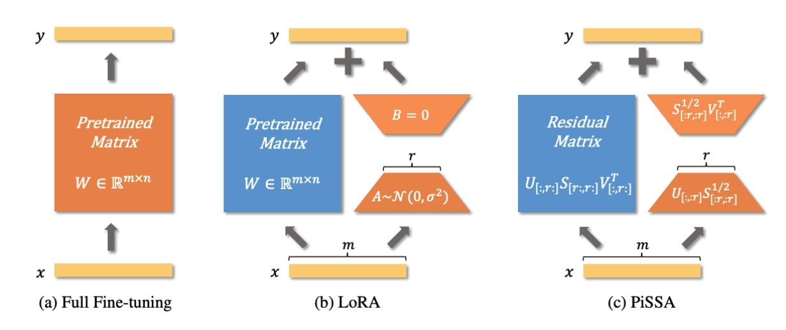
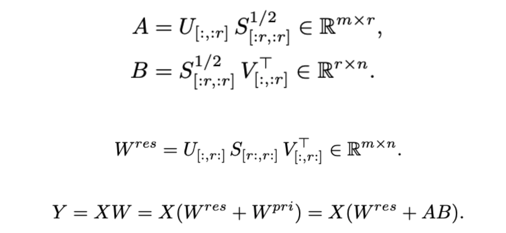
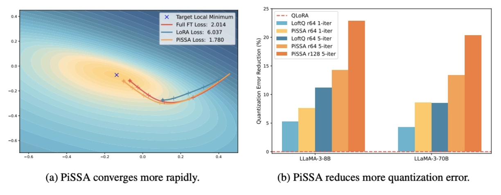
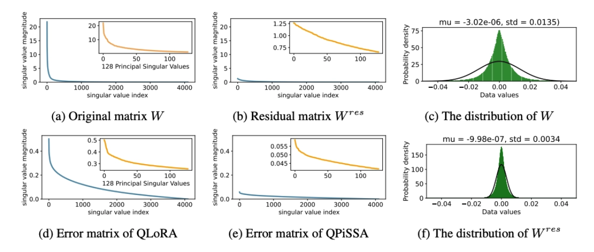

Unsplash / Photo by Alan Hardman

[PiSSA: Principal Singular Values and Singular Vectors Adaptation of Large Language Models](https://arxiv.org/pdf/2404.02948)를 리뷰합니다.

LLM full fine-tuning이 성능 향상에 매우 좋은 것은 사실이지만 모델 크기에 따라서 fine tuning의 비용이 폭발적으로 증가한다는 문제점이 있습니다. 그래서 PEFT가 등장하고, 그 중에서 LoRA 아이디어가 sensational한 아이디어로 인정을 받아서 그것을 중심으로 많이 연구가 되어왔던 것은 사실입니다.

LoRA의 아이디어가 Parameter를 극한으로 줄일 수 있다는 것은 사실이지만 B와 A로 incremental matrix를 나누고 학습을 할 때, B &#61; 0으로 초기화를 하고, A는 random Gaussian noise를 적용합니다.  BA의 초기화 값이 0이기 때문에 pre-trained된 모델이 초반에 학습을 잘 할 수 있다는 것이 어느정도 보장된 상태로 학습이 진행됩니다.

다만 문제점이 존재합니다. 바로 0에서부터 출발한다는 점과 A가 Random Gaussian Noise로부터 출발한다는 것입니다. 이로 인해서 gradient의 크기가 오랫동안 작은 값으로, 그리고 유익하지 않은 방향으로 학습을 하게 된다는 것입니다. 또 논문에서 실험으로 밝힌 바에 의하면 LoRA가 initial point에서 꽤 오랜 시간동안 시간을 낭비한다고 언급합니다.

그래서 이런 문제를 발생시키지 않기 위해서 ‘초기화’ 부분에서부터 모델의 학습 방향을 정해주게끔 만드는 것이 이 논문의 핵심 아이디어입니다.

QPiSSA의 핵심 아이디어는 바로 pre-trained weight를 SVD(특이값 분해)를 해서 LoRA에 각각 입혀주는 아이디어입니다.

다만 SVD를 했을 때 USV 3개의 행렬로 나뉘던 것을 B, A라는 두 개의 행렬로 나뉘는 구조는 그대로 유지하기 위해서 각각 U와 S의 절반, S의 절반과 U로 초기화하게 됩니다. 이렇게 되면 사실상 초기값을 pre-trained weight로부터 출발하는 것과 다르지 않습니다.

다만 incremental matrix에 해당하는 특이값의 범위는 hyperparameter로 지정한 rank에 해당하는 값만큼의 범위로 제일 큰 특이값부터 갖게 되고, 나머지 부분은 pre-trained matrix의 위치에 freeze 시켜서 Rank에 해당하는 파라미터의 비율만큼 효율적으로 학습하겠다는 LoRA의 아이디어는 그대로 가져갈 수 있게 되는 것입니다.

그래서 중요한 정보를 가진 matrix 부분은 incremental matrix, 즉 Prior matrix가 되고 그 나머지에 대한 행렬을 residual matrix입니다.

그래서 식에서 존재하는 W&#95;res와 W&#95;pri가 이 두 개를 의미합니다.

거기에 Quantization 아이디어까지 더해서 4-bit quantization으로 확장한 QPiSSA도 제시합니다.

Quantization은 너무 작은 값에 해당함에도 불구하고 메모리에서 많은 공간을 차지하기 때문에 이런 부분에서 효율성을 위해 적용하는 Efficient 연구의 한 종류입니다.

LoRA에 quantization을 적용했던 QLoRA라는 논문이 기존에 있었는데 그 아이디어를 적용합니다. 다만 차이점이 있다면 QLoRA에서는 W 전체 자체에 quantization을 적용했다면, QPiSSA에서는 중요한 정보를 담고 있는 W&#95;pri는 건드리지 않고 덜 중요한 정보를 담고 있는 W&#95;res에 Quantization을 적용합니다. Quantization은 기본적으로 메모리 성능 측면에서의 이점을 가지면서 성능은 거의 떨어지지 않는 선을 중요하게 봐야하는데, W&#95;res는 애당초에 중요한 정보를 담고 있지 않아서 Quantization을 적용했을 때에도 성능이 거의 떨어지지 않는다는 것을 시사합니다.

Figure 2: Two key davantages of PiSSA

Figure 2를 보면 두 개의 장점에 대해 언급합니다.

1. 더 빠르고 더 좋은 방향으로 수렴한다. LoRA는 random initialization으로 인해 엉뚱한 방향으로부터 시작하고 느리게 이동해서 결국 targe local minimum에 도달하지 못하지만 PiSSA는 최적화된 방향으로 수렴해서 결국 target local minimum에 도달할 수 있다는 것입니다.
2. Quantization error를 다른 방법에 비해 더 잘 줄일 수 있다. QLoRA는 전체 가중치를 4bit로 quantization 하는 반면 QPiSSA는 W&#95;res만 4bit로 quantization했기 때문에 중요한 정보는 보존하고 덜 중요한 것만 압축한다는 것입니다.

따라서 PiSSA는 좋은 방향에서 시작해서 빨리 수렴하고 중요한 정보는 남겨둬서 quantization도 정확해진다는 것입니다.

Figure 3: Visualizations of LLaMA 2B&#126;7B's layers&#91;0&#93;.self&#95;attn.q&#95;proj에 해당하는 matrix 정보

그래서 실제로 성능에 큰 영향을 미치는 가에 대한 정보를 확인하는 것이 figure 3에 있습니다.

(a)를 보면 기존의 QPiSSA를 사용하지 않은 pre-trained matrix를 SVD하고난 뒤의 극소수의 특이값들이 대부분의 정보력을 차지하는 것을 알 수 있습니다.

하지만 QPiSSA 아이디어를 사용하고 난 pre-trained matrix에 해당하는 W&#95;res에는 특이값의 수준이 매우 작아진 것을 볼 수 있습니다. 128개의 principal Singular values의 scale만 봐도 눈금의 단위가 10에서 0.25로 크게 줄어든 것을 볼 수 있습니다.

비슷한 맥락에서 (d)와 (e)의 비교를 보면 error의 특이값 크기도 QPiSSA를 사용한 것이 월등히 좋은 성능을 보인다는 것을 알 수 있습니다.

이 논문에서도 문제점은 존재합니다.

일단 rank를 layer마다 고정적으로 사용한다는 것이 후속 연구들을 통해서 좋지 않다는 게 밝혀지기도 했습니다. top layer와 bottom layer에 따라서 중요도가 또 나뉘는데 layer마다 동등하게 rank를 적용한다는 점이 있습니다.

또한 CorDA 논문에서 밝힌 것처럼, PiSSA를 비롯한 기존 연구들은 ‘가중치 그 자체의 값’ 크기에 주목했는데 실제로는 출력의 오차에 집중해야한다는 점을 꼬집어서 W의 큰 특이값이 꼭 실제 task에서 중요한 feature가 아닐 수 있다는 것을 밝혀냈습니다. 오히려 LoRA는 random initialization으로 인해서 자유도가 있지만, PiSSA의 경우는 Pre-trained weight의 중요한 정보에 이미 강제로 고정된 상태로 시작하기 때문에 그 feature에 집중되어서 Out Of Distribution 문제에 있어서 LoRA보다 오히려 문제가 생길 수 있다는 것입니다.