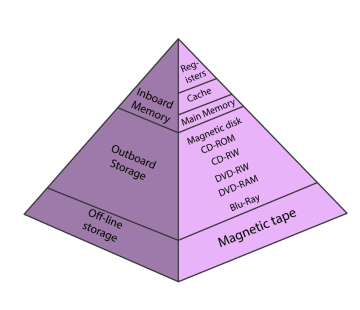

Unsplash / Photo by Vlado Paunovic

논문을 읽으면서 항상 experiment setup에 GPU의 VRAM 용량에 대해서도 많이 나와서 RAM에 많은 종류가 있는데 다양한 RAM들과 어떤 차이가 있는지 궁금해서 공부하게 된 내용입니다.

memory는 hierarchy가 있고 이런 계층 구조에서 상단에 위치할수록 CPU와 CPU에 가까워 속도가 빠르지만 용량이 작고 비쌉니다.

### SRAM(Static RAM)

프로세서 내부에 바로 위치하는 캐시 메모리(L1, L2, L3 Cache)로 사용됩니다. 전력이 공급되는 한 데이터를 유지하며 지연 시간(Latency)이 나노초 단위로 극도로 짧습니다. 프로세서가 당장 계산해야 할 데이터를 임시로 쥐고 있는 역할을 합니다.

> 그렇다면 L1, L2, L3 cache가 정확히 무슨 차이가 있을까요? <strong>L1 cache</strong>: 연산 장치인 ALU 바로 옆에 있는 cache를 의미합니다.  <strong>L2 cache</strong>: L1 cache에서 원하는 데이터를 찾지 못하는 cache miss가 발생했을 때 그 다음으로 보는 공간을 의미합니다. L1 cache보다 느리지만 용량은 더 큽니다.  <strong>L3 cache</strong>: L1과 L2 cache는 코어 안에 위치했다면 L3는 하나의 CPU 안에 있는 여러 개의 코어가 공동으로 공유하는 공간입니다. 코어들끼리 데이터를 주고 받고 L1, L2보다 용량은 크고 속도는 느리지만 당연히 DRAM으로 가서 데이터를 가져오는 것보다는 빠릅니다.

다만, 면적을 많이 차지하고 생산 비용이 매우 비쌉니다. 따라서 수백 MB 수준으로 용량을 키우는 것이 물리적으로도, 경제적으로도 한계가 있습니다.

### DRAM(Dynamic RAM)

흔히 말하는 컴퓨터의 주기억장치(System RAM)입니다. 고집적이 가능해 SRAM에 비해서 ALU와의 물리적 거리가 멀고 접근 속도가 느립니다. 대신에 용량은 SRAM에 비해 상대적으로 큽니다.

커패시터의 전하가 방전되기 전에 주기적으로 재충전을 해줘야 하기 때문에 Dynamic이라는 이름이 붙었고, 물리적으로 프로세서 외부에 떨어져 있어 데이터를 가져오는 데 시간이 걸립니다. 연산 속도보다 데이터를 가져오는 속도가 느려 병목(Von Neumann Bottleneck)을 유발합니다.

### VRAM(Video RAM)

GPU가 화면을 그리기 위해 사용하는 GPU만의 전용 메모리입니다.

AI가 많이 사용이 되면서 수천 개의 코어가 동시에 병렬적으로 작동하고 엄청난 양의 데이터를 처리하게 되었습니다. 이 때 GPU에 전용으로 사용되는 RAM이 VRAM입니다.

보통 이 VRAM을 구현하는 방식이 두 가지가 있습니다. 바로 GDDR과 HBM입니다.

#### GDDR(Graphics Double Data Rate)

전통적인 방식으로 bandwidth가 짧아서 보낼 수 있는 데이터의 통로가 좁은 것이 특징입니다. 그래서 데이터를 빨리 보내기 위해 클럭 속도를 끌어올리는데 이 과정에서 발열과 전력 소모가 극심한 것이 문제가 되어서 HBM이 지금은 main VRAM으로 자리 잡고 있습니다.

#### HBM(High Bandwidth Memory)

DRAM 칩에 미세한 구멍을 뚫어서 수직으로 관통하는 전극을 연결하는 TSV(Through Silicon-Via)라는 기술을 VRAM에 적용한 것입니다.

GDDR은 판을 평면적으로 넓게 배치한 것이 특징이었다면 HBM은 수직으로 쌓아올리는 방식입니다.

이 HBM이 silicon interposer라는 특수 기판 위에서 GPU die와 매우 가깝게 연결되어있습니다.

GDDR은 칩당 bandwidth가 32bit인 것에 비해 HBM의 쌓아올린 메모리는 1024 bit로 32배 더 넓은 대역폭을 갖습니다. 따라서 클럭 속도를 무리하게 높이지 안항도 한 번에 엄청난 양의 데이터를 전송할 수 있고 전력 소모와 발열 문제에서도 GDDR에 비해 자유롭습니다.

이게 중요한 이유는 결국 GPU 코어가 여러 개가 있어서 노동자가 많이 있어도 데이터라는 일거리가 들어오지 않으면 의미 없기 때문에 매우 중요한 작업입니다.

그렇다면 VRAM의 용량, 즉 capacity는 큰 게 왜 좋은 것일까요?

공장에 비유하자면, core는 노동자의 수, bandwidth는 일이 전달되는 속도, capacity는 공장의 크기를 의미합니다. 즉 작업할 수 있는 환경이 크면 클수록 core의 수가 늘고 bandwidth가 늘어남에 따라 VRAM의 용량도 늘어나는 것이 좋습니다.

그러면 실질적으로 VRAM의 용량은 어느정도 돼야 좋을까요?

7B 정도의 모델을 사용한다고 가정해보겠습니다. 즉 파라미터의 수가 70억 개인 상황입니다.

파라미터 한 개의 FP16, 즉 16bit로 표현한다고 치면 2byte가 1개의 파라미터 용량을 차지합니다. 따라서 70억 개면 14GB의 공간이 필요하게 됩니다.

이 상태에서 모델을 추가로 학습시킬 때 Adam과 같은 optimizer를 활용하게 되고 학습 방향을 잡기 위해 momentum과 variance를 저장하게 되는데 이 정보를 유지하기 위해 모델의 가중치 용량의 2&#126;3배 많은 용량을 더 요구하게 됩니다. 따라서 7B 모델을 학습시키기 위해서 기본적으로 optimizer 공간만 30&#126;50GB 넘게 필요해지게 됩니다.

그 외적으로도 backpropogation 할 때 gradient에 대한 정보를 계속 VRAM에서 가지고 있어야 되기도 하고 Foward로 학습을 진행할 때에도 layer마다의 activation 값들을 VRAM에 저장해둬야 합니다. 또 KV Cache와 같이 연산 결과를 쌓아두는데에도 VRAM 공간이 필요하게 됩니다.